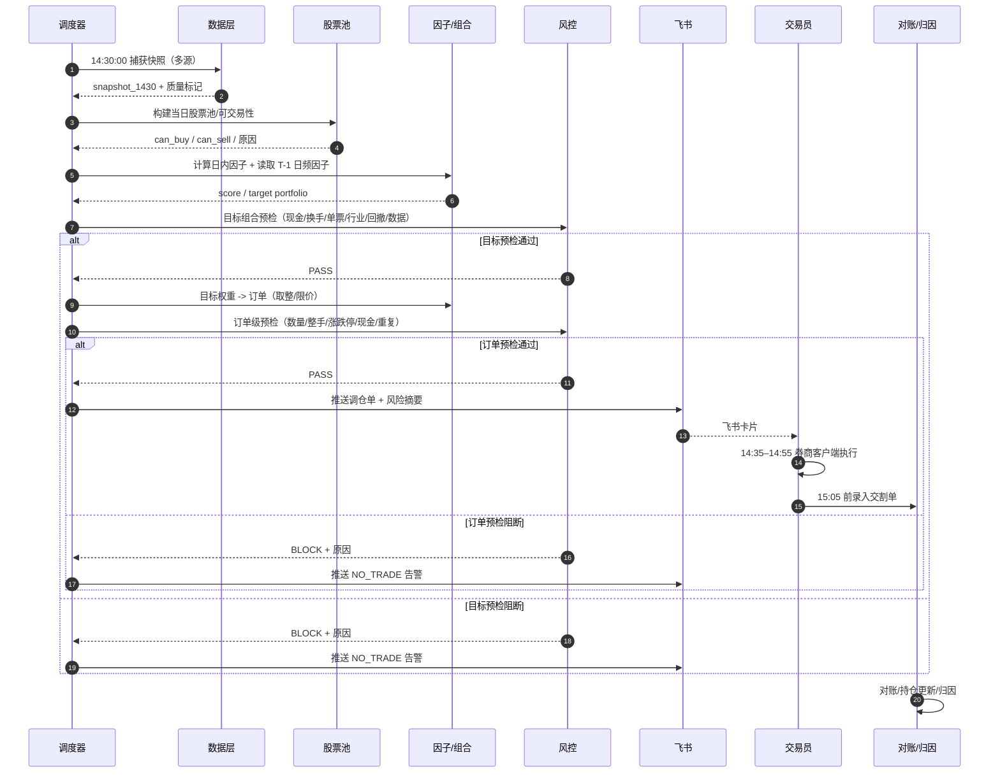
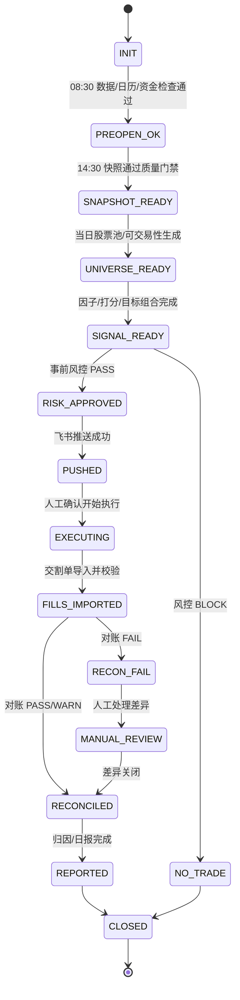

# QuantX：A 股日频量化回测与人工实盘系统详细设计

> 文档版本：v1.0<br>
> 状态：设计稿（可进入实现）<br>
> 适用市场：上海证券交易所主板、深圳证券交易所主板、创业板、科创板<br>
> 交易方式：系统生成信号与调仓单，人工在券商客户端执行<br>
> 最后更新：2026-11-15<br>
> 代码基线：空仓库，从 0 到 1 搭建

---

## 目录

- [0. 文档信息](#0-文档信息)
- [1. 需求理解与范围](#1-需求理解与范围)
- [2. 总体架构](#2-总体架构)
- [3. 运行时序与状态机](#3-运行时序与状态机)
- [4. 数据层](#4-数据层)
- [5. 股票池](#5-股票池)
- [6. 因子库](#6-因子库)
- [7. 组合构建与订单生成](#7-组合构建与订单生成)
- [8. 回测执行器](#8-回测执行器)
- [9. 实盘人工执行](#9-实盘人工执行)
- [10. 非功能性设计](#10-非功能性设计)
- [11. 测试与验收](#11-测试与验收)
- [12. 实施路线图与风险](#12-实施路线图与风险)
- [附录 A：核心表结构](#附录-a核心表结构)
- [附录 B：配置示例](#附录-b配置示例)
- [附录 C：交割单与调仓单模板](#附录-c交割单与调仓单模板)
- [附录 D：WorldQuant 101 精选公式](#附录-dworldquant-101-精选公式)
- [附录 E：术语表](#附录-e术语表)

---

## 0. 文档信息

### 0.1 文档目的

本文档描述 QuantX 的详细设计，覆盖：

1. 系统边界、关键假设与不可妥协的约束；
2. 数据采集、清洗、校验、对齐、存储与 Point-in-Time（PIT）语义；
3. 历史/当日股票池、可交易性判定与 A 股交易规则；
4. 因子注册表、增量计算、预处理、第一版因子与评测体系；
5. 等权合成、TopN 组合构建、换手控制、约束与订单生成；
6. 基于 Backtrader 的历史回测执行器与 A 股成交模拟；
7. 人工实盘执行、飞书推送、事前风控、回撤控制、交割单录入；
8. 对账、归因、一致性报告、监控告警、测试与上线路线。

本文档不是投资建议，也不承诺任何收益。所有阈值、因子、权重和规则均为工程默认值，需要经过样本外验证后才能用于实盘。

### 0.2 读者对象

- 策略研究/因子开发人员；
- 数据工程与平台开发人员；
- 实盘交易与风控负责人；
- 后续维护该系统的开发者。

### 0.3 设计原则

| 原则 | 含义 | 落地方式 |
|---|---|---|
| 先防错，再求收益 | 数据错、规则错、对账错造成的损失远大于因子优化收益 | 数据门禁、风控门禁、对账硬阻断、失败关闭 |
| 前视偏差零容忍 | 任何 T 日信号只能看到 T 日 14:30 前可用的数据 | 双时间轴、`available_at`、PIT 查询、回测/实盘同一信号接口 |
| 回测与实盘同构 | 回测和实盘使用同一套股票池、因子、组合、订单、风控代码 | 共享 `SignalPipeline`，只替换执行器 |
| 人工执行可审计 | 人工环节不靠记忆和聊天记录 | 调仓单、执行确认、交割单、差异报告、审计日志 |
| 简单可解释 | 小资金、日频、TopN 等权，不引入不必要的优化器黑箱 | 规则透明、逐笔可追溯、参数可解释 |
| 失败关闭 | 关键数据/风控/对账不通过时，宁可不交易 | `NO_TRADE` 状态与 P0 告警 |
| 可复现 | 任一历史信号、回测、对账结果可重放 | 输入快照哈希、配置哈希、代码版本、因子版本 |

### 0.4 关键设计决策摘要

| 编号 | 决策 | 选择 | 理由 |
|---|---|---|---|
| D1 | 实现语言 | Python 3.11+ | 数据/因子/回测生态成熟，迭代快 |
| D2 | 分析型存储 | Parquet + DuckDB | 列式压缩、按日分区、嵌入式无需运维，适合单机日频/5 分钟数据 |
| D3 | 交易型存储 | SQLite（WAL） | 单用户、强一致、零运维；接口按 PostgreSQL 兼容方式设计，后续可迁移 |
| D4 | 回测引擎 | Backtrader（执行级）+ 预计算信号 | 事件驱动、可定制 broker/费用/滑点；避免把 5000 只股票的因子计算塞进事件循环 |
| D5 | 实盘执行 | 人工执行 + 系统记账 | 当前无券商 API 需求，避免自动化交易接入成本与风险 |
| D6 | 组合优化 | 约束化 TopN 等权 + 换手预算 | 小资金、解释性强、避免均值方差模型的估计误差 |
| D7 | 因子合成 | 因子等权（可切换类别等权） | 第一版避免动态权重过拟合；类别等权用于控制类别数量偏置 |
| D8 | 数据一致性 | 多源交叉校验 + 冲突隔离 | 免费源无 SLA，单一数据源错误会直接污染信号 |
| D9 | 时间语义 | 双时间轴（业务日期 + 知识时间） | 同时解决财报公告、停复牌、ST、指数成分的历史时点问题 |
| D10 | 失败策略 | Fail-closed | 数据/风控/对账关键项失败时禁止生成可执行订单 |

---

## 1. 需求理解与范围

### 1.1 目标

构建一套可日常运行的 A 股日频量化系统：

1. 每个交易日 14:30 使用 **T-1 日频数据 + T 日 14:30 盘中快照** 生成信号；
2. 收盘前由人工按调仓单执行，收盘后录入交割单并完成对账、持仓更新和盘后流程；
3. 支持历史回测与模拟成交，回测规则尽量贴近真实 A 股交易约束；
4. 支持因子研究、因子评测、组合构建、换手控制与风险约束；
5. 所有关键数据、信号、订单、成交、持仓、对账结果可追溯、可复现；
6. 在数据错误、信号延迟、执行遗漏、对账不一致时能及时告警并阻止错误扩大。

### 1.2 非目标（第一版明确不做）

| 非目标 | 说明 |
|---|---|
| 日内高频/盘中反复交易 | 每个交易日只生成一次主信号；不做盘中二次调仓、不做盘中择时 |
| 盘中个股止损 | 第一版不设置个股盘中止损；仅保留组合级回撤控制 |
| 做空/融资融券 | 只做多，现金账户，不引入杠杆和融券 |
| ETF、可转债、期权、期货 | 证券主数据白名单直接排除 |
| Level-2 行情/逐笔委托 | 不使用十档、逐笔成交、委托队列；仅使用 Level-1 快照与 5 分钟线 |
| 自动下单 | 人工在券商客户端执行；系统不保存券商交易密码，不直连交易柜台 |
| 市场冲击模型 | 资金规模小，默认无冲击；用参与率上限和容量监控代替 |
| 复杂机器学习/深度学习 | 第一版以可解释的价量、基本面、WorldQuant 101 因子为主 |
| 多因子动态择时 | 不预测大盘涨跌；回撤控制是风险 overlay，不是择时模型 |

### 1.3 约束与假设

| 类别 | 约束/假设 |
|---|---|
| 市场 | 沪深主板、创业板、科创板；排除北交所、B 股、ETF、LOF、可转债、期权、期货 |
| 方向 | 只做多；目标权重均非负；现金不得为负；无融资融券 |
| 频率 | 日频决策；每个交易日允许重新计算组合；可每日调仓，但不强制每日交易 |
| 持有期 | 单只股票至少持有 1 个交易日；受 T+1 约束，买入当日不可卖 |
| 资金 | 小资金；订单金额远小于日均成交额；默认无市场冲击 |
| 数据 | 免费源为主；多源交叉校验；允许部分数据延迟，但必须有门禁和降级 |
| 执行 | 14:30 生成信号，14:35 前推送，14:35–14:55 人工执行，15:00 收盘 |
| 盘后 | 15:05 前录入交割单；15:30 前完成初步对账；16:30 前完成正式对账；17:00 前完成归因/日报；17:30 前完成次日准备 |
| 时区 | Asia/Shanghai；所有调度、时间戳、日志统一使用该时区，数据库存 UTC 或带时区时间 |
| 资金流 | 第一版假设无外部申购/赎回；如发生入金/出金，必须记录现金流并调整收益计算 |

### 1.4 需求追踪矩阵

| 需求 | 设计章节 | 关键实现 |
|---|---|---|
| 沪深主板+创业板+科创板，只做多，不融资融券 | 5.1、5.2、7.3 | 板块白名单、证券类型白名单、权重非负断言 |
| 排除 ST、*ST、新股、退市、停牌 | 5.2、5.4 | 状态表 + 名称/公告交叉校验 + 可交易性表 |
| 14:30 生成信号，收盘前人工执行，收盘后录入/对账 | 3.1–3.4、9 | 调度器、状态机、调仓单、交割单导入 |
| 日频、每日可调仓、至少持有 1 日、不盘中反复交易 | 3、7.4、9.2 | 单次信号、T+1、`min_hold_days`、订单当日失效 |
| 数据层：T-1 日频 + T 14:30 快照 | 4.1–4.3 | 双时间轴、快照表、PIT 查询 |
| 免费多源、交叉校验、交易日历、证券主数据、证券阻挡、OHLCV、复权因子、5 分钟、涨跌停、停牌、ST/退市、财务、快照 | 4.1–4.8 | 数据源矩阵、标准化 Schema、质量门禁 |
| 防前视偏差、合适存储 | 4.2、4.6 | Parquet+DuckDB、`available_at`、`knowledge_date`、快照哈希 |
| 历史/当日股票池 | 5.3 | `universe_membership`、`universe_run`、差异报告 |
| 因子注册表、增量、缓存、日期 x 代码 | 6.1–6.4 | `FactorSpec`、`factor_run`、Parquet panel、内容哈希 |
| 价值/质量/动量交易/日内/WQ101 | 6.6、6.7 | 因子清单、公式、依赖、方向 |
| 预处理：MAD、zscore、缺失 | 6.5 | 每日横截面预处理，禁止全样本统计 |
| 评测：RankIC、IC 均值/标准差/ICIR/衰减/分层/换手/相关性 | 6.7 | `FactorEvaluator` + 指标表 + 报告 |
| 等权合成、TopN 等权、换手控制、约束 | 7.1–7.5 | `CompositeScorer`、`PortfolioBuilder`、换手预算 |
| 回测框架、滑点、T+1、涨跌停、停牌、整手 | 8 | Backtrader + 自定义 A 股 Broker |
| 人工执行、风控、回撤、延迟告警、一致性报告 | 9 | 事前列、风险 overlay、SLA 告警、对账报告 |
| IM 推送、调仓单、人工成交录入 | 9.2、9.5 | 飞书适配器、订单表、交割单导入 |

### 1.5 关键名词

| 名词 | 定义 |
|---|---|
| `trade_date` | 交易业务日期，A 股交易日 |
| `as_of` | 决策时点；本文默认 T 日 14:30:00 |
| `available_at` | 某条数据在现实中可被系统使用的时点（知识时间） |
| `knowledge_date` | 数据版本被来源确认/发布的日期，用于处理财报重述、状态变更 |
| 历史股票池 | 按历史时点重建的、当时符合条件的股票集合，用于回测/因子评测 |
| 当日股票池 | T 日 14:30 实际可用于选股的集合，含盘中停牌/涨跌停/ST 刷新 |
| 可交易性 | 某股票在某时点是否可买/可卖，不等同于是否在股票池内 |
| 目标组合 | 目标权重或目标股数，不含执行结果 |
| 调仓单 | 面向人工执行的买卖清单，含数量、限价、金额、原因、截止时间 |
| 交割单 | 券商返回的实际成交记录，人工录入或导出 |
| 对账 | 内部订单/成交/持仓/现金与券商结果、行情市值的一致性校验 |
| PIT | Point-in-Time，按 `as_of` 只读取当时可知的数据 |

---

## 2. 总体架构

### 2.1 逻辑架构

```mermaid
flowchart LR
    subgraph SRC["免费数据源"]
        S1["Tushare<br/>日线/财务/复权"]
        S2["Baostock<br/>日线/5分钟/状态"]
        S3["东方财富<br/>快照/日线/5分钟"]
        S4["新浪/腾讯<br/>实时快照"]
        S5["交易所/巨潮<br/>公告/日历/状态"]
    end

    subgraph DATA["数据层"]
        RAW["Raw 原始层<br/>不可变、带来源"]
        CLEAN["清洗/单位归一/去重"]
        VALID["多源校验/质量门禁"]
        CURATED["Curated PIT 层<br/>Parquet + DuckDB"]
    end

    subgraph RESEARCH["研究/信号层"]
        UNI["股票池<br/>历史/当日"]
        FACT["因子注册表<br/>增量计算/缓存"]
        SCORE["预处理/等权打分"]
        PORT["组合构建<br/>约束/换手/TopN"]
        ORDER["订单/信号生成<br/>可交易性/取整/限价"]
    end

    subgraph EXEC["执行层"]
        BT["回测执行器<br/>Backtrader + A股规则"]
        MAN["人工执行器<br/>调仓单/成交录入"]
    end

    subgraph OPS["运营/风控层"]
        RISK["事前风控<br/>现金/换手/行业/回撤"]
        IM["飞书/企微<br/>信号推送"]
        LEDGER["持仓/现金台账"]
        RECON["对账<br/>订单-成交-持仓-券商"]
        ATTR["归因/报告"]
    end

    SRC --> RAW --> CLEAN --> VALID --> CURATED
    CURATED --> UNI --> FACT --> SCORE --> PORT --> ORDER
    ORDER --> RISK
    RISK --> BT
    RISK --> IM --> MAN
    BT --> LEDGER
    MAN --> LEDGER
    LEDGER --> RECON --> ATTR
    RECON -.->|阻断/告警| RISK
```



### 2.2 分层职责

| 层 | 模块 | 职责 | 不做什么 |
|---|---|---|---|
| 数据层 | `quantx.data` | 采集、原始留存、单位归一、清洗、校验、对齐、PIT 查询 | 不计算因子、不做选股 |
| 股票池 | `quantx.universe` | 板块/证券类型过滤、ST/新股/退市/停牌过滤、历史池与当日池、可交易性 | 不决定买多少 |
| 因子层 | `quantx.factors` | 注册表、依赖解析、增量计算、预处理、缓存、评测 | 不生成订单 |
| 打分/组合 | `quantx.portfolio` | 等权合成、打分、TopN、约束、换手控制、目标权重 | 不直接下单 |
| 订单/信号 | `quantx.signals` | 目标权重到订单、取整、限价、可交易性、调仓单、推送载荷 | 不执行成交 |
| 回测 | `quantx.backtest` | 事件驱动模拟、A 股成交规则、费用、滑点、指标 | 不接触真实资金 |
| 实盘 | `quantx.live` | 运行日状态、调仓单、人工执行确认、交割单录入、持仓更新 | 不自动登录券商 |
| 风控 | `quantx.risk` | 事前检查、回撤 overlay、数据/对账门禁、告警 | 不预测收益 |
| 对账/归因 | `quantx.recon`、`quantx.attribution` | 三方对账、差异分类、PnL/Brinson/因子归因 | 不修改原始成交 |
| 公共 | `quantx.common` | 配置、日历、日志、时钟、ID、异常、通知适配 | 不承载业务规则 |

### 2.3 核心领域对象

```text
Security           证券主数据（代码、板块、上市/退市、整手规则、涨跌停规则）
SecurityBlock      证券阻挡/黑名单（硬阻断、生效区间、来源）
TradingCalendar    交易日历（开市日、上一/下一交易日、交易时段）
DailyBar           T 日日线（不复权 OHLCV/成交额/状态）
MinuteBar          5 分钟线（bar_end、OHLCV/成交额）
Snapshot1430       T 日 14:30 快照（最新价、开高低、累计量额、涨跌停、状态）
FinancialRecord    PIT 财务记录（报告期、公告日、可用时间、字段）
FactorSpec         因子元数据（名称、依赖、函数、版本、方向、预处理）
FactorPanel        日期 x 代码的因子矩阵（含 available_at/universe_version）
Universe           某日股票池及不可入池原因
Tradability        某股票某时点 can_buy/can_sell 及原因
Score              某日每只股票的合成分
TargetPortfolio    目标权重/目标股数/现金缓冲
Order              调仓订单（side、qty、limit_price、reason、status）
Fill               实际/模拟成交（数量、价格、费用、时间、broker_trade_id）
Position           持仓（total_qty、available_qty、avg_cost、market_value）
CashLedger         现金流水（成交、费用、分红、出入金）
RiskDecision       风控结论（PASS/WARN/BLOCK）及原因
ReconReport        对账报告（差异、严重级别、处理状态）
AttributionReport  归因报告（收益、行业、因子、执行、成本）
```

### 2.4 推荐代码仓库结构

```text
quantx/
├── pyproject.toml
├── README.md
├── config/
│   ├── base.yaml
│   ├── dev.yaml
│   ├── paper.yaml
│   └── live.yaml
├── docs/
│   └── design.md
├── src/quantx/
│   ├── __init__.py
│   ├── common/
│   │   ├── config.py          # Pydantic Settings
│   │   ├── calendar.py        # 交易日历
│   │   ├── clock.py           # Asia/Shanghai 时钟
│   │   ├── ids.py             # run_id/order_id/fill_id
│   │   ├── logging.py         # structlog
│   │   ├── errors.py
│   │   └── types.py
│   ├── data/
│   │   ├── sources/           # tushare/baostock/eastmoney/sina/tencent/cninfo
│   │   ├── ingest.py
│   │   ├── normalize.py       # 单位、代码、字段标准化
│   │   ├── clean.py
│   │   ├── validate.py
│   │   ├── crosscheck.py
│   │   ├── align.py
│   │   ├── store.py           # Parquet 写读、manifest、原子提交
│   │   ├── pit.py             # as_of 查询
│   │   └── schemas.py
│   ├── universe/
│   │   ├── rules.py
│   │   ├── builder.py
│   │   └── tradability.py
│   ├── factors/
│   │   ├── registry.py
│   │   ├── context.py
│   │   ├── engine.py
│   │   ├── preprocess.py
│   │   ├── cache.py
│   │   ├── evaluate.py
│   │   └── library/
│   │       ├── value.py
│   │       ├── quality.py
│   │       ├── momentum.py
│   │       ├── intraday.py
│   │       └── wq101.py
│   ├── portfolio/
│   │   ├── score.py
│   │   ├── constraints.py
│   │   ├── builder.py
│   │   └── turnover.py
│   ├── signals/
│   │   ├── orders.py
│   │   ├── lots.py
│   │   ├── limits.py
│   │   ├── sheet.py
│   │   └── pipeline.py
│   ├── risk/
│   │   ├── pretrade.py
│   │   ├── drawdown.py
│   │   └── gates.py
│   ├── backtest/
│   │   ├── broker.py          # AShareBroker
│   │   ├── commission.py
│   │   ├── slippage.py
│   │   ├── execution.py
│   │   ├── feeds.py
│   │   └── runner.py
│   ├── live/
│   │   ├── run.py
│   │   ├── manual_executor.py
│   │   ├── fills.py
│   │   ├── positions.py
│   │   └── notify.py
│   ├── recon/
│   │   ├── engine.py
│   │   ├── breaks.py
│   │   └── report.py
│   ├── attribution/
│   │   ├── pnl.py
│   │   ├── brinson.py
│   │   └── factor.py
│   ├── reporting/
│   │   ├── daily.py
│   │   └── templates/
│   └── cli.py
├── scripts/
│   ├── run_after_close.sh
│   ├── run_signal_1430.sh
│   └── run_recon.sh
├── tests/
│   ├── unit/
│   ├── integration/
│   ├── golden/
│   └── fixtures/
├── data/                      # 运行时数据目录（gitignore）
└── reports/                   # 运行时报告目录（gitignore）
```

### 2.5 部署拓扑

第一版建议单机部署：

```text
macOS/Linux 工作站（或境内云主机）
├── 定时任务：cron / launchd / systemd timer
├── Python 虚拟环境（uv 管理）
├── 本地 SSD：data/ + reports/
├── SQLite：data/state/quantx.sqlite
├── DuckDB：data/catalog.duckdb
├── 飞书机器人 Webhook / 应用
├── 券商客户端（人工操作，独立进程）
└── 备份：每日加密备份到外置盘/对象存储
```

要求：

- 主机时区 `Asia/Shanghai`，开启 NTP；
- 交易时段不断电、不睡眠；建议 UPS；
- 不在交易时段执行系统升级/重启；
- 若主机在境外，免费行情源延迟和稳定性可能不达标，建议境内主机；
- 第一版不引入 Kubernetes/消息队列，避免运维复杂度；
- 所有定时任务必须支持幂等重跑和手动补跑。

---

## 3. 运行时序与状态机

### 3.1 交易日时间轴

| 时点 | 任务 | 输入 | 输出 | 失败处理 |
|---|---|---|---|---|
| T-1 18:00 | 日终数据采集 | 免费源 | 原始层日线/财务/状态 | 重试；次日 08:30 前必须补齐 |
| T-1 18:30 | 清洗/多源校验 | 原始层 | Curated PIT 层 | 冲突隔离；P0 告警 |
| T-1 19:00 | 历史/次日预股票池 | PIT 数据 | `universe_preliminary` | 失败则 T 日不交易 |
| T-1 19:30 | 日频因子增量 | 日线/财务 | 因子 panel | 失败则 T 日不交易 |
| T 08:30 | 开盘前检查 + 隔夜数据补采 | 数据/日历/券商资金/公告 | `PREOPEN_OK` | 缺数据则告警并准备降级；只使用 `available_at <= 14:30` 的数据 |
| T 08:45 | 因子缓存失效检查/重算 | 隔夜财报、复权、状态 | `factor_panel` 新版本 | 失败则沿用 T-1 版本并标注；影响持仓/候选则 NO_TRADE |
| T 14:25 | 5 分钟线/快照预热 | 行情源 | 临时缓存 | 源失败切换备源 |
| T 14:30:00 | 捕获 14:30 快照 | 新浪/腾讯/东财 | `snapshot_1430` | 30 秒内重试；超时降级 |
| T 14:30–14:33 | 当日股票池/可交易性 | 快照 + 状态 | `tradability` | 关键股票失败则 NO_TRADE |
| T 14:30–14:35 | 日内因子/打分/组合/订单 | 因子 + 快照 | `TargetPortfolio` + `OrderSheet` | 失败则不推送订单 |
| T 14:35 | 事前风控 + 飞书推送 | 订单 + 风控 | 飞书卡片 + 调仓单 | 推送失败重试/降级；仍失败 P0 |
| T 14:35–14:55 | 人工执行 | 调仓单 | 券商成交 | 未执行/部分执行记录原因 |
| T 14:55 | 执行窗口关闭 | 订单 | 未成交订单过期 | 不追单，不生成盘中二次信号 |
| T 15:00 | 收盘 | — | — | — |
| T 15:05 | 交割单录入截止 | 券商成交 | `Fill` | 未录入则 P1 告警 |
| T 15:15 | 持仓/现金更新 | 成交 + 公司行为 | `Position`/`CashLedger` | 失败则阻断次日信号 |
| T 15:30 | 初步对账 | 内部台账 + 券商对账单 | `ReconReport` | 硬差异 P0 |
| T 16:00 | 日终数据采集 | 免费源 | 原始层 | 重试 |
| T 16:30 | 正式对账 | 三方数据 | `ReconReport` | FAIL 阻断次日 |
| T 17:00 | 归因/日报 | 持仓/行情/基准 | 日报/归因 | 告警 |
| T 17:30 | 次日数据准备 | 日线/财务 | 因子增量/预股票池 | 失败则次日 08:30 前补齐 |

> 说明：14:30 是“决策时点”，不是“数据下载时点”。14:30 之后产生的行情、公告、收盘价一律不能进入 T 日信号。T 日收盘数据只能用于 T 日盘后流程和 T+1 信号。

### 3.2 14:30 信号时序



### 3.3 盘后流程

```text
15:00 收盘
  -> 15:05 交割单导入（CSV/手工）
  -> 15:15 成交校验、持仓/现金更新、T+1 可用数量滚动
  -> 15:30 初步对账（订单 vs 成交 vs 持仓 vs 券商）
  -> 16:00 日终行情/财务/状态采集
  -> 16:30 正式对账 + 公司行为处理
  -> 17:00 当日 PnL、行业/因子/执行归因、日报
  -> 17:30 次日因子增量、预股票池、数据质量报告
  -> 18:00 备份、归档、告警汇总
```

盘后必须回答的五个问题：

1. 目标组合是什么？实际成交是什么？差异在哪？
2. 现金、持仓、可用数量是否与券商一致？
3. 当日收益来自市场、行业、因子、选股还是执行？
4. 有没有数据/规则/执行异常需要在次日开盘前修复？
5. 次日股票池和因子是否已准备好？

### 3.4 运行状态机



状态规则：

- 只有 `RISK_APPROVED` 才能生成可执行调仓单；`NO_TRADE` 也必须推送，说明原因；
- `PUSHED` 之后不允许静默修改订单；如必须修正，生成新的 `signal_version`，旧版本作废并推送更正；
- `RECON_FAIL` 是硬状态：次日 `signal run` 默认拒绝执行，直到差异关闭或显式 override（记录原因、审批人、时间）；
- 所有状态转换写入 `signal_run`/`job_run`，包含操作者、时间、输入哈希、输出哈希。

### 3.5 SLA 与延迟告警

| 监控项 | 正常阈值 | 告警阈值 | 级别 | 处理 |
|---|---|---|---|---|
| 14:30 快照时间戳 | ≤ 14:30:30 | > 14:30:30 或缺失 | P0 | 重试备源；仍失败则 NO_TRADE |
| 快照多源价差 | ≤ 0.1% | > 0.1% | P1 | 标记冲突；关键股票升级 P0 |
| 股票池构建 | ≤ 60 秒 | > 120 秒 | P1 | 检查数据/代码 |
| 因子+组合计算 | ≤ 3 分钟 | > 5 分钟 | P1 | 缓存/降级；超过 14:40 不推送 |
| 风控检查 | ≤ 30 秒 | > 60 秒 | P1 | 阻断 |
| 飞书推送 | 14:35 前 | 14:35 未成功 | P1 | 重试/备用通道；14:40 未成功 P0 |
| 人工确认 | 14:40 前 | 14:45 未确认 | P1 | 电话/私聊提醒 |
| 成交录入 | 15:05 前 | 15:15 未完成 | P1 | 阻断对账 |
| 正式对账 | 16:30 前 | 17:00 未完成 | P1 | 人工介入 |
| 次日数据准备 | 18:00 前 | 次日 08:30 未完成 | P0 | 次日 NO_TRADE |

告警通道：

- 主通道：飞书私聊/群机器人；
- 备通道：企业微信/钉钉/邮件（适配器可替换）；
- P0 建议同时电话/短信（可选，不依赖免费 IM）；
- 所有告警写入 `alert` 表，包含 `alert_id`、`severity`、`run_id`、`message`、`created_at`、`ack_at`、`resolved_at`。

### 3.6 失败与降级策略

| 故障 | 检测 | 降级 | 是否允许交易 |
|---|---|---|---|
| 主数据源日线缺失 | 行数/覆盖率 | 备源补齐，标记 `SOURCE_FALLBACK` | 关键字段一致则允许 |
| 多源收盘价冲突 | 价差 > 0.1% | 隔离该股票；不自动平均 | 该股票不可交易；持仓股冲突则 NO_TRADE |
| 14:30 快照延迟 | 时间戳 > 30 秒 | 备源；缩短计算 | 超 14:35 未就绪则 NO_TRADE |
| 5 分钟线缺失 | 最新 bar < 14:25 | 用 14:25 bar 并标记 | 关键因子缺失则降级/NO_TRADE |
| 因子计算失败 | 异常/覆盖率低 | 使用上一版缓存（仅当输入未变） | 输入变化则 NO_TRADE |
| 飞书推送失败 | HTTP/超时 | 重试 3 次 + 备用通道 | 人工可从本地调仓单执行；必须记录 |
| 券商成交未录入 | 15:05 检查 | 人工补录 | 对账前不允许次日信号 |
| 对账硬差异 | qty/cash 不一致 | 人工复核 | 次日 NO_TRADE，直到关闭 |
| 回撤超阈值 | 日终/14:30 | 降暴露/只卖不买 | 按回撤等级执行 |
| 重复运行 | 同 `run_id` | 幂等返回；强制重跑生成新版本 | 旧订单作废 |

---

## 4. 数据层

### 4.1 数据源矩阵

免费数据源没有 SLA，且接口、字段、频率可能变化。设计上采用“**主源 + 备源 + 权威源校验**”，任何单源异常都不能静默进入信号。

| 数据集 | 主源 | 备源 | 权威/校验源 | 频率/延迟 | 关键注意点 |
|---|---|---|---|---|---|
| 交易日历 | Tushare `trade_cal` | Baostock | 交易所公告 | 日 | 节假日、临时休市；必须保留历史版本 |
| 证券主数据 | Tushare `stock_basic` | Baostock | 交易所/巨潮 | 日 | 代码、板块、上市/退市、名称历史 |
| 证券阻挡/黑名单 | 交易所/监管公告 | 巨潮/东财 | 交易所 | 日/事件 | 长期停牌、风险警示、退市、禁止交易证券；只做排除，不做选股 |
| 日线 OHLCV（不复权） | Tushare `daily` | Baostock | 东财/新浪 | T 日 15:30 后 | 单位不同；停牌日可能无记录 |
| 复权因子 | Tushare `adj_factor` | Baostock 复权价反推 | 东财 | 日 | 因子方向/基准；避免用未来因子 |
| 5 分钟线 | Baostock | 东财/腾讯 | 交易所行情 | 盘中/历史 | 历史深度有限；bar 时间戳语义 |
| 14:30 快照 | 新浪 | 腾讯/东财 | 交易所时间戳 | 实时 | 多源并发抓取；30 秒超时 |
| 每日涨跌停价 | 计算 | 东财快照字段 | 交易所规则 | 日/实时 | 除权日参考价；ST/板块规则 |
| 停牌/复牌 | 日线缺失 + Baostock `tradestatus` | 东财状态 | 交易所公告 | 日 | 不能把“缺失”直接当停牌 |
| ST/*ST/退市整理 | 名称历史 + 状态表 | 东财/交易所 | 巨潮公告 | 日 | 名称法有历史误差，公告优先 |
| 财务指标 | Tushare 财报接口 | Baostock | 巨潮/东财 | 季度/公告日 | 必须用公告日，不用报告期 |
| 行业分类 | Tushare SW | 东财 | 申万/交易所 | 日/季度 | 历史成分与生效日；避免未来分类 |
| 公司行为 | Tushare `dividend` | 巨潮/东财 | 交易所公告 | 日 | 分红、送转、配股、除权参考价 |
| 指数/基准 | Tushare `index_daily` | 东财 | 中证/交易所 | 日 | 沪深 300/500/1000/全指 |
| 公告 | 巨潮 | 交易所 | 巨潮 | 日 | ST、退市、风险提示、财报 |

数据源使用要求：

1. 每个适配器声明字段单位、时区、代码格式、复权方式、频率；
2. 所有请求带超时、重试、退避、限速；禁止高频轰炸免费接口；
3. 原始响应原样落盘，便于追责和重放；
4. 免费源只用于个人研究/自有资金；遵守来源服务条款，不转售、不公开再分发；
5. 关键字段不允许“单源直接入库后即使用”，必须经过交叉校验；
6. 允许配置付费备源（如 Tushare 积分接口）作为可选增强，但第一版不依赖。

### 4.2 存储方案

#### 4.2.1 选型

| 数据类型 | 存储 | 理由 |
|---|---|---|
| 原始响应/日线/5 分钟/因子 panel | Parquet（Zstd） | 列式、压缩率高、按日分区、DuckDB 可直接查询、备份简单 |
| 分析查询/聚合 | DuckDB | 嵌入式、零运维、SQL、可直接读 Parquet；单机日频足够 |
| 订单/成交/持仓/现金/对账/告警 | SQLite（WAL） | 事务、强一致、单用户、部署简单；表结构兼容 PostgreSQL |
| 配置/报告 | YAML/JSON/Markdown/CSV | 可读、可版本化、易审计 |
| 大对象（公告 PDF） | 文件系统 + 元数据表 | 不塞数据库 |

不选 ClickHouse/Spark 的原因：数据量在单机可承受范围（日线约千万行、5 分钟约数亿行），引入分布式系统会增加运维和故障面。若未来 5 分钟全市场多年数据超过单机能力，再评估 ClickHouse/ArcticDB。

#### 4.2.2 目录布局

```text
data/
├── raw/
│   ├── tushare/daily/trade_date=2026-11-13/ingest=20261113T183000.parquet
│   ├── baostock/daily/trade_date=2026-11-13/...
│   ├── eastmoney/snapshot/trade_date=2026-11-13/snapshot_1430.parquet
│   └── sse/announcement/...
├── curated/
│   ├── daily_bars/year=2026/month=11/part-000.parquet
│   ├── bars_5m/year=2026/month=11/part-000.parquet
│   ├── adj_factors/year=2026/month=11/...
│   ├── financials_pit/year=2026/...
│   ├── security_master/...
│   ├── trading_calendar/...
│   ├── universe/...
│   └── snapshots_1430/year=2026/month=11/...
├── cache/
│   └── factors/{factor_id}/{version}/{trade_date}.parquet
├── quarantine/
│   └── daily_bars/trade_date=.../*.parquet
├── state/
│   └── quantx.sqlite
├── catalog.duckdb
└── manifests/
    └── {dataset}/{trade_date}.json
```

写入规则：

- **原始层不可变**：每次采集新文件，不覆盖；文件名包含 `ingest` 时间；
- **Curated 层原子提交**：先写临时目录，校验行数/哈希/分区，再原子 rename，最后写 `_SUCCESS` 和 manifest；
- **分区**：日线按 `year/month`，5 分钟按 `trade_date`（或 `year/month/day`），因子按 `factor_id/version/year`；
- **排序**：写入前按 `(trade_date, code)` 排序，提升压缩和扫描效率；
- **Schema 版本**：每张表有 `schema_version`；变更走迁移脚本，不就地改旧文件；
- **幂等**：同一 `(dataset, trade_date, source, ingest_id)` 重复写入不产生重复行；以 manifest 哈希判断。

#### 4.2.3 容量估算

| 数据 | 规模估算 | 压缩后量级 | 保留 |
|---|---|---|---|
| 日线 10 年 | 5,500 只 × 250 日 × 10 年 ≈ 1,375 万行 | 1–3 GB | 全量 |
| 5 分钟 5 年 | 5,500 × 48 bar × 250 × 5 ≈ 3.3 亿行 | 20–60 GB | 全量/按需 |
| 14:30 快照 | 5,500 × 250 × 5 ≈ 687 万行 | 1–3 GB | 3 年 |
| 财务/公司行为 | 百万级 | < 1 GB | 全量 |
| 因子 panel | 因子数 × 日期 × 股票 | 10–50 GB | 全量 + 版本 |
| 订单/成交/持仓 | 每日几十到几百行 | MB 级 | 全量 |

> 实际容量取决于字段数、压缩率、5 分钟历史深度。上线前用一个月真实数据做一次容量基准。

### 4.3 核心数据集与 Schema

以下为逻辑 Schema；物理 Parquet 可增减字段，但语义必须保持一致。

#### 4.3.1 交易日历 `trading_calendar`

| 字段 | 类型 | 说明 |
|---|---|---|
| `trade_date` | DATE | 交易日 |
| `is_open` | BOOLEAN | 是否开市 |
| `prev_trade_date` | DATE | 上一交易日 |
| `next_trade_date` | DATE | 下一交易日 |
| `session_am_open` | TIME | 09:30 |
| `session_am_close` | TIME | 11:30 |
| `session_pm_open` | TIME | 13:00 |
| `session_pm_close` | TIME | 15:00 |
| `source` | VARCHAR | 来源 |
| `available_at` | TIMESTAMP | 可使用时点 |
| `schema_version` | INT | Schema 版本 |

#### 4.3.2 证券主数据 `security_master`（SCD2）

| 字段 | 类型 | 说明 |
|---|---|---|
| `code` | VARCHAR | 6 位代码，如 `600000` |
| `exchange` | VARCHAR | SSE/SZSE |
| `board` | VARCHAR | SH_MAIN/SZ_MAIN/CHINEXT/STAR |
| `name` | VARCHAR | 证券简称 |
| `security_type` | VARCHAR | STOCK/ETF/BOND/OPTION/FUND |
| `currency` | VARCHAR | CNY |
| `listing_date` | DATE | 上市日 |
| `delisting_date` | DATE | 退市日，空为未退市 |
| `is_st` | BOOLEAN | 该版本是否 ST/*ST |
| `is_delisting` | BOOLEAN | 是否退市整理/已退市 |
| `total_shares` | BIGINT | 总股本 |
| `float_shares` | BIGINT | 流通股本 |
| `lot_rule_id` | VARCHAR | 整手规则 |
| `limit_rule_id` | VARCHAR | 涨跌停规则 |
| `industry_l1` | VARCHAR | 申万一级 |
| `industry_l2` | VARCHAR | 申万二级 |
| `valid_from` | DATE | 生效日 |
| `valid_to` | DATE | 失效日（开区间） |
| `knowledge_date` | DATE | 该版本已知日期 |
| `source` | VARCHAR | 来源 |
| `available_at` | TIMESTAMP | 可使用时点 |

#### 4.3.3 日线 `daily_bars`

| 字段 | 类型 | 说明 |
|---|---|---|
| `trade_date` | DATE | 交易日 |
| `code` | VARCHAR | 代码 |
| `open` | DECIMAL(18,4) | 开盘价（不复权） |
| `high` | DECIMAL(18,4) | 最高价 |
| `low` | DECIMAL(18,4) | 最低价 |
| `close` | DECIMAL(18,4) | 收盘价 |
| `preclose` | DECIMAL(18,4) | 前收盘（原始） |
| `prev_close_ref` | DECIMAL(18,4) | 除权除息参考价（用于涨跌停） |
| `volume` | BIGINT | 成交量（股） |
| `amount` | DECIMAL(20,2) | 成交额（元） |
| `num_trades` | BIGINT | 成交笔数，可空 |
| `vwap` | DECIMAL(18,4) | 成交额/成交量 |
| `trade_status` | VARCHAR | NORMAL/SUSPENDED |
| `is_st` | BOOLEAN | 当日是否 ST |
| `is_delisting` | BOOLEAN | 当日是否退市整理 |
| `limit_up` | DECIMAL(18,4) | 涨停价，可空（无涨跌停） |
| `limit_down` | DECIMAL(18,4) | 跌停价 |
| `adj_factor` | DOUBLE | 复权因子（累计） |
| `source_primary` | VARCHAR | 主源 |
| `sources_used` | VARCHAR | 参与校验的源 |
| `quality_flags` | INT | 位掩码 |
| `ingested_at` | TIMESTAMP | 入库时间 |
| `available_at` | TIMESTAMP | 可使用时点（≥收盘后） |
| `knowledge_date` | DATE | 知识日期 |
| `schema_version` | INT | 版本 |

#### 4.3.4 5 分钟线 `bars_5m`

| 字段 | 类型 | 说明 |
|---|---|---|
| `trade_date` | DATE | 交易日 |
| `code` | VARCHAR | 代码 |
| `bar_end` | TIMESTAMP | bar 结束时间（Asia/Shanghai） |
| `open/high/low/close` | DECIMAL(18,4) | 不复权 |
| `volume` | BIGINT | 股 |
| `amount` | DECIMAL(20,2) | 元 |
| `vwap` | DECIMAL(18,4) | amount/volume |
| `source` | VARCHAR | 来源 |
| `quality_flags` | INT | 质量标记 |
| `available_at` | TIMESTAMP | bar 可使用时点（≥bar_end） |

时间戳约定：

- `bar_end=14:30:00` 表示 14:25:00–14:30:00 的 bar；
- 14:30 信号只能使用 `bar_end <= 14:30:00` 的 bar；
- 若 14:30 bar 尚未就绪，回退到 14:25 bar，并在 `signal_run` 记录 `intraday_bar_lag_seconds`；
- 不使用 14:35 bar 及以后的数据。

#### 4.3.5 14:30 快照 `snapshots_1430`

| 字段 | 类型 | 说明 |
|---|---|---|
| `trade_date` | DATE | 交易日 |
| `code` | VARCHAR | 代码 |
| `captured_at` | TIMESTAMP | 系统抓取时间 |
| `exchange_ts` | TIMESTAMP | 交易所/行情源时间戳 |
| `last` | DECIMAL(18,4) | 最新价 |
| `open/high/low` | DECIMAL(18,4) | 当日截至 14:30 的开高低 |
| `prev_close` | DECIMAL(18,4) | 前收盘（原始） |
| `prev_close_ref` | DECIMAL(18,4) | 除权除息参考价；用于计算/校验涨跌停 |
| `volume` | BIGINT | 累计成交量（股） |
| `amount` | DECIMAL(20,2) | 累计成交额（元） |
| `vwap` | DECIMAL(18,4) | 累计成交额/累计成交量 |
| `limit_up/limit_down` | DECIMAL(18,4) | 涨跌停价 |
| `is_suspended` | BOOLEAN | 是否停牌 |
| `is_st` | BOOLEAN | 是否 ST |
| `is_delisting` | BOOLEAN | 是否退市整理 |
| `name` | VARCHAR | 当日简称 |
| `bid1/ask1` | DECIMAL(18,4) | 买一/卖一，可空；不用于 L2 因子 |
| `source` | VARCHAR | 来源 |
| `source_count` | INT | 成功源数量 |
| `crosscheck_status` | VARCHAR | OK/WARN/CONFLICT |
| `quality_flags` | INT | 位掩码 |
| `available_at` | TIMESTAMP | 抓取完成时间 |

> 快照只使用 Level-1 信息；`bid1/ask1` 仅用于人工执行参考，不构建盘口类因子。

#### 4.3.6 复权因子 `adj_factors`

| 字段 | 类型 | 说明 |
|---|---|---|
| `trade_date` | DATE | 交易日 |
| `code` | VARCHAR | 代码 |
| `adj_factor` | DOUBLE | 累计复权因子 |
| `source` | VARCHAR | 来源 |
| `knowledge_date` | DATE | 版本日期 |
| `available_at` | TIMESTAMP | 可使用时点 |

复权约定：

- `adj_close = close * adj_factor`；收益率用 `adj_close_t / adj_close_{t-1} - 1`；
- 不做“前复权到最新价”的全样本变换，避免未来复权因子污染历史；
- 因子计算使用复权价；执行、涨跌停、成交金额使用不复权价；
- 复权因子变更必须触发受影响日期的因子重算；
- 供应商因子方向不一致时，在适配器内统一为“累计、单调、除权日跳变”的口径，并用价格连续性测试验证。

#### 4.3.7 财务数据 `financials_pit`

| 字段 | 类型 | 说明 |
|---|---|---|
| `code` | VARCHAR | 代码 |
| `report_period` | DATE | 报告期（如 2025-12-31） |
| `ann_date` | DATE | 公告日 |
| `f_ann_date` | DATE | 实际公告日，可空 |
| `statement_type` | VARCHAR | income/balance/cashflow/indicator |
| `revenue` | DECIMAL | 营业收入（元） |
| `cogs` | DECIMAL | 营业成本 |
| `net_profit` | DECIMAL | 归母净利润 |
| `net_profit_total` | DECIMAL | 净利润（含少数股东） |
| `total_assets` | DECIMAL | 总资产 |
| `total_liabilities` | DECIMAL | 总负债 |
| `total_equity` | DECIMAL | 归母权益 |
| `cfo` | DECIMAL | 经营活动现金流净额 |
| `capex` | DECIMAL | 资本开支 |
| `eps` | DECIMAL | 每股收益 |
| `roe` | DECIMAL | 净资产收益率 |
| `gross_margin` | DECIMAL | 毛利率 |
| `source` | VARCHAR | 来源 |
| `knowledge_date` | DATE | 版本日期 |
| `available_at` | TIMESTAMP | 可使用时点 |
| `revision` | INT | 重述版本 |

PIT 规则：

- 只能使用 `available_at <= as_of` 的记录；
- 若只有公告日没有公告时间，保守取公告日 18:00；T 日 14:30 不能使用 T 日公告的财报；
- 同一报告期有重述时，按 `knowledge_date` 取 `as_of` 时已知的最新版本；
- TTM 由最近 4 个单季度值相加；每个季度值使用 `as_of` 时已知版本；
- 财务字段缺失时保持 NaN，不跨行业用均值硬填。

#### 4.3.8 状态与公司行为

`security_status_daily`：

| 字段 | 说明 |
|---|---|
| `trade_date` | 交易日 |
| `code` | 代码 |
| `is_suspended` | 是否停牌 |
| `suspend_reason` | 停牌原因 |
| `is_st` | 是否 ST/*ST |
| `is_delisting` | 是否退市整理 |
| `delisting_stage` | 退市阶段 |
| `limit_up/limit_down` | 当日涨跌停价 |
| `name` | 当日简称 |
| `source` | 来源 |
| `available_at` | 可使用时点 |

`security_blocklist`（证券阻挡/黑名单）：

| 字段 | 说明 |
|---|---|
| `code` | 代码，可空（按板块/代码段阻挡时为空） |
| `block_type` | BOARD/SECURITY_TYPE/ST/DELISTING/SUSPENDED/REGULATORY/OTHER |
| `reason` | 阻挡原因 |
| `effective_from` / `effective_to` | 生效区间 |
| `source` | 来源/公告 |
| `available_at` | 可使用时点 |
| `is_hard_block` | 是否硬阻断（硬阻断不得人工绕过） |

阻挡层与股票池的关系：股票池是“选股资格”，阻挡层是“合规/交易禁止”。硬阻断优先级最高，任何因子分数都不能覆盖。

`corporate_actions`：

| 字段 | 说明 |
|---|---|
| `code` | 代码 |
| `ex_date` | 除权除息日 |
| `record_date` | 股权登记日 |
| `pay_date` | 派息日 |
| `action_type` | CASH_DIVIDEND/BONUS/SPLIT/RIGHTS |
| `cash_per_share` | 每股现金分红 |
| `bonus_ratio` | 每股送股 |
| `split_ratio` | 每股转增 |
| `rights_ratio` | 配股比例 |
| `rights_price` | 配股价 |
| `announced_at` | 公告时间 |
| `available_at` | 可使用时点 |
| `source` | 来源 |

第一版支持现金分红、送股、转增、拆股；配股需要人工决策，系统只做提示，不自动认购；回测中按“不参与配股”的保守假设处理，并在报告中标注。

#### 4.3.9 行业与指数

`industry_membership`：

| 字段 | 说明 |
|---|---|
| `code` | 代码 |
| `industry_system` | SW2021 |
| `level1` / `level2` / `level3` | 行业 |
| `valid_from` / `valid_to` | 生效区间 |
| `knowledge_date` | 版本日期 |
| `source` | 来源 |

`index_membership`：

| 字段 | 说明 |
|---|---|
| `index_code` | 指数代码 |
| `code` | 成分股 |
| `valid_from` / `valid_to` | 生效区间 |
| `knowledge_date` | 版本日期 |
| `source` | 来源 |

第一版行业分类允许使用供应商当前分类 + 生效日回填；若历史分类不可得，必须在回测报告中声明“行业分类存在前视风险”，并优先用行业中性化降低影响。

### 4.4 采集、清洗与对齐

#### 4.4.1 采集

- 调度器按数据集配置并发抓取；每源独立限速、超时、重试；
- 抓取结果先写原始层，记录请求参数、响应哈希、HTTP 状态、耗时；
- 同一数据集多源抓取时间差控制在 60 秒内；
- 14:30 快照并发抓取新浪/腾讯/东财，取成功源做交叉校验；
- 失败重试 3 次（指数退避），仍失败则触发告警/降级；
- 所有时间戳统一转 `Asia/Shanghai`，数据库存储带时区时间。

#### 4.4.2 清洗

清洗规则：

1. **代码标准化**：6 位数字；补零；剔除市场前缀；建立 `600000.SH`/`000001.SZ` 映射；
2. **单位归一**：成交量统一为“股”，成交额统一为“元”，金额统一为“元”；见 4.4.3；
3. **重复处理**：同一 `(trade_date, code, source)` 保留最新 `ingested_at`，原始层不删；
4. **OHLC 合法性**：`low <= open/close <= high`，价格 > 0；否则标记并隔离；
5. **量额一致性**：`vwap = amount / volume` 与 `close` 偏差超过 20% 时告警（停牌/集合竞价/单位错误）；
6. **停牌识别**：优先使用状态源；无状态源时，`volume=0` 且无成交额才可标记为疑似停牌，不能仅因缺行判定；
7. **ST 识别**：优先状态/公告；名称含 `ST`、`*ST`、`SST`、`S*ST`、`退` 作为辅助；
8. **异常值**：价格/成交量极端值不直接删除，标记后进入隔离区，等待多源校验；
9. **公司行为**：除权日价格跳变不应当作异常；用 `prev_close_ref` 和复权因子校验；
10. **对齐**：按交易日历补齐日期索引；不把非交易日数据混入；缺失日保留 NaN，不做无标记前填。

#### 4.4.3 单位换算（必须显式声明）

| 来源 | 成交量单位 | 成交额单位 | 归一化 |
|---|---|---|---|
| Tushare `daily` | 手（100 股） | 千元 | `volume *= 100`; `amount *= 1000` |
| Baostock | 股 | 元 | 不变 |
| 东方财富 | 手 | 元 | `volume *= 100` |
| 新浪 | 股 | 元 | 不变 |
| 腾讯 | 手/万元（以适配器实测为准） | 万元 | 按适配器声明换算并校验 |

强制校验：`amount / volume` 应落在当日 `[low*0.8, high*1.2]` 范围内；否则标记 `UNIT_SUSPECT`，不得进入因子。

#### 4.4.4 对齐

- **时间对齐**：日频按 `trade_date`；5 分钟按 `bar_end`；快照按 `captured_at`；财务按 `available_at`；
- **代码对齐**：以证券主数据为左表，缺行不自动补零；
- **股票池对齐**：因子 panel 的列必须与 `universe_version` 对齐；不同版本不得混用；
- **信号对齐**：T 日信号只允许读取 `as_of <= 14:30:00` 的数据；盘后数据不得回填到 T 日信号；
- **时区对齐**：所有比较使用带时区时间，禁止 naive datetime。

### 4.5 多源交叉校验

#### 4.5.1 校验字段与容差

| 字段 | 容差 | 处理 |
|---|---|---|
| `open/high/low/close` | 绝对 0.01 元或相对 0.1% | 超差标记冲突；持仓股冲突升级 P0 |
| `preclose/prev_close_ref` | 绝对 0.01 元 | 超差隔离 |
| `volume` | 相对 1% | 超差标记；用于因子时降权/剔除 |
| `amount` | 相对 1% | 超差标记 |
| `adj_factor` | 相对 1e-6 | 超差隔离，禁止复权计算 |
| `limit_up/limit_down` | 精确到 0.01 | 超差以规则计算值为准并告警 |
| `is_suspended/is_st/is_delisting` | 布尔一致 | 冲突时以权威源/公告为准；无法判定则不可交易 |
| 快照 `last` | 绝对 0.01 元或相对 0.1% | 超差标记 `CONFLICT` |

#### 4.5.2 冲突解决

1. **三源多数票**：字段值在容差内分组，取最大组；最大组票数相同则主源优先；
2. **两源冲突**：主源优先，但标记 `CONFLICT`；关键字段（close/limit/status）冲突时隔离，不进入信号；
3. **主源缺失**：备源补齐，标记 `SOURCE_FALLBACK`；
4. **全部缺失**：该股票当日不可交易；持仓股触发 P0；
5. **禁止平均价格**：价格是离散 tick，平均会制造不存在的价格；只做选择/隔离。

#### 4.5.3 冲突率门禁

- 全市场日线冲突率 > 0.5%：P1，检查源/单位/接口；
- 持仓股或候选 TopN 股票任一关键字段冲突：P0，该股票不交易；
- 快照冲突率 > 1%：P0，NO_TRADE；
- 冲突数据写入 `quarantine`，附主源/备源值、差异、时间。

### 4.6 前视偏差与 PIT

#### 4.6.1 双时间轴

每条记录至少有两个时间：

- **业务时间**：`trade_date` / `report_period` / `ex_date`；
- **知识时间**：`available_at` / `knowledge_date` / `ingested_at`。

查询必须使用 `as_of`：

```duckdb
SELECT *
FROM daily_bars
WHERE trade_date <= :trade_date
  AND available_at <= :as_of
QUALIFY row_number() OVER (
  PARTITION BY trade_date, code
  ORDER BY knowledge_date DESC, ingested_at DESC
) = 1;
```

**两个时点必须区分**：

| 时点 | 含义 | 典型值 |
|---|---|---|
| `data_as_of` | 行情/公告数据的截止时点 | T 14:30:00 |
| `decided_at` | 信号计算完成、订单可用的时点 | T 14:33–14:35 |

规则：

- 原始数据查询用 `data_as_of`：`available_at <= data_as_of`；
- 派生因子写入 `available_at = computed_at`（通常晚于 14:30）；
- 信号消费因子时用 `decided_at`：`factor.available_at <= decided_at`，同时其输入必须满足 `input.available_at <= data_as_of`；
- 回测中，信号在 bar 结束后计算，订单在下一 bar 执行；不得在同一 bar 内“用收盘价算信号再按收盘价成交”；
- 本文其余部分用 `as_of` 作为简写，具体含义由上下文决定；实现时变量名必须区分 `data_as_of` 与 `decided_at`。

#### 4.6.2 典型前视陷阱与处理

| 陷阱 | 错误做法 | 正确做法 |
|---|---|---|
| 用 T 日收盘价生成 T 日 14:30 信号 | 直接读 T 日 `daily_bars` | 只读 T-1 及更早；T 日只用 `snapshot_1430`/`bars_5m <= 14:30` |
| 用最新复权因子回算历史 | 全样本前复权 | 用 `adj_factor_t / adj_factor_{t-1}` 计算收益；信号只用当时已知因子 |
| 用报告期而不是公告日 | `report_period <= T` 就使用 | `available_at <= as_of`；公告日 18:00 前不可用 |
| 用当前 ST 名单回测历史 | 用今天的 ST 名单过滤 | 用历史状态/名称/公告重建 |
| 用当前指数成分回测历史 | 用最新成分股 | 用 `index_membership` 的 `valid_from/valid_to` |
| 用当前行业分类回测历史 | 用最新行业 | 用历史行业；不可得时声明风险并做行业中性化 |
| 用退市后代码的“未来生存”信息 | 只保留当前上市股票 | 证券主数据包含退市股；回测持有到退市 |
| 5 分钟 bar 时间戳误用 | 14:30 使用 14:35 bar | 只用 `bar_end <= 14:30` |
| 财务重述 | 用重述后数据回测早期 | 用 `knowledge_date` 对应版本，或明确使用“最新重述”并标注 |

#### 4.6.3 前视审计

- 每个因子/信号 run 记录 `input_manifest_hash`、`as_of`、`universe_version`；
- 回测提供 `shift_test`：把未来数据整体平移/截断，信号不应变化；
- 提供 `future_injection_test`：注入 T 日 14:30 之后的数据，断言信号不变；
- 代码审查禁止在因子函数中直接读“最新”文件；必须通过 `DataPortal.as_of()`；
- 数据层 API 不暴露无 `as_of` 的便捷查询（或默认 `as_of=now` 且明确标注为研究模式）。

### 4.7 数据质量门禁

#### 4.7.1 日频门禁

| 检查 | 阈值 | 失败动作 |
|---|---|---|
| 日线覆盖率 | ≥ 99.5% 应有股票 | P0，NO_TRADE |
| 股票池非空 | ≥ 100 只 | P0 |
| OHLC 违法率 | ≤ 0.1% | P1；违法股票隔离 |
| 量额单位异常率 | ≤ 0.1% | P1；异常股票隔离 |
| 多源冲突率 | ≤ 0.5% | P1；关键股票 P0 |
| 涨跌停价缺失 | 仅无涨跌停股票允许 | P0（有涨跌停股票缺失） |
| 复权因子缺失 | ≤ 0.1% | P0（持仓/候选股） |
| 财务字段缺失 | 按因子最低覆盖 | 因子层处理；不阻断全市场 |
| 日历一致性 | 与交易所日历一致 | P0 |

#### 4.7.2 盘中门禁

| 检查 | 阈值 | 失败动作 |
|---|---|---|
| 快照时间戳 | ≤ 14:30:30 | 重试；14:35 未就绪 NO_TRADE |
| 快照覆盖率 | ≥ 98% 股票池 | P0 |
| 快照价差 | ≤ 0.1% | P1；关键股票 P0 |
| 5 分钟线最新 bar | ≥ 14:25 | 标记 lag；必要时降级 |
| 股票池可交易比例 | ≥ 80% | P1；过低检查数据 |
| 涨跌停价一致性 | 100% | P0 |
| 停牌/ST 状态冲突 | 0 关键冲突 | P0 |

#### 4.7.3 门禁结果

- `PASS`：继续；
- `WARN`：继续，但在调仓单/飞书卡片标注；
- `BLOCK`：不生成可执行订单，推送 `NO_TRADE`，写 `alert`；
- 所有门禁结果写入 `data_quality_run`，可按日复盘。

### 4.8 数据保留与备份

- 原始层：至少保留 2 年；关键公告/财报保留 5 年；
- Curated 层：全量保留；
- 快照：至少 3 年；
- 因子 panel：保留所有生产版本；研究版本可归档；
- 订单/成交/持仓/对账/报告：全量保留，至少 5 年；
- 每日 18:00 加密备份到外置盘/对象存储；每月做一次恢复演练；
- SQLite 使用 WAL，定期 `VACUUM`/备份；备份前 checkpoint；
- 任何删除/迁移操作必须有 manifest 和校验和，禁止“rm -rf 后重下”。

---

## 5. 股票池

### 5.1 市场与板块

采用**白名单**，只允许：

| 板块 | 交易所 | 代码前缀（示例） | 说明 |
|---|---|---|---|
| 沪市主板 | SSE | 600/601/603/605 | 含原中小板并入后的深市主板不在此行 |
| 深市主板 | SZSE | 000/001/002/003 | 002 原中小板，已并入主板 |
| 创业板 | SZSE | 300/301 | 注册制后 301 也常见 |
| 科创板 | SSE | 688/689 | 689 为 CDR/特殊代码，按交易所规则处理 |

明确排除：

- 北交所（43/83/87/88/92 等）；
- B 股（900/200）；
- ETF/LOF/封闭式基金（51/56/58/15/16 等）；
- 可转债/可交换债（11/12 等）；
- 期权/期货/回购；
- 港股/美股；
- 任何 `security_type != STOCK` 的证券。

代码前缀只是初筛，最终以证券主数据的 `board`/`security_type` 为准；避免仅靠前缀误判新代码段。

### 5.2 排除规则

股票池资格按 `as_of` 逐日判定，任一条件不满足即排除：

| 规则 | 判定 | 默认参数 | 说明 |
|---|---|---|---|
| 板块 | `board in {SH_MAIN, SZ_MAIN, CHINEXT, STAR}` | — | 白名单 |
| 证券类型 | `security_type == STOCK` | — | 排除 ETF/债券等 |
| ST/*ST | `is_st` 或名称匹配 `ST/*ST/SST/S*ST` | 排除 | 名称/公告/状态三源；冲突时保守排除 |
| 退市/退市整理 | `is_delisting` 或 `delisting_date <= as_of` 或名称含“退” | 排除 | 已退市、退市整理期均不买 |
| 新股 | `listed_trading_days < 120` | 120 个交易日 | 次新股波动大、无足够历史；可按研究需要调整 |
| 停牌 | T-1 或 T 14:30 `is_suspended` | 排除买入 | 持仓股保留，卖出挂起 |
| 价格 | `close < 2.0` 元 | 2.0 | 避免极低价/仙股；可配置 |
| 流动性 | `ADV20 < 2000 万元` | 2000 万 | 小资金也需可进出；按实际资金调整 |
| 上市状态 | `listing_date > as_of` | 排除 | 未上市 |
| 证券阻挡/黑名单 | `security_blocklist` 硬阻断 | 排除 | 优先级最高，不可人工绕过 |
| 数据完整性 | 关键字段缺失/冲突 | 排除 | 不能把缺失当 0 |
| 财务可用性 | 无任何可用财务数据 | 不硬性排除 | 价值/质量因子缺失；由打分覆盖度处理 |

“ST*”说明：用户所指应包括 `ST`、`*ST`；实现上用 `is_st` 为主，名称正则覆盖 `^\*?ST`、`^S\*?ST`、`退` 等。名称历史不完整时，以公告/状态源为准；无法判定时保守排除。
### 5.3 历史股票池与当日股票池

#### 5.3.1 历史股票池

用途：回测、因子评测、归因基准。

- 按每个历史交易日 `as_of=当日14:30` 重建；
- 使用 PIT 的证券主数据、状态、财务、行业、日线；
- 包含后来退市的股票（避免生存者偏差）；
- 不使用当前 ST/当前成分/当前行业名单；
- 结果写入 `universe_membership`，带 `universe_version`；
- 回测只读取对应日期的历史池，禁止用最新池覆盖。

#### 5.3.2 当日股票池

用途：T 日 14:30 实盘信号。

构建两阶段：

1. **T-1 盘后预池**：用 T-1 收盘数据 + 已知公告，生成 `universe_preliminary`；
2. **T 14:30 刷新**：用快照刷新停牌、ST、涨跌停、退市状态，生成 `universe_live`。

差异报告：

- 新增/剔除股票及原因；
- 若单日剔除超过预池 5%，P1 告警，检查数据/公告；
- 持仓股被剔除时，标记 `FORCE_EXIT` 或 `PENDING_EXIT`；
- 差异写入 `universe_diff`，飞书卡片展示摘要。

#### 5.3.3 股票池输出

`universe_membership`：

| 字段 | 说明 |
|---|---|
| `trade_date` | 交易日 |
| `as_of` | 决策时点 |
| `code` | 代码 |
| `eligible` | 是否入池 |
| `reason_bits` | 排除原因位掩码 |
| `reason_text` | 人类可读原因 |
| `board` | 板块 |
| `industry_l1` | 行业 |
| `adv20` | 20 日均成交额 |
| `listed_trading_days` | 已上市交易日数 |
| `universe_version` | 版本 |
| `created_at` | 生成时间 |

原因位掩码建议：

```text
1   BOARD          板块不符
2   SECURITY_TYPE  非股票
4   ST             ST/*ST
8   DELISTING      退市/退市整理
16  NEW            上市不足 N 日
32  SUSPENDED      停牌
64  PRICE          价格过低
128 LIQUIDITY      ADV20 不足
256 DATA          数据缺失/冲突
512 BLOCK          证券阻挡/合规
```

`reason_bits` 可同时置多位；`reason_text` 用于人类排查，不能替代位掩码。

### 5.4 可交易性

股票池回答“能不能选”，可交易性回答“今天能不能买/卖”。二者必须分开。

`tradability`：

| 字段 | 说明 |
|---|---|
| `trade_date` | 交易日 |
| `as_of` | 14:30 |
| `code` | 代码 |
| `can_buy` | 是否可买 |
| `can_sell` | 是否可卖 |
| `buy_block_reason` | 涨停/停牌/ST/新股/退市/数据冲突/流动性 |
| `sell_block_reason` | 跌停/停牌/T+1/退市/数据冲突 |
| `last` | 14:30 最新价 |
| `limit_up/limit_down` | 涨跌停价 |
| `is_suspended` | 停牌 |
| `is_st` | ST |
| `is_delisting` | 退市整理 |
| `available_qty` | 可卖数量（来自台账，T+1） |
| `snapshot_at` | 快照时间 |
| `source_count` | 快照源数量 |

默认规则：

- 涨停（`last >= limit_up - 0.005`）禁止买入；允许卖出；
- 跌停（`last <= limit_down + 0.005`）禁止卖出；买入默认也禁止（避免接飞刀），可配置；
- 停牌：`can_buy=false`、`can_sell=false`；
- ST/退市整理/新股：`can_buy=false`；持仓股 `can_sell` 视流动性与跌停而定；
- T+1：`available_qty=0` 时 `can_sell=false`；
- 数据冲突/快照过期：`can_buy=false`、`can_sell=false`（保守）；
- 流动性：订单超过 `1% ADV20` 时拒绝或缩量。

### 5.5 涨跌停、整手与费用规则

这些规则不能散落在代码里，必须做成**按板块/状态/日期生效的规则表**，并由单元测试锁定。

#### 5.5.1 涨跌停规则

| 板块/状态 | 默认涨跌幅 | 生效说明 |
|---|---|---|
| 沪深主板正常 | 10% | 主板股票 |
| 沪深主板 ST/*ST | 5% | 风险警示板 |
| 创业板正常 | 20% | 2020-08-24 注册制改革后；之前 10% |
| 创业板 ST/*ST | 20% | 改革后风险警示股票 |
| 科创板正常 | 20% | 科创板 |
| 科创板 ST/*ST | 20% | 科创板风险警示股票 |
| 新股上市初期 | 无涨跌幅/特殊规则 | 科创板/创业板前 5 个交易日无涨跌幅；主板注册制后前 5 日无涨跌幅；历史规则按日期表 |
| 退市整理期 | 10%（以交易所规则为准） | 仅用于回测/持仓处理；不买入 |

实现要点：

- 规则表字段：`board`、`is_st`、`is_new`、`effective_from`、`effective_to`、`limit_pct`、`no_limit_days`；
- 涨停价 = `round_half_up(prev_close_ref * (1 + limit_pct), 2)`；跌停价同理；用 `Decimal + ROUND_HALF_UP`，不要用 Python 内置 `round`（银行家舍入）；
- `prev_close_ref` 是除权除息参考价，不是简单的前收盘；
- 无涨跌幅时 `limit_up/limit_down = NULL`，不能当 0；
- 交易所规则变更必须通过配置/规则表更新，不能改代码常量；更新前用历史样本回归测试；
- 回测和实盘共用同一 `LimitRuleEngine`。

#### 5.5.2 整手规则

| 板块 | 买入最小/步长 | 卖出 | 说明 |
|---|---|---|---|
| 沪深主板 | 100 股 / 100 股 | 100 股整数倍；余额不足 100 股可一次性卖出 | 标准 |
| 创业板 | 100 股 / 100 股 | 同上 | 注册制后仍按 100 股 |
| 科创板 | 200 股起，超过 200 股可按 1 股递增 | 部分卖出 ≥ 200 股；余额不足 200 股可一次性卖出 | 以交易所最新规则为准 |

实现：

```python
@dataclass(frozen=True)
class LotRule:
    min_qty: int
    step: int
    odd_lot_full_sell: bool = True

LOT_RULES = {
    "SH_MAIN": LotRule(100, 100),
    "SZ_MAIN": LotRule(100, 100),
    "CHINEXT": LotRule(100, 100),
    "STAR": LotRule(200, 1),
}
```

取整算法必须同时满足：

- 买入数量 ≥ `min_qty`；
- 买入数量满足步长；
- 卖出数量 ≤ 可用数量；
- 部分卖出数量 ≥ `min_qty` 且满足步长；
- 若卖出后剩余数量 < `min_qty`，优先一次性全部卖出；不能拆成“不足最小申报量”的碎单；
- 全部卖出允许零股；
- 取整后现金不为负、权重不超限。

#### 5.5.3 费用规则

费用按日期生效，不能写死：

| 费用 | 默认 | 生效说明 |
|---|---|---|
| 佣金 | 2.5 bp，单笔最低 5 元 | 以券商实际为准；可配置 |
| 印花税 | 卖出 5 bp | 2023-08-28 起；之前 10 bp |
| 过户费 | 双边 0.1 bp | 2022-04-29 起；之前 0.2 bp |
| 滑点 | 5 bp | 回测保守假设；实盘记录实际 |

费用计算：

```text
buy_cost  = commission + transfer_fee
sell_cost = commission + stamp_duty + transfer_fee
commission = max(min_commission, amount * commission_rate)
```

- 佣金最低 5 元会让小单成本显著；组合构建必须把费用纳入换手收益判断；
- 费用规则表按 `effective_from/effective_to` 管理；
- 回测输出 `gross_return`、`net_return`、`cost_drag`，避免只看毛收益。

### 5.6 股票池构建算法

```text
build_universe(trade_date, as_of):
  1. 读取 PIT 证券主数据，筛选 board/security_type
  2. 计算 listed_trading_days
  3. 读取 T-1 日线/状态/财务/行业
  4. 逐条应用排除规则，生成 reason_bits
  5. 计算 ADV20、价格、流动性
  6. 读取 T 14:30 快照，刷新停牌/ST/退市/涨跌停
  7. 生成 universe_membership + tradability
  8. 与 pre_universe 做差异，写 universe_diff
  9. 若关键门禁失败 -> BLOCK
```

伪代码：

```python
def build_universe(ctx: SignalContext) -> Universe:
    sec = ctx.security_master.as_of(ctx.as_of)
    bars = ctx.daily_bars.as_of(ctx.as_of, lookback=25)
    status = ctx.status.as_of(ctx.as_of)
    snap = ctx.snapshot_1430

    df = sec.filter(
        board__in=ALLOWED_BOARDS,
        security_type="STOCK",
    )
    df = df.with_columns(
        listed_days=count_trading_days(df.listing_date, ctx.trade_date),
        adv20=mean_amount(bars, 20),
        last=snap.last,
    )
    df = df.with_columns(
        eligible=(
            (listed_days >= 120)
            & (~is_st)
            & (~is_delisting)
            & (~is_suspended)
            & (last >= 2.0)
            & (adv20 >= 20_000_000)
            & (~data_conflict)
        )
    )
    return Universe(df)
```

---

## 6. 因子库

### 6.1 设计原则

1. **注册表驱动**：新增因子只写一个函数 + 声明元数据，不改引擎；
2. **依赖显式**：因子依赖的字段、其他因子、lookback 必须声明，引擎按 DAG 计算；
3. **按日横截面**：所有标准化/去极值/中性化只在当日横截面内做，禁止全样本统计；
4. **可复现**：因子版本 = 代码哈希 + 参数哈希 + 数据快照哈希；
5. **增量优先**：已计算且输入未变的日期直接读缓存；输入变则失效重算；
6. **可评测**：每个版本必须有覆盖率、缺失率、异常值、IC、分层、换手、相关性；
7. **方向可配置**：WQ101 等因子的经济方向不预设，方向由训练窗口确定并冻结，避免用未来数据调方向；
8. **失败可解释**：因子计算失败时返回 NaN + 原因，不静默填 0。

### 6.2 注册表结构

#### 6.2.1 `FactorSpec`

```python
from dataclasses import dataclass
from typing import Literal, Callable
import polars as pl

@dataclass(frozen=True)
class FactorSpec:
    name: str
    version: str
    category: Literal["value", "quality", "momentum", "intraday", "wq101"]
    frequency: Literal["daily", "intraday"]
    dependencies: tuple[str, ...]       # 数据字段或其他因子
    lookback: int                       # 交易日
    func: Callable[[FactorContext], pl.DataFrame]
    direction: int = 1                  # +1/-1，冻结后不随评测改
    preprocess: str = "mad_zscore"
    min_coverage: float = 0.6
    owner: str = "research"
    description: str = ""
```

#### 6.2.2 注册表元数据表

`factor_registry`：

| 字段 | 说明 |
|---|---|
| `factor_id` | 唯一 ID，如 `value_ep` |
| `name` | 显示名 |
| `version` | 语义版本，如 `1.0.0` |
| `category` | value/quality/momentum/intraday/wq101 |
| `frequency` | daily/intraday |
| `dependencies` | JSON 数组，字段/因子 |
| `lookback` | 回看交易日 |
| `params` | JSON，参数 |
| `code_hash` | 函数源码哈希 |
| `direction` | +1/-1 |
| `preprocess` | 预处理方案 |
| `min_coverage` | 最低覆盖率 |
| `status` | draft/active/retired |
| `created_at` | 创建时间 |
| `description` | 说明 |

#### 6.2.3 运行元数据表

`factor_run`：

| 字段 | 说明 |
|---|---|
| `run_id` | 运行 ID |
| `factor_id` | 因子 |
| `version` | 版本 |
| `trade_date` | 交易日 |
| `data_as_of` | 数据截止时点（T 14:30） |
| `universe_version` | 股票池版本 |
| `input_hash` | 输入数据快照哈希 |
| `params_hash` | 参数哈希 |
| `code_hash` | 代码哈希 |
| `computed_at` | 计算完成时间 |
| `duration_ms` | 耗时 |
| `universe_count` | 池内股票数 |
| `coverage_count` | 有值股票数 |
| `coverage_ratio` | 覆盖率 = coverage_count / universe_count |
| `missing_ratio` | 缺失比例 = 1 - coverage_ratio |
| `outlier_count` | MAD 异常值数量 |
| `status` | OK/FAIL |
| `error` | 错误信息 |

> 用户要求的“名称、依赖、计算函数、版本号、计算时间、覆盖股票数、缺失比例、异常值数量”分别落在 `factor_registry` 与 `factor_run` 中；计算函数以 `code_hash` 关联源码，源码在 git 中可追溯。

### 6.3 计算上下文与输出

#### 6.3.1 `FactorContext`

```python
@dataclass
class FactorContext:
    trade_date: date
    as_of: datetime
    universe: Universe
    daily: DailyPanel          # 截至 T-1 的日线，含 adj_close
    intraday: IntradayPanel    # 截至 14:30 的 5 分钟线/快照
    financials: FinancialPanel # PIT 财务
    industry: IndustryPanel    # PIT 行业
    market: MarketPanel        # 市值/股本/换手
    params: dict
```

约束：

- `FactorContext` 只能由 `SignalContext` 构建，构造时校验 `as_of`；
- 因子函数不允许访问 `DataPortal` 的“最新”接口；
- 因子函数不能读写全局缓存；缓存由引擎负责；
- 因子函数必须是纯函数（相同输入 -> 相同输出），随机因子需固定种子。

#### 6.3.2 输出

规范输出为 **long panel**：

```text
trade_date | code | factor_id | version | raw_value | value | data_as_of | available_at | universe_version | input_hash
```

`factor_values` 表（Parquet 逻辑 Schema）：

| 字段 | 类型 | 说明 |
|---|---|---|
| `trade_date` | DATE | 交易日 |
| `code` | VARCHAR | 代码 |
| `factor_id` | VARCHAR | 因子 ID |
| `version` | VARCHAR | 因子版本 |
| `raw_value` | DOUBLE | 预处理前值 |
| `value` | DOUBLE | 预处理后值 |
| `data_as_of` | TIMESTAMP | 输入数据截止时点（T 14:30） |
| `available_at` | TIMESTAMP | 该因子值可被信号使用的时点 |
| `universe_version` | VARCHAR | 股票池版本 |
| `input_hash` | VARCHAR | 输入快照哈希 |
| `params_hash` | VARCHAR | 参数哈希 |
| `computed_at` | TIMESTAMP | 计算时间 |

同时提供 **wide panel**：

```text
trade_date | 000001 | 000002 | ... | 600000
2026-11-13 | 0.12   | -0.03  | ... | 1.21
```

- 内部计算用 wide（按日横截面向量化）；
- 落盘用 long（易增量、易版本化）；
- 读取时 `pivot` 成 `date x code`，即用户要求的因子值表；
- `raw_value` 保留预处理前值，`value` 为预处理后值；
- `available_at` 用于 PIT 校验；`universe_version` 用于对齐。

### 6.4 增量计算与缓存

#### 6.4.1 缓存键

```text
cache_key = sha256(
  factor_id + version + code_hash + params_hash +
  trade_date + universe_version + input_hash
)
```

`input_hash` 由依赖数据集在 lookback 窗口内的快照 manifest 哈希组成，而不是“文件修改时间”。

#### 6.4.2 增量策略

| 场景 | 行为 |
|---|---|
| 新交易日 | 只计算新日期，回看 `lookback` 天 |
| 输入数据修订（财报重述、复权因子变更、状态更正） | 失效受影响日期及之后 `lookback` 天，重算 |
| 因子代码/参数/版本变更 | 全量重算该版本 |
| 股票池版本变更 | 失效该日期 panel，重算 |
| 缓存存在但输入哈希不同 | 不信任缓存，重算并记录 `cache_miss_reason` |
| 计算失败 | 不写正式缓存；写 `FAIL` 运行记录；告警 |

#### 6.4.3 计算调度

```text
1. 解析依赖 DAG，拓扑排序
2. 对每个因子，按日期升序：
   a. 计算 input_hash
   b. 查缓存；命中且哈希一致 -> 读取
   c. 未命中 -> 计算 -> 预处理 -> 校验 -> 原子写
3. 汇总 coverage/missing/outlier 到 factor_run
4. 生成 factor_manifest
```

- 每日增量目标：≤ 2 分钟（全市场、20–30 个因子，单机）；
- 全量回填：按年/月分批，支持断点续跑；
- 并发：按因子并行，单因子内按日期串行（避免依赖乱序）；
- 原子写：临时文件 -> 校验 -> rename -> `_SUCCESS`；失败不覆盖旧版本。

### 6.5 预处理

预处理顺序固定，且在**每个交易日的横截面**上独立执行：

```text
raw
 -> 缺失处理
 -> MAD 去极值
 -> 缺失再处理
 -> zscore 标准化
 -> 行业/市值中性化（可选）
 -> 方向调整
 -> 再次 zscore / clip
 -> 输出 value
```

#### 6.5.1 MAD 去极值

```text
median = median(x)
mad = median(|x - median|)
lower = median - k * 1.4826 * mad
upper = median + k * 1.4826 * mad
x_clipped = clip(x, lower, upper)
```

- 默认 `k=5`；
- `mad=0` 时退化为 1%/99% 分位裁剪；若仍退化，保留原值并标记；
- 记录 `outlier_count`（被裁剪的股票数）；
- 不删除股票，避免生存者偏差；极端值裁到边界。

#### 6.5.2 缺失值

| 类型 | 策略 |
|---|---|
| 价格/成交量 | 停牌期间不 forward fill 用于交易；因子计算可有限前填（≤5 日）并标记 |
| 财务 | 使用最近一期已知值，最多 stale 400 天；超过则 NaN |
| 行业 | 缺失则不能做行业中性化；该股票因子标记 `NO_INDUSTRY`，打分时降低覆盖 |
| 因子值 | 不跨股票填均值；标准化后缺失保持 NaN；合成时按覆盖度处理 |

合成时：

- 单因子缺失 -> 该因子 z=0（中性），但计入覆盖度；
- 覆盖度 < `min_factor_coverage`（默认 60%）-> 该股票不参与选股；
- 至少需要 `min_factors`（默认 5）个非缺失因子；
- 不允许用全样本均值/未来数据填补。

#### 6.5.3 zscore

```text
z = (x - mean_cs(x)) / std_cs(x)
```

- `std < 1e-12` 时 z=0；
- 可选 clip 到 [-5, 5]，防止极端值主导等权合成；
- 只用当日横截面，不用时间序列全样本；
- 对已做行业中性化的因子，zscore 仍在全市场做，以便合成。

#### 6.5.4 行业/市值中性化

- 默认：行业中性化（申万一级）；
- 方法：对因子值做行业哑变量回归，取残差；或行业内 zscore；
- 市值中性化可选：`log(total_market_cap)` 回归取残差；
- 金融股的特殊财务指标（杠杆、应计）单独标记；不做硬排除，避免人为缩小市场；
- 中性化后重新 zscore；
- 中性化参数写入因子版本，回测/实盘一致。

#### 6.5.5 方向

- `direction=+1`：因子值越大越看好；
- `direction=-1`：因子值越小越看好；
- 方向必须在训练窗口确定并冻结，写入 `FactorSpec`；
- 禁止在评测全样本上挑方向；OOS 方向反转视为因子失效信号，而不是自动翻符号；
- WQ101 原始公式的符号不保证在 A 股有效，必须评测。

### 6.6 第一版因子清单

第一版候选池约 40+ 个，默认合成经准入和相关性去重后保留 20–30 个，按类别均衡，避免单类过多。下列为**候选池**，最终进入默认合成前需通过 6.8 的准入与相关性去重。

#### 6.6.1 价值类（Value）

| 因子 | 定义 | 方向 | 依赖 |
|---|---|---|---|
| `value_ep` | `net_profit_ttm / total_market_cap` | + | 归母净利润 TTM、总市值 |
| `value_bp` | `equity_attr_parent / total_market_cap` | + | 归母净资产、总市值 |
| `value_sp` | `revenue_ttm / total_market_cap` | + | 营业收入 TTM、总市值 |
| `value_cfp` | `cfo_ttm / total_market_cap` | + | 经营现金流 TTM、总市值 |
| `value_div` | `cash_dividend_ttm / total_market_cap` | + | 分红、总市值；可选 |

说明：

- 不用 `1/PE` 处理负盈利，直接用盈利收益率，避免负 PE 排序错误；
- 总市值 = 总股本 × 不复权收盘价；股本用 PIT；
- 金融股与非金融股的 BP/EP 可比性有限，依赖行业中性化；质量因子中的杠杆/应计对金融股标记缺失。

#### 6.6.2 质量类（Quality）

| 因子 | 定义 | 方向 | 依赖 |
|---|---|---|---|
| `quality_roe` | `net_profit_ttm / avg_equity` | + | 净利润 TTM、期初期末权益 |
| `quality_gross_margin` | `(revenue_ttm - cogs_ttm) / revenue_ttm` | + | 营收、营业成本 |
| `quality_accruals` | `(net_profit_ttm - cfo_ttm) / total_assets` | - | 净利润、经营现金流、总资产 |
| `quality_leverage` | `total_liabilities / total_assets` | - | 负债、资产；金融股标记 |
| `quality_asset_turnover` | `revenue_ttm / avg_total_assets` | + | 营收、资产 |
| `quality_cash_conversion` | `cfo_ttm / net_profit_ttm`（净利润>0） | + | 现金流、净利润 |

#### 6.6.3 动量/交易类（Momentum & Trading）

| 因子 | 定义 | 方向（先验，需验证） | 依赖 |
|---|---|---|---|
| `mom_20` | `adj_close_t / adj_close_{t-20} - 1` | + | 复权收盘 |
| `mom_60` | `adj_close_t / adj_close_{t-60} - 1` | + | 复权收盘 |
| `mom_120` | `adj_close_t / adj_close_{t-120} - 1` | + | 复权收盘 |
| `mom_250_1` | `adj_close_{t-20} / adj_close_{t-250} - 1` | + | 复权收盘（12-1 月） |
| `rev_5` | `adj_close_t / adj_close_{t-5} - 1` | - | 复权收盘 |
| `mom_risk_adj_60` | `mom_60 / std(daily_ret, 60)` | + | 复权收盘 |
| `turnover_20` | `mean(turnover, 20)` | - | 成交量、流通股本 |
| `abnormal_turnover` | `mean(turnover, 5) / mean(turnover, 60)` | - | 成交量、流通股本 |
| `vol_20` | `std(daily_ret, 20)` | - | 复权收盘 |
| `max_ret_20` | `max(daily_ret, 20)` | - | 复权收盘 |

说明：

- A 股短期反转/动量方向不稳定，必须按训练窗口验证；不要假设美股结论；
- `turnover` 用 `volume / float_shares`，或 `amount / float_market_cap`，二选一并固定；
- 动量因子在除权日必须用复权价，否则会产生假跳变。

#### 6.6.4 日内因子（Intraday）

日内因子只使用 5 分钟线和 14:30 快照，不引用 14:30 之后的数据。

| 因子 | 定义 | 方向（先验） | 依赖 |
|---|---|---|---|
| `intraday_ret` | `p_1430 / prev_close - 1` | -（先验反转） | 快照、前收 |
| `intraday_gap` | `open / prev_close - 1` | - | 快照/日线 |
| `intraday_clv` | `(p_1430 - low_1430) / (high_1430 - low_1430)` | +/- 待验证 | 快照 |
| `intraday_vwap_dev` | `p_1430 / vwap_1430 - 1` | - | 快照累计量额 |
| `intraday_volume_pace` | `cum_vol_1430 / expected_cum_vol_1430` | - | 5 分钟线、20 日历史 |
| `intraday_afternoon_mom` | `p_1430 / p_1130 - 1` | - | 5 分钟线 |
| `intraday_last30_mom` | `p_1430 / p_1400 - 1` | - | 5 分钟线 |
| `intraday_realized_vol` | `std(5m_ret, 09:30–14:30)` | - | 5 分钟线 |
| `intraday_range` | `(high_1430 - low_1430) / prev_close` | - | 快照 |

说明：

- `expected_cum_vol_1430` 用过去 20 个交易日的同一时刻累计成交量中位数，按个股自身历史计算；
- 日内因子容易受微观结构/噪声影响，必须看 IC 衰减和换手，不能只看 IC；
- 不使用 L2 数据，不做大单/撤单/盘口不平衡因子；
- 5 分钟 bar 缺失时，该因子 NaN，不用日线近似冒充日内因子。

#### 6.6.5 WorldQuant 101 精选

第一版从 WQ101 中选 **17 个**仅依赖价量、不依赖行业中性化的因子，公式见附录 D。选择原则：

1. 只依赖 OHLCV/VWAP/ADV，数据可得；
2. 不依赖 `IndClass`/行业分类，减少数据依赖；
3. 覆盖反转、量价相关、波动、日内位置、均值回归等不同逻辑；
4. 与已有因子做相关性去重，避免同类重复；
5. 每个因子在训练窗口评测方向，冻结后进入合成。

候选：

`alpha002`, `alpha003`, `alpha004`, `alpha006`, `alpha012`, `alpha013`, `alpha014`, `alpha020`, `alpha024`, `alpha033`, `alpha041`, `alpha043`, `alpha044`, `alpha049`, `alpha053`, `alpha054`, `alpha101`。

默认合成不会全部等权使用；先经过 6.8 的相关性聚类/准入，保留 6–10 个 WQ101 因子。

### 6.7 因子评测

#### 6.7.1 评测输入

- 因子 panel（PIT，版本固定）；
- 股票池（历史池，PIT）；
- 未来收益（仅评测使用，绝不进入因子）；
- 基准/行业；
- 费用假设（用于分层净收益，可选）。

未来收益定义：

| 场景 | 入场 | 出场 | 用途 |
|---|---|---|---|
| 日频标准评测 | T+1 开盘 | T+1+h 收盘 | 传统因子研究，避免 T 日收盘前视 |
| 与实盘对齐 | T 14:30 | T+h 收盘 | 评估 14:30 信号的可实现收益 |
| 日内因子 | T 14:30 | T+1 收盘/T+h 收盘 | 日内因子的短周期衰减 |

默认同时输出两套，报告中标注口径；主口径选择“与实盘对齐”，避免回测和实盘错位。

#### 6.7.2 指标

| 指标 | 定义 | 说明 |
|---|---|---|
| RankIC | 每日横截面 Spearman(因子值, 未来收益) | 对异常值稳健 |
| IC 均值 | `mean(IC_adj_t)` | 方向调整后；另输出 raw |
| IC 标准差 | `std(IC_adj_t)` | 波动 |
| ICIR | `mean(IC_adj_t)/std(IC_adj_t)` | 未年化；另输出年化 `ICIR * sqrt(252/h)` |
| IC t 统计量 | Newey-West 调整 | 处理重叠收益自相关 |
| `IC_adj>0` 占比 | `mean(IC_adj_t > 0)` | 方向调整后胜率 |
| IC 衰减 | h=1,2,3,5,10,20 的 IC | 衰减曲线/半衰期 |
| 分层收益 | 按因子分 5/10 组，等权持有 | 单调性、Top 组收益 |
| 多空收益 | Top - Bottom | 仅研究，实盘不做空 |
| 因子换手 | 因子排序/ Top 组成分变化 | 交易成本预判 |
| 因子相关性 | 因子间横截面 Spearman 均值 | 去重/共线性 |
| 覆盖率 | 非空/股票池 | 数据质量 |
| 缺失比例 | 空值/股票池 | 数据质量 |
| 异常值数量 | MAD 裁剪数 | 数据质量 |
| 分层换手 | Top 组每日成分换手 | 与组合换手对应 |
| 半衰期 | IC 衰减到一半的期限 | 调仓频率参考 |

**方向调整**：因子声明 `direction=+1/-1` 后，评测同时输出 raw IC 与 `IC_adj = direction * IC`；准入、IC 胜率、ICIR 使用 `IC_adj`，避免把负向因子误判为无效。方向必须在训练窗口确定并冻结，OOS 方向反转视为失效信号，不自动翻符号。

换手口径：

```text
Top 组换手 = 1 - |Top_t ∩ Top_{t-1}| / N
因子秩换手 = 0.5 * Σ_i |rank_t(i)/N - rank_{t-1}(i)/N|
```

第一个用于估算组合换手，第二个用于衡量因子稳定性；两者都要报告。

#### 6.7.3 评测实现

```python
def evaluate_factor(panel, forward_returns, universe, direction, horizons=(1, 5, 10, 20)):
    results = {}
    for h in horizons:
        ic_raw = cross_section_spearman(panel, forward_returns[h], universe)
        ic = direction * ic_raw
        results[h] = {
            "ic_raw_mean": ic_raw.mean(),
            "ic_mean": ic.mean(),                 # 方向调整后
            "ic_std": ic.std(),
            "icir": ic.mean() / ic.std(),
            "icir_ann": ic.mean() / ic.std() * np.sqrt(252 / h),
            "ic_t": newey_west_t(ic, lag=h - 1),
            "ic_win": (ic > 0).mean(),
        }
    results["quantiles"] = quantile_returns(panel, forward_returns[1], n=5, direction=direction)
    results["turnover"] = factor_turnover(panel, top_frac=0.2, direction=direction)
    results["corr"] = factor_correlation(panel, other_factors)
    return results
```

要求：

- 每个日期至少 100 只股票才计算 IC；
- 缺失值不参与排序；
- 分层收益用等权，不用市值加权（避免大票主导）；
- 重叠收益的 t 统计量用 Newey-West；
- 评测结果写入 `factor_eval`，包含因子版本、区间、口径、样本数；
- 图表：IC 时间序列、IC 衰减、分层净值、换手、相关性热力图。

#### 6.7.4 评测报告

每个因子版本输出：

```text
reports/factors/{factor_id}/{version}/
├── summary.md
├── metrics.json
├── ic_timeseries.parquet
├── quantile_returns.parquet
├── turnover.parquet
├── correlation.parquet
└── charts/
    ├── ic.png
    ├── ic_decay.png
    ├── quantiles.png
    └── corr_heatmap.png
```

### 6.8 因子准入与合成

#### 6.8.1 准入标准（建议，需按样本调整）

| 条件 | 默认阈值 |
|---|---|
| 覆盖率 | ≥ 80% |
| `IC_adj` 均值 | ≥ 0.02 |
| `ICIR`（方向调整后） | ≥ 0.3 |
| `IC_adj` 胜率 | ≥ 52% |
| 分层单调性 | Top-Bottom 方向一致，且不是单组异常 |
| 因子换手 | 日均 Top 组换手 ≤ 80% |
| 与其他因子相关性 | `abs(rho) < 0.8`；超过则聚类保留一个 |
| 子区间稳定性 | 至少 2/3 子区间同方向 |
| 经济逻辑 | 可解释，非纯数据挖掘 |

不满足的因子进入 `watch`，不进入默认合成；不要为了凑数强行加入。

#### 6.8.2 相关性去重

1. 计算因子间平均横截面 Spearman 相关；
2. 以 `|rho| >= 0.8` 建图，连通分量聚类；
3. 每个聚类保留 ICIR 最高/覆盖最好的 1 个（可保留 2 个不同方向/逻辑）；
4. 输出 `factor_clusters.json`，记录被淘汰因子及原因；
5. 每季度复核，不频繁调整。

#### 6.8.3 合成

默认因子等权：

```text
score_i = Σ_f w_f * z_{i,f}
w_f = 1 / N_active
```

可选类别等权：

```text
w_f = 1 / (K * N_k)   # K 个类别，N_k 为该类因子数
```

选择：

- 第一版默认**因子等权**，满足需求；
- 若 WQ101 因子数量明显多于价值/质量，使用类别等权做对照，避免类别偏置；
- 权重在训练窗口确定后冻结；不按近期 IC 动态调权（避免过拟合和换手）；
- 缺失因子 z=0；覆盖度不足的股票不参与；
- 合成后不再做全市场中性化；行业/市值暴露由组合约束控制；
- 输出 `score` + `coverage` + `n_factors` + `score_version`。

---

## 7. 组合构建与订单生成

### 7.1 输入与输出

输入：

- `score`：T 日横截面分数；
- `universe`：当日股票池；
- `tradability`：can_buy/can_sell；
- `prev_positions`：T-1 收盘持仓、可用数量、成本；
- `cash`：可用现金；
- `prices`：14:30 最新价/涨跌停；
- `constraints`：配置；
- `risk_state`：回撤等级/暴露乘数；
- `calendar`：T+1/T+2 交易日。

输出：

- `TargetPortfolio`：目标权重、目标股数、现金缓冲、目标暴露；
- `OrderList`：买卖方向、数量、限价、金额、原因、优先级；
- `TradePlan`：先卖后买、现金计划、预计费用/换手；
- `RiskReport`：约束满足情况、阻断原因；
- `OrderSheet`：人类可读调仓单。

### 7.2 打分

```text
score_i = Σ_f w_f * z_{i,f}
```

- `z` 为 6.5 预处理后的因子值；
- 缺失因子 z=0，但覆盖度不足的股票剔除；
- 分数越高越看好；方向已在因子层处理；
- 同分排序：`score desc, adv20 desc, code asc`，保证确定性；
- 记录 `score_version`、`factor_version_set`、`universe_version`。

### 7.3 约束

| 约束 | 默认 | 类型 | 说明 |
|---|---|---|---|
| 只做多 | `w_i >= 0` | 硬 | 无负权重、无融券 |
| 无杠杆 | `Σw_i <= 1 - cash_buffer` | 硬 | 现金账户 |
| 现金缓冲 | 2% | 硬 | 覆盖费用/取整/滑点 |
| 持仓数 | 20–40，目标 30 | 硬/软 | 太少集中，太多难跟踪 |
| 单票上限 | 5% | 硬 | 等权目标 3.33%，留漂移空间 |
| 行业上限 | 20%（申万一级） | 硬 | 单一行业不超过 1/5 |
| 换手上限 | 单日单边 20% | 硬 | 控制成本；强制退出可突破 |
| 新增个股 | 每日 ≤ 5 只 | 软/硬 | 控制执行复杂度 |
| 最小持有 | 1 个交易日 | 硬 | T+1 + `min_hold_days` |
| 流动性 | 订单 ≤ 1% ADV20 | 硬 | 小资金也不冲击 |
| 价格 | ≥ 2 元 | 硬 | 避免极低价 |
| 可买 | `can_buy=True` | 硬 | 涨停/停牌/ST/新股/退市/冲突均不可买 |
| 可卖 | `can_sell=True` | 硬 | 跌停/停牌/T+1 不可卖 |
| 行业未知 | 不买入 | 硬 | 无法控制行业暴露 |
| 数据冲突 | 不交易 | 硬 | 保守 |
| 证券阻挡 | `security_blocklist` 硬阻断 | 硬 | 不买入；持仓按规则退出 |
| 回撤 overlay | 按等级降暴露 | 硬 | 见 9.4 |

约束优先级：

1. 合规/市场规则（只做多、T+1、涨跌停、停牌、ST/退市、整手）；
2. 资金安全（现金非负、对账未失败、数据门禁）；
3. 风险约束（单票、行业、回撤）；
4. 换手/成本；
5. 分数/收益。

低优先级约束不能推翻高优先级约束。强制退出（ST/退市/风险）可以突破换手上限，但不能突破跌停/停牌（只能挂起等待）。

首次建仓或资金大幅变动时，可临时放宽 `max_new_names_per_day`（例如一次建到目标 N），但必须在配置中显式设置、记录原因，并在调仓单标注；默认仍按每日 5 只爬坡，避免一次性执行风险。

### 7.4 选股与换手控制算法

#### 7.4.1 目标

在满足约束的前提下，持有分数最高的 N 只股票，同时控制换手和交易成本。

#### 7.4.2 算法（贪心 + 缓冲 + 预算）

```text
build_target(score, prev, universe, tradability, constraints, risk):
  1. 过滤不可买股票；保留可持有但不可卖的持仓
  2. 计算 rank（score desc）
  3. keep = 现有持仓中：
       rank <= N*(1+buffer) 且 非强制退出 且 仍合规
  4. candidates = 非持仓中：
       rank <= N*(1-buffer) 且 can_buy
  5. forced_exits = 现有持仓中 ST/退市/长期停牌/合规剔除；
       若 can_sell -> 必须卖；若不可卖 -> pending_exit
  6. 从 keep 开始，按 rank 加入 candidates，直到 N，检查行业/单票约束
  7. 计算 proposed 的 one_way_turnover
  8. 若 turnover > cap：
       - 优先保留 rank 更高的 keep
       - 按“分数改善/换手成本”排序 swaps
       - 只接受能放进预算的 swap
       - forced_exits 不受预算限制（风险优先）
  9. 等权分配；应用 risk exposure multiplier
 10. 取整/现金校验；必要时缩减买入
 11. 重新检查约束；不满足则回退到上一个可行集合
 12. 输出目标/订单
```

#### 7.4.3 缓冲带

- `buffer = 20%`，N=30：
  - 现有持仓只要排名 ≤ 36 就优先保留；
  - 新股票只有排名 ≤ 24 才优先买入；
  - 24–36 之间是“缓冲区”，减少边界抖动带来的换手。
- 缓冲带不是硬性保留：如果行业超限、ST、流动性变差，仍可卖出。

#### 7.4.4 换手预算

定义：

```text
one_way_turnover = 0.5 * Σ_i |w_target_i - w_prev_i|
two_way_turnover = Σ_i |w_target_i - w_prev_i|
```

- 默认单日单边上限 20%；
- 等权 N=30 时，换掉一只股票约贡献 `1/30 ≈ 3.33%` 单边换手；20% 约可换 6 只；
- 预算按“分数改善/预计成本”排序使用；
- 强制退出不受预算限制；
- 若当日预算不足以完成所有合意调仓，剩余留到下一交易日，不追单；
- 记录 `turnover_budget_used`、`deferred_swaps`。

成本感知：

```text
turnover_delta = 0.5 * (|Δw_sell| + |Δw_buy|)          # 该 swap 的单边换手
expected_cost_bps = turnover_delta * round_trip_cost_bps
expected_alpha_bps = score_gain * alpha_bps_per_score   # alpha_bps_per_score 在训练集校准
accept_swap if score_gain >= min_score_improvement
            and expected_alpha_bps >= expected_cost_bps * cost_hurdle_multiple
```

默认 `min_score_improvement=0.2`（z 分），`cost_hurdle_multiple=2`；`alpha_bps_per_score` 用训练窗口估计，并冻结到版本中。若样本不足、无法可靠校准，则第一版退化为只使用 `min_score_improvement` 硬阈值，成本只做展示和事后归因，不拍脑袋设定“1 分等于多少 bp”。

#### 7.4.5 最小持有期

- `min_hold_days=1`：T 日买入，最早 T+1 可卖；
- 与 A 股 T+1 一致；
- 若 T+1 跌停/停牌，继续持有，`pending_exit`；
- 不因为“持有一天到了”就强制卖出；仍由分数/约束决定。

### 7.5 权重、取整与现金

#### 7.5.1 等权目标

```text
base_weight = (1 - cash_buffer) / N
target_weight_i = base_weight * risk_exposure_multiplier
```

- `risk_exposure_multiplier`：正常 1.0，回撤降档 0.5/0.0；
- 若行业/单票约束导致某些股票不能满仓，剩余留现金，不强行加给其他股票（避免超限）；
- 单票上限 5% 高于等权 3.33%，主要用于容纳价格漂移；不主动超配。

#### 7.5.2 取整

```text
target_shares_i = floor(target_weight_i * equity / price_i)
target_shares_i = round_to_lot(target_shares_i, lot_rule)
```

规则：

- 主板/创业板：100 股整数倍；
- 科创板：≥200 股，超过 200 可按 1 股递增；
- 卖出：部分卖出数量 ≥ `min_qty` 且按步长；若卖出后剩余 < `min_qty`，优先全部卖出；全部卖出允许零股；
- 取整后重新计算权重，检查单票/行业/现金；
- 买入总金额 + 费用 + 现金缓冲 ≤ 可用现金（含当日卖出回款）；
- 不足则按“买入优先级”从低到高缩减，直到满足；
- 残留现金保留，不强行凑整。

#### 7.5.3 现金计划

```text
cash_available = cash_start + proceeds_from_sells - sell_fees
cash_needed = buys + buy_fees + cash_buffer
if cash_needed > cash_available:
    scale_down_buys()
```

- 先卖后买；卖出回款当日可用于买入（A 股交易资金可用）；
- 不用“T+1 资金不可用”的错误假设；但提现 T+1 不建模；
- 费用按费率表估算，留 2% 缓冲；
- 任何情况下现金不得为负；回测/实盘都断言。

### 7.6 订单/信号生成

#### 7.6.1 订单字段

| 字段 | 说明 |
|---|---|
| `client_order_id` | 幂等 ID：`hash(trade_date, code, side, signal_version)` |
| `signal_run_id` | 信号运行 |
| `trade_date` | 交易日 |
| `code/name` | 股票 |
| `side` | BUY/SELL |
| `qty` | 股数 |
| `order_type` | LIMIT（默认） |
| `limit_price` | 限价 |
| `ref_price` | 14:30 参考价 |
| `target_weight` | 目标权重 |
| `current_qty` | 当前持仓 |
| `delta_qty` | 变动 |
| `amount_est` | 预计金额 |
| `reason` | 新进/加仓/减仓/退出/强制退出/再平衡 |
| `priority` | 1 卖，2 买 |
| `valid_until` | 14:55 |
| `risk_flags` | 风控标记 |

#### 7.6.2 可交易性检查

生成订单前逐只检查：

- 在股票池且 `eligible`；
- 买入：`can_buy=True`，非涨停/停牌/ST/新股/退市/冲突；
- 卖出：`can_sell=True`，非跌停/停牌，`available_qty` 足够；
- 价格在涨跌停之间；
- 订单数量满足整手规则；
- 订单金额 ≤ `1% ADV20`；
- 单票/行业/换手/现金约束；
- 无重复订单/反向订单。

不满足：

- 买入 -> 取消/延后，记录原因；
- 卖出 -> 若只是跌停/停牌，标记 `PENDING_EXIT`，不生成可执行卖单；若 T+1，延后；
- 关键持仓无法卖出 -> 飞书 P1/P0 告警。

#### 7.6.3 限价

```text
buy_limit  = min(round_to_tick(last * (1 + buy_buffer)), limit_up)
sell_limit = max(round_to_tick(last * (1 - sell_buffer)), limit_down)
```

- `buy_buffer/sell_buffer` 默认 0.5%；
- 不追涨停：若 `last >= limit_up - tick`，买入跳过；
- 不砸跌停：若 `last <= limit_down + tick`，卖出挂起；
- 限价单，不用市价单；
- 人工可在调仓单给出的限价范围内自主优化，但不能超过涨跌停/风控上限；
- 实际成交价由券商返回，系统按实际录入。

#### 7.6.4 调仓单

调仓单是人工执行的唯一依据，必须包含：

- 日期、信号版本、生成时间、执行截止时间；
- 账户总资产、可用现金、目标仓位、当前仓位；
- 回撤等级/暴露乘数；
- 卖出清单（优先）和买入清单；
- 每只股票：代码、名称、方向、当前数量、目标数量、买卖数量、参考价、限价、预计金额、原因、风险提示；
- 预计换手、预计费用、预计现金余额；
- 未执行/部分执行的处理规则；
- 数据质量/风险提示；
- 免责声明/人工复核签名位。

输出格式：

- `order_sheet.csv`：机器可读；
- `order_sheet.md`：人类可读；
- 飞书卡片摘要；
- 可选 PDF（后续）。

#### 7.6.5 订单生命周期

```text
NEW -> RISK_APPROVED -> PUSHED -> SENT_TO_MANUAL -> PARTIAL/FILLED
                                   -> EXPIRED（14:55 未完成）
                                   -> CANCELLED（人工取消/信号作废）
                                   -> REJECTED（风控/券商拒绝）
```

- 订单当日有效，收盘未成交自动过期；
- 不自动顺延到次日；次日重新计算信号；
- 部分成交更新剩余数量；剩余过期；
- 所有状态变更写审计日志。

---

## 8. 回测执行器

### 8.1 选型：Backtrader

#### 8.1.1 结论

**选择 Backtrader 作为第一版官方回测执行器**，采用“**信号预计算 + 订单级执行回放**”架构；不选 vnpy 作为第一版回测核心。

#### 8.1.2 对比

| 维度 | Backtrader | vnpy |
|---|---|---|
| 定位 | 事件驱动回测/交易框架 | 交易平台（回测+实盘网关+GUI） |
| A 股股票日频 | 轻量、可定制 broker/费用/滑点 | 更偏期货/CTP，股票网关依赖券商 |
| 自定义 T+1/涨跌停/整手 | 需要自写 broker/规则，但可控 | 同样需要自写，且框架更重 |
| 实盘接入 | 非重点；本系统人工执行，不需要 | 强项，但第一版不需要 |
| 依赖/运维 | 纯 Python，轻 | 组件多，学习/维护成本高 |
| 性能 | 多标的 feed 较慢，需控制标的数 | 事件引擎，适合实时，回测性能也需优化 |
| 维护状态 | 成熟稳定，社区维护节奏较慢 | 活跃，但 API/生态偏交易平台 |

#### 8.1.3 理由

1. 本系统是日频、TopN、人工执行，不需要 vnpy 的实盘网关；
2. Backtrader 的 `Broker`/`Commission`/`Slippage`/`Analyzer` 扩展点足够；
3. 纯 Python、依赖少，适合单机；
4. 通过“信号预计算 + 只喂候选/持仓股票”规避多标的性能问题；
5. 用 `BacktestEngine` 接口隔离，未来若需 vnpy/QMT 实盘，可替换执行层而不改信号层。

#### 8.1.4 风险与缓解

| 风险 | 缓解 |
|---|---|
| Backtrader 不原生支持 T+1/涨跌停/整手/停牌 | 自定义 `AShareBroker` + `ExecutionModel` + 单元测试 |
| 多标的 feed 慢 | 信号离线预计算；只加载目标/持仓/基准的并集 |
| 公司行为不原生 | `CorporateActionProcessor` 在每日开盘前调整持仓/现金 |
| 浮点现金误差 | 台账用 Decimal 记账；回测结束与 broker 对账 |
| 框架维护慢 | 锁定版本；适配层隔离；关键规则自测 |
| 5 分钟数据历史不足 | 明确回测区间；不足则不用日线冒充，缩短样本或使用研究模式并标注 |

### 8.2 回测架构

```text
PIT 数据
  -> UniverseBuilder（历史池）
  -> FactorEngine（缓存）
  -> CompositeScorer
  -> PortfolioBuilder（每日目标权重）
  -> TargetPortfolio 序列（信号预计算）
  -> BacktestRunner
       -> AShareBroker（现金/持仓/T+1/费用）
       -> ExecutionModel（涨跌停/停牌/整手/部分成交）
       -> Feeds（目标/持仓/基准的并集，5 分钟或日线）
  -> Analyzer/Report
```

关键点：

- **信号预计算**：因子/组合不在 Backtrader 的 `next()` 里算，避免性能问题和前视风险；
- **执行回放**：Backtrader 只负责“给定目标/订单，模拟成交和记账”；
- **同一套规则**：`LimitRuleEngine`、`LotRule`、`FeeSchedule`、`T1Ledger` 与实盘共用；
- **可重放**：输入 `TargetPortfolio` 序列 + 行情 + 规则版本，输出确定。

### 8.3 A 股成交规则

#### 8.3.1 T+1

- 买入成交的股票计入 `total_qty`，但 `available_qty=0`；
- 下一交易日开盘前，昨日买入的 `available_qty` 转为可卖；
- 卖出只能使用 `available_qty`；
- 当日买入当日卖出 -> 拒绝；
- 当日卖出回款可用于当日买入；
- 持仓成本：买入均价，卖出不改变均价（或按移动加权，需固定口径）；
- 分红/送转：按公司行为调整数量和成本。

实现建议：

```python
@dataclass
class Lot:
    qty: int
    acquired_date: date

class T1Ledger:
    lots: dict[str, list[Lot]]
    def available(self, code, trade_date):
        return sum(l.qty for l in self.lots[code] if l.acquired_date < trade_date)
    def buy(self, code, qty, trade_date): ...
    def sell(self, code, qty, trade_date): ...
    def roll(self, trade_date): ...
```

#### 8.3.2 涨跌停

- 买入：若股票一字涨停/无卖盘，不成交；若盘中开板，可按 bar 规则成交；
- 卖出：若一字跌停/无买盘，不成交；
- 限价单价格必须在 `[limit_down, limit_up]`；
- 成交价不得超过涨跌停；
- 无涨跌幅股票（新股首日等）按规则表处理；第一版股票池已排除新股，但回测边界仍需支持；
- 除权日使用 `prev_close_ref` 计算涨跌停，不用原始前收。

#### 8.3.3 停牌

- 停牌日无 bar 或 `is_suspended=True`；
- 买单/卖单拒绝或过期；
- 持仓按最后收盘价估值；
- 复牌日可交易，但若涨跌停则按涨跌停规则；
- 回测不得把停牌日收益记为 0 后继续交易；持仓保留，现金不变。

#### 8.3.4 整手

- 买入必须满足板块 `LotRule`；
- 卖出部分必须满足步长；全部卖出允许零股；
- 订单数量不足最小数量 -> 拒绝；
- 取整导致的现金残留保留；
- 科创板 200 股起、1 股递增；主板/创业板 100 股整数倍。

#### 8.3.5 部分成交

- 订单在 14:30 提交，允许在 14:35–14:55 的 5 分钟 bar 中分批成交；
- 每根 bar 的成交量上限 = `bar.volume * participation_rate`（默认 1%）；
- 剩余数量继续挂到下一 bar，14:55 未成交部分过期；
- 不因为部分成交而生成新信号；
- 回测输出每笔 fill 和订单剩余。

#### 8.3.6 订单价格与成交价

保守规则：

```text
买入限价 L：
  if bar 一字涨停 or 无成交: 不成交
  elif bar.open <= L: 成交价 = min(L, bar.open + slippage)  # 开盘更优
  elif bar.low <= L: 成交价 = L + slippage
  else: 不成交

卖出限价 L：
  if bar 一字跌停 or 无成交: 不成交
  elif bar.open >= L: 成交价 = max(L, bar.open - slippage)
  elif bar.high >= L: 成交价 = L - slippage
  else: 不成交
```

- 成交价必须落在 `[bar.low, bar.high]` 和 `[limit_down, limit_up]`；
- 滑点方向始终对策略不利；
- 不用收盘价“偷价”；
- 日线模式只能近似，必须标注；官方回测优先 5 分钟模式。

#### 8.3.7 公司行为

- 除权除息日开盘前处理：
  - 送股/转增/拆股：`qty *= (1 + bonus_ratio + split_ratio)`；
  - 现金分红：在派息日 `cash += qty * cash_per_share`；若派息日缺失，按除权日入账并标记 `DIVIDEND_DATE_ESTIMATED`；
  - 配股：第一版不自动参与，标记事件，按不参与处理；
- 调整持仓成本，保证市值连续；
- 复权因子用于信号，不用于现金记账；
- 公司行为缺失会导致对账/回测错误，必须作为 P0 数据门禁。

#### 8.3.8 退市

- 退市整理期：不买入；持仓尽量卖出；
- 无法卖出：按最后交易价/0 保守处理，报告中单独列出；
- 回测不得把退市股从历史中删除（生存者偏差）；
- 退市损失计入归因。

### 8.4 费用与滑点

- 佣金、印花税、过户费按 5.5.3 的日期规则；
- 滑点默认 5 bp，按成交金额计；
- 无市场冲击；参与率上限 1% ADV20；
- 回测输出毛收益/净收益/费用明细；
- 敏感性分析：滑点 0/5/10/20 bp，佣金 1/2.5/3 bp，印花税按历史；
- 小资金假设：单笔订单通常远小于 1% ADV；若回测资金放大，必须重新评估容量。

### 8.5 回测流程

```text
1. 读取配置/规则版本/数据 manifest
2. 构建历史股票池（逐日）
3. 计算/读取因子 panel（缓存）
4. 合成 score
5. 逐日构建目标组合（只用 as_of 数据）
6. 生成 TargetPortfolio 序列
7. 加载回测标的并集（目标/持仓/基准）
8. 初始化 AShareBroker/现金/持仓
9. 逐 bar/逐日：
   a. 处理公司行为
   b. 处理 T+1 roll
   c. 执行前一日/当日 14:30 订单
   d. 更新市值/权益
10. 每日收盘记录 equity/positions/orders/fills
11. 计算指标/归因/报告
12. 与独立台账对账（现金、持仓、订单）
```

模式：

| 模式 | 数据 | 信号时点 | 成交 | 用途 |
|---|---|---|---|---|
| `production-replay` | 日线 + 5 分钟 | T 14:30 | 14:35–14:55 5 分钟 bar | 官方回测 |
| `daily-research` | 日线 | T-1 收盘 | T 收盘/次日开盘 | 快速研究，非官方 |
| `intraday-only` | 5 分钟 | 14:30 | 14:35–14:55 | 日内因子验证 |

`daily-research` 必须在报告中标注“与实盘时间轴不一致”，不得用于对外/实盘决策。

### 8.6 回测指标

| 类别 | 指标 |
|---|---|
| 收益 | 累计收益、年化收益、超额收益、月度/年度收益 |
| 风险 | 年化波动、最大回撤、回撤持续期、下行波动、VaR/CVaR、Beta |
| 风险调整 | Sharpe、Sortino、Calmar、信息比率 |
| 交易 | 换手率、交易成本、费用拖累、成交率、拒单率、部分成交率 |
| 持仓 | 平均持仓数、平均持有天数、行业暴露、市值暴露、集中度 |
| 因子 | IC、RankIC、ICIR、因子暴露、因子收益 |
| 执行 | 决策价到成交价的滑点、未成交机会成本、执行延迟敏感性 |
| 容量 | 订单/ADV、资金规模敏感性 |
| 数据 | 覆盖率、冲突率、停牌/涨跌停占比、退市处理 |

指标口径：

```text
annual_return = (equity_end / equity_start) ** (252 / n_days) - 1
sharpe = mean(daily_excess) / std(daily_excess) * sqrt(252)
max_drawdown = min(equity / cummax(equity) - 1)
calmar = annual_return / abs(max_drawdown)
turnover_daily = 0.5 * sum(abs(w_t - w_{t-1}))
```

基准：

- 主要：中证全指（覆盖沪深全市场）；
- 辅助：沪深 300、中证 500、中证 1000；
- 等权股票池基准（研究用）；
- 报告中明确基准，不用“跑赢上证指数”混淆风格。

### 8.7 验证方法

1. **样本外**：训练/验证/测试时间切分；参数只在训练集确定；
2. **Walk-forward**：滚动训练 3 年、验证 1 年、测试 1 年；purge 20 天、embargo 5 天，避免重叠收益泄漏；
3. **前视审计**：future injection / shift test；
4. **生存者偏差**：包含退市股；与“当前成分”版本对比，量化偏差；
5. **规则测试**：T+1、涨跌停、停牌、整手、费用、除权的已知答案测试；
6. **参数敏感性**：N、buffer、换手上限、滑点、信号时间（14:30/14:45）；
7. **子样本**：牛市/熊市/震荡、不同板块、不同市值/流动性分组；
8. **多重检验**：Deflated Sharpe、BHY/Bonferroni；记录尝试过的因子/参数数量；
9. **成本敏感性**：0/5/10/20 bp 滑点，佣金上浮；
10. **执行延迟**：14:30 vs 14:40 vs 14:50，评估信号衰减；
11. **容量**：资金 100 万/500 万/1000 万，订单/ADV 比例；
12. **独立复算**：用另一套简单向量化脚本复算收益，和 Backtrader 对账。

### 8.8 回测输出

```text
reports/backtest/{run_id}/
├── summary.md
├── metrics.json
├── config.yaml
├── data_manifest.json
├── equity.parquet
├── positions.parquet
├── orders.parquet
├── fills.parquet
├── rejections.parquet
├── exposure.parquet
├── attribution.parquet
└── charts/
    ├── equity.png
    ├── drawdown.png
    ├── monthly_returns.png
    ├── turnover.png
    ├── exposure.png
    └── ic.png
```

可复现字段：

- `run_id`、git commit、配置哈希；
- 数据 manifest 哈希；
- 因子版本集合；
- 规则表版本；
- 回测起止、模式、基准；
- 随机种子（如有）；
- Python/依赖版本。

---

## 9. 实盘人工执行

### 9.1 组件与职责

| 组件 | 职责 |
|---|---|
| `SignalJob` | 14:30 采集快照、构建股票池、计算因子、打分、组合、订单 |
| `RiskGate` | 数据/现金/换手/单票/行业/回撤/对账门禁 |
| `OrderSheetGenerator` | 生成 CSV/Markdown/飞书卡片 |
| `Notifier` | 飞书/企微/邮件推送、重试、告警 |
| `ManualExecutor` | 记录人工执行状态、确认、备注；不自动下单 |
| `FillIngestor` | 导入/录入交割单，校验、幂等、更新订单 |
| `PositionService` | 持仓、现金、成本、T+1 可用数量 |
| `Reconciler` | 订单-成交-持仓-现金-券商对账 |
| `Attribution` | PnL/行业/因子/执行归因 |
| `Scheduler` | 定时任务、重试、状态机、超时告警 |

#### 9.1.1 统一执行器接口

回测与实盘共享同一个执行器协议，避免“回测一套、实盘一套”：

```python
class ExecutionAdapter(Protocol):
    def submit(self, order: Order) -> Ack: ...
    def cancel(self, client_order_id: str) -> Ack: ...
    def poll_fills(self, since: datetime) -> list[Fill]: ...
    def positions(self) -> list[Position]: ...
    def cash(self) -> CashSnapshot: ...
```

| 实现 | 行为 |
|---|---|
| `BacktestExecutionAdapter` | 把订单交给 `AShareBroker`，按 5 分钟/日线规则模拟成交，返回 `Fill` |
| `ManualExecutionAdapter` | 把订单写入调仓单并等待人工执行；`poll_fills` 读取已导入的交割单；不自动下单 |

约束：

- `ExecutionAdapter` 只负责“订单 -> 成交/持仓/现金”，不计算因子/目标组合；
- 回测和实盘的订单字段、状态机、费用口径一致；
- 人工执行器不能在未导入成交的情况下“猜测”成交；
- 所有 `Fill` 必须可追溯到 `client_order_id` 和 `broker_trade_id`（或手工 ID）。

### 9.2 信号推送（飞书）

#### 9.2.1 消息内容

飞书卡片建议包含：

- 标题：`QuantX 调仓信号 | 2026-11-13 | v1`
- 账户：总资产、可用现金、当前仓位、目标仓位；
- 风险：回撤等级、暴露乘数、数据质量、对账状态；
- 交易：买入 N 只、卖出 M 只、预计换手、预计费用、预计现金；
- Top 5 买入/卖出（代码、名称、数量、限价、原因）；
- 执行窗口：14:35–14:55；
- 截止：15:05 前录入交割单；
- 链接/附件：调仓单 CSV、信号报告；
- 风险提示：人工复核，不构成投资建议。

#### 9.2.2 推送适配器

```python
class Notifier(Protocol):
    def send_signal(self, card: SignalCard) -> PushResult: ...
    def send_alert(self, alert: Alert) -> PushResult: ...
    def send_report(self, report: ReportRef) -> PushResult: ...
```

实现：

- 飞书自定义机器人 Webhook：签名串 `string_to_sign = timestamp + "\n" + secret`；以该字符串为 key，对空消息做 HMAC-SHA256，Base64 后作为 `sign`；具体以飞书官方文档为准；
- 超时 5 秒，重试 3 次，指数退避；
- 幂等键：`trade_date + signal_version + message_type`，避免重复刷屏；
- 失败降级：企业微信/钉钉/邮件/本地文件；P0 电话/短信可选；
- 消息中不包含账户号、密码、完整持仓明细；敏感信息只放本地报告；
- 飞书文件上传需要应用权限；第一版可发送本地路径 + 卡片摘要，后续接应用 API 上传 CSV。

#### 9.2.3 确认（Ack）

- 交易员在飞书回复“已收到/开始执行”，或运行 `quantx live ack --run-id ...`；
- 14:40 未 ack -> P1 提醒；14:45 未 ack -> P0；
- ack 只表示收到，不代表成交；
- 执行完成后必须录入交割单，不能只发消息。

### 9.3 事前风控

| 检查 | 规则 | 失败动作 | 级别 |
|---|---|---|---|
| 数据新鲜度 | 快照 ≤ 14:30:30；日线齐全 | BLOCK | P0 |
| 数据一致性 | 多源冲突率/关键字段 | BLOCK | P0 |
| 股票池 | 非空、可交易比例 ≥ 80% | BLOCK/WARN | P0/P1 |
| 对账状态 | 上一交易日无 FAIL | BLOCK | P0 |
| 现金 | 买入+费用+缓冲 ≤ 可用现金 | BLOCK | P0 |
| 卖出可用 | 卖出 ≤ `available_qty`（T+1） | 调整/拒绝 | P0 |
| 换手 | 单日单边 ≤ 20% | 缩减/延后 | P1 |
| 单票 | 目标权重 ≤ 5% | 缩减 | P1 |
| 行业 | 目标行业 ≤ 20% | 缩减/替换 | P1 |
| 持仓数 | ≥ 20 | BLOCK/WARN | P1 |
| 流动性 | 订单 ≤ 1% ADV20 | 缩量/拒绝 | P1 |
| 涨跌停 | 买入非涨停、卖出非跌停 | 跳过/挂起 | P1 |
| 停牌/ST/新股/退市 | 不可买；持仓可卖则卖 | 跳过/强制退出 | P1/P0 |
| 价格偏离 | 限价与参考价偏离 ≤ 3% | 拒绝 | P1 |
| 重复订单 | 同股票同方向同版本唯一 | 去重 | P0 |
| 回撤 | 按等级降暴露 | 降仓/只卖不买 | P0/P1 |
| 人工确认 | 推送后 ack | 超时告警 | P1 |

风控结果：

- `PASS`：生成可执行订单；
- `WARN`：生成订单，但卡片标注，人工确认后执行；
- `BLOCK`：不生成可执行订单，推送 `NO_TRADE` + 原因；
- 所有 override 必须记录：操作者、时间、原因、原风控结论、影响订单；
- 不允许“静默跳过”关键检查。

### 9.4 回撤控制

#### 9.4.1 定义

- 权益：现金 + 持仓市值（收盘价/14:30 价）；
- 高水位 `HWM`：历史每日权益最大值；
- 回撤 `DD = equity / HWM - 1`；
- 第一版用**日频收盘权益**定级；14:30 可用快照做预警，但不做盘中反复择时；
- 回撤控制是组合风险 overlay，不是市场择时，不预测涨跌；
- 第一版不设置个股盘中止损；本节只做组合级、日频的回撤降暴露。

#### 9.4.2 分级

| 等级 | 回撤（从 HWM） | 目标暴露乘数 | 动作 |
|---|---|---|---|
| NORMAL | < 5% | 1.0 | 正常 |
| WATCH | 5%–8% | 1.0 | 告警，暂停新增行业暴露，准备降仓 |
| DE_RISK | 8%–12% | 0.5 | 目标仓位降至 50%，优先卖低分/高波动 |
| DEFENSIVE | 12%–15% | 0.0 | 只卖不买，目标现金 100% |
| HALT | > 15% | 0.0 | 停止交易，人工复盘，必须显式恢复 |

> 阈值是风险预算，不是收益优化参数；应在回测/模拟盘中验证，不能按历史最大回撤反向拟合。不同资金规模/策略的风险承受能力不同，上线前由交易负责人确认。

滞回：

- DE_RISK 进入 8%，恢复到 6% 以下才回 NORMAL；
- DEFENSIVE 进入 12%，恢复到 10% 以下才回 DE_RISK；
- 避免阈值附近反复切换；
- 快速下跌（单日 > 5%）可直接跳级，但需记录原因。

#### 9.4.3 执行

- 14:30 读取上一交易日收盘回撤等级；
- 若 14:30 快照显示回撤进一步扩大 ≥ 2 个百分点，升级；
- 降暴露通过目标权重乘数实现，不直接市价砸盘；
- 先卖低分、流动性好、非跌停/停牌的股票；
- 跌停/停牌无法卖 -> `PENDING_EXIT`，次日继续；
- 不加杠杆、不逆势加仓；
- 恢复需要连续 2 个交易日低于滞回阈值，且人工确认；
- 回撤报告写入日报，包含 HWM、当前 DD、等级、目标/实际暴露。

### 9.5 人工执行与交割单录入

#### 9.5.1 执行前

- 收到飞书卡片，打开调仓单；
- 核对：日期、账户、现金、持仓、买卖方向、数量、限价；
- 确认无停牌/涨跌停/除权异常；
- 卖出优先，买入后置；
- 不执行超出调仓单的“临时起意”交易；如必须调整，记录原因。

#### 9.5.2 执行中

- 在券商客户端下限价单；
- 价格不超过调仓单限价（买入不高于限价，卖出不低于限价）；
- 不追涨停、不砸跌停；
- 部分成交时，剩余订单可在 14:55 前继续，但不新开无关订单；
- 同一订单可在窗口内分笔成交；不得因盘中波动新增/撤销目标或生成第二版信号（除非数据/系统错误并显式版本化）；
- 14:55 未完成 -> 取消剩余，记录“未执行/部分执行”；
- 不做盘中反复交易；不因盘中波动临时改变目标。

#### 9.5.3 执行后

- 15:05 前录入交割单；
- 录入字段：`broker_trade_id, client_order_id, trade_date, code, side, qty, price, commission, stamp_duty, transfer_fee, executed_at, note`；
- 支持 CSV 导入和 CLI 手工录入；
- 支持一笔订单多笔成交（部分成交）；
- 校验：
  - 订单存在且方向一致；
  - 累计成交量 ≤ 订单量；
  - 价格在涨跌停内、在合理偏离内；
  - 费用非负；
  - 成交时间在交易时段；
  - `broker_trade_id` 唯一，幂等；
- 校验失败 -> 拒绝导入，提示具体行/字段；
- 导入成功后更新订单状态、持仓、现金、T+1 可用数量；
- 未成交订单标记 `EXPIRED`，不自动顺延。

#### 9.5.4 手工录入兜底

- 券商无 CSV 时，提供 `quantx live fill add` 交互式录入；
- 必须二次确认；
- 记录操作者、录入时间、原始截图/备注路径；
- 手工录入与 CSV 导入同一校验逻辑；
- 不允许直接改数据库持仓；必须通过成交/公司行为/现金流事件。

### 9.6 对账

#### 9.6.1 三方对账

```text
内部订单/成交（系统）
        vs
券商对账单/成交回报（人工导出）
        vs
行情市值/公司行为（数据层）
```

时点安排：

- 15:30 初步对账可基于已录入成交与券商 App 成交记录，用于尽早发现漏录；
- 16:30 正式对账必须以券商对账单/成交回报为准；
- 若券商对账单延迟，正式对账顺延，且次日信号默认 BLOCK，直到对账完成；
- 不允许用“内部台账自洽”代替券商对账。

#### 9.6.2 对账步骤

1. 归一化券商对账单（字段、代码、方向、费用）；
2. 按 `broker_trade_id` 匹配成交；无 ID 时用 `(date, code, side, qty, price, time)` 近似匹配，并标记；
3. 检查订单-成交：无孤儿成交、无超量成交、无方向错误；
4. 从昨日持仓 + 今日成交 + 公司行为重建持仓；
5. 对比内部持仓 vs 券商持仓：数量、可用数量、成本；
6. 对比现金：`期末现金 = 期初现金 + 卖出成交额 - 买入成交额 - 佣金 - 印花税 - 过户费 + 现金分红 + 其他公司行为现金流`；
7. 对比市值：数量 × 收盘价；
8. 生成差异列表、严重级别、处理建议；
9. 硬差异未关闭 -> 次日信号 BLOCK。

#### 9.6.3 差异分类

| 差异 | 说明 | 级别 | 处理 |
|---|---|---|---|
| `MISSING_FILL` | 券商有成交，系统无 | P0 | 补录 |
| `ORPHAN_FILL` | 系统有成交，券商无 | P0 | 核查/撤销 |
| `QTY_MISMATCH` | 持仓数量不一致 | P0 | 人工复核，禁止次日交易 |
| `CASH_MISMATCH` | 现金不一致 | P0 | 核查费用/分红/出入金 |
| `FEE_MISMATCH` | 费用差 | P1/P0 | 仅当差异 ≤ 0.01 元且为四舍五入导致时可自动调整；否则人工复核 |
| `PRICE_MISMATCH` | 成交价不一致 | P1 | 复核 |
| `T1_MISMATCH` | 可用数量错误 | P0 | 修正台账 |
| `CORP_ACTION_MISSING` | 分红/送转未处理 | P0 | 补处理 |
| `MARKET_VALUE_MISMATCH` | 市值差异 | P1 | 检查价格/数量 |
| `DUPLICATE_FILL` | 重复成交 | P0 | 去重 |

#### 9.6.4 对账容差

- 数量：0 股；
- 现金：≤ 0.01 元；
- 成交价：≤ 0.001 元；
- 费用：≤ 0.01 元（券商最低佣金/四舍五入）；
- 市值：≤ 0.01 元或 0.1%；
- 超过容差即差异；不允许“差不多就行”。

#### 9.6.5 对账报告

`recon_report.md`：

- 日期、账户、期初/期末权益；
- 订单数/成交数/成交率；
- 持仓对比表；
- 现金流水；
- 差异列表、级别、状态；
- 处理人/处理时间/备注；
- 结论：PASS/WARN/FAIL；
- 对次日交易的影响。

### 9.7 归因

#### 9.7.1 PnL 分解

收益可以从多个视角解释，但**不要把不同视角简单相加**，否则会重复计算：

```text
绝对收益视角：市场 Beta + 行业/风格暴露 + 个股 Alpha + 执行/费用
相对收益视角：Brinson 行业配置 + 个股选择 + 交互
因子视角：因子收益 + 特异性 Alpha
```

- 逐日计算，累计；
- 无外部资金流时，`return_t = equity_t / equity_{t-1} - 1`；
- 有出入金时，用时间加权收益，现金流单独记录；
- 分红/送转计入收益，不当作“额外收益”；
- 每个视角的残差单独列示，不强行归入某一项。

#### 9.7.2 Brinson 归因

```text
R_p - R_b = Σ_i (w_pi - w_bi) * R_bi          # 行业配置
          + Σ_i w_bi * (R_pi - R_bi)          # 个股选择
          + Σ_i (w_pi - w_bi) * (R_pi - R_bi) # 交互
```

- 行业用申万一级；
- 基准用中证全指或配置基准；
- 输出行业配置/选股/交互贡献；
- 注意基准行业权重与组合行业权重的口径一致。

#### 9.7.3 因子归因

- 用持仓/个股收益对因子暴露做横截面回归：
  `r_i = α + Σ β_k f_{i,k} + ε_i`；
- 因子暴露用 T-1 或 T 14:30 已知值，避免前视；
- 输出因子收益、α、t 统计量、解释度；
- 因子共线性严重时，用正交化/聚类后的因子；
- 归因是解释工具，不直接用于调参。

#### 9.7.4 执行归因

```text
signed_qty_i = +qty_i（买入） / -qty_i（卖出）
implementation_shortfall = Σ_i signed_qty_i * (p_fill_i - p_decision_i) / equity
signed_unfilled_i = +qty_i（未成交买入） / -qty_i（未成交卖出）
opportunity_cost = Σ_i max(0, signed_unfilled_i * (p_close_i - p_decision_i)) / equity
```

- 决策价：14:30 参考价；
- 成交价：交割单实际价；
- 符号约定：买入为正、卖出为负；买入成交价更高或卖出成交价更低都产生正成本；
- 未成交：买入未成交且收盘上涨、卖出未成交且收盘下跌，才计机会成本；
- 输出滑点（bp）、执行延迟、未成交原因；
- 与回测滑点假设对比，校准未来回测。

#### 9.7.5 归因报告

- 日/周/月/年初至今；
- Top/Bottom 贡献个股；
- 行业配置/选股；
- 因子收益/α；
- 执行滑点/费用；
- 与基准/等权池对比；
- 图表：累计收益、回撤、行业暴露、因子暴露、换手、成本。

### 9.8 一致性报告

每日 `consistency_report.md` 必须包含：

1. **信号一致性**：目标组合 vs 订单 vs 实际成交；
2. **持仓一致性**：内部台账 vs 券商；
3. **现金一致性**：内部现金 vs 券商；
4. **价格一致性**：市值价格 vs 行情源；
5. **规则一致性**：T+1、整手、涨跌停、停牌、费用；
6. **数据一致性**：多源冲突、缺失、延迟；
7. **风险一致性**：目标暴露 vs 实际暴露、回撤等级；
8. **结论**：PASS/WARN/FAIL + 次日是否允许交易。

报告模板字段：

```text
日期：
信号版本：
账户权益：期初 / 期末 / 收益
目标仓位 / 实际仓位 / 现金
订单数 / 成交数 / 未成交数 / 部分成交数
换手（目标/实际）
费用（佣金/印花/过户/滑点）
差异数量 / 级别 / 处理状态
数据质量：覆盖率/冲突率/快照延迟
结论：PASS/WARN/FAIL
阻断项：
处理人/时间：
```

#### 9.8.1 回测-实盘一致性

每日/每周对比“同一策略、同一数据版本”下回测与实盘的差异：

| 对比项 | 方法 | 预警阈值 |
|---|---|---|
| 目标组合重合度 | 实盘目标 vs 回测目标（同日期/同版本） | < 90% 复盘 |
| 成交价差 | 实盘成交价 vs 回测假设价（同一时点） | 滑点 > 2 倍假设 |
| 换手/费用 | 实盘 vs 回测 | 偏差 > 20% |
| 信号时间 | 14:30 信号 vs 回测 14:30 | 延迟 > 5 分钟 |
| 收益偏差 | 实盘 TWR vs 回测同期 | 连续 5 日同向偏差 > 1% |

差异原因分类：数据版本不同、执行延迟、未成交/部分成交、费用假设、股票池差异、代码/规则版本不同。没有解释的偏差必须开 issue，不能“归因于市场”。

### 9.9 告警与运维

- 所有任务有 `run_id`、开始/结束、状态、耗时、重试次数；
- 关键任务失败 P0；数据延迟/部分成交 P1；一般质量警告 P2；
- 飞书卡片/告警包含：发生了什么、影响、建议动作、截止时间、相关文件；
- 每日 18:00 生成运维日报：任务成功率、数据延迟、告警数、对账状态；
- 每周复盘：信号/成交偏差、滑点、因子表现、数据冲突；
- 每月演练：数据源故障、飞书故障、对账差异、回滚；
- 禁止在交易时段随意改配置/代码；紧急修改必须记录并次日复核。

---

## 10. 非功能性设计

### 10.1 性能

| 任务 | 目标 | 说明 |
|---|---|---|
| 日终数据采集 | ≤ 10 分钟 | 多源并发、限速 |
| 日频因子增量 | ≤ 2 分钟 | 20–30 因子、全市场 |
| 14:30 信号 | ≤ 3 分钟 | 快照到订单 |
| 回测 5 年（执行回放） | ≤ 30 分钟 | 只加载目标/持仓并集 |
| 回测 10 年（日线研究） | ≤ 60 分钟 | 非官方模式 |
| 日报/归因 | ≤ 1 分钟 | 预聚合 |
| 对账 | ≤ 30 秒 | 单账户 |

性能原则：

- 向量化优先（Polars/NumPy）；
- 因子缓存；
- 回测不重复计算因子；
- 数据库查询按分区裁剪；
- 避免在 `next()` 中做全市场计算；
- 任何性能优化不得改变 PIT 语义。

### 10.2 可靠性

- 幂等：重复运行同 `run_id` 返回同一结果；强制重跑生成新版本；
- 原子写：临时文件 + rename + manifest；
- 重试：网络 3 次；数据源故障切换；
- 熔断：连续失败暂停源，避免雪崩；
- 备份/恢复：每日备份，每月演练；
- 单点：单机部署是单点；关键数据备份，故障时可从 manifest 重建；
- 时间同步：NTP；交易时段不允许休眠；
- 磁盘监控：剩余空间 < 20% 告警；
- 依赖锁定：`uv.lock`/`poetry.lock`；升级需回归测试。

### 10.3 安全与合规

- 不保存券商账号密码；人工执行；
- 飞书 Webhook/Token 存环境变量/Keychain，不入 git；
- 数据目录权限 700；报告权限 700；
- 飞书群仅限本人/授权人；不发账户号；
- 免费数据源遵守服务条款，不公开再分发；
- 交易记录/对账/报告保留至少 5 年；
- 系统输出不构成投资建议；所有交易由人工确认；
- 如未来接入自动下单，必须重新做合规/风控/审计设计，不沿用本文档的“人工执行”假设。

### 10.4 可观测性

- 结构化日志（JSON）：`run_id`、`trade_date`、`module`、`event`、`duration_ms`、`status`、`error`；
- 指标：任务耗时、成功率、数据延迟、冲突率、信号数量、订单数量、成交率、换手、回撤、对账差异；
- 追踪：一次信号 run 的完整链路（数据 -> 因子 -> 组合 -> 风控 -> 推送 -> 成交 -> 对账）；
- 审计：谁在何时改了什么（配置、订单、成交、override）；
- 报告：每日/每周/每月。

### 10.5 配置管理

- YAML + Pydantic Settings；
- 分层：`base.yaml` + `dev/paper/live`；
- 环境变量覆盖敏感项；
- 配置哈希写入 `signal_run`/回测报告；
- 交易规则/费率/因子权重均配置化；
- 禁止在代码里写死股票列表、费率、阈值；
- 配置变更需 code review + 回归测试；交易时段禁止变更。

---

## 11. 测试与验收

### 11.1 测试策略

| 层级 | 内容 | 工具 |
|---|---|---|
| 单元测试 | 涨跌停、整手、T+1、费用、MAD、zscore、IC、换手、取整 | pytest |
| 属性测试 | 现金非负、无空头、无同日卖、数量合规、权重和≤1 | hypothesis |
| 集成测试 | 10 只股票 × 30 日端到端：数据->信号->订单->成交->对账 | pytest + fixtures |
| 黄金测试 | 已知因子值/收益/费用，防止重构改变结果 | golden files |
| 前视测试 | 注入未来数据/平移数据，信号不变 | 自定义 harness |
| 数据测试 | 多源冲突、缺失、单位、停牌、ST、除权 | fixtures |
| 混沌测试 | 源超时、快照过期、飞书失败、重复成交、对账差异 | fault injection |
| 回测回归 | 固定数据/配置，指标在容差内 | CI |
| UAT | 模拟盘 20 个交易日，人工执行/录入/对账 | 人工 |

### 11.2 关键测试用例

1. 主板买入 100 股成交；买入 50 股拒绝；卖出 150 股（持仓 150）允许全部卖出；
2. 科创板买入 150 股拒绝；200 股允许；250 股允许；持仓 250 卖 100 拒绝；卖 200 允许；卖 250 允许；持仓 150 全部卖出允许；
3. T 日买入，T 日卖出拒绝；T+1 卖出允许；
4. 涨停买入不成交；跌停卖出不成交；一字板不成交；
5. 停牌日订单拒绝/过期；复牌日按规则成交；
6. 除权日涨停价用 `prev_close_ref`；持仓数量/现金按分红送转调整；
7. 佣金最低 5 元；印花税仅卖出；过户费双边；
8. 滑点方向对策略不利；成交价不超出 bar 高低/涨跌停；
9. MAD 对极端值裁剪；zscore 均值 0/标准差 1；缺失不填 0；
10. 因子未来数据注入后值不变；
11. IC/RankIC 与手工计算一致；Newey-West t 统计量合理；
12. 换手计算与手工一致；换手预算生效；强制退出突破预算；
13. 现金不足时缩减买入；现金永不为负；
14. 对账：缺成交、重复成交、数量/现金/费用差异均能识别；
15. 重复运行幂等；重复成交导入去重；
16. 飞书失败降级；告警级别正确；
17. 回撤阈值触发降仓；滞回不抖动；
18. 退市股回测不消失；退市损失计入。

### 11.3 上线验收

必须全部满足：

- [ ] 数据：连续 20 个交易日无 P0 数据故障；
- [ ] 信号：每个交易日 14:35 前生成并推送；
- [ ] 风控：所有订单通过事前检查；无静默跳过；
- [ ] 对账：连续 20 个交易日 PASS 或 WARN 已闭环，无未解决 P0；
- [ ] 回测：T+1/涨跌停/停牌/整手/费用测试全过；
- [ ] 前视：future injection/shift test 全过；
- [ ] 模拟盘：至少 20 个交易日人工执行 + 交割单录入 + 对账；
- [ ] 回撤：演练触发/降仓/恢复；
- [ ] 备份：恢复演练成功；
- [ ] 文档：运行手册、故障手册、上线检查表完成；
- [ ] 人工确认：交易员理解流程和免责声明。

---

## 12. 实施路线图与风险

### 12.1 阶段

| 阶段 | 周期 | 交付 |
|---|---|---|
| P0 基础 | 1 周 | 仓库骨架、配置、日历、证券主数据、Parquet/DuckDB、SQLite、日志 |
| P1 数据 | 2 周 | 日线/复权/财务/状态/行业/公司行为采集；多源校验；PIT；质量门禁 |
| P2 因子 | 2 周 | 因子注册表、增量缓存、预处理、价值/质量/动量/日内/WQ101、评测 |
| P3 组合 | 1–2 周 | 打分、TopN、约束、换手、订单/调仓单、单测 |
| P4 回测 | 2 周 | Backtrader、AShareBroker、T+1/涨跌停/停牌/整手/费用、报告 |
| P5 实盘 | 2 周 | 14:30 信号、飞书、事前风控、回撤、交割单、对账、归因 |
| P6 试运行 | 4 周 | 模拟盘/小资金实盘、调参、稳定性、上线验收 |

### 12.2 MVP 范围

必须：

- 日线/复权/财务/状态/快照；
- 股票池排除 ST/新股/退市/停牌；
- 价值/质量/动量/日内/WQ101 精选；
- 等权合成、TopN、换手/单票/行业约束；
- Backtrader 回测含 T+1/涨跌停/停牌/整手/费用；
- 14:30 信号 + 飞书 + 调仓单；
- 交割单录入 + 对账 + 持仓更新；
- 回撤分级；
- 日报/归因。

可后置：

- 配股自动处理；
- 复杂 optimizer；
- 多账户；
- 自动下单；
- 高级归因/风险模型；
- Web UI；
- 付费数据源。

### 12.3 风险清单

| 风险 | 影响 | 缓解 |
|---|---|---|
| 免费源不稳定/接口变更 | 信号缺失/错误 | 多源、缓存、告警、适配器隔离、付费备源 |
| 5 分钟历史不足 | 无法做长周期官方回测 | 明确样本起点；不用日线冒充；逐步积累 |
| 财务 PIT 不完整 | 前视/错误因子 | 公告日、版本、缺失处理、回测声明 |
| ST/退市历史重建误差 | 股票池偏差 | 公告/状态源优先；名称辅助；保守排除 |
| 生存者偏差 | 回测高估 | 包含退市股；历史池；对比测试 |
| A 股规则变化 | 回测/实盘错 | 规则表按日期；交易所公告；回归测试 |
| Backtrader 维护慢 | 长期风险 | 锁版本、适配层、关键规则自测 |
| 人工执行延迟/遗漏 | 滑点/未成交 | SLA、告警、调仓单、截止时间、不追单 |
| 对账差异未闭环 | 持仓/现金错误 | 硬阻断、人工复核、审计 |
| 过拟合/因子衰减 | 实盘不达预期 | 样本外、Walk-forward、多重检验、因子准入 |
| 小资金容量假设失效 | 冲击成本 | 参与率上限、容量监控、资金规模阈值 |
| 单机故障 | 错过交易 | 备份、UPS、手动补跑、备用机 |
| 数据/密钥泄露 | 合规风险 | 权限、环境变量、私有群、审计 |

### 12.4 待确认事项

以下为设计默认值，落地前需要确认：

1. 初始资金规模、券商佣金/最低佣金、是否有券商 CSV 交割单；
2. 目标持仓数 N（默认 30）、单票上限（5%）、行业上限（20%）；
3. 换手上限（默认单日单边 20%）与再平衡频率；
4. 新股上市天数阈值（默认 120 个交易日）；
5. 是否纳入金融股；金融股的杠杆/应计因子如何处理；
6. 行业分类源（申万 2021）与历史成分是否可得；
7. 5 分钟数据的历史深度与是否接受付费备源；
8. 飞书群/机器人/应用权限，是否需要文件上传；
9. 基准选择（默认中证全指）；
10. 回撤阈值（5/8/12/15%）与恢复规则；
11. 是否允许人工 override 风控，以及审批人；
12. 部署位置（本机/境内云主机）与备份方案。

---

## 附录 A：核心表结构

以下为 SQLite 逻辑 DDL（简化，字段可按需扩展）。生产环境应使用迁移工具管理版本。

### A.1 运行与信号

```sql
CREATE TABLE job_run (
    run_id          TEXT PRIMARY KEY,
    job_name        TEXT NOT NULL,
    trade_date      TEXT NOT NULL,
    status          TEXT NOT NULL, -- RUNNING/OK/FAIL/SKIPPED
    started_at      TEXT NOT NULL,
    ended_at        TEXT,
    attempt         INTEGER NOT NULL DEFAULT 1,
    input_hash      TEXT,
    output_hash     TEXT,
    error           TEXT
);

CREATE TABLE signal_run (
    run_id            TEXT PRIMARY KEY,
    trade_date        TEXT NOT NULL,
    data_as_of        TEXT NOT NULL,
    decided_at        TEXT,
    mode              TEXT NOT NULL, -- LIVE/BACKTEST/PAPER
    signal_version    INTEGER NOT NULL DEFAULT 1,
    universe_version  TEXT NOT NULL,
    factor_versions   TEXT NOT NULL, -- JSON
    config_hash       TEXT NOT NULL,
    input_manifest    TEXT NOT NULL,
    status            TEXT NOT NULL,
    risk_status       TEXT,
    pushed_at         TEXT,
    created_at        TEXT NOT NULL,
    UNIQUE(trade_date, mode, signal_version)
);
```

### A.2 订单与成交

```sql
CREATE TABLE orders (
    client_order_id  TEXT PRIMARY KEY,
    signal_run_id    TEXT NOT NULL,
    trade_date       TEXT NOT NULL,
    code             TEXT NOT NULL,
    side             TEXT NOT NULL CHECK (side IN ('BUY','SELL')),
    qty              INTEGER NOT NULL CHECK (qty > 0),
    order_type       TEXT NOT NULL DEFAULT 'LIMIT',
    limit_price      REAL NOT NULL CHECK (limit_price > 0),
    ref_price        REAL NOT NULL,
    target_weight    REAL,
    current_qty      INTEGER,
    amount_est       REAL,
    reason           TEXT,
    priority         INTEGER NOT NULL,
    status           TEXT NOT NULL, -- NEW/RISK_APPROVED/PUSHED/SENT_TO_MANUAL/PARTIAL/FILLED/EXPIRED/CANCELLED/REJECTED
    valid_until      TEXT,
    risk_flags       TEXT,
    created_at       TEXT NOT NULL,
    updated_at       TEXT NOT NULL
);

CREATE TABLE fills (
    fill_id          TEXT PRIMARY KEY,
    client_order_id  TEXT NOT NULL REFERENCES orders(client_order_id),
    broker_trade_id  TEXT,
    trade_date       TEXT NOT NULL,
    code             TEXT NOT NULL,
    side             TEXT NOT NULL,
    qty              INTEGER NOT NULL CHECK (qty > 0),
    price            REAL NOT NULL CHECK (price > 0),
    commission       REAL NOT NULL DEFAULT 0,
    stamp_duty       REAL NOT NULL DEFAULT 0,
    transfer_fee     REAL NOT NULL DEFAULT 0,
    executed_at      TEXT NOT NULL,
    source           TEXT NOT NULL, -- MANUAL/CSV/BACKTEST
    created_at       TEXT NOT NULL,
    UNIQUE(broker_trade_id)
);

CREATE INDEX idx_fills_order ON fills(client_order_id);
CREATE INDEX idx_orders_date ON orders(trade_date);
```

### A.3 持仓与现金

```sql
CREATE TABLE positions (
    trade_date      TEXT NOT NULL,
    code            TEXT NOT NULL,
    total_qty       INTEGER NOT NULL,
    available_qty   INTEGER NOT NULL,
    avg_cost        REAL NOT NULL,
    last_price      REAL,
    market_value    REAL,
    unrealized_pnl  REAL,
    updated_at      TEXT NOT NULL,
    PRIMARY KEY (trade_date, code)
);

CREATE TABLE cash_ledger (
    entry_id        TEXT PRIMARY KEY,
    trade_date      TEXT NOT NULL,
    entry_type      TEXT NOT NULL, -- BUY/SELL/FEE/DIVIDEND/TRANSFER/ADJUST
    amount          REAL NOT NULL,
    balance         REAL NOT NULL,
    ref_id          TEXT,
    note            TEXT,
    created_at      TEXT NOT NULL
);

CREATE TABLE equity_curve (
    trade_date      TEXT PRIMARY KEY,
    equity          REAL NOT NULL,
    cash            REAL NOT NULL,
    market_value    REAL NOT NULL,
    hwm             REAL NOT NULL,
    drawdown        REAL NOT NULL,
    exposure        REAL NOT NULL
);
```

### A.4 对账与告警

```sql
CREATE TABLE recon_run (
    run_id          TEXT PRIMARY KEY,
    trade_date      TEXT NOT NULL,
    status          TEXT NOT NULL, -- PASS/WARN/FAIL
    hard_breaks     INTEGER NOT NULL DEFAULT 0,
    soft_breaks     INTEGER NOT NULL DEFAULT 0,
    started_at      TEXT NOT NULL,
    ended_at        TEXT,
    report_path     TEXT
);

CREATE TABLE recon_breaks (
    break_id        TEXT PRIMARY KEY,
    run_id          TEXT NOT NULL REFERENCES recon_run(run_id),
    break_type      TEXT NOT NULL,
    code            TEXT,
    expected        TEXT,
    actual          TEXT,
    diff            TEXT,
    severity        TEXT NOT NULL, -- P0/P1/P2
    status          TEXT NOT NULL, -- OPEN/RESOLVED/IGNORED
    resolution      TEXT,
    resolved_by     TEXT,
    resolved_at     TEXT
);

CREATE TABLE alerts (
    alert_id        TEXT PRIMARY KEY,
    severity        TEXT NOT NULL,
    category        TEXT NOT NULL,
    run_id          TEXT,
    message         TEXT NOT NULL,
    created_at      TEXT NOT NULL,
    ack_at          TEXT,
    resolved_at     TEXT
);
```

### A.5 因子评测

```sql
CREATE TABLE factor_eval (
    eval_id         TEXT PRIMARY KEY,
    factor_id       TEXT NOT NULL,
    version         TEXT NOT NULL,
    start_date      TEXT NOT NULL,
    end_date        TEXT NOT NULL,
    horizon         INTEGER NOT NULL,
    universe_version TEXT,
    ic_mean         REAL,
    ic_std          REAL,
    icir            REAL,
    ic_win          REAL,
    ic_t            REAL,
    coverage        REAL,
    turnover        REAL,
    metrics_json    TEXT,
    created_at      TEXT NOT NULL
);
```

---

## 附录 B：配置示例

```yaml
# config/live.yaml
system:
  timezone: Asia/Shanghai
  mode: live
  signal_time: "14:30:00"
  execution_deadline: "14:55:00"
  fill_entry_deadline: "15:05:00"
  recon_deadline: "16:30:00"

data:
  root: "./data"
  raw_retention_days: 730
  snapshot_retention_days: 1095
  crosscheck:
    price_abs_tol: 0.01
    price_rel_tol: 0.001
    volume_rel_tol: 0.01
    amount_rel_tol: 0.01
    adj_factor_rel_tol: 1.0e-6
  gates:
    max_conflict_rate: 0.005
    min_daily_coverage: 0.995
    max_snapshot_lag_seconds: 30

universe:
  boards: [SH_MAIN, SZ_MAIN, CHINEXT, STAR]
  min_listed_trading_days: 120
  min_price: 2.0
  min_adv20_amount: 20000000
  exclude_st: true
  exclude_delisting: true
  exclude_suspended: true
  exclude_new: true

factors:
  min_coverage: 0.6
  min_factors: 5
  mad_k: 5.0
  clip_z: 5.0
  neutralize_industry: true
  neutralize_size: false

portfolio:
  top_n: 30
  min_positions: 20
  max_weight: 0.05
  industry_max: 0.20
  cash_buffer: 0.02
  max_daily_turnover: 0.20
  buffer_ratio: 0.20
  max_new_names_per_day: 5
  min_hold_days: 1
  min_score_improvement: 0.20
  risk_exposure:
    NORMAL: 1.0
    WATCH: 1.0
    DE_RISK: 0.5
    DEFENSIVE: 0.0
    HALT: 0.0

risk:
  drawdown:
    watch: 0.05
    de_risk: 0.08
    defensive: 0.12
    halt: 0.15
    hysteresis: 0.02
  pretrade:
    max_price_deviation: 0.03
    max_participation: 0.01
    max_single_weight: 0.05
    max_industry_weight: 0.20
    max_turnover: 0.20

trading:
  slippage_bps: 5
  participation_rate: 0.01
  lot_rules:
    SH_MAIN: {min_qty: 100, step: 100}
    SZ_MAIN: {min_qty: 100, step: 100}
    CHINEXT: {min_qty: 100, step: 100}
    STAR: {min_qty: 200, step: 1}
  fees:
    commission_rate: 0.00025
    min_commission: 5.0
    stamp_duty_sell: 0.0005
    transfer_fee: 0.00001

notify:
  feishu:
    webhook_env: FEISHU_WEBHOOK
    secret_env: FEISHU_SECRET
    timeout_seconds: 5
    retries: 3
  fallback:
    - email

backtest:
  engine: backtrader
  mode: production-replay
  benchmark: "000985.CSI"  # 中证全指示例
  start: "2021-01-01"
  end: "2025-12-31"
  slippage_bps: 5
  commission_rate: 0.00025
  min_commission: 5.0
```

---

## 附录 C：交割单与调仓单模板

### C.1 调仓单 CSV

```csv
trade_date,signal_version,code,name,side,current_qty,target_qty,delta_qty,ref_price,limit_price,amount_est,reason,priority,valid_until,risk_flags
2026-11-13,v1,600000,浦发银行,SELL,1000,0,-1000,10.50,10.45,10450.00,退出/低分,1,14:55,
2026-11-13,v1,000001,平安银行,BUY,0,300,300,11.20,11.26,3378.00,新进/高分,2,14:55,
```

### C.2 交割单 CSV

```csv
broker_trade_id,client_order_id,trade_date,code,side,qty,price,commission,stamp_duty,transfer_fee,executed_at,note
T202611130001,<order_id>,2026-11-13,600000,SELL,1000,10.48,5.00,5.24,0.10,2026-11-13T14:40:12,部分成交
T202611130002,<order_id>,2026-11-13,000001,BUY,300,11.24,5.00,0.00,0.03,2026-11-13T14:42:05,
```

字段要求：

- `broker_trade_id` 必填且唯一；无则用系统生成的 `manual-{uuid}`，并备注；
- `client_order_id` 必须匹配系统订单；
- 数量为正整数；
- 价格保留 2–3 位小数；
- 费用非负；
- `executed_at` 为交易时段内时间；
- 支持同一订单多行（部分成交）。

### C.3 飞书卡片示例（JSON 结构）

```json
{
  "msg_type": "interactive",
  "card": {
    "header": {
      "title": {"tag": "plain_text", "content": "QuantX 调仓信号 | 2026-11-13 | v1"},
      "template": "blue"
    },
    "elements": [
      {"tag": "div", "text": {"tag": "lark_md", "content": "**账户**：总资产 ¥1,000,000｜可用 ¥120,000｜目标仓位 98%"}},
      {"tag": "div", "text": {"tag": "lark_md", "content": "**风险**：NORMAL｜回撤 -2.1%｜数据 PASS｜对账 PASS"}},
      {"tag": "div", "text": {"tag": "lark_md", "content": "**交易**：买入 5｜卖出 4｜预计换手 8.2%｜费用 ¥320"}},
      {"tag": "div", "text": {"tag": "lark_md", "content": "**执行窗口**：14:35–14:55｜**交割单截止**：15:05"}},
      {"tag": "action", "actions": [
        {"tag": "button", "text": {"tag": "plain_text", "content": "查看调仓单"}, "url": "http://127.0.0.1:8080/reports/..."}
      ]}
    ]
  }
}
```

> 实际飞书卡片字段以官方文档为准；本地链接需保证交易员可访问。若无法访问，改为附件/应用消息。

---

## 附录 D：WorldQuant 101 精选公式

以下公式改编自 WorldQuant《101 Formulaic Alphas》（Kakushadze, 2015），仅用于个人研究。实现时必须：

- `rank`：当日横截面百分位排名，范围 [0,1]；
- `ts_rank(x, n)`：x 在最近 n 日窗口内的时间序列排名；
- `delay(x, n)`：n 个交易日前的值；
- `delta(x, n)`：`x - delay(x, n)`；
- `correlation(x, y, n)`：最近 n 日滚动 Pearson 相关；
- `covariance(x, y, n)`：最近 n 日滚动样本协方差；
- `advN`：最近 N 日平均成交量（股）；
- `vwap`：日成交额/成交量；复权时同比例复权；
- 除法/对数/开方前做零值/负值保护，非法值返回 NaN；
- 所有因子在股票池内计算，缺失值不参与排名；
- 因子方向不预设，按训练窗口确定并冻结。

1. **Alpha#002**

```text
-1 * correlation(rank(delta(log(volume), 2)), rank((close - open) / open), 6)
```

2. **Alpha#003**

```text
-1 * correlation(rank(open), rank(volume), 10)
```

3. **Alpha#004**

```text
-1 * ts_rank(rank(low), 9)
```

4. **Alpha#006**

```text
-1 * correlation(open, volume, 10)
```

5. **Alpha#012**

```text
sign(delta(volume, 1)) * (-1 * delta(close, 1))
```

6. **Alpha#013**

```text
-1 * rank(covariance(rank(close), rank(volume), 5))
```

7. **Alpha#014**

```text
(-1 * rank(delta(returns, 3))) * correlation(open, volume, 10)
```

8. **Alpha#020**

```text
(-1 * rank(open - delay(high, 1)))
* rank(open - delay(close, 1))
* rank(open - delay(low, 1))
```

9. **Alpha#024**

```text
((((delta((sum(close, 100) / 100), 100) / delay(close, 100)) < 0.05)
  || ((delta((sum(close, 100) / 100), 100) / delay(close, 100)) == 0.05))
 ? (-1 * (close - ts_min(close, 100)))
 : (-1 * delta(close, 3)))
```

10. **Alpha#033**

```text
rank((-1 * ((1 - (open / close))^1)))
```

11. **Alpha#041**

```text
(((high * low)^0.5) - vwap)
```

12. **Alpha#043**

```text
ts_rank((volume / adv20), 20) * ts_rank((-1 * delta(close, 7)), 8)
```

13. **Alpha#044**

```text
-1 * correlation(high, rank(volume), 5)
```

14. **Alpha#049**

```text
((((delay(close, 20) - delay(close, 10)) / 10)
   - ((delay(close, 10) - close) / 10)) < (-1 * 0.05))
 ? 1
 : (-1 * (close - delay(close, 1)))
```

15. **Alpha#053**

```text
-1 * delta((((close - low) - (high - close)) / (close - low)), 9)
```

16. **Alpha#054**

```text
((-1 * ((low - close) * (open^5))) / ((low - high) * (close^5)))
```

17. **Alpha#101**

```text
((close - open) / ((high - low) + 0.001))
```

实现备注：

- `Alpha#049` 与 `Alpha#051` 公式相近/重复，第一版只保留一个，避免重复暴露；
- 公式中的 `close/open/high/low/vwap` 使用复权价，`volume/adv20` 使用股数；
- `Alpha#024` 的条件分支必须用向量化 `when/then`，并处理 `delay(close,100)=0`；
- 所有 alpha 输出先做 MAD/zscore，再进入合成；
- 若某 alpha 与现有因子相关性 > 0.8，进入聚类去重；
- 不建议第一版全部 101 个都上，计算/过拟合/维护成本高。

---

## 附录 E：术语表

| 术语 | 解释 |
|---|---|
| ADV20 | 过去 20 个交易日平均成交额/成交量 |
| Alpha | 因子/超额收益信号 |
| Brinson | 行业配置/个股选择/交互归因模型 |
| Cash buffer | 现金缓冲，覆盖费用/取整/滑点 |
| Drawdown | 从历史高水位回撤 |
| Fill | 成交记录 |
| HWM | High Water Mark，历史最高权益 |
| IC | 因子值与未来收益的横截面相关系数 |
| IM | Instant Messaging，飞书/企微/钉钉等即时消息通道 |
| ICIR | IC 均值/IC 标准差 |
| Implementation Shortfall | 决策价与成交价之间的执行差额 |
| Lot | 整手规则 |
| MAD | 中位数绝对偏差，用于去极值 |
| PIT | Point-in-Time，按历史时点可见数据 |
| RankIC | Spearman 秩相关 IC |
| SCD2 | 缓慢变化维，保留生效区间 |
| T+1 | 当日买入次日可卖 |
| Target Portfolio | 目标组合权重/股数 |
| Turnover | 换手率，`0.5*Σabs(w_t-w_{t-1})` 为单边 |
| Universe | 股票池 |
| VWAP | 成交量加权平均价 |
| WQ101 | WorldQuant 101 Formulaic Alphas |

---

## 结语

本设计的核心不是“找到神奇因子”，而是把**数据可信、时点正确、规则贴近、执行可审计、对账能闭环**这五件事工程化。第一版应优先保证：

1. 14:30 信号稳定、可解释、可复现；
2. 交易规则（T+1、涨跌停、停牌、整手、费用）在回测和实盘中一致；
3. 人工执行有调仓单、有截止时间、有交割单、有对账；
4. 数据/风控/对账失败时能阻断，而不是“带病交易”；
5. 任何收益结论都能追溯到数据版本、因子版本、配置版本和代码版本。

在此基础上，再逐步增加因子、优化组合、提升执行效率。
