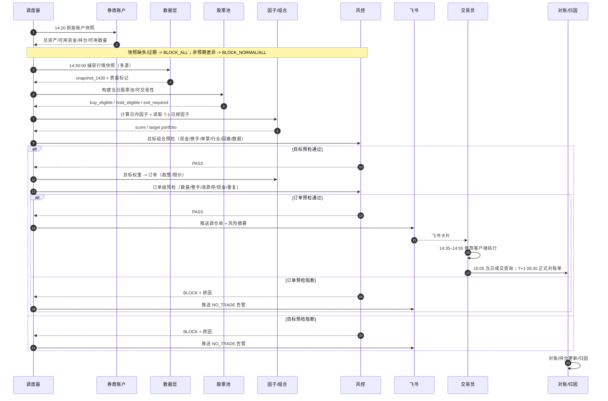
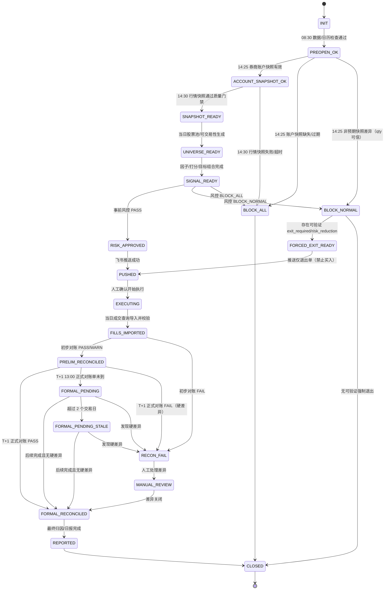

# QuantX：A 股日频量化回测与人工实盘系统详细设计

> 文档版本：v1.5<br>
> 状态：设计稿（已按 review 意见修订）<br>
> 适用市场：上海证券交易所主板、深圳证券交易所主板、创业板、科创板<br>
> 交易方式：系统生成信号与调仓单，人工在券商客户端执行<br>
> 最后更新：2026-11-16<br>
> 代码基线：空仓库，从 0 到 1 搭建

---

## 目录

- [0. 文档信息](#0-文档信息)
- [1. 需求理解与范围](#1-需求理解与范围)
- [2. 总体架构](#2-总体架构)
- [3. 运行时序与状态机](#3-运行时序与状态机)
- [4. 数据层](#4-数据层)
- [5. 股票池](#5-股票池)
- [6. 因子库](#6-因子库)
- [7. 组合构建与订单生成](#7-组合构建与订单生成)
- [8. 回测执行器](#8-回测执行器)
- [9. 实盘人工执行](#9-实盘人工执行)
- [10. 非功能性设计](#10-非功能性设计)
- [11. 测试与验收](#11-测试与验收)
- [12. 实施路线图与风险](#12-实施路线图与风险)
- [附录 A：核心表结构](#附录-a核心表结构)
- [附录 B：配置示例](#附录-b配置示例)
- [附录 C：交割单与调仓单模板](#附录-c交割单与调仓单模板)
- [附录 D：WorldQuant 101 精选公式](#附录-dworldquant-101-精选公式)
- [附录 E：术语表](#附录-e术语表)

---

## 0. 文档信息

### 0.1 文档目的

本文档描述 QuantX 的详细设计，覆盖：

1. 系统边界、关键假设与不可妥协的约束；
2. 数据采集、清洗、校验、对齐、存储与 Point-in-Time（PIT）语义；
3. 历史/当日股票池、可交易性判定与 A 股交易规则；
4. 因子注册表、增量计算、预处理、第一版因子与评测体系；
5. 资金规模推导 N、等权合成、TopN 组合构建、换手控制、约束与订单生成；
6. 自研 A 股日频/5 分钟回放引擎与 A 股成交模拟；
7. 账户快照、人工实盘执行、飞书推送、事前风控、回撤控制、成交录入；
8. 对账、归因、一致性报告、监控告警、测试与上线路线。

本文档不是投资建议，也不承诺任何收益。所有阈值、因子、权重和规则均为工程默认值，需要经过样本外验证后才能用于实盘。

### 0.2 读者对象

- 策略研究/因子开发人员；
- 数据工程与平台开发人员；
- 实盘交易与风控负责人；
- 后续维护该系统的开发者。

### 0.3 设计原则

| 原则 | 含义 | 落地方式 |
|---|---|---|
| 先防错，再求收益 | 数据错、规则错、对账错造成的损失远大于因子优化收益 | 数据门禁、风控门禁、对账硬阻断、失败关闭 |
| 前视偏差零容忍 | 任何 T 日信号只能看到 T 日 14:30 前可用、且 14:30:30 前抓到的数据 | `event_cutoff/capture_cutoff/decision_time`、PIT 查询、回测/实盘同一信号接口 |
| 回测与实盘同构 | 回测和实盘使用同一套股票池、因子、组合、订单、风控代码 | 共享 `SignalPipeline`，只替换执行器 |
| 人工执行可审计 | 人工环节不靠记忆和聊天记录 | 调仓单、执行确认、交割单、差异报告、审计日志 |
| 简单可解释 | 小资金、日频、TopN 等权，不引入不必要的优化器黑箱 | 规则透明、逐笔可追溯、参数可解释 |
| 失败关闭 | 关键数据/风控/对账不通过时，宁可不交易 | `NO_TRADE` 状态与 P0 告警 |
| 可复现 | 任一历史信号、回测、对账结果可重放 | 输入快照哈希、配置哈希、代码版本、因子版本 |

### 0.4 关键设计决策摘要

| 编号 | 决策 | 选择 | 理由 |
|---|---|---|---|
| D1 | 实现语言 | Python 3.11+ | 数据/因子/回测生态成熟，迭代快 |
| D2 | 分析型存储 | Parquet + DuckDB | 列式压缩、按日分区、嵌入式无需运维，适合单机日频/5 分钟数据 |
| D3 | 交易型存储 | SQLite（WAL），金额/价格用整数分 | 单用户、强一致、零运维；避免 REAL 记账误差；接口按 PostgreSQL 兼容设计 |
| D4 | 回测引擎 | 自研 `AShareReplayEngine` + 预计算 score | 目标/订单必须在账户状态上逐日生成；自研可复用实盘规则，避免框架阻抗 |
| D5 | 实盘执行 | 人工执行 + 账户快照 + 系统记账 | 无券商 API；账户快照是资金/持仓基线，无快照不交易 |
| D6 | 组合优化 | 资金推导 N + 约束化等权 + 10% 换手预算 | 解决小资金整手/最低佣金/单票上限矛盾；解释性强 |
| D7 | 因子合成 | 因子等权（可切换类别等权） | 第一版避免动态权重过拟合；类别等权用于控制类别数量偏置 |
| D8 | 数据一致性 | 2–4 周校准 + 多源交叉校验 + critical/市场分层门禁 | 免费源无 SLA；全市场 P0 会频繁 NO_TRADE |
| D9 | 时间语义 | 业务时间 + 真实可用时间 + 首次抓取时间 + 版本时间 | 解决财报公告、停复牌、ST、指数成分和“抓到才算可用”的问题 |
| D10 | 失败策略 | Fail-closed | 数据/风控/对账关键项失败时禁止生成可执行订单 |

### 0.5 v1.1 基础修订摘要（v1.2 已补充）

| 修订项 | 处理 |
|---|---|
| ST 涨跌幅 | 主板 ST 5% 仅适用于 2026-07-05 及以前；**2026-07-06 起 10%**；创业板/科创板 ST 20%；退市整理首日无涨跌幅 |
| 回测参与率 | 订单 ≤0.1% ADV20 免 bar 比例限制（不保证成交）；大额订单 10% bar 量参与；1% ADV20 为事前上限 |
| 对账时点 | 16:30 正式对账改为 **T+1**；T 日只做当日成交查询 + PRELIM；正式对账单 T+1 09:30，FORMAL T+1 10:00，13:00 截止 |
| 券商无订单号 | `client_order_id` 可空；按 `broker_trade_id`/`broker_order_id`/复合键弱匹配，`UNMATCHED/AMBIGUOUS` 保留成交人工分配 |
| 资金规模 | 固定 N=30/5% 改为 **由权益推导 N、单票上限、最少持仓**；默认最低 15 万；一手金额超上限的股票剔除 |
| 换手 | 单日单边 20% 改为 **10%**，5 日累计 30%；最低佣金进入换手成本 |
| 回测框架 | 去掉 Backtrader 依赖，改为自研 `AShareReplayEngine` |
| 回测样本 | 长历史用 `daily-research` 2015+；`production-replay` 只做近期 5 分钟执行校准 |
| 14:30 的 close | 明确定义 `close_d`（T-1 完整日线）与 `last_1430`；WQ101/动量用 `close_d` |
| 免费数据源 | 增加 2–4 周校准期；P0 只覆盖持仓/Top 候选/订单关键字段，全市场原则上 P1（灾难级/非空门禁除外） |
| Tushare | 改为可选增强，默认关闭，不作为唯一主源 |
| 成交价 | 明确 live=实际成交、production=14:40 bar、daily=T open |
| 5 分钟 | 改为可选；日频信号只用 T-1 日线 + 14:30 快照即可运行 |
| PIT | 区分 `available_at`、`first_seen_at`、`ingested_at`；v1.2 进一步改为 `event_cutoff/capture_cutoff/decision_time` 三截止 |
| 股票池 | 拆为 `buy_eligible`、`hold_eligible`、`exit_required` |
| SQLite | 金额/价格改为整数分，禁止 REAL |
| 账户快照 | 14:20 券商账户快照；缺失/过期 -> BLOCK_ALL；非预期不一致 -> BLOCK_NORMAL/ALL |

### 0.6 v1.2 review 修订摘要

| 主题 | 处理 |
|---|---|
| 板块准入 | 创业板/科创板权限与资金/经验门槛配置化，默认开启；无权限只允许卖出 |
| 价格笼子 | 新增按板块/日期生效的 `PriceCageRule`；限价偏离取 `min(cage, 3%)` |
| 不交易带 | 现有持仓默认保持股数；仅排名出带/超单票上限/强制退出交易；新增 `min_trade_value` 与 N 滞回 |
| 锁定持仓 | T+1/停牌/跌停持仓先锁定，不生成卖单、不计可用现金 |
| 最少持仓 | 降为目标级软约束；只影响买入，不阻断卖出，建仓期豁免 |
| 红利税/利息 | 增加按 lot 的递延红利税（20/10/0%）与现金利息 |
| 回测时点 | `daily-research` 改为 T-1 收盘信号、T 日开盘成交；`production-replay` 首 bar 改为 14:40 |
| 日内因子 | 实盘默认 `intraday_enabled=false`，与长历史日频因子集一致 |
| 预处理股票池 | 固定 `universe_preliminary`；14:30 只过滤不重算 z |
| 对账/权益 | `FORMAL_PENDING` 只告警，硬差异才阻断；N 用 `equity_1430` |
| 行业数据 | 中性化默认关闭；行业约束降为 WARN，行业未知不硬拒绝 |
| 回撤 | 阈值按 60 日波动缩放；增加独立恢复阶梯，避免清仓后永久锁死 |
| PIT | 明确 `event_cutoff`/`capture_cutoff`/`decision_time`；无历史版本标 `PIT_UNAVAILABLE` |
| 回测反馈 | 只预计算 score；目标/订单逐日依赖实际账户状态；同账户禁止并行 |
| 限价撮合 | 买入成交价 ≤ 限价、卖出 ≥ 限价；小单不保证成交 |
| 成交导入 | raw 与 economic fill 分离；真实成交先入账户事实再告警；`EXPIRED` 不等于撤单成功 |
| 数据/规则 | 规则覆盖 2015+；Baostock 复权因子优先；5 分钟能力探测；快照永久保留；科创板 200 股一手纳入校验 |

### 0.7 v1.3 review 修订摘要

| 主题 | 处理 |
|---|---|
| 除权除息时序 | T-1 盘后写 effective-dated `position_event`，不改当前持仓；14:20 只放行限定科目的预期差异；送转股可卖日取 `new_shares_listing_date`，缺失才保守取 ex_date 下一交易日 |
| 不交易带 vs 回撤 | `multiplier<1` 时覆盖 keep-shares，按低分/高波动/可卖减持，风险卖单不受换手/min_trade 限制 |
| 现金时点/税 | 拆分 gross/receivable/tax_estimate/tax_final/tax_withheld；红利税 T+1 扣缴、利息按季到账，时点差标 `CASH_TIMING_EXPECTED` |
| 回撤自反馈 | 波动缩放和恢复判断改用满仓影子组合；降级时冻结 `vol_scale` |
| 快照截止 | 增加 `snapshot_event_cutoff=14:30:30`，允许免费源 14:30:00–14:30:05 的 exchange_ts |
| 对账 pending | `FORMAL_PENDING` 最多 2 个交易日，超时 `FORMAL_PENDING_STALE` |
| BLOCK 分级 | `BLOCK_BUY/BLOCK_NORMAL/BLOCK_ALL`；强制退出满足条件可放行 |
| 回测门禁 | 回测逐日执行同一套 critical 数据门禁 |
| 小 N 换手 | N≤10 按只数预算（每日 0.5 只/每周 <3 只），风险卖出不计入 |
| 价格笼子 | 买入用 ask1、卖出用 bid1；规则表含无笼子区间；调仓单带 cage_hint，人工按盘口复核 |
| 权益/精度 | 修正 frozen 重复计算；订单分/成交 micros/金额费用分，统一舍入 |
| daily-research | 增加独立 T-1 收盘上下文；无完整上下文只做因子研究 |
| 发布冻结 | 新增 `strategy_release` 状态机与哈希校验，FROZEN 后变更必须新 release |

### 0.8 v1.4 review 修订摘要

| 主题 | 处理 |
|---|---|
| 跨源成交幂等 | 保留 PRELIM/FORMAL 两条 raw；不用精确哈希，按 broker_trade_id/容差匹配同一 Fill；费用差额走 `fill_adjustment` |
| 公司行为时序 | 改为 effective-dated `position_event`，不改当前持仓；T-1 对账用 `positions_as_of(T-1)`，T 日校验用 T 日截取 |
| 送转股可卖日 | 新增 `new_shares_listing_date`，按公告；缺失才保守取 ex_date 下一交易日 |
| 现金时点匹配 | `cash_timing_item` 定义匹配键/窗口/过期，超时 `CASH_TIMING_EXPIRED` 转 CASH_MISMATCH |
| 影子组合 | 同 release/成交模型/约束/公司行为；独立 paper account；冷启动回填 252 日 |
| 恢复仓位 | 10% 探测仓按权益绝对比例；25/50/100% 按 normal_gross 比例 |
| 换手口径 | 改为实际成交金额/权益；价格漂移不计换手；5 日最多 3 只（小 N） |
| 利息/应收 | 增加 accrual ledger；`INTEREST_ACCRUED/INTEREST_RECEIVABLE/INTEREST_RECEIVED` 分离 |
| PIT 快照 | 普通历史数据与 14:30 快照分开，修正 `available_at` 语义 |
| 现金科目 | 14:20 只放行 CASH_DIVIDEND/TAX_DUE 的预期差异 |
| 现金桶 | `cash_total`/available/frozen/receivable 使用场景分开 |
| 风险减持终态 | COMPLETE/PARTIAL/BLOCKED，记录目标/实际/locked/原因/次日动作 |
| 涨跌停比较 | 统一整数分，不用浮点容差 |
| daily_bars | 补 `event_time` |
| cash_ledger | 拆出 accrual/receivable，cash 只记实际流水 |

### 0.9 v1.5 review 修订摘要

| 主题 | 处理 |
|---|---|
| 跨源成交匹配 | 去掉精确哈希；PRELIM 建 PROVISIONAL Fill，FORMAL 按 broker_trade_id/容差确认；匹配不到冲销 provisional，费用差额走 fill_adjustment |
| 送转股规则一致性 | 旧文 `available_date=ex_date` 全部改为 `new_shares_listing_date`；缺失标 ESTIMATED，实盘用券商 available_qty，回测才用保守日期 |
| 回撤期 N | `dd_state != NORMAL` 冻结 N；恢复 NORMAL 连续 2 日后解冻 |
| 影子模型 | 默认与实盘同模型；若 5 分钟不足，整个影子统一用 daily-research 并标注；切换后冻结 60 日 |
| fills raw 关联 | 删除 `fills.raw_fill_id` 单条关联，统一由 `broker_trade_raw.economic_fill_id` 一对多 |
| 公司行为事件幂等 | 增加 `event_key/expected_event_id/actual_event_id`；同一 key ACTUAL 替换 EXPECTED，不重复生效 |
| BLOCK_NORMAL 放行 | 状态机增加 `FORCED_EXIT_READY`，只推送退出单 |
| 风险减持 min trade | `exit_required` 完全豁免；`risk_reduction` 受 `min_risk_reduction_value` 约束，低于阈值记 NO_EFFECT |
| 回撤滞回 | 改为 `hysteresis=max(2%,0.25*de_risk)`，不用固定 2% |
| 红利税口径 | 拆分 gross/receivable/tax_estimate/tax_final/tax_withheld；NAV 加应收、减税负债 |
| 现金时点容差 | 改为 `min(max(abs, amount*rel), max)`，默认 1 分/0.1%/100 分 |

---

## 1. 需求理解与范围

### 1.1 目标

构建一套可日常运行的 A 股日频量化系统：

1. 每个交易日 14:30 使用 **T-1 日频数据 + T 日 14:30 盘中快照** 生成信号；
2. 收盘前由人工按调仓单执行；收盘后录入当日成交并完成初步对账/T+1 正式对账、持仓更新和盘后流程；
3. 支持历史回测与模拟成交，回测规则尽量贴近真实 A 股交易约束；
4. 支持因子研究、因子评测、组合构建、换手控制与风险约束；
5. 所有关键数据、信号、订单、成交、持仓、对账结果可追溯、可复现；
6. 在数据错误、信号延迟、执行遗漏、对账不一致时能及时告警并阻止错误扩大。

### 1.2 非目标（第一版明确不做）

| 非目标 | 说明 |
|---|---|
| 日内高频/盘中反复交易 | 每个交易日只生成一次主信号；不做盘中二次调仓、不做盘中择时 |
| 盘中个股止损 | 第一版不设置个股盘中止损；仅保留组合级回撤控制 |
| 做空/融资融券 | 只做多，现金账户，不引入杠杆和融券 |
| ETF、可转债、期权、期货 | 证券主数据白名单直接排除 |
| Level-2 行情/逐笔委托 | 不使用十档、逐笔成交、委托队列；仅使用 Level-1 快照与 5 分钟线 |
| 自动下单 | 人工在券商客户端执行；系统不保存券商交易密码，不直连交易柜台 |
| 市场冲击模型 | 资金规模小，默认无冲击；小单按 bar 价全额，大单 10% 参与率 + 容量监控 |
| 复杂机器学习/深度学习 | 第一版以可解释的价量、基本面、WorldQuant 101 因子为主 |
| 多因子动态择时 | 不预测大盘涨跌；回撤控制是风险 overlay，不是择时模型 |

### 1.3 约束与假设

| 类别 | 约束/假设 |
|---|---|
| 市场 | 沪深主板、创业板、科创板；排除北交所、B 股、ETF、LOF、可转债、期权、期货；创业板/科创板需对应交易权限 |
| 方向 | 只做多；目标权重均非负；现金不得为负；无融资融券 |
| 频率 | 日频决策；每个交易日允许重新计算组合；可每日调仓，但不强制每日交易 |
| 持有期 | 单只股票至少持有 1 个交易日；受 T+1 约束，买入当日不可卖 |
| 资金 | 初始建议 ≥15 万元；小资金；订单金额远小于日均成交额；默认无市场冲击；N/单票上限由权益推导 |
| 数据 | 免费源为主，Tushare 仅可选；多源交叉校验；先做 2–4 周真实数据校准；允许部分延迟但有门禁/降级 |
| 执行 | 14:20 账户快照，14:30 生成信号，14:35 前推送，14:35–14:55 人工执行，15:00 收盘；无快照不交易 |
| 盘后 | 15:05 当日成交查询；15:30 初步对账；T+1 09:30 正式对账单、10:00 正式对账、13:00 截止；16:30 初步归因/日报 |
| 时区 | Asia/Shanghai；所有调度、时间戳、日志统一使用该时区，数据库存 UTC 或带时区时间 |
| 资金流 | 第一版假设无外部申购/赎回；如发生入金/出金，必须记录现金流并调整收益计算 |
| 交易规则 | 涨跌停、价格笼子、整手、费率、红利税按板块/日期规则表，覆盖 2015+ |

### 1.4 需求追踪矩阵

| 需求 | 设计章节 | 关键实现 |
|---|---|---|
| 沪深主板+创业板+科创板，只做多，不融资融券 | 5.1、5.2、7.3 | 板块白名单、证券类型白名单、权重非负断言 |
| 排除 ST、*ST、新股、退市、停牌 | 5.2、5.4 | `buy_eligible`/`hold_eligible`/`exit_required` 三态 + 可交易性 |
| 14:30 生成信号，收盘前人工执行，收盘后录入/对账 | 3.1–3.4、9 | 14:20 账户快照、状态机、调仓单、当日查询/T+1 对账单 |
| 日频、每日可调仓、至少持有 1 日、不盘中反复交易 | 3、7.4、9.2 | 单次信号、T+1、`min_hold_days`、订单当日失效 |
| 数据层：T-1 日频 + T 14:30 快照 | 4.1–4.3 | 快照表、PIT 查询、`first_seen_at` |
| 免费多源、交叉校验、交易日历、证券主数据、证券阻挡、OHLCV、复权因子、5 分钟（可选）、涨跌停、停牌、ST/退市、财务、快照 | 4.1–4.8 | 数据源矩阵、标准化 Schema、质量门禁 |
| 防前视偏差、合适存储 | 4.2、4.6 | Parquet+DuckDB、`available_at`/`first_seen_at`、`knowledge_date`、快照哈希 |
| 历史/当日股票池 | 5.3 | `universe_membership`、`universe_run`、差异报告 |
| 因子注册表、增量、缓存、日期 x 代码 | 6.1–6.4 | `FactorSpec`、`factor_run`、Parquet panel、内容哈希 |
| 价值/质量/动量交易/日内/WQ101 | 6.6、6.7 | 因子清单、公式、依赖、方向 |
| 预处理：MAD、zscore、缺失 | 6.5 | 每日横截面预处理，禁止全样本统计 |
| 评测：RankIC、IC 均值/标准差/ICIR/衰减/分层/换手/相关性 | 6.7 | `FactorEvaluator` + 指标表 + 报告 |
| 等权合成、TopN 等权、换手控制、约束 | 7.1–7.5 | 资金推导 N、`CompositeScorer`、`PortfolioBuilder`、10% 换手预算 |
| 板块权限、价格笼子、2015+ 规则 | 5.1.1、5.5 | 权限过滤、`PriceCageRule`、规则表按日期生效 |
| 红利税、现金利息、整数分 | 5.5.5、A | 按 lot 递延税、日计息、SQLite 整数最小单位 |
| 公司行为预调整/现金时点 | 8.3.7、9.6 | T-1 expected corp action、T 14:20 EXPECTED 差异、CASH_TIMING_EXPECTED |
| 回撤/影子组合 | 9.4 | shadow NAV 波动缩放、冻结 vol_scale、恢复阶梯 |
| 发布冻结 | 10.6 | `strategy_release` 状态机与哈希校验 |
| 回测框架、滑点、T+1、涨跌停、停牌、整手 | 8 | 自研 A 股回放引擎；daily-research 2015+；production-replay 近期；目标/订单逐日反馈 |
| 人工执行、风控、回撤、延迟告警、一致性报告 | 9 | 账户快照、事前风控、回撤 overlay、PRELIM/FORMAL 对账 |
| IM 推送、调仓单、人工成交录入 | 9.2、9.5 | 飞书适配器、订单表、弱成交匹配/人工分配 |

### 1.5 关键名词

| 名词 | 定义 |
|---|---|
| `trade_date` | 交易业务日期，A 股交易日 |
| `as_of` | 决策时点；本文默认 T 日 14:30:00 |
| `available_at` | 某条数据在现实中可被系统使用的时点（知识时间） |
| `knowledge_date` | 数据版本被来源确认/发布的日期，用于处理财报重述、状态变更 |
| 历史股票池 | 按历史时点重建的、当时符合条件的股票集合，用于回测/因子评测 |
| 当日股票池 | T 日 14:30 实际可用于选股的集合，含盘中停牌/涨跌停/ST 刷新 |
| 可交易性 | 某股票在某时点是否可买/可卖，不等同于是否在股票池内 |
| 目标组合 | 目标权重或目标股数，不含执行结果 |
| 调仓单 | 面向人工执行的买卖清单，含数量、限价、金额、原因、截止时间 |
| 交割单 | 券商返回的实际成交记录，人工录入或导出 |
| 对账 | 内部订单/成交/持仓/现金与券商结果、行情市值的一致性校验 |
| PIT | Point-in-Time，按 `as_of` 只读取当时可知的数据 |

---

## 2. 总体架构

### 2.1 逻辑架构

```mermaid
flowchart LR
    subgraph SRC["免费数据源"]
        S1["Tushare<br/>日线/财务/复权"]
        S2["Baostock<br/>日线/5分钟/状态"]
        S3["东方财富<br/>快照/日线/5分钟"]
        S4["新浪/腾讯<br/>实时快照"]
        S5["交易所/巨潮<br/>公告/日历/状态"]
    end

    subgraph DATA["数据层"]
        RAW["Raw 原始层<br/>不可变、带来源"]
        CLEAN["清洗/单位归一/去重"]
        VALID["多源校验/质量门禁"]
        CURATED["Curated PIT 层<br/>Parquet + DuckDB"]
    end

    subgraph RESEARCH["研究/信号层"]
        UNI["股票池<br/>历史/当日"]
        FACT["因子注册表<br/>增量计算/缓存"]
        SCORE["预处理/等权打分"]
        PORT["组合构建<br/>约束/换手/TopN"]
        ORDER["订单/信号生成<br/>可交易性/取整/限价"]
    end

    subgraph EXEC["执行层"]
        BT["回测执行器<br/>自研 A 股回放"]
        MAN["人工执行器<br/>调仓单/成交录入"]
    end

    subgraph OPS["运营/风控层"]
        RISK["事前风控<br/>现金/换手/行业/回撤"]
        IM["飞书/企微<br/>信号推送"]
        LEDGER["持仓/现金台账"]
        RECON["对账<br/>订单-成交-持仓-券商"]
        ATTR["归因/报告"]
    end

    SRC --> RAW --> CLEAN --> VALID --> CURATED
    CURATED --> UNI --> FACT --> SCORE --> PORT --> ORDER
    ORDER --> RISK
    RISK --> BT
    RISK --> IM --> MAN
    BT --> LEDGER
    MAN --> LEDGER
    LEDGER -.->|持仓/现金/回撤反馈| PORT
    LEDGER --> RECON --> ATTR
    RECON -.->|阻断/告警| RISK
```



### 2.2 分层职责

| 层 | 模块 | 职责 | 不做什么 |
|---|---|---|---|
| 数据层 | `quantx.data` | 采集、原始留存、单位归一、清洗、校验、对齐、PIT 查询 | 不计算因子、不做选股 |
| 股票池 | `quantx.universe` | 板块/证券类型过滤、ST/新股/退市/停牌过滤、历史池与当日池、可交易性 | 不决定买多少 |
| 因子层 | `quantx.factors` | 注册表、依赖解析、增量计算、预处理、缓存、评测 | 不生成订单 |
| 打分/组合 | `quantx.portfolio` | 等权合成、打分、TopN、约束、换手控制、目标权重 | 不直接下单 |
| 订单/信号 | `quantx.signals` | 目标权重到订单、取整、限价、可交易性、调仓单、推送载荷 | 不执行成交 |
| 回测 | `quantx.backtest` | `AShareReplayEngine`：逐日/逐 bar 回放、A 股成交规则、费用、滑点、指标 | 不接触真实资金 |
| 实盘 | `quantx.live` | 运行日状态、调仓单、人工执行确认、交割单录入、持仓更新 | 不自动登录券商 |
| 风控 | `quantx.risk` | 事前检查、回撤 overlay、数据/对账门禁、告警 | 不预测收益 |
| 对账/归因 | `quantx.recon`、`quantx.attribution` | PRELIM/FORMAL 对账、弱成交匹配、差异分类、PnL/Brinson/因子归因 | 不修改原始成交 |
| 公共 | `quantx.common` | 配置、日历、日志、时钟、ID、异常、通知适配 | 不承载业务规则 |

### 2.3 核心领域对象

```text
Security           证券主数据（代码、板块、上市/退市、整手规则、涨跌停规则）
SecurityBlock      证券阻挡/黑名单（硬阻断、生效区间、来源）
TradingCalendar    交易日历（开市日、上一/下一交易日、交易时段）
PriceCageRule      价格笼子（板块/日期/2% + 0.10 元）
StrategyRelease    策略发布/冻结（release_id、哈希、状态）
DailyBar           日线（不复权 OHLCV/成交额/状态；T 日信号只用 T-1 完整日线）
MinuteBar          5 分钟线（bar_end、OHLCV/成交额）
Snapshot1430       T 日 14:30 快照（最新价、开高低、累计量额、涨跌停、状态）
DailyResearchContext T-1 收盘上下文（无 14:30 快照/无价格笼子，T 日开盘成交）
FinancialRecord    PIT 财务记录（报告期、公告日、可用时间、字段）
FactorSpec         因子元数据（名称、依赖、函数、版本、方向、预处理）
FactorPanel        日期 x 代码的因子矩阵（含 available_at/universe_version）
Universe           某日股票池及不可入池原因
Tradability        某股票某时点 can_buy/can_sell/hold_allowed/exit_required 及原因
Score              某日每只股票的合成分
TargetPortfolio    目标权重/目标股数/锁定股数/现金缓冲
Order              调仓订单（side、qty、limit_price、reason、status）
Fill               实际/模拟成交（数量、价格、费用、时间、broker_trade_id、match_status）
AccountSnapshot    券商账户快照（总资产、现金、持仓、可用数量、时间、来源）
BrokerStatement    券商正式对账单（T+1 导入、内容哈希、对账状态）
Position           持仓（total_qty、available_qty、avg_cost、market_value）
CashLedger         现金流水（成交、费用、分红、红利税、利息、出入金）
PositionLot        持仓批次（成本、持有期、已收股息、红利税）
PositionEvent      有效日期公司行为事件（EXPECTED/ACTUAL，不直接改当前持仓）
RiskDecision       风控结论（PASS/WARN/BLOCK）及原因
ReconReport        对账报告（PRELIM/FORMAL、差异、严重级别、处理状态）
AttributionReport  归因报告（收益、行业、因子、执行、成本）
```

### 2.4 推荐代码仓库结构

```text
quantx/
├── pyproject.toml
├── README.md
├── config/
│   ├── base.yaml
│   ├── dev.yaml
│   ├── paper.yaml
│   └── live.yaml
├── docs/
│   └── design.md
├── src/quantx/
│   ├── __init__.py
│   ├── common/
│   │   ├── config.py          # Pydantic Settings
│   │   ├── calendar.py        # 交易日历
│   │   ├── clock.py           # Asia/Shanghai 时钟
│   │   ├── ids.py             # run_id/order_id/fill_id
│   │   ├── money.py           # 整数分/Decimal 金额
│   │   ├── release.py         # 策略发布/冻结
│   │   ├── logging.py         # structlog
│   │   ├── errors.py
│   │   └── types.py
│   ├── data/
│   │   ├── sources/           # tushare/baostock/eastmoney/sina/tencent/cninfo
│   │   ├── ingest.py
│   │   ├── normalize.py       # 单位、代码、字段标准化
│   │   ├── clean.py
│   │   ├── validate.py
│   │   ├── crosscheck.py
│   │   ├── align.py
│   │   ├── store.py           # Parquet 写读、manifest、原子提交
│   │   ├── pit.py             # as_of 查询
│   │   └── schemas.py
│   ├── universe/
│   │   ├── rules.py
│   │   ├── builder.py
│   │   └── tradability.py
│   ├── factors/
│   │   ├── registry.py
│   │   ├── context.py
│   │   ├── engine.py
│   │   ├── preprocess.py
│   │   ├── cache.py
│   │   ├── evaluate.py
│   │   └── library/
│   │       ├── value.py
│   │       ├── quality.py
│   │       ├── momentum.py
│   │       ├── intraday.py
│   │       └── wq101.py
│   ├── portfolio/
│   │   ├── score.py
│   │   ├── constraints.py
│   │   ├── builder.py
│   │   └── turnover.py
│   ├── signals/
│   │   ├── orders.py
│   │   ├── lots.py
│   │   ├── limits.py
│   │   ├── sheet.py
│   │   └── pipeline.py
│   ├── risk/
│   │   ├── pretrade.py
│   │   ├── drawdown.py
│   │   └── gates.py
│   ├── backtest/
│   │   ├── engine.py          # AShareReplayEngine 主循环
│   │   ├── matching.py        # 涨跌停/停牌/整手/参与率/部分成交
│   │   ├── ledger.py          # T1Ledger/CashLedger/PositionLedger
│   │   ├── tax.py             # 红利税/持仓期
│   │   ├── interest.py        # 现金利息
│   │   ├── corporate_actions.py
│   │   ├── execution.py       # 成交价策略
│   │   ├── costs.py           # 佣金/印花/过户/滑点
│   │   └── runner.py
│   ├── live/
│   │   ├── run.py
│   │   ├── account_snapshot.py
│   │   ├── manual_executor.py
│   │   ├── fills.py
│   │   ├── positions.py
│   │   └── notify.py
│   ├── recon/
│   │   ├── engine.py
│   │   ├── matching.py        # 弱成交匹配
│   │   ├── statement.py       # 券商对账单
│   │   ├── breaks.py
│   │   └── report.py
│   ├── attribution/
│   │   ├── pnl.py
│   │   ├── brinson.py
│   │   └── factor.py
│   ├── reporting/
│   │   ├── daily.py
│   │   └── templates/
│   └── cli.py
├── scripts/
│   ├── run_after_close.sh
│   ├── run_signal_1430.sh
│   └── run_recon.sh
├── tests/
│   ├── unit/
│   ├── integration/
│   ├── golden/
│   └── fixtures/
├── data/                      # 运行时数据目录（gitignore）
└── reports/                   # 运行时报告目录（gitignore）
```

### 2.5 部署拓扑

第一版建议单机部署：

```text
macOS/Linux 工作站（或境内云主机）
├── 定时任务：cron / launchd / systemd timer
├── Python 虚拟环境（uv 管理）
├── 本地 SSD：data/ + reports/
├── SQLite：data/state/quantx.sqlite
├── DuckDB：data/catalog.duckdb
├── 飞书机器人 Webhook / 应用
├── 券商客户端（人工操作，独立进程）
└── 备份：每日加密备份到外置盘/对象存储
```

要求：

- 主机时区 `Asia/Shanghai`，开启 NTP；
- 交易时段不断电、不睡眠；建议 UPS；
- 不在交易时段执行系统升级/重启；
- 若主机在境外，免费行情源延迟和稳定性可能不达标，建议境内主机；
- 第一版不引入 Kubernetes/消息队列，避免运维复杂度；
- 所有定时任务必须支持幂等重跑和手动补跑。

---

## 3. 运行时序与状态机

### 3.1 交易日时间轴

| 时点 | 任务 | 输入 | 输出 | 失败处理 |
|---|---|---|---|---|
| T-1 18:00 | 日终数据采集 | 免费源 | 原始层日线/财务/状态 | 重试；次日 08:30 前必须补齐 |
| T-1 18:30 | 清洗/多源校验 | 原始层 | Curated PIT 层 | 冲突隔离；关键对象 P0 |
| T-1 18:45 | 公司行为预调整（ex_date=T） | 已公告 `corporate_actions` + 持仓 lots | `position_event`（EXPECTED，effective_date=T） | 不修改当前持仓；T-1 对账仍用 T-1 持仓；缺失 -> `PENDING_CORP_ACTION` |
| T-1 19:00 | 历史/次日预股票池 | PIT 数据 | `universe_preliminary` | 失败则 T 日不交易 |
| T-1 19:30 | 日频因子增量 | 日线/财务 | 因子 panel | 失败则 T 日不交易 |
| T 08:30 | 开盘前检查 + 隔夜数据补采 | 数据/日历/公告 | `PREOPEN_OK` | 缺数据则告警；只使用普通数据 `event_time <= 14:30:00`、快照 `exchange_ts <= 14:30:30`，且 `first_seen_at <= 14:30:30` |
| T 08:45 | 因子缓存失效检查/重算 | 隔夜财报、复权、状态 | `factor_panel` 新版本 | 失败则沿用 T-1 版本并标注；影响持仓/候选则 BLOCK_NORMAL（强制退出按 qty 可信度放行） |
| T 14:20 | 券商账户快照 | 券商 App/CSV/截图 | `account_snapshot` | 缺失/过期 -> BLOCK_ALL；不一致先核对 `EXPECTED_CORP_ACTION`；非预期按 BLOCK_NORMAL/ALL |
| T 14:25 | 账户快照校验 + 5 分钟线预热 | 快照、行情源 | `ACCOUNT_SNAPSHOT_OK` | 不通过 -> BLOCK_ALL；差异为预期公司行为 -> 放行 |
| T 14:30:00 | 捕获 14:30 快照 | 新浪/腾讯/东财 | `snapshot_1430` | 30 秒内重试；超时降级 |
| T 14:30–14:33 | 当日股票池/可交易性 | 快照 + 状态 | `buy_eligible`/`hold_eligible`/`exit_required` | critical 失败 -> BLOCK_NORMAL；qty 不可信 -> BLOCK_ALL |
| T 14:30–14:35 | 日内因子/打分/组合/订单 | 因子 + 快照 + 权益 | `TargetPortfolio` + `OrderSheet` | 失败则不推送订单 |
| T 14:35 | 事前风控 + 飞书推送 | 订单 + 风控 + 账户快照 | 飞书卡片 + 调仓单 | 推送失败重试/降级；仍失败 P0 |
| T 14:35–14:55 | 人工执行 | 调仓单 | 券商成交 | 未执行/部分执行记录原因 |
| T 14:55 | 执行窗口关闭 | 订单 | `CANCEL_REQUESTED`（未成交部分） | 不追单；等待券商撤单确认，不生成盘中二次信号 |
| T 15:00 | 收盘 | — | — | — |
| T 15:05 | 当日成交查询/成交录入 | 券商 App 成交查询 | `Fill`（可无 client_order_id） | 未录入则 P1 告警 |
| T 15:15 | provisional 持仓/现金 + 实际公司行为入账准备 | 成交 + 实际 `position_event` + 收盘账户快照 | `Position`/`CashLedger`（provisional） | 与预期差异 -> `CORP_ACTION_MISMATCH`；T+1 FORMAL 才正式入账 |
| T 15:30 | 初步对账（prelim） | 内部台账 + 当日成交查询 + 持仓/资金页面 | `ReconReport(PRELIM)` | 数量/现金硬差异 P0；费用差异 PENDING_FORMAL |
| T 16:00 | 日终数据采集 | 免费源 | 原始层 | 重试 |
| T 16:30 | 初步 PnL/归因/日报 | 持仓/行情/基准 | 日报（标注 preliminary） | 告警 |
| T+1 09:30 | 正式对账单导入 | 券商官方交割单/对账单 | `broker_statement` | 缺失/延迟 -> P0 |
| T+1 10:00 | 正式对账（formal） | 内部台账 + 券商对账单 + 行情 | `ReconReport(FORMAL)` | FAIL 阻断 T+1 14:30 信号 |
| T+1 10:30 | 最终归因/日报 | 正式对账结果 + 行情 | 最终日报 | FORMAL 未完成则顺延并告警 |
| T+1 13:00 | 正式对账截止 | — | `FORMAL_RECON_OK` 或 `FORMAL_PENDING` | PENDING -> WARN 允许交易，最多 2 日；超时/硬差异 -> BLOCK_NORMAL（强制退出放行） |
| T+1 17:30 | 次日数据准备 | 日线/财务 | 因子增量/预股票池 | 失败则次日 08:30 前补齐 |

> 说明：14:30 是“决策时点”，不是“数据下载时点”。14:30 之后产生的行情、公告、收盘价一律不能进入 T 日信号。T 日收盘数据只能用于 T 日盘后流程和 T+1 信号。

### 3.2 14:30 信号时序



### 3.3 盘后流程

```text
15:00 收盘
  -> 15:05 当日成交查询导入（券商 App/CSV；允许无 client_order_id）
  -> 15:15 成交校验、provisional 持仓/现金（PRELIM，不替代正式入账）、T+1 可用数量滚动
  -> 15:15 收盘账户快照（总资产/现金/持仓/可用数量）
  -> 15:30 初步对账 PRELIM（内部台账 vs 当日成交查询 vs 持仓/资金页面）
  -> 16:00 日终行情/财务/状态采集
  -> 16:30 初步 PnL、行业/因子/执行归因、日报（标注 preliminary）
  -> 18:00 备份、归档、告警汇总
  -> T+1 09:30 券商正式对账单/交割单导入
  -> T+1 10:00 正式对账 FORMAL（先入账 T 日成交，再对内部台账 vs 券商对账单 vs 行情）
  -> T+1 13:00 正式对账截止；未完成 -> FORMAL_PENDING，最多 2 日；超时 -> BLOCK_NORMAL
```

盘后必须回答的五个问题：

1. 目标组合是什么？实际成交是什么？差异在哪？
2. 现金、持仓、可用数量是否与券商一致？
3. 当日收益来自市场、行业、因子、选股还是执行？
4. 有没有数据/规则/执行异常需要在次日开盘前修复？
5. 次日股票池和因子是否已准备好？

### 3.4 运行状态机



状态规则：

- `ACCOUNT_SNAPSHOT_OK` 是硬前置：没有当日券商账户快照，不得生成可执行订单；
- 只有 `RISK_APPROVED` 才能生成普通可执行调仓单；`NO_TRADE` 是信号级标签，实际订单按 `block_level` 放行；`BLOCK_NORMAL` 仍可生成 `exit_required` 的强制退出卖单；
- `NO_TRADE` 也必须推送，说明原因和 block_level；
- `PUSHED` 之后不允许静默修改订单；如必须修正，生成新的 `signal_version`，旧版本作废并推送更正；
- `PRELIM_RECONCILED` 只代表当日成交查询/页面级对账通过，不能替代 `FORMAL_RECONCILED`；
- `FORMAL_PENDING` 不等于 FAIL：允许交易但 P1 告警，最多 2 个交易日；超过 -> `FORMAL_PENDING_STALE`，`BLOCK_NORMAL`；
- `RECON_FAIL`：T+1 14:30 `BLOCK_NORMAL`；qty/cash 不可信时 `BLOCK_ALL`；可验证的强制退出仍放行；差异关闭或显式 override 后恢复；
- 所有状态转换写入 `signal_run`/`job_run`，包含操作者、时间、输入哈希、输出哈希。

### 3.5 SLA 与延迟告警

| 监控项 | 正常阈值 | 告警阈值 | 级别 | 处理 |
|---|---|---|---|---|
| 券商账户快照 | 14:20 前 | 14:25 缺失/过期 | P0 | BLOCK_ALL |
| 账户快照与台账差异 | 数量 0；现金 ≤0.01 元 | 超差 | P0 | 预期放行；非预期 BLOCK_NORMAL/ALL |
| 14:30 快照时间戳 | ≤ 14:30:30 | > 14:30:30 或缺失 | P0 | 重试备源；仍失败 BLOCK_ALL |
| 快照多源价差 | ≤ 0.1% | > 0.2% | P1 | 标记冲突；关键股票 P0 |
| 股票池构建 | ≤ 60 秒 | > 120 秒 | P1 | 检查数据/代码 |
| 因子+组合计算 | ≤ 3 分钟 | > 5 分钟 | P1 | 缓存/降级；超过 14:40 不推送 |
| 风控检查 | ≤ 30 秒 | > 60 秒 | P1 | 阻断 |
| 飞书推送 | 14:35 前 | 14:35 未成功 | P1 | 重试/备用通道；14:40 未成功 P0 |
| 人工确认 | 14:40 前 | 14:45 未确认 | P1 | 电话/私聊提醒 |
| 当日成交录入 | 15:05 前 | 15:15 未完成 | P1 | 阻断初步对账 |
| 初步对账 | 15:30 前 | 16:00 未完成 | P1 | 人工介入 |
| 正式对账单导入 | T+1 09:30 前 | T+1 10:00 未完成 | P1 | 标记 FORMAL_PENDING，不直接阻断 |
| 正式对账 | T+1 10:00 前 | T+1 13:00 未完成 | P1 | PENDING 允许交易并告警，最多 2 日；超时 -> BLOCK_NORMAL；硬差异 -> BLOCK_NORMAL/ALL |
| 次日数据准备 | 18:00 前 | 次日 08:30 未完成 | P0 | 次日 BLOCK_BUY/NORMAL |

告警通道：

- 主通道：飞书私聊/群机器人；
- 备通道：企业微信/钉钉/邮件（适配器可替换）；
- P0 建议同时电话/短信（可选，不依赖免费 IM）；
- 所有告警写入 `alert` 表，包含 `alert_id`、`severity`、`run_id`、`message`、`created_at`、`ack_at`、`resolved_at`。

### 3.6 失败与降级策略

| 故障 | 检测 | 降级 | 是否允许交易 |
|---|---|---|---|
| 账户快照缺失/过期 | 14:25 检查 | 无降级；等待人工补抓 | BLOCK_ALL |
| 账户快照与台账不一致 | 数量/现金超差 | 先核对 EXPECTED_CORP_ACTION；人工复核 | 预期放行；非预期 BLOCK_NORMAL（qty 可信）/ALL |
| T-1 已公告公司行为未到账 | 14:20 快照差异 | 标记 EXPECTED_CORP_ACTION/PENDING_CORP_ACTION | 预期差异放行；非预期阻断 |
| 主数据源日线缺失 | 行数/覆盖率 | 备源补齐，标记 `SOURCE_FALLBACK` | 关键字段一致则允许 |
| 关键股票收盘价/前收/涨跌停冲突 | critical 字段冲突 | 隔离该股票；不自动平均 | 持仓股 BLOCK_NORMAL（qty 可信可强制退出）；候选剔除 |
| 全市场冲突率升高 | market 指标超阈值 | P1 告警 + 隔离 | 允许（除非覆盖率跌破地板） |
| 14:30 快照延迟 | 时间戳 > 30 秒 | 备源；缩短计算 | 超 14:35 未就绪则 BLOCK_ALL |
| 5 分钟线缺失 | 最新 bar < 14:25 | 日频因子照常；日内因子 NaN/降级 | 不因 5 分钟缺失直接 NO_TRADE |
| 因子计算失败 | 异常/覆盖率低 | 使用上一版缓存（仅当输入未变） | 输入变化则 BLOCK_NORMAL |
| 飞书推送失败 | HTTP/超时 | 重试 3 次 + 备用通道 | 人工可从本地调仓单执行；必须记录 |
| 当日成交查询未录入 | 15:05 检查 | 人工补录 | 初步对账前不阻断，但 FORMAL 前必须补齐 |
| 券商对账单无 client_order_id | 导入检查 | 弱匹配/人工分配 | 允许；未匹配成交 P0 |
| 券商成交结构非法/缺字段 | 导入检查 | 写 `SUSPENSE`，保留 raw，P0 告警 | 该笔不静默入账；人工修复 |
| 内部 EXPIRED 但券商未确认撤单 | 14:55/对账检查 | 保持 `CANCEL_PENDING`，不得当作已撤单 | 不新开反向单；确认后关闭 |
| 撤单后到达成交 | 导入检查 | 记 `LATE_FILL`，正常入账 | 允许；更新订单/告警 |
| 正式对账单延迟 | T+1 09:30 检查 | 标记 FORMAL_PENDING，继续获取 | 允许交易并告警；超时/硬差异 BLOCK_NORMAL；qty 不可信 BLOCK_ALL |
| 对账硬差异 | qty/cash 不一致 | 人工复核 | BLOCK_NORMAL（qty 可信时允许强制退出）；qty 不可信 BLOCK_ALL |
| 回撤超阈值 | 日终/14:30 | 降暴露/只卖不买 | 按回撤等级执行 |
| 重复运行 | 同 `run_id` | 幂等返回；强制重跑生成新版本 | 旧订单作废 |

---

## 4. 数据层

### 4.1 数据源矩阵

免费数据源没有 SLA，且接口、字段、频率可能变化。设计上采用“**主源 + 备源 + 权威源校验**”，任何单源异常都不能静默进入信号。

| 数据集 | 主源（免费/默认可） | 备源 | 权威/校验源 | 频率/延迟 | 关键注意点 |
|---|---|---|---|---|---|
| 交易日历 | Baostock / 交易所日历 | 东财 | 交易所公告 | 日 | 节假日、临时休市；保留历史版本 |
| 证券主数据 | Baostock / 交易所 | 东财/巨潮 | 交易所/巨潮 | 日 | 代码、板块、上市/退市、名称历史 |
| 证券阻挡/黑名单 | 交易所/监管公告 | 巨潮/东财 | 交易所 | 日/事件 | 长期停牌、风险警示、退市、禁止交易证券；只做排除 |
| 日线 OHLCV（不复权） | Baostock | 东财/新浪/腾讯 | 交易所行情 | T 日 15:30 后 | 单位不同；停牌日可能无记录 |
| 复权因子 | Baostock 复权因子/复权价接口（若可用）优先，否则反推 | 东财 | 交易所/行情源 | 日 | 先探测接口能力；因子方向/基准；避免用未来因子 |
| 5 分钟线 | Baostock | 东财/腾讯 | 交易所行情 | 盘中/历史 | 历史深度有限；**可选**，不阻塞日频信号 |
| 14:30 快照 | 新浪 | 腾讯/东财 | 交易所时间戳 | 实时 | 多源并发；30 秒超时 |
| 每日涨跌停价 | 规则计算 | 东财快照字段 | 交易所规则 | 日/实时 | 除权日参考价；ST/板块/日期规则 |
| 停牌/复牌 | 日线缺失 + Baostock `tradestatus` | 东财状态 | 交易所公告 | 日 | 不能把“缺失”直接当停牌 |
| ST/*ST/退市整理 | 名称历史 + 状态表 | 东财/交易所 | 巨潮公告 | 日 | 名称法有历史误差，公告优先 |
| 财务指标 | Baostock | 巨潮/东财 | 巨潮/交易所 | 季度/公告日 | 必须用公告日，不用报告期 |
| 行业分类 | 东财/申万 | 巨潮 | 申万/交易所 | 日/季度 | 历史成分与生效日；避免未来分类 |
| 公司行为 | 巨潮/东财 | 交易所公告 | 交易所 | 日 | 分红、送转、配股、除权参考价 |
| 指数/基准 | 东财/中证 | 交易所 | 中证/交易所 | 日 | 沪深 300/500/1000/全指 |
| 公告 | 巨潮 | 交易所 | 巨潮 | 日 | ST、退市、风险提示、财报 |
| Tushare（可选增强） | 有 token/积分时启用 | — | — | 视权限 | **不假设免费**；无权限/积分不足时自动禁用，不作为唯一主源 |

### 4.1.1 数据源校准期（必须先做）

免费源的真实覆盖率、延迟、冲突率不能靠拍脑袋设阈值。上线前必须先跑 **2–4 周真实数据校准**：

1. 每天采集所有可用源，只记录、不交易；
2. 统计每个字段的覆盖率、缺失率、多源冲突率、快照延迟、单位异常；
3. 用校准结果设置 P1 阈值和隔离规则；
4. P0 只绑定“持仓 + Top 候选 + 订单相关”的关键字段；
5. 校准结束后冻结一版 `data_gate_profile`，后续变更需重新校准。

校准期输出 `reports/data_calibration/{yyyyww}/`，至少包含：覆盖率、冲突率、延迟分布、单位异常、关键字段样本核对。

同时执行 **数据能力探测**，写入 `data_capability.json`：每个源/数据集的最早日期、最晚日期、行数、缺口、5 分钟实际起点、复权因子是否直接可得。`production-replay` 的可用起点以探测结果为准，不能假设 5 分钟能覆盖 2015 年。

数据源使用要求：

1. 每个适配器声明字段单位、时区、代码格式、复权方式、频率；
2. 所有请求带超时、重试、退避、限速；禁止高频轰炸免费接口；
3. 原始响应原样落盘，便于追责和重放；
4. 免费源只用于个人研究/自有资金；遵守来源服务条款，不转售、不公开再分发；
5. 关键字段不允许“单源直接入库后即使用”，必须经过交叉校验；
6. 允许配置付费备源（如 Tushare 积分接口）作为可选增强，但第一版不依赖。

### 4.2 存储方案

#### 4.2.1 选型

| 数据类型 | 存储 | 理由 |
|---|---|---|
| 原始响应/日线/5 分钟/因子 panel | Parquet（Zstd） | 列式、压缩率高、按日分区、DuckDB 可直接查询、备份简单 |
| 分析查询/聚合 | DuckDB | 嵌入式、零运维、SQL、可直接读 Parquet；单机日频足够 |
| 订单/成交/持仓/现金/对账/告警 | SQLite（WAL） | 事务、强一致、单用户、部署简单；表结构兼容 PostgreSQL |
| 配置/报告 | YAML/JSON/Markdown/CSV | 可读、可版本化、易审计 |
| 大对象（公告 PDF） | 文件系统 + 元数据表 | 不塞数据库 |

不选 ClickHouse/Spark 的原因：数据量在单机可承受范围（日线约千万行、5 分钟约数亿行），引入分布式系统会增加运维和故障面。若未来 5 分钟全市场多年数据超过单机能力，再评估 ClickHouse/ArcticDB。

#### 4.2.2 目录布局

```text
data/
├── raw/
│   ├── tushare/daily/trade_date=2026-11-13/ingest=20261113T183000.parquet
│   ├── baostock/daily/trade_date=2026-11-13/...
│   ├── eastmoney/snapshot/trade_date=2026-11-13/snapshot_1430.parquet
│   └── sse/announcement/...
├── curated/
│   ├── daily_bars/year=2026/month=11/part-000.parquet
│   ├── bars_5m/year=2026/month=11/part-000.parquet
│   ├── adj_factors/year=2026/month=11/...
│   ├── financials_pit/year=2026/...
│   ├── security_master/...
│   ├── trading_calendar/...
│   ├── universe/...
│   └── snapshots_1430/year=2026/month=11/...
├── cache/
│   └── factors/{factor_id}/{version}/{trade_date}.parquet
├── quarantine/
│   └── daily_bars/trade_date=.../*.parquet
├── state/
│   └── quantx.sqlite
├── catalog.duckdb
└── manifests/
    └── {dataset}/{trade_date}.json
```

写入规则：

- **原始层不可变**：每次采集新文件，不覆盖；文件名包含 `ingest` 时间；
- **Curated 层原子提交**：先写临时目录，校验行数/哈希/分区，再原子 rename，最后写 `_SUCCESS` 和 manifest；
- **分区**：日线按 `year/month`，5 分钟按 `trade_date`（或 `year/month/day`），因子按 `factor_id/version/year`；
- **排序**：写入前按 `(trade_date, code)` 排序，提升压缩和扫描效率；
- **Schema 版本**：每张表有 `schema_version`；变更走迁移脚本，不就地改旧文件；
- **幂等**：同一 `(dataset, trade_date, source, ingest_id)` 重复写入不产生重复行；以 manifest 哈希判断。

#### 4.2.3 容量估算

| 数据 | 规模估算 | 压缩后量级 | 保留 |
|---|---|---|---|
| 日线 10 年 | 5,500 只 × 250 日 × 10 年 ≈ 1,375 万行 | 1–3 GB | 全量 |
| 5 分钟 5 年 | 5,500 × 48 bar × 250 × 5 ≈ 3.3 亿行 | 20–60 GB | 全量/按需 |
| 14:30 快照 | 5,500 × 250 × 5 ≈ 687 万行 | 1–3 GB | 永久 |
| 财务/公司行为 | 百万级 | < 1 GB | 全量 |
| 因子 panel | 因子数 × 日期 × 股票 | 10–50 GB | 全量 + 版本 |
| 订单/成交/持仓 | 每日几十到几百行 | MB 级 | 全量 |

> 实际容量取决于字段数、压缩率、5 分钟历史深度。上线前用一个月真实数据做一次容量基准。

### 4.3 核心数据集与 Schema

以下为逻辑 Schema；物理 Parquet 可增减字段，但语义必须保持一致。**所有原始/状态/财务/行情表都必须包含 `event_time`、`first_seen_at`、`available_at`、`available_at_quality`**；日线 `event_time=当日收盘`，5 分钟 `event_time=bar_end`，快照 `event_time=exchange_ts`，公告 `event_time=announced_at`。为简洁，部分表只列关键字段。

#### 4.3.1 交易日历 `trading_calendar`

| 字段 | 类型 | 说明 |
|---|---|---|
| `trade_date` | DATE | 交易日 |
| `is_open` | BOOLEAN | 是否开市 |
| `prev_trade_date` | DATE | 上一交易日 |
| `next_trade_date` | DATE | 下一交易日 |
| `session_am_open` | TIME | 09:30 |
| `session_am_close` | TIME | 11:30 |
| `session_pm_open` | TIME | 13:00 |
| `session_pm_close` | TIME | 15:00 |
| `source` | VARCHAR | 来源 |
| `available_at` | TIMESTAMP | 可使用时点 |
| `schema_version` | INT | Schema 版本 |

#### 4.3.2 证券主数据 `security_master`（SCD2）

| 字段 | 类型 | 说明 |
|---|---|---|
| `code` | VARCHAR | 6 位代码，如 `600000` |
| `exchange` | VARCHAR | SSE/SZSE |
| `board` | VARCHAR | SH_MAIN/SZ_MAIN/CHINEXT/STAR |
| `name` | VARCHAR | 证券简称 |
| `security_type` | VARCHAR | STOCK/ETF/BOND/OPTION/FUND |
| `currency` | VARCHAR | CNY |
| `listing_date` | DATE | 上市日 |
| `delisting_date` | DATE | 退市日，空为未退市 |
| `is_st` | BOOLEAN | 该版本是否 ST/*ST |
| `is_delisting` | BOOLEAN | 是否退市整理/已退市 |
| `total_shares` | BIGINT | 总股本 |
| `float_shares` | BIGINT | 流通股本 |
| `lot_rule_id` | VARCHAR | 整手规则 |
| `limit_rule_id` | VARCHAR | 涨跌停规则 |
| `industry_l1` | VARCHAR | 申万一级 |
| `industry_l2` | VARCHAR | 申万二级 |
| `valid_from` | DATE | 生效日 |
| `valid_to` | DATE | 失效日（开区间） |
| `knowledge_date` | DATE | 该版本已知日期 |
| `source` | VARCHAR | 来源 |
| `available_at` | TIMESTAMP | 可使用时点 |

#### 4.3.3 日线 `daily_bars`

| 字段 | 类型 | 说明 |
|---|---|---|
| `trade_date` | DATE | 交易日 |
| `event_time` | TIMESTAMP | 事件时间（当日收盘 15:00） |
| `code` | VARCHAR | 代码 |
| `open` | DECIMAL(18,4) | 开盘价（不复权） |
| `high` | DECIMAL(18,4) | 最高价 |
| `low` | DECIMAL(18,4) | 最低价 |
| `close` | DECIMAL(18,4) | 收盘价 |
| `preclose` | DECIMAL(18,4) | 前收盘（原始） |
| `prev_close_ref` | DECIMAL(18,4) | 除权除息参考价（用于涨跌停） |
| `volume` | BIGINT | 成交量（股） |
| `amount` | DECIMAL(20,2) | 成交额（元） |
| `num_trades` | BIGINT | 成交笔数，可空 |
| `vwap` | DECIMAL(18,4) | 成交额/成交量 |
| `trade_status` | VARCHAR | NORMAL/SUSPENDED |
| `is_st` | BOOLEAN | 当日是否 ST |
| `is_delisting` | BOOLEAN | 当日是否退市整理 |
| `limit_up` | DECIMAL(18,4) | 涨停价，可空（无涨跌停） |
| `limit_down` | DECIMAL(18,4) | 跌停价 |
| `adj_factor` | DOUBLE | 复权因子（累计） |
| `source_primary` | VARCHAR | 主源 |
| `sources_used` | VARCHAR | 参与校验的源 |
| `quality_flags` | INT | 位掩码 |
| `ingested_at` | TIMESTAMP | 入库时间 |
| `first_seen_at` | TIMESTAMP | 首次成功抓取时间 |
| `available_at` | TIMESTAMP | 真实可用时间（≥收盘后） |
| `available_at_quality` | VARCHAR | EXACT/ESTIMATED/CAPTURE_ONLY |
| `knowledge_date` | DATE | 知识日期 |
| `schema_version` | INT | 版本 |

#### 4.3.4 5 分钟线 `bars_5m`

| 字段 | 类型 | 说明 |
|---|---|---|
| `trade_date` | DATE | 交易日 |
| `code` | VARCHAR | 代码 |
| `bar_end` | TIMESTAMP | bar 结束时间（Asia/Shanghai） |
| `event_time` | TIMESTAMP | 事件时间，等于 `bar_end` |
| `open/high/low/close` | DECIMAL(18,4) | 不复权 |
| `volume` | BIGINT | 股 |
| `amount` | DECIMAL(20,2) | 元 |
| `vwap` | DECIMAL(18,4) | amount/volume |
| `source` | VARCHAR | 来源 |
| `quality_flags` | INT | 质量标记 |
| `first_seen_at` | TIMESTAMP | 首次成功抓取时间 |
| `available_at` | TIMESTAMP | bar 真实可用时间（≥bar_end） |
| `available_at_quality` | VARCHAR | EXACT/ESTIMATED/CAPTURE_ONLY |

时间戳约定：

- `bar_end=14:30:00` 表示 14:25:00–14:30:00 的 bar；
- 14:30 信号只能使用 `bar_end <= 14:30:00` 的 bar；
- 若 14:30 bar 尚未就绪，回退到 14:25 bar，并在 `signal_run` 记录 `intraday_bar_lag_seconds`；
- 不使用 14:35 bar 及以后的数据。

#### 4.3.5 14:30 快照 `snapshots_1430`

| 字段 | 类型 | 说明 |
|---|---|---|
| `trade_date` | DATE | 交易日 |
| `code` | VARCHAR | 代码 |
| `captured_at` | TIMESTAMP | 系统抓取时间 |
| `event_time` | TIMESTAMP | 事件时间，等于 `exchange_ts` |
| `exchange_ts` | TIMESTAMP | 交易所/行情源时间戳 |
| `last` | DECIMAL(18,4) | 最新价 |
| `open/high/low` | DECIMAL(18,4) | 当日截至 14:30 的开高低 |
| `prev_close` | DECIMAL(18,4) | 前收盘（原始） |
| `prev_close_ref` | DECIMAL(18,4) | 除权除息参考价；用于计算/校验涨跌停 |
| `volume` | BIGINT | 累计成交量（股） |
| `amount` | DECIMAL(20,2) | 累计成交额（元） |
| `vwap` | DECIMAL(18,4) | 累计成交额/累计成交量 |
| `limit_up/limit_down` | DECIMAL(18,4) | 涨跌停价 |
| `is_suspended` | BOOLEAN | 是否停牌 |
| `is_st` | BOOLEAN | 是否 ST |
| `is_delisting` | BOOLEAN | 是否退市整理 |
| `name` | VARCHAR | 当日简称 |
| `bid1/ask1` | DECIMAL(18,4) | 买一/卖一，可空；不用于 L2 因子 |
| `source` | VARCHAR | 来源 |
| `source_count` | INT | 成功源数量 |
| `crosscheck_status` | VARCHAR | OK/WARN/CONFLICT |
| `quality_flags` | INT | 位掩码 |
| `first_seen_at` | TIMESTAMP | 首次成功抓取时间 |
| `available_at` | TIMESTAMP | 快照真实可用时间（≤captured_at） |
| `available_at_quality` | VARCHAR | EXACT/ESTIMATED/CAPTURE_ONLY |

> 快照只使用 Level-1 信息；`bid1/ask1` 仅用于人工执行参考，不构建盘口类因子。

#### 4.3.6 复权因子 `adj_factors`

| 字段 | 类型 | 说明 |
|---|---|---|
| `trade_date` | DATE | 交易日 |
| `code` | VARCHAR | 代码 |
| `adj_factor` | DOUBLE | 累计复权因子 |
| `source` | VARCHAR | 来源 |
| `knowledge_date` | DATE | 版本日期 |
| `first_seen_at` | TIMESTAMP | 首次成功抓取时间 |
| `available_at` | TIMESTAMP | 真实可用时间 |
| `available_at_quality` | VARCHAR | EXACT/ESTIMATED/CAPTURE_ONLY |

复权约定：

- `adj_close = close * adj_factor`；收益率用 `adj_close_t / adj_close_{t-1} - 1`；
- 不做“前复权到最新价”的全样本变换，避免未来复权因子污染历史；
- 因子计算使用复权价；执行、涨跌停、成交金额使用不复权价；
- 复权因子变更必须触发受影响日期的因子重算；
- 供应商因子方向不一致时，在适配器内统一为“累计、单调、除权日跳变”的口径，并用价格连续性测试验证；
- Baostock 若直接提供 `adj_factor` 或复权价，优先使用并校验；只有接口不提供时才用复权价反推。

#### 4.3.7 财务数据 `financials_pit`

| 字段 | 类型 | 说明 |
|---|---|---|
| `code` | VARCHAR | 代码 |
| `report_period` | DATE | 报告期（如 2025-12-31） |
| `ann_date` | DATE | 公告日 |
| `f_ann_date` | DATE | 实际公告日，可空 |
| `statement_type` | VARCHAR | income/balance/cashflow/indicator |
| `revenue` | DECIMAL | 营业收入（元） |
| `cogs` | DECIMAL | 营业成本 |
| `net_profit` | DECIMAL | 归母净利润 |
| `net_profit_total` | DECIMAL | 净利润（含少数股东） |
| `total_assets` | DECIMAL | 总资产 |
| `total_liabilities` | DECIMAL | 总负债 |
| `total_equity` | DECIMAL | 归母权益 |
| `cfo` | DECIMAL | 经营活动现金流净额 |
| `capex` | DECIMAL | 资本开支 |
| `eps` | DECIMAL | 每股收益 |
| `roe` | DECIMAL | 净资产收益率 |
| `gross_margin` | DECIMAL | 毛利率 |
| `source` | VARCHAR | 来源 |
| `knowledge_date` | DATE | 版本日期 |
| `first_seen_at` | TIMESTAMP | 首次成功抓取时间 |
| `available_at` | TIMESTAMP | 真实可用时间（公告日 18:00 等） |
| `available_at_quality` | VARCHAR | EXACT/ESTIMATED/CAPTURE_ONLY |
| `revision` | INT | 重述版本 |

PIT 规则：

- 只能使用 `available_at <= as_of` 的记录；
- 若只有公告日没有公告时间，保守取公告日 18:00；T 日 14:30 不能使用 T 日公告的财报；
- 同一报告期有重述时，按 `knowledge_date` 取 `as_of` 时已知的最新版本；
- TTM 由最近 4 个单季度值相加；每个季度值使用 `as_of` 时已知版本；
- 财务字段缺失时保持 NaN，不跨行业用均值硬填。

#### 4.3.8 状态与公司行为

`security_status_daily`：

| 字段 | 说明 |
|---|---|
| `trade_date` | 交易日 |
| `code` | 代码 |
| `is_suspended` | 是否停牌 |
| `suspend_reason` | 停牌原因 |
| `is_st` | 是否 ST/*ST |
| `is_delisting` | 是否退市整理 |
| `delisting_stage` | 退市阶段 |
| `limit_up/limit_down` | 当日涨跌停价 |
| `name` | 当日简称 |
| `source` | 来源 |
| `first_seen_at` | 首次成功抓取时间 |
| `available_at` | 真实可用时间 |
| `available_at_quality` | EXACT/ESTIMATED/CAPTURE_ONLY |

`security_blocklist`（证券阻挡/黑名单）：

| 字段 | 说明 |
|---|---|
| `code` | 代码，可空（按板块/代码段阻挡时为空） |
| `block_type` | BOARD/SECURITY_TYPE/ST/DELISTING/SUSPENDED/REGULATORY/OTHER |
| `reason` | 阻挡原因 |
| `effective_from` / `effective_to` | 生效区间 |
| `source` | 来源/公告 |
| `first_seen_at` | 首次成功抓取时间 |
| `available_at` | 真实可用时间 |
| `available_at_quality` | EXACT/ESTIMATED/CAPTURE_ONLY |
| `is_hard_block` | 是否硬阻断（硬阻断不得人工绕过） |

阻挡层与股票池的关系：股票池是“选股资格”，阻挡层是“合规/交易禁止”。硬阻断优先级最高，任何因子分数都不能覆盖。

`corporate_actions`：

| 字段 | 说明 |
|---|---|
| `code` | 代码 |
| `ex_date` | 除权除息日 |
| `record_date` | 股权登记日 |
| `cash_pay_date` | 现金分红派息日（以公告为准） |
| `new_shares_listing_date` | 送转股上市/可流通日（以公告为准） |
| `action_type` | CASH_DIVIDEND/BONUS/SPLIT/RIGHTS |
| `cash_component` | CASH_DIVIDEND/TAX_DUE/...（预期现金差异科目） |
| `cash_per_share` | 每股现金分红 |
| `bonus_ratio` | 每股送股 |
| `split_ratio` | 每股转增 |
| `rights_ratio` | 配股比例 |
| `rights_price` | 配股价 |
| `announced_at` | 公告时间 |
| `available_at` | 可使用时点 |
| `source` | 来源 |

第一版支持现金分红、送股、转增、拆股；配股需要人工决策，系统只做提示，不自动认购；回测中按“不参与配股”的保守假设处理，并在报告中标注。

#### 4.3.9 行业与指数

`industry_membership`：

| 字段 | 说明 |
|---|---|
| `code` | 代码 |
| `industry_system` | SW2021 |
| `level1` / `level2` / `level3` | 行业 |
| `valid_from` / `valid_to` | 生效区间 |
| `knowledge_date` | 版本日期 |
| `source` | 来源 |

`index_membership`：

| 字段 | 说明 |
|---|---|
| `index_code` | 指数代码 |
| `code` | 成分股 |
| `valid_from` / `valid_to` | 生效区间 |
| `knowledge_date` | 版本日期 |
| `source` | 来源 |

第一版行业分类允许使用供应商当前分类 + 生效日回填；若历史分类不可得，必须在回测报告中声明“行业分类存在前视风险”，并优先用行业中性化降低影响。

#### 4.3.10 券商账户快照 `account_snapshot`

人工执行没有券商 API，必须在 14:20 前后从券商 App/CSV/截图抓取一份**账户快照**，作为当日交易的资金/持仓基线。没有有效快照 -> BLOCK_ALL。

`account_snapshot`：

| 字段 | 说明 |
|---|---|
| `snapshot_id` | 快照 ID |
| `trade_date` | 交易日 |
| `captured_at` | 快照时间（券商页面时间/录入时间） |
| `captured_by` | 操作者 |
| `source` | APP/CSV/SCREENSHOT/MANUAL |
| `total_assets_cents` | 总资产（分） |
| `cash_total_cents` | 现金总额（含冻结，分） |
| `available_cash_cents` | 可用资金（分） |
| `market_value_cents` | 持仓市值（分） |
| `frozen_cents` | 冻结资金（分）；`cash_total = available + frozen` |
| `position_count` | 持仓只数 |
| `board_permissions` | 已开通板块权限 JSON，如 `["SH_MAIN","SZ_MAIN","CHINEXT"]` |
| `content_hash` | 截图/CSV 内容哈希 |
| `file_path` | 原始文件路径 |
| `status` | VALID/STALE/MISMATCH |
| `first_seen_at` | 系统首次拿到快照的时间 |
| `available_at` | 快照真实可用时间 |
| `available_at_quality` | EXACT/ESTIMATED/CAPTURE_ONLY |
| `created_at` | 入库时间 |

`account_snapshot_position`：

| 字段 | 说明 |
|---|---|
| `snapshot_id` | 快照 ID |
| `code` | 代码 |
| `total_qty` | 总数量 |
| `available_qty` | 可卖数量 |
| `avg_cost_micros` | 成本（1e-6 元） |
| `market_value_cents` | 市值（分） |

校验：

- 快照时间距 14:30 不超过 15 分钟；超过标记 `STALE`；
- 总资产 = `cash_total_cents + 持仓市值`（允许 0.01 元误差）；`cash_total = available_cash + frozen_cash`，不得再额外加 frozen；
- 持仓数量/可用数量与内部台账逐只对比；数量不一致 -> `MISMATCH` -> BLOCK_ALL；
- 截图必须能看清账户、日期、总资产、可用资金、持仓；否则视为无效；
- 收盘后再抓一份快照，用于 15:15 持仓/现金更新和初步对账；
- 快照只作为人工执行基线，不替代 T+1 正式对账单。

**现金字段的使用场景必须分开**：

| 字段 | 含义 | 计入 NAV/权益 | 可用于买入 | 说明 |
|---|---|---|---|---|
| `cash_total_cents` | 现金总额（含冻结） | 是 | 否 | 只用于总资产/权益 |
| `available_cash_cents` | 可用资金 | 是（已含在 total） | 是 | 买入/现金计划只用它 |
| `frozen_cents` | 冻结资金 | 是（已含在 total） | 否 | 不能再加到 total 上 |
| `cash_receivable_cents` | 应收分红/利息 | 是（应计） | 否 | 到账后才转 available |
| `dividend_tax_estimate_cents` | 红利税估计负债 | 否（冲减 NAV） | 否 | 卖出时转 final |
| `dividend_tax_final_cents` | 红利税最终负债 | 否（冲减 NAV） | 否 | 实际扣缴时转现金 |
| `dividend_tax_withheld_cents` | 已扣缴税额 | 否 | 否 | 只做审计 |

`equity_for_sizing = cash_total + market_value`（保守，不含应收）；`NAV/绩效 = cash_total + market_value + dividend_receivable + interest_receivable - tax_liability`。两套口径在报告中必须标明。

### 4.4 采集、清洗与对齐

#### 4.4.1 采集

- 调度器按数据集配置并发抓取；每源独立限速、超时、重试；
- 抓取结果先写原始层，记录请求参数、响应哈希、HTTP 状态、耗时；
- 同一数据集多源抓取时间差控制在 60 秒内；
- 14:30 快照并发抓取新浪/腾讯/东财，取成功源做交叉校验；
- 失败重试 3 次（指数退避），仍失败则触发告警/降级；
- 所有时间戳统一转 `Asia/Shanghai`，数据库存储带时区时间。

#### 4.4.2 清洗

清洗规则：

1. **代码标准化**：6 位数字；补零；剔除市场前缀；建立 `600000.SH`/`000001.SZ` 映射；
2. **单位归一**：成交量统一为“股”，成交额统一为“元”，金额统一为“元”；见 4.4.3；
3. **重复处理**：同一 `(trade_date, code, source)` 保留最新 `ingested_at`，原始层不删；
4. **OHLC 合法性**：`low <= open/close <= high`，价格 > 0；否则标记并隔离；
5. **量额一致性**：`vwap = amount / volume` 与 `close` 偏差超过 20% 时告警（停牌/集合竞价/单位错误）；
6. **停牌识别**：优先使用状态源；无状态源时，`volume=0` 且无成交额才可标记为疑似停牌，不能仅因缺行判定；
7. **ST 识别**：优先状态/公告；名称含 `ST`、`*ST`、`SST`、`S*ST`、`退` 作为辅助；
8. **异常值**：价格/成交量极端值不直接删除，标记后进入隔离区，等待多源校验；
9. **公司行为**：除权日价格跳变不应当作异常；用 `prev_close_ref` 和复权因子校验；
10. **对齐**：按交易日历补齐日期索引；不把非交易日数据混入；缺失日保留 NaN，不做无标记前填。

#### 4.4.3 单位换算（必须显式声明）

| 来源 | 成交量单位 | 成交额单位 | 归一化 |
|---|---|---|---|
| Tushare `daily` | 手（100 股） | 千元 | `volume *= 100`; `amount *= 1000` |
| Baostock | 股 | 元 | 不变 |
| 东方财富 | 手 | 元 | `volume *= 100` |
| 新浪 | 股 | 元 | 不变 |
| 腾讯 | 手/万元（以适配器实测为准） | 万元 | 按适配器声明换算并校验 |

强制校验：`amount / volume` 应落在当日 `[low*0.8, high*1.2]` 范围内；否则标记 `UNIT_SUSPECT`，不得进入因子。

#### 4.4.4 对齐

- **时间对齐**：日频按 `trade_date`；5 分钟按 `bar_end`；快照按 `captured_at`；财务按 `available_at`；
- **代码对齐**：以证券主数据为左表，缺行不自动补零；
- **股票池对齐**：因子 panel 的列必须与 `universe_version` 对齐；不同版本不得混用；
- **信号对齐**：T 日信号只允许读取 `as_of <= 14:30:00` 的数据；盘后数据不得回填到 T 日信号；
- **时区对齐**：所有比较使用带时区时间，禁止 naive datetime。

### 4.5 多源交叉校验

#### 4.5.1 校验字段与容差

| 字段 | 容差 | 处理 |
|---|---|---|
| `open/high/low/close` | 绝对 0.01 元或相对 0.1% | 超差标记冲突；持仓股冲突升级 P0 |
| `preclose/prev_close_ref` | 绝对 0.01 元 | 超差隔离 |
| `volume` | 相对 1% | 超差标记；用于因子时降权/剔除 |
| `amount` | 相对 1% | 超差标记 |
| `adj_factor` | 相对 1e-6 | 超差隔离，禁止复权计算 |
| `limit_up/limit_down` | 精确到 0.01 | 超差以规则计算值为准并告警 |
| `is_suspended/is_st/is_delisting` | 布尔一致 | 冲突时以权威源/公告为准；无法判定则不可交易 |
| 快照 `last` | 绝对 0.01 元或相对 0.1% | 超差标记 `CONFLICT` |

#### 4.5.2 冲突解决

1. **三源多数票**：字段值在容差内分组，取最大组；最大组票数相同则主源优先；
2. **两源冲突**：主源优先，但标记 `CONFLICT`；关键字段（close/limit/status）冲突时隔离，不进入信号；
3. **主源缺失**：备源补齐，标记 `SOURCE_FALLBACK`；
4. **全部缺失**：该股票当日不可交易；持仓股触发 P0；
5. **禁止平均价格**：价格是离散 tick，平均会制造不存在的价格；只做选择/隔离。

#### 4.5.3 冲突率门禁

- 全市场日线冲突率 > 校准阈值（初始 2%）：P1，检查源/单位/接口；
- 持仓股或 Top 2N 候选任一关键字段冲突：P0，持仓股 BLOCK_NORMAL（qty 可信可强制退出）/候选剔除；
- 全市场快照冲突率 > 校准阈值（初始 2%）：P1；关键股票冲突仍 P0；
- 冲突数据写入 `quarantine`，附主源/备源值、差异、时间。

### 4.6 前视偏差与 PIT

#### 4.6.1 PIT 时间语义与三个截止时间

PIT 不是“给数据补一个时间戳”，而是同时约束**事件发生时间、系统抓到时间、决策时间**：

| 字段 | 含义 | 典型值 |
|---|---|---|
| `event_time` | 行情/公告事件本身发生的时间 | 快照 14:30:00、公告 10:15、收盘 15:00 |
| `available_at` | 数据在现实世界中首次公开可用的时间 | 收盘后 15:30、公告发布时刻、财报公告日 18:00 |
| `first_seen_at` | 本系统第一次成功抓取到该数据的时间 | 14:29:50 / 14:32:10 |
| `ingested_at` | 数据写入存储的时间 | 可能晚于 `first_seen_at` |
| `knowledge_date` / `revision` | 来源版本/重述版本 | 财报重述、状态更正 |
| `available_at_quality` | 可用时间可信度 | `EXACT` / `ESTIMATED` / `CAPTURE_ONLY` / `PIT_UNAVAILABLE` |

三个截止时间必须写死并进入配置：

| 截止 | 默认 | 作用 |
|---|---|---|
| `event_cutoff` | T 14:30:00 | 日线/公告/5 分钟 bar 的事件时间上限 |
| `snapshot_event_cutoff` | T 14:30:30 | 14:30 快照允许的 `exchange_ts` 上限；免费源常见 14:30:00–14:30:05 |
| `capture_cutoff` | T 14:30:30 | 系统必须在该时刻前已抓到数据 |
| `decision_time` | T 14:35:00 | 信号/订单最终生成时间；**不能用来放宽 capture 截止** |

实时信号的准入条件分两类，不能混用：

```text
A. 普通历史数据（日线/5分钟/公告/财务）：
   event_time <= event_cutoff
   AND available_at <= event_cutoff
   AND first_seen_at <= capture_cutoff

B. 14:30 快照：
   exchange_ts >= event_cutoff
   AND exchange_ts <= snapshot_event_cutoff
   AND available_at <= capture_cutoff     # 快照的 available_at = 抓取完成时间
   AND first_seen_at <= capture_cutoff
```

`available_at` 的定义按数据集区分：

- 普通数据：真实公开可用时间（公告时刻、收盘后发布时间）；
- 14:30 快照：**抓取完成时间**，不是 `exchange_ts`；`exchange_ts` 是事件时间。

快照策略：

- 取 **14:30:00 之后第一份** `exchange_ts` 在 `[14:30:00, 14:30:30]` 的快照；
- 记录 `exchange_ts_offset_seconds = exchange_ts - 14:30:00`；超过 10 秒标 `SNAPSHOT_LATE`，仍可用但告警；
- 14:30:30 之后才抓到的快照不得用于当日信号；
- 不能用 14:31 的日线/5 分钟 bar 替代快照。

不能用 `max(available_at, first_seen_at) <= decision_time` 作为统一条件：那会把 14:32 才抓到的普通数据放进 14:30 截止的信号，也会把快照的 exchange_ts/抓取时间混在一起。普通数据用 A，快照用 B。

回测：

- 普通数据：`event_time <= event_cutoff` + `available_at <= event_cutoff` + `knowledge_date` 版本重建；
- 快照：`exchange_ts <= snapshot_event_cutoff` + `available_at <= capture_cutoff`；历史快照没有真实抓取时间时，只能做敏感性分析，不能假装是 PIT；
- 不能用 `first_seen_at` 代替真实发布时间；也不能把事后补抓的数据“回填”成当时可用；
- 缺少历史版本/无法还原真实可用时间 -> 标记 `PIT_UNAVAILABLE`，该数据不能用于 PIT 回测结论，不能简单补时间戳；
- 只有 `available_at_quality=EXACT/ESTIMATED` 的数据可进入主回测；`CAPTURE_ONLY` 只能做敏感性分析，`PIT_UNAVAILABLE` 排除。

查询示例（回测/研究）：

```duckdb
SELECT *
FROM daily_bars
WHERE trade_date <= :trade_date
  AND event_time <= :event_cutoff
  AND available_at <= :event_cutoff
QUALIFY row_number() OVER (
  PARTITION BY trade_date, code
  ORDER BY knowledge_date DESC, ingested_at DESC
) = 1;
```

实时查询则加 `first_seen_at <= :capture_cutoff`，而不是只比较 `decision_time`。

规则：

- 派生因子写入 `available_at = computed_at`（通常 14:31–14:34）；
- 信号消费因子时：`factor.available_at <= decision_time`，且其原始输入满足上述 event/capture 条件；
- 回测中，信号在 bar 结束后计算，订单在下一可成交 bar 执行；不得在同一 bar 内“用收盘价算信号再按收盘价成交”；
- 本文其余部分用 `as_of` 作为简写，实现时变量名必须区分 `event_cutoff`、`capture_cutoff`、`decision_time`。

#### 4.6.2 典型前视陷阱与处理

| 陷阱 | 错误做法 | 正确做法 |
|---|---|---|
| 用 T 日收盘价生成 T 日 14:30 信号 | 直接读 T 日 `daily_bars` | 只读 T-1 及更早；T 日只用 `snapshot_1430`/`bars_5m <= 14:30` |
| 用最新复权因子回算历史 | 全样本前复权 | 用 `adj_factor_t / adj_factor_{t-1}` 计算收益；信号只用当时已知因子 |
| 用报告期而不是公告日 | `report_period <= T` 就使用 | `available_at <= event_cutoff` + `first_seen_at <= capture_cutoff`；公告日 18:00 前不可用 |
| 用当前 ST 名单回测历史 | 用今天的 ST 名单过滤 | 用历史状态/名称/公告重建 |
| 用当前指数成分回测历史 | 用最新成分股 | 用 `index_membership` 的 `valid_from/valid_to` |
| 用当前行业分类回测历史 | 用最新行业 | 用历史行业；不可得时声明风险并做行业中性化 |
| 用退市后代码的“未来生存”信息 | 只保留当前上市股票 | 证券主数据包含退市股；回测持有到退市 |
| 5 分钟 bar 时间戳误用 | 14:30 使用 14:35 bar | 只用 `bar_end <= 14:30` |
| 财务重述 | 用重述后数据回测早期 | 用 `knowledge_date` 对应版本，或明确使用“最新重述”并标注 |

#### 4.6.3 前视审计

- 每个因子/信号 run 记录 `input_manifest_hash`、`as_of`、`universe_version`；
- 回测提供 `shift_test`：把未来数据整体平移/截断，信号不应变化；
- 提供 `future_injection_test`：注入 T 日 14:30 之后的数据，断言信号不变；
- 提供 `first_seen_test`：将某条数据的 `first_seen_at` 调到 14:31，断言 14:30 信号不使用它；
- 代码审查禁止在因子函数中直接读“最新”文件；必须通过 `DataPortal.as_of()`；
- 数据层 API 不暴露无 `as_of` 的便捷查询（或默认 `as_of=now` 且明确标注为研究模式）。

### 4.7 数据质量门禁

#### 4.7.1 门禁分层：P0 只覆盖“会下单/持仓”的关键对象

免费数据源不可能做到全市场零缺失、零冲突。把全市场指标都设成 P0 会导致频繁 NO_TRADE，反而使系统不可用。门禁必须分层：

| 范围 | 说明 | 默认级别 |
|---|---|---|
| `critical` | 持仓 + Top 2N 候选 + 当日订单相关股票 | 关键字段失败 -> P0；按 9.3.1 选 BLOCK_NORMAL/ALL，不一律 NO_TRADE |
| `market` | 全市场覆盖率、冲突率、异常率 | P1 告警 + 隔离；只有覆盖率跌破地板才 P0 |
| `reference` | 财务、行业、指数等非实时字段 | P2/P1；影响因子覆盖时按因子规则处理 |

`critical` 的硬字段（必须全部通过）：

- 收盘价 `close`；
- 前收盘/除权参考价 `preclose` / `prev_close_ref`；
- 涨跌停价 `limit_up` / `limit_down`；
- 停牌 `is_suspended`；
- ST/退市整理 `is_st` / `is_delisting`；
- 成交量 `volume`、成交额 `amount`。

这些字段任一缺失/冲突：

- 持仓股 -> P0，BLOCK_NORMAL（qty 可信可强制退出）；
- Top 候选 -> 剔除该股票，不阻断全市场；
- 订单股 -> 阻断该订单；
- 非 critical 股票 -> 隔离并 P1。

#### 4.7.2 日频门禁

| 检查 | 范围 | 阈值 | 失败动作 |
|---|---|---|---|
| 日线覆盖率 | market | 校准期确定，初始 ≥ 95% | P1；低于 80% 的灾难级才 P0 |
| 股票池非空 | market | ≥ 100 只 | P0 |
| OHLC 违法率 | market | 校准期确定，初始 ≤ 0.5% | P1；违法股票隔离 |
| 量额单位异常率 | market | ≤ 0.5% | P1；异常股票隔离 |
| 多源冲突率 | market | 校准期确定，初始 ≤ 2% | P1 |
| 关键字段缺失/冲突 | critical | 0 | P0（持仓） / 剔除（候选） |
| 涨跌停价缺失 | critical | 仅无涨跌停股票允许 | P0 |
| 复权因子缺失 | critical | 0 | P0 |
| 财务字段缺失 | reference | 按因子最低覆盖 | 因子层处理 |
| 日历一致性 | market | 与交易所日历一致 | P0 |
| 数据源新鲜度 | market | 校准期确定 | P1；关键股 P0 |

> 阈值是初始值，必须用 4.1.1 的 2–4 周校准结果替换；不要在没有真实数据分布的情况下把 99.5% 之类的数字写死。

#### 4.7.3 盘中门禁

| 检查 | 范围 | 阈值 | 失败动作 |
|---|---|---|---|
| 快照时间戳 | critical | ≤ 14:30:30 | 重试；14:35 未就绪 BLOCK_ALL |
| 快照覆盖率 | market | 校准期确定，初始 ≥ 95% | P1；关键股缺失 P0 |
| 快照价差 | critical | ≤ 0.2% | P1；关键股 P0 |
| 5 分钟线最新 bar | critical | ≥ 14:25 | 标记 lag；主因子依赖时降级 |
| 股票池可交易比例 | market | ≥ 80% | P1；过低检查数据 |
| 涨跌停价一致性 | critical | 100% | P0 |
| 停牌/ST 状态冲突 | critical | 0 | P0 |

#### 4.7.4 门禁结果

- `PASS`：继续；
- `WARN`：继续，但在调仓单/飞书卡片标注；
- `BLOCK_*`：按 9.3.1 分级放行/禁止，推送原因，写 `alert`；
- 所有门禁结果写入 `data_quality_run`，包含 `profile_version`、`critical_set`、`market_metrics`；
- 校准期 `data_gate_profile` 冻结后，任何阈值变更都要记录并重新跑历史回放。

### 4.8 数据保留与备份

- 原始层：至少保留 2 年；关键公告/财报保留 5 年；
- Curated 层：全量保留；
- 快照：**永久保留**（至少与订单/成交/对账记录同寿命；容量很小）；
- 因子 panel：保留所有生产版本；研究版本可归档；
- 订单/成交/持仓/对账/报告：全量保留，至少 5 年；
- 每日 18:00 加密备份到外置盘/对象存储；每月做一次恢复演练；
- SQLite 使用 WAL，定期 `VACUUM`/备份；备份前 checkpoint；
- 任何删除/迁移操作必须有 manifest 和校验和，禁止“rm -rf 后重下”。

---

## 5. 股票池

### 5.1 市场与板块

采用**白名单**，只允许：

| 板块 | 交易所 | 代码前缀（示例） | 说明 |
|---|---|---|---|
| 沪市主板 | SSE | 600/601/603/605 | 含原中小板并入后的深市主板不在此行 |
| 深市主板 | SZSE | 000/001/002/003 | 002 原中小板，已并入主板 |
| 创业板 | SZSE | 300/301 | 注册制后 301 也常见 |
| 科创板 | SSE | 688/689 | 689 为 CDR/特殊代码，按交易所规则处理 |

明确排除：

- 北交所（43/83/87/88/92 等）；
- B 股（900/200）；
- ETF/LOF/封闭式基金（51/56/58/15/16 等）；
- 可转债/可交换债（11/12 等）；
- 期权/期货/回购；
- 港股/美股；
- 任何 `security_type != STOCK` 的证券。

代码前缀只是初筛，最终以证券主数据的 `board`/`security_type` 为准；避免仅靠前缀误判新代码段。

#### 5.1.1 板块交易权限与资金准入（默认开启）

创业板、科创板不是“有代码就能买”，必须先开通对应交易权限。系统把板块准入做成配置化过滤，默认开启；没有权限的板块只允许卖出/持有，不允许新买。

| 板块 | 准入条件（个人投资者） | 系统配置 | 权限未知时 |
|---|---|---|---|
| 沪深主板 | 无特殊资金/经验门槛 | 默认允许 | 允许 |
| 创业板 | 前 20 个交易日日均资产 ≥10 万元 + 24 个月交易经验 + 开通权限 | `min_equity_for_permission: 100000`、`min_trading_months: 24`、`requires_permission: true` | 不允许买入 |
| 科创板（含 689 CDR） | 前 20 个交易日日均资产 ≥50 万元 + 24 个月交易经验 + 开通权限 | `min_equity_for_permission: 500000`、`min_trading_months: 24`、`requires_permission: true` | 不允许买入 |

关键语义：

- `min_equity_for_permission` 是**开通权限时的历史门槛**，不是每日账户权益门槛；开通后账户权益低于 50 万仍可继续交易科创板；
- 每日只检查 `has_permission`（券商 App/对账单/手工配置），不拿当前权益反推权限；
- 权限状态写入 `account_snapshot.board_permissions`，未知 -> `false`（保守）；
- 权限被撤销/过期：`buy_eligible=false`，但 `hold_eligible=true`，允许卖出，不强制砸盘；
- 板块准入是 `buy_eligible` 的硬条件，不是 `min_positions`/换手的约束；
- 若账户没有科创板权限，股票池默认不包含科创板，策略实际市场变为“沪深主板 + 创业板”；报告中必须写明。

### 5.2 买入资格与持有/退出资格

“不能买”不等于“必须卖”。规则必须拆成三个维度：

| 维度 | 含义 | 用途 |
|---|---|---|
| `buy_eligible` | 今天是否允许新买/加仓 | 选股、目标组合、订单生成 |
| `hold_eligible` | 是否允许继续持有 | 组合优化、风险报告 |
| `exit_required` | 是否必须退出 | 强制卖出、`pending_exit`、告警 |

规则表：

| 规则 | 禁止买入 | 禁止持有/退出 | 默认参数 | 说明 |
|---|---|---|---|---|
| 板块不符 | 是 | 是（强制退出） | 白名单 | 北交所/B 股/非目标板块 |
| 板块权限不足 | 是 | 否（可持有/卖出） | `board_access` | 创业板/科创板未开通；不强制卖出 |
| 证券类型不符 | 是 | 是（强制退出） | `STOCK` | ETF/债券/期权等 |
| ST/*ST | 是 | 是（强制退出） | — | 用户要求排除；名称/公告/状态三源 |
| 退市/退市整理 | 是 | 是（强制退出） | — | 已退市、退市整理期 |
| 新股 | 是 | 否（可继续持有） | `listed_trading_days < 120` | 不再加仓，已有持仓可持有 |
| 停牌 | 是 | 否（暂不能卖） | — | 持仓保留，复牌后按 `pending_exit` 处理 |
| 价格过低 | 是 | 否 | `< 2.0` 元 | 不再买入；持仓可留待退出 |
| 流动性不足 | 是 | 否 | `ADV20 < 2000 万元` | 不再买入；持仓按退出规则 |
| 证券阻挡/黑名单 | 是 | 是（硬阻断） | `security_blocklist` | 不可人工绕过；持仓退出 |
| 数据关键字段冲突 | 是 | 持仓股 -> 暂停交易/复核 | — | 不能把缺失当 0；持仓股 P0 |
| 财务不可用 | 否 | 否 | 因子覆盖度处理 | 价值/质量缺失，不硬性排除 |
| 行业未知 | 否（WARN） | 否 | `industry_unknown_action: warn` | 免费源可能缺行业；不再硬性禁止买入，行业约束降级为告警 |

实现上：

```text
buy_eligible  = board_ok & type_ok & board_allowed
                & !st & !delisting & !new & !suspended
                & price_ok & liquidity_ok & !blocked & !data_conflict
hold_eligible = type_ok & board_ok & !delisting & !blocked & !st
exit_required = st | delisting | blocked | board_changed | type_changed
```

- `exit_required=True` 且 `can_sell=True` -> 生成强制卖单，优先级高于换手预算；
- `exit_required=True` 且 `can_sell=False`（跌停/停牌）-> `PENDING_EXIT`，每日重试，不放弃；
- `buy_eligible=False` 但 `hold_eligible=True` -> 只允许持有/减仓，不允许加仓；
- `hold_eligible=False` 且无法卖出 -> 风险报告标注 `STUCK_POSITION`，升级告警；
- 历史回测必须使用当时的 `buy_eligible`/`hold_eligible`，不能用今天的规则覆盖历史。

“ST*”说明：用户所指应包括 `ST`、`*ST`；实现上用 `is_st` 为主，名称正则覆盖 `^\*?ST`、`^S\*?ST`、`退` 等。名称历史不完整时，以公告/状态源为准；无法判定时保守排除买入，并对持仓标记退出审查。

### 5.3 历史股票池与当日股票池

#### 5.3.1 历史股票池

用途：回测、因子评测、归因基准。

- 按每个历史交易日 `as_of=当日14:30` 重建；
- 使用 PIT 的证券主数据、状态、财务、行业、日线；
- 包含后来退市的股票（避免生存者偏差）；
- 不使用当前 ST/当前成分/当前行业名单；
- 结果写入 `universe_membership`，带 `universe_version`；
- 回测只读取对应日期的历史池，禁止用最新池覆盖。

#### 5.3.2 当日股票池

用途：T 日 14:30 实盘信号。

构建两阶段：

1. **T-1 盘后预池**：用 T-1 收盘数据 + 已知公告，生成 `universe_preliminary`；
2. **T 14:30 刷新**：用快照刷新停牌、ST、涨跌停、退市状态，生成 `universe_live`。

差异报告：

- 新增/剔除股票及原因；
- 若单日剔除超过预池 5%，P1 告警，检查数据/公告；
- 持仓股被剔除时，标记 `FORCE_EXIT` 或 `PENDING_EXIT`；
- 差异写入 `universe_diff`，飞书卡片展示摘要。

#### 5.3.3 股票池输出

`universe_membership`：

| 字段 | 说明 |
|---|---|
| `trade_date` | 交易日 |
| `as_of` | 决策时点 |
| `code` | 代码 |
| `buy_eligible` | 是否允许新买/加仓 |
| `hold_eligible` | 是否允许继续持有 |
| `exit_required` | 是否必须退出 |
| `exit_priority` | 退出优先级（1 最高） |
| `reason_bits` | 原因位掩码 |
| `reason_text` | 人类可读原因 |
| `board` | 板块 |
| `board_allowed` | 板块权限是否允许买入 |
| `industry_l1` | 行业 |
| `adv20` | 20 日均成交额 |
| `listed_trading_days` | 已上市交易日数 |
| `universe_version` | 版本 |
| `created_at` | 生成时间 |

原因位掩码建议：

```text
1   BOARD          板块不符
2   SECURITY_TYPE  非股票
4   ST             ST/*ST
8   DELISTING      退市/退市整理
16  NEW            上市不足 N 日
32  SUSPENDED      停牌
64  PRICE          价格过低
128 LIQUIDITY      ADV20 不足
256 DATA          数据缺失/冲突
512 BLOCK          证券阻挡/合规
1024 FORCE_EXIT    必须退出（ST/退市/合规）
2048 PENDING_EXIT  应退但当前不可卖（跌停/停牌）
```

`reason_bits` 可同时置多位；`reason_text` 用于人类排查，不能替代位掩码。

### 5.4 可交易性

股票池回答“能不能选”，可交易性回答“今天能不能买/卖”。二者必须分开。

`tradability`：

| 字段 | 说明 |
|---|---|
| `trade_date` | 交易日 |
| `as_of` | 14:30 |
| `code` | 代码 |
| `can_buy` | 是否可买 |
| `can_sell` | 是否可卖 |
| `hold_allowed` | 是否允许继续持有 |
| `exit_required` | 是否必须退出 |
| `buy_block_reason` | 涨停/停牌/ST/新股/退市/数据冲突/流动性 |
| `sell_block_reason` | 跌停/停牌/T+1/退市/数据冲突 |
| `last` | 14:30 最新价 |
| `limit_up/limit_down` | 涨跌停价 |
| `is_suspended` | 停牌 |
| `is_st` | ST |
| `is_delisting` | 退市整理 |
| `available_qty` | 可卖数量（来自台账，T+1） |
| `snapshot_at` | 快照时间 |
| `source_count` | 快照源数量 |

默认规则：

- 先统一转整数分：`last_cents`、`limit_up_cents`、`limit_down_cents`；
- 涨停：`last_cents >= limit_up_cents` 禁止买入；允许卖出；
- 跌停：`last_cents <= limit_down_cents` 禁止卖出；买入默认也禁止（避免接飞刀），可配置；
- 不使用 `0.005` 之类的浮点容差；交易所价格本身就是 0.01 的整数倍；
- 停牌：`can_buy=false`、`can_sell=false`、`hold_allowed=true`（复牌后按 `exit_required` 处理）；
- ST/退市整理：`can_buy=false`、`hold_allowed=false`、`exit_required=true`；持仓股 `can_sell` 视流动性与跌停而定；
- 新股：`can_buy=false`、`hold_allowed=true`；已有持仓可继续持有，不再加仓；
- 价格过低/流动性不足：`can_buy=false`、`hold_allowed=true`；按退出规则处理；
- 证券阻挡：`can_buy=false`、`hold_allowed=false`、`exit_required=true`；
- T+1：`available_qty=0` 时 `can_sell=false`；
- 数据冲突/快照过期：`can_buy=false`、`can_sell=false`（保守）；
- 流动性：订单超过 `1% ADV20` 时拒绝或缩量。

### 5.5 涨跌停、整手与费用规则

这些规则不能散落在代码里，必须做成**按板块/状态/日期生效的规则表**，并由单元测试锁定。规则表至少覆盖 **2015-01-01 至今天**：主板/创业板涨跌停、ST 规则、2020-08-24 创业板改革、2019-07-22 科创板、2023-04-10 主板注册制、2026-07-06 主板 ST 10%、整手、价格笼子、费率、印花税、过户费、红利税。

#### 5.5.1 涨跌停规则

| 板块/状态 | 默认涨跌幅 | 生效说明 |
|---|---|---|
| 沪深主板正常 | 10% | 主板股票 |
| 沪深主板 ST/*ST（2026-07-05 及以前） | 5% | 历史回测必须按日期切换 |
| 沪深主板 ST/*ST（2026-07-06 起） | 10% | 2026-07-06 新规实施，与主板普通股票一致 |
| 创业板正常 | 20% | 2020-08-24 注册制改革后；之前 10% |
| 创业板 ST/*ST | 20% | 改革后风险警示股票 |
| 科创板正常 | 20% | 科创板 |
| 科创板 ST/*ST | 20% | 科创板风险警示股票 |
| 新股上市初期 | 无涨跌幅/特殊规则 | 科创板/创业板前 5 个交易日无涨跌幅；主板注册制后前 5 日无涨跌幅；历史规则按日期表 |
| 退市整理期首日 | 无涨跌幅 | 首个交易日不实行价格涨跌幅限制 |
| 退市整理期次日起（主板） | 10% | 以交易所规则为准 |
| 退市整理期次日起（创业板/科创板） | 20% | 以交易所规则为准 |

> **规则变更提示**：沪深交易所自 **2026-07-06** 起将主板风险警示股票（ST/*ST）涨跌幅限制由 5% 调整为 10%。回测/实盘规则表必须按 `effective_from/effective_to` 切换，不能用一个常量覆盖全历史。创业板、科创板风险警示股票维持 20%。退市整理期首日无涨跌幅，次日起按板块规则；具体以交易所最新业务规则为准。

实现要点：

- 规则表字段：`board`、`is_st`、`is_new`、`is_delisting`、`is_delisting_first_day`、`effective_from`、`effective_to`、`limit_pct`、`no_limit_days`；
- 涨停价 = `round_half_up(prev_close_ref * (1 + limit_pct), 2)`；跌停价同理；用 `Decimal + ROUND_HALF_UP`，不要用 Python 内置 `round`（银行家舍入）；
- `prev_close_ref` 是除权除息参考价，不是简单的前收盘；
- 无涨跌幅时 `limit_up/limit_down = NULL`，不能当 0；
- 交易所规则变更必须通过配置/规则表更新，不能改代码常量；更新前用历史样本回归测试；
- 回测和实盘共用同一 `LimitRuleEngine`；
- 规则变更留痕：主板风险警示股票 5%→10%（2026-07-06）参考 [沪深交易所新规落地报道](https://finance.eastmoney.com/a/202607063795349693.html)；退市整理期首日无涨跌幅、次日起按板块规则参考 [深交所投教问答](https://investor.szse.cn/knowledge/t20210127_584470.html)。

#### 5.5.2 价格笼子（连续竞价有效申报范围）

价格笼子与事前风控的 3% 偏离检查不是一回事：笼子是交易所的**硬拒单**规则，3% 是内部风控。有效上限取 `min(price_cage, 3%)`，不能只查 3%。

| 板块 | 连续竞价价格笼子 | 生效说明 |
|---|---|---|
| 沪深主板 | 买入 ≤ `max(基准价×102%, 基准价+0.10 元)`；卖出 ≥ `min(基准价×98%, 基准价-0.10 元)` | 2023-04-10 注册制主板规则起 |
| 创业板 | 同上（2% + 0.10 元孰宽） | 2020-08-24 改革后 |
| 科创板 | 买入 ≤ 基准价×102%；卖出 ≥ 基准价×98% | 2019-07-22 起；科创板无 0.10 元孰宽条款 |

规则表字段：`board`、`effective_from`、`effective_to`、`cage_pct`、`cage_min_tick`、`applies_to`（CONTINUOUS_AUCTION）、`no_cage_windows`（OPEN_AUCTION/CLOSE_AUCTION/TEMP_SUSPENSION）。

实现（基准价必须按方向区分）：

```text
买入基准：
  ask1（最低卖出价）存在 -> ask1
  否则 bid1（最高买入价）存在 -> bid1
  否则 last -> last
  当日无成交 -> prev_close
卖出基准：
  bid1（最高买入价）存在 -> bid1
  否则 ask1（最低卖出价）存在 -> ask1
  否则 last -> last
  当日无成交 -> prev_close

cage_abs = max(base_price * cage_pct, cage_min_tick)   # 科创板 cage_min_tick=0
internal_abs = ref_price * 0.03
max_abs = min(cage_abs, internal_abs)

buy_limit <= buy_base + max_abs
sell_limit >= sell_base - max_abs
```

无笼子区间（不套用本公式）：

- 开盘集合竞价 09:15–09:25；
- 收盘集合竞价 14:57–15:00；
- 盘中临时停牌期间；
- 交易所另有规定的其他阶段。

本系统人工执行窗口 14:35–14:55 属于连续竞价，适用笼子；14:57 后不再新下限价单。人工下单时必须按**当前盘口**重新核对买入基准（ask1）/卖出基准（bid1），不能只用 14:30 的基准价。

- 价格笼子只适用于连续竞价；开盘/收盘集合竞价、盘中临时停牌期间不套用本公式；本系统人工执行窗口 14:35–14:55 属于连续竞价；
- 没有 Level-2 时，用快照 `bid1/ask1` 作为基准；缺失时用最新价/前收，并标记 `CAGE_BASE_ESTIMATED`；
- 超笼子的订单交易所会直接拒单；内部事前风控必须先拦截；
- 规则表必须覆盖 2015 年以来各板块的生效日期；无法确认时按更保守的 2% 处理并告警。

#### 5.5.3 整手规则

| 板块 | 买入最小/步长 | 卖出 | 说明 |
|---|---|---|---|
| 沪深主板 | 100 股 / 100 股 | 100 股整数倍；余额不足 100 股可一次性卖出 | 标准 |
| 创业板 | 100 股 / 100 股 | 同上 | 注册制后仍按 100 股 |
| 科创板 | 200 股起，超过 200 股可按 1 股递增 | 部分卖出 ≥ 200 股；余额不足 200 股可一次性卖出 | 以交易所最新规则为准 |

实现：

```python
@dataclass(frozen=True)
class LotRule:
    min_qty: int
    step: int
    odd_lot_full_sell: bool = True

LOT_RULES = {
    "SH_MAIN": LotRule(100, 100),
    "SZ_MAIN": LotRule(100, 100),
    "CHINEXT": LotRule(100, 100),
    "STAR": LotRule(200, 1),
}
```

取整算法必须同时满足：

- 买入数量 ≥ `min_qty`；
- 买入数量满足步长；
- 卖出数量 ≤ 可用数量；
- 部分卖出数量 ≥ `min_qty` 且满足步长；
- 若卖出后剩余数量 < `min_qty`，优先一次性全部卖出；不能拆成“不足最小申报量”的碎单；
- 全部卖出允许零股；
- 取整后现金不为负、权重不超限。

#### 5.5.4 费用规则

费用按日期生效，不能写死：

| 费用 | 默认 | 生效说明 |
|---|---|---|
| 佣金 | 2.5 bp，单笔最低 5 元 | 以券商实际为准；可配置 |
| 印花税 | 卖出 5 bp | 2023-08-28 起；之前 10 bp |
| 过户费 | 双边 0.1 bp | 2022-04-29 起；之前 0.2 bp |
| 滑点 | 5 bp | 回测保守假设；实盘记录实际 |

费用计算：

```text
buy_cost  = commission + transfer_fee
sell_cost = commission + stamp_duty + transfer_fee
commission = max(min_commission, amount * commission_rate)
```

- 佣金最低 5 元会让小单成本显著；组合构建必须把费用纳入换手收益判断；
- 费用规则表按 `effective_from/effective_to` 管理；
- 回测输出 `gross_return`、`net_return`、`cost_drag`，避免只看毛收益。

#### 5.5.5 红利税与现金利息（不能省略）

这两项金额不大，但会系统性影响净收益、换手门槛、现金对账和长历史回测，必须进账，而且**不能把“应计”和“实际现金”混为一谈**。

**红利税（个人投资者，A 股）**

| 持股期限 | 股息红利税负 | 说明 |
|---|---|---|
| ≤1 个月 | 20% | 全额计入应纳税所得额 |
| 1 个月–1 年 | 10% | 减按 50% 计入，税率 20% |
| >1 年 | 0% | 暂免征收 |

按 lot 记录四个金额，禁止只用一个 `dividend` 字段：

| 字段 | 含义 |
|---|---|
| `dividend_gross_cents` | 税前股息总额 |
| `dividend_receivable_cents` | 尚未到账的应收股息 |
| `dividend_net_cents` | 经济净额 = `gross - dividend_tax_final` |
| `dividend_tax_estimate_cents` | 按当前持有期估算的应纳税额（会随持有期变化） |
| `dividend_tax_final_cents` | 卖出/结算时确定的最终税额 |
| `dividend_tax_withheld_cents` | 券商/税务实际已扣缴金额 |

时序：

```text
ex_date/record_date：
  按 lot 记 dividend_gross_cents
  tax_estimate = gross * 税率（按当时持有期估算）
  net = gross - tax_estimate

派息日（默认 ex_date；以公告为准）：
  现金先记“应收” cash_receivable_cents
  券商实际到账后转 cash；未到账不计可用现金

卖出时：
  按 FIFO/指定 lot 分配股息
  用卖出时持有期重算 tax_final
  tax_withheld 通常由券商在卖出后 T+1 扣缴
  实际扣缴前，现金差异标记 CASH_TIMING_EXPECTED，不误报 CASH_MISMATCH

部分卖出：
  按卖出比例分摊 gross/net/due/withheld
```

- 默认 `dividend_tax_mode=deferred_at_sell`；若券商派息时已代扣，用 `withhold_at_pay`；
- 税基按 **每股股息 × 该 lot 分到的股数**，不是按卖出金额；不要把税算成交易印花税；
- 持有期用自然日/月规则，边界（1 个月、1 年）按税务口径；
- 税会改变净收益，必须进 `cash_ledger`；但**扣缴时点以券商流水为准**。

**现金利息**

```text
interest_accrued_t = cash_total * annual_rate / 365
```

- 回测/绩效每日计提 `INTEREST_ACCRUED`，进入 accrual ledger，用于 NAV/归因；
- 实盘应计但未到账 -> `INTEREST_RECEIVABLE`；只有券商实际结息（通常按季）才记 `INTEREST_RECEIVED` 进现金；
- 三个类型必须分开，不能用一个 `INTEREST` 混在一起；
- 现金对账时，应计利息和未到账分红都标记 `CASH_TIMING_EXPECTED`，与真实 `CASH_MISMATCH` 分开；
- 无融资融券，没有融资利息；现金管理产品按现金利息近似；
- 若券商不计息，配置 `cash_interest_rate_annual=0`，但必须显式声明。

**`CASH_TIMING_EXPECTED` 的匹配与过期**

`CASH_TIMING_EXPECTED` 不能无限挂着，必须有匹配键和过期规则：

| 项目 | 匹配键 | 到账窗口 | 过期处理 |
|---|---|---|---|
| 现金分红应收 | `code + cash_pay_date + cash_component=CASH_DIVIDEND` | cash_pay_date ±2 个交易日 | 超过 +3 日 -> `CASH_TIMING_EXPIRED` P1 |
| 红利税应扣 | `code + sell_date + lot_id + TAX_DUE` | 卖出后 T+1 至 T+3 | 超时 -> `CASH_TIMING_EXPIRED` P0，转 `CASH_MISMATCH` 审查 |
| 应计利息 | `cash_account + interest_period + INTEREST_ACCRUED` | 券商结息日 ±5 个交易日 | 超时 -> `CASH_TIMING_EXPIRED` P1 |

`cash_timing_item` 状态：`OPEN/PARTIAL/MATCHED/EXPIRED`；匹配金额容差：

```text
tolerance = min(
    max(absolute_tolerance_cents, amount * relative_tolerance),
    max_tolerance_cents
)
# 默认 absolute=1 分，relative=0.001，max=100 分
```

不能用“0.01 元或 1% 取大”，否则大额利息/分红会被 1% 放得过宽。匹配后写 `matched_cash_entry_id`；过期项必须升级告警，不能在报告里永久显示“expected”。

#### 5.5.6 金额、价格与舍入

订单、成交、费用的精度必须一致，不能订单用分、成交用元、费用用浮点。

| 对象 | 存储 | 计算 |
|---|---|---|
| 订单限价/参考价 | `limit_price_cents` / `ref_price_cents` | 2 位小数，整数分 |
| 成交价 | `price_micros` | 4 位小数，整数 1e-6 元；券商只给 2 位时乘以 10000 |
| 成交金额 | `amount_cents` | `round_half_up(qty * price_micros / 10000)` |
| 预计订单金额 | `amount_est_cents` | `round_half_up(qty * limit_price_cents)` |
| 佣金/印花/过户 | `*_cents` | 按成交金额算，逐项 `round_half_up`，佣金取 max(最低佣金) |
| 持仓成本 | `avg_cost_micros` | 总成本 micros / 数量，四舍五入 |

规则：

- 所有金额用整数最小单位；禁止 `qty * float(price)` 直接进现金；
- 订单金额与成交金额可以不同（限价 vs 实际成交价），报告分别列示 `amount_est_cents`/`amount_cents`；
- 费用先按成交金额算，再逐项取整；不要先取整价格再乘数量导致累计误差；
- 券商对账单的成交价统一存 `price_micros`；若只给 2 位小数，乘以 10000 后存入；
- 对账容差按最小单位比较，不转 float；
- 舍入统一用 `Decimal + ROUND_HALF_UP`，不用 Python 内置 `round`。

### 5.6 股票池构建算法


```text
build_universe(trade_date, as_of):
  1. 读取 PIT 证券主数据，筛选 board/security_type
  2. 计算 listed_trading_days
  3. 读取 T-1 日线/状态/财务/行业
  4. 逐条应用排除规则，生成 reason_bits
  5. 计算 ADV20、价格、流动性
  6. 读取 T 14:30 快照，刷新停牌/ST/退市/涨跌停
  7. 生成 universe_membership + tradability
  8. 与 pre_universe 做差异，写 universe_diff
  9. 若关键门禁失败 -> BLOCK
```

伪代码（注意：先对全市场算 flags，再把 held 持仓 union 回来；不能先过滤掉再算 `exit_required`）：

```python
def build_universe(ctx: SignalContext) -> Universe:
    sec = ctx.security_master.as_of(ctx.as_of)
    # 先取全市场 + 当前持仓，不能先 filter 掉再判断 exit_required
    codes = set(sec.code) | set(ctx.holdings.code)
    df = sec.filter(code__in=codes)

    bars = ctx.daily_bars.as_of(ctx.as_of, lookback=25)
    status = ctx.status.as_of(ctx.as_of)
    snap = ctx.snapshot_1430
    blocked = ctx.security_blocklist.as_of(ctx.as_of)
    # is_st / is_suspended / is_delisting 来自 status；data_conflict 来自数据质量；此处省略 join
    df = df.with_columns(
        board_ok=df.board.isin(ALLOWED_BOARDS),
        type_ok=df.security_type.eq("STOCK"),
        board_allowed=df.board.isin(ctx.account_permissions.allowed_boards),
        listed_days=count_trading_days(df.listing_date, ctx.trade_date),
        adv20=mean_amount(bars, 20),
        last=snap.last,
        blocked=df.code.isin(blocked.codes),
    )
    df = df.with_columns(
        buy_eligible=(
            board_ok & type_ok & board_allowed
            & (listed_days >= 120)
            & (~is_st) & (~is_delisting) & (~is_suspended)
            & (last >= 2.0) & (adv20 >= 20_000_000)
            & (~data_conflict) & (~blocked)
        ),
        hold_eligible=(
            board_ok & type_ok
            & (~is_st) & (~is_delisting) & (~blocked)
        ),
        exit_required=(
            is_st | is_delisting | blocked
            | (~board_ok) | (~type_ok)
        ),
    )
    return Universe(df.filter(buy_eligible | hold_eligible | exit_required))
```

---

## 6. 因子库

### 6.1 设计原则

1. **注册表驱动**：新增因子只写一个函数 + 声明元数据，不改引擎；
2. **依赖显式**：因子依赖的字段、其他因子、lookback 必须声明，引擎按 DAG 计算；
3. **按日横截面**：所有标准化/去极值/中性化只在当日横截面内做，禁止全样本统计；
4. **可复现**：因子版本 = 代码哈希 + 参数哈希 + 数据快照哈希；
5. **增量优先**：已计算且输入未变的日期直接读缓存；输入变则失效重算；
6. **可评测**：每个版本必须有覆盖率、缺失率、异常值、IC、分层、换手、相关性；
7. **方向可配置**：WQ101 等因子的经济方向不预设，方向由训练窗口确定并冻结，避免用未来数据调方向；
8. **失败可解释**：因子计算失败时返回 NaN + 原因，不静默填 0。

### 6.2 注册表结构

#### 6.2.1 `FactorSpec`

```python
from dataclasses import dataclass
from typing import Literal, Callable
import polars as pl

@dataclass(frozen=True)
class FactorSpec:
    name: str
    version: str
    category: Literal["value", "quality", "momentum", "intraday", "wq101"]
    frequency: Literal["daily", "intraday"]
    dependencies: tuple[str, ...]       # 数据字段或其他因子
    lookback: int                       # 交易日
    func: Callable[[FactorContext], pl.DataFrame]
    direction: int = 1                  # +1/-1，冻结后不随评测改
    preprocess: str = "mad_zscore"
    min_coverage: float = 0.6
    owner: str = "research"
    description: str = ""
```

#### 6.2.2 注册表元数据表

`factor_registry`：

| 字段 | 说明 |
|---|---|
| `factor_id` | 唯一 ID，如 `value_ep` |
| `name` | 显示名 |
| `version` | 语义版本，如 `1.0.0` |
| `category` | value/quality/momentum/intraday/wq101 |
| `frequency` | daily/intraday |
| `dependencies` | JSON 数组，字段/因子 |
| `lookback` | 回看交易日 |
| `params` | JSON，参数 |
| `code_hash` | 函数源码哈希 |
| `direction` | +1/-1 |
| `preprocess` | 预处理方案 |
| `min_coverage` | 最低覆盖率 |
| `status` | draft/active/retired |
| `created_at` | 创建时间 |
| `description` | 说明 |

#### 6.2.3 运行元数据表

`factor_run`：

| 字段 | 说明 |
|---|---|
| `run_id` | 运行 ID |
| `factor_id` | 因子 |
| `version` | 版本 |
| `trade_date` | 交易日 |
| `data_as_of` | 数据截止时点（T 14:30） |
| `universe_version` | 股票池版本 |
| `input_hash` | 输入数据快照哈希 |
| `params_hash` | 参数哈希 |
| `code_hash` | 代码哈希 |
| `computed_at` | 计算完成时间 |
| `duration_ms` | 耗时 |
| `universe_count` | 池内股票数 |
| `coverage_count` | 有值股票数 |
| `coverage_ratio` | 覆盖率 = coverage_count / universe_count |
| `missing_ratio` | 缺失比例 = 1 - coverage_ratio |
| `outlier_count` | MAD 异常值数量 |
| `status` | OK/FAIL |
| `error` | 错误信息 |

> 用户要求的“名称、依赖、计算函数、版本号、计算时间、覆盖股票数、缺失比例、异常值数量”分别落在 `factor_registry` 与 `factor_run` 中；计算函数以 `code_hash` 关联源码，源码在 git 中可追溯。

### 6.3 计算上下文与输出

#### 6.3.1 `FactorContext`

```python
@dataclass
class FactorContext:
    trade_date: date
    as_of: datetime
    universe: Universe
    daily: DailyPanel          # 截至 T-1 的日线，含 adj_close
    intraday: IntradayPanel    # 截至 14:30 的 5 分钟线/快照
    financials: FinancialPanel # PIT 财务
    industry: IndustryPanel    # PIT 行业
    market: MarketPanel        # 市值/股本/换手
    params: dict
```

约束：

- `FactorContext` 只能由 `SignalContext` 构建，构造时校验 `as_of`；
- 因子函数不允许访问 `DataPortal` 的“最新”接口；
- 因子函数不能读写全局缓存；缓存由引擎负责；
- 因子函数必须是纯函数（相同输入 -> 相同输出），随机因子需固定种子。

#### 6.3.2 输出

规范输出为 **long panel**：

```text
trade_date | code | factor_id | version | raw_value | value | data_as_of | available_at | universe_version | input_hash
```

`factor_values` 表（Parquet 逻辑 Schema）：

| 字段 | 类型 | 说明 |
|---|---|---|
| `trade_date` | DATE | 交易日 |
| `code` | VARCHAR | 代码 |
| `factor_id` | VARCHAR | 因子 ID |
| `version` | VARCHAR | 因子版本 |
| `raw_value` | DOUBLE | 预处理前值 |
| `value` | DOUBLE | 预处理后值 |
| `data_as_of` | TIMESTAMP | 输入数据截止时点（T 14:30） |
| `available_at` | TIMESTAMP | 该因子值可被信号使用的时点 |
| `universe_version` | VARCHAR | 股票池版本 |
| `input_hash` | VARCHAR | 输入快照哈希 |
| `params_hash` | VARCHAR | 参数哈希 |
| `computed_at` | TIMESTAMP | 计算时间 |

同时提供 **wide panel**：

```text
trade_date | 000001 | 000002 | ... | 600000
2026-11-13 | 0.12   | -0.03  | ... | 1.21
```

- 内部计算用 wide（按日横截面向量化）；
- 落盘用 long（易增量、易版本化）；
- 读取时 `pivot` 成 `date x code`，即用户要求的因子值表；
- `raw_value` 保留预处理前值，`value` 为预处理后值；
- `available_at` 用于 PIT 校验；`universe_version` 用于对齐。

### 6.4 增量计算与缓存

#### 6.4.1 缓存键

```text
cache_key = sha256(
  factor_id + version + code_hash + params_hash +
  trade_date + universe_version + input_hash
)
```

`input_hash` 由依赖数据集在 lookback 窗口内的快照 manifest 哈希组成，而不是“文件修改时间”。

#### 6.4.2 增量策略

| 场景 | 行为 |
|---|---|
| 新交易日 | 只计算新日期，回看 `lookback` 天 |
| 输入数据修订（财报重述、复权因子变更、状态更正） | 失效受影响日期及之后 `lookback` 天，重算 |
| 因子代码/参数/版本变更 | 全量重算该版本 |
| 股票池版本变更 | 失效该日期 panel，重算 |
| 缓存存在但输入哈希不同 | 不信任缓存，重算并记录 `cache_miss_reason` |
| 计算失败 | 不写正式缓存；写 `FAIL` 运行记录；告警 |

#### 6.4.3 计算调度

```text
1. 解析依赖 DAG，拓扑排序
2. 对每个因子，按日期升序：
   a. 计算 input_hash
   b. 查缓存；命中且哈希一致 -> 读取
   c. 未命中 -> 计算 -> 预处理 -> 校验 -> 原子写
3. 汇总 coverage/missing/outlier 到 factor_run
4. 生成 factor_manifest
```

- 每日增量目标：≤ 2 分钟（全市场、20–30 个因子，单机）；
- 全量回填：按年/月分批，支持断点续跑；
- 并发：按因子并行，单因子内按日期串行（避免依赖乱序）；
- 原子写：临时文件 -> 校验 -> rename -> `_SUCCESS`；失败不覆盖旧版本。

### 6.5 预处理

预处理顺序固定，且在**每个交易日的横截面**上独立执行。横截面股票池统一使用 **`universe_preliminary`**（T-1 盘后生成、版本冻结），不是 14:30 的 `universe_live`。14:30 只做可交易性/ST/停牌/涨跌停过滤，**不重算因子值或 zscore**，避免盘中状态变化导致分数跳变和隐性前视。

```text
raw
 -> 缺失处理
 -> MAD 去极值
 -> 缺失再处理
 -> zscore 标准化
 -> 行业/市值中性化（可选）
 -> 方向调整
 -> 再次 zscore / clip
 -> 输出 value
```

`factor_values.universe_version` 必须记录 `universe_preliminary` 版本；`signal_run` 同时记录 `preprocess_universe_version` 与 `live_filter_version`。若 14:30 某股票被剔除，只从候选/目标中移除，不改变其他股票的 z 值。

#### 6.5.1 MAD 去极值

```text
median = median(x)
mad = median(|x - median|)
lower = median - k * 1.4826 * mad
upper = median + k * 1.4826 * mad
x_clipped = clip(x, lower, upper)
```

- 默认 `k=5`；
- `mad=0` 时退化为 1%/99% 分位裁剪；若仍退化，保留原值并标记；
- 记录 `outlier_count`（被裁剪的股票数）；
- 不删除股票，避免生存者偏差；极端值裁到边界。

#### 6.5.2 缺失值

| 类型 | 策略 |
|---|---|
| 价格/成交量 | 停牌期间不 forward fill 用于交易；因子计算可有限前填（≤5 日）并标记 |
| 财务 | 使用最近一期已知值，最多 stale 400 天；超过则 NaN |
| 行业 | 缺失则不能做行业中性化；该股票因子标记 `NO_INDUSTRY`，打分时降低覆盖 |
| 因子值 | 不跨股票填均值；标准化后缺失保持 NaN；合成时按覆盖度处理 |

合成时：

- 单因子缺失 -> 该因子 z=0（中性），但计入覆盖度；
- 覆盖度 < `min_factor_coverage`（默认 60%）-> 该股票不参与选股；
- 至少需要 `min_factors`（默认 5）个非缺失因子；
- 不允许用全样本均值/未来数据填补。

#### 6.5.3 zscore

```text
z = (x - mean_cs(x)) / std_cs(x)
```

- `std < 1e-12` 时 z=0；
- 可选 clip 到 [-5, 5]，防止极端值主导等权合成；
- 只用当日横截面，不用时间序列全样本；
- 对已做行业中性化的因子，zscore 仍在全市场做，以便合成。

#### 6.5.4 行业/市值中性化

- **默认关闭行业中性化**：免费行业数据可能缺失，硬依赖会制造不可用因子；
- 仅当 PIT 行业覆盖率 ≥ `industry_min_coverage`（默认 90%）且行业版本可追溯时，才允许开启（`neutralize_industry=true`）；
- 方法：对因子值做行业哑变量回归，取残差；或行业内 zscore；未知行业归入 `UNKNOWN` 桶，不删除股票；
- 市值中性化可选：`log(total_market_cap)` 回归取残差；
- 金融股的特殊财务指标（杠杆、应计）单独标记；不做硬排除，避免人为缩小市场；
- 中性化后重新 zscore；
- 中性化参数写入因子版本，回测/实盘一致；行业数据不可得时，报告必须标注 `industry_neutralization=off`。

#### 6.5.5 方向

- `direction=+1`：因子值越大越看好；
- `direction=-1`：因子值越小越看好；
- 方向必须在训练窗口确定并冻结，写入 `FactorSpec`；
- 禁止在评测全样本上挑方向；OOS 方向反转视为因子失效信号，而不是自动翻符号；
- WQ101 原始公式的符号不保证在 A 股有效，必须评测。

### 6.6 第一版因子清单

第一版候选池约 40+ 个，默认合成经准入和相关性去重后保留 20–30 个，按类别均衡，避免单类过多。下列为**候选池**，最终进入默认合成前需通过 6.8 的准入与相关性去重。

#### 6.6.1 价格与成交量口径（必须先统一）

14:30 信号同时涉及“昨天的完整日线”和“今天的盘中快照”，绝不能把两者都叫 `close`。统一定义：

| 名称 | 定义 | 谁使用 |
|---|---|---|
| `close_d` | T-1 日最后一个**完整**交易日收盘价 | 价值/质量/动量/WQ101 等日频因子 |
| `open_d/high_d/low_d` | T-1 日完整 OHLC | 日频因子 |
| `volume_d` / `amount_d` | T-1 日成交量/成交额 | 日频因子、ADV20 |
| `vwap_d` | T-1 日 `amount_d / volume_d` | WQ101 |
| `last_1430` | T 日 14:30 快照最新价 | 实盘决策价、限价、TCA |
| `open_1430/high_1430/low_1430` | T 日截至 14:30 的开高低 | **仅**日内因子 |
| `volume_1430/amount_1430` | T 日截至 14:30 的累计量额 | **仅**日内因子 |
| `vwap_1430` | T 日截至 14:30 的累计 VWAP | **仅**日内因子 |
| `close_1430` | 同 `last_1430`，仅作为别名 | **不用于**日频/WQ101 |

映射规则：

- 动量、WQ101、价值、质量里出现的 `close/open/high/low/volume/vwap`，默认映射到 **T-1 完整日线**；
- 只有明确命名为 `intraday_*` 的因子才使用 `last_1430` / 5 分钟线；
- 不允许把 `last_1430` 塞进 WQ101 的 `close`，也不允许用 T 日收盘价补 14:30 的日线；
- `returns` 在日频因子中指 `close_d / delay(close_d,1) - 1`；日内因子另定义 `last_1430/prev_close - 1`；
- 回测 `daily-research` 用 `close_d` 生成信号、T 日开盘成交；`production-replay` 用同一套日频因子 + `last_1430` 生成订单、14:40 bar 成交。

#### 6.6.2 价值类（Value）

| 因子 | 定义 | 方向 | 依赖 |
|---|---|---|---|
| `value_ep` | `net_profit_ttm / total_market_cap` | + | 归母净利润 TTM、总市值 |
| `value_bp` | `equity_attr_parent / total_market_cap` | + | 归母净资产、总市值 |
| `value_sp` | `revenue_ttm / total_market_cap` | + | 营业收入 TTM、总市值 |
| `value_cfp` | `cfo_ttm / total_market_cap` | + | 经营现金流 TTM、总市值 |
| `value_div` | `cash_dividend_ttm / total_market_cap` | + | 分红、总市值；可选 |

说明：

- 不用 `1/PE` 处理负盈利，直接用盈利收益率，避免负 PE 排序错误；
- 总市值 = 总股本 × 不复权收盘价；股本用 PIT；
- 金融股与非金融股的 BP/EP 可比性有限，依赖行业中性化；质量因子中的杠杆/应计对金融股标记缺失。

#### 6.6.3 质量类（Quality）

| 因子 | 定义 | 方向 | 依赖 |
|---|---|---|---|
| `quality_roe` | `net_profit_ttm / avg_equity` | + | 净利润 TTM、期初期末权益 |
| `quality_gross_margin` | `(revenue_ttm - cogs_ttm) / revenue_ttm` | + | 营收、营业成本 |
| `quality_accruals` | `(net_profit_ttm - cfo_ttm) / total_assets` | - | 净利润、经营现金流、总资产 |
| `quality_leverage` | `total_liabilities / total_assets` | - | 负债、资产；金融股标记 |
| `quality_asset_turnover` | `revenue_ttm / avg_total_assets` | + | 营收、资产 |
| `quality_cash_conversion` | `cfo_ttm / net_profit_ttm`（净利润>0） | + | 现金流、净利润 |

#### 6.6.4 动量/交易类（Momentum & Trading）

| 因子 | 定义 | 方向（先验，需验证） | 依赖 |
|---|---|---|---|
| `mom_20` | `adj_close_t / adj_close_{t-20} - 1` | + | 复权收盘 |
| `mom_60` | `adj_close_t / adj_close_{t-60} - 1` | + | 复权收盘 |
| `mom_120` | `adj_close_t / adj_close_{t-120} - 1` | + | 复权收盘 |
| `mom_250_1` | `adj_close_{t-20} / adj_close_{t-250} - 1` | + | 复权收盘（12-1 月） |
| `rev_5` | `adj_close_t / adj_close_{t-5} - 1` | - | 复权收盘 |
| `mom_risk_adj_60` | `mom_60 / std(daily_ret, 60)` | + | 复权收盘 |
| `turnover_20` | `mean(turnover, 20)` | - | 成交量、流通股本 |
| `abnormal_turnover` | `mean(turnover, 5) / mean(turnover, 60)` | - | 成交量、流通股本 |
| `vol_20` | `std(daily_ret, 20)` | - | 复权收盘 |
| `max_ret_20` | `max(daily_ret, 20)` | - | 复权收盘 |

说明：

- A 股短期反转/动量方向不稳定，必须按训练窗口验证；不要假设美股结论；
- `turnover` 用 `volume / float_shares`，或 `amount / float_market_cap`，二选一并固定；
- 动量因子在除权日必须用复权价，否则会产生假跳变。

#### 6.6.5 日内因子（Intraday）

日内因子只使用 5 分钟线和 14:30 快照，不引用 14:30 之后的数据。**日内因子是可选增强，不是日频信号的前置条件**。实盘 v1 默认 `intraday_enabled=false`，与 `daily-research` 的长历史日频因子集保持一致；只有经过独立的 `production-replay` 样本外验证后，才允许把日内因子加入实盘组合。5 分钟线不足时也自动关闭，系统仍可用 T-1 日频因子 + 14:30 快照生成订单。

| 因子 | 定义 | 方向（先验） | 依赖 |
|---|---|---|---|
| `intraday_ret` | `p_1430 / prev_close - 1` | -（先验反转） | 快照、前收 |
| `intraday_gap` | `open / prev_close - 1` | - | 快照/日线 |
| `intraday_clv` | `(p_1430 - low_1430) / (high_1430 - low_1430)` | +/- 待验证 | 快照 |
| `intraday_vwap_dev` | `p_1430 / vwap_1430 - 1` | - | 快照累计量额 |
| `intraday_volume_pace` | `cum_vol_1430 / expected_cum_vol_1430` | - | 5 分钟线、20 日历史 |
| `intraday_afternoon_mom` | `p_1430 / p_1130 - 1` | - | 5 分钟线 |
| `intraday_last30_mom` | `p_1430 / p_1400 - 1` | - | 5 分钟线 |
| `intraday_realized_vol` | `std(5m_ret, 09:30–14:30)` | - | 5 分钟线 |
| `intraday_range` | `(high_1430 - low_1430) / prev_close` | - | 快照 |

说明：

- `expected_cum_vol_1430` 用过去 20 个交易日的同一时刻累计成交量中位数，按个股自身历史计算；
- 日内因子容易受微观结构/噪声影响，必须看 IC 衰减和换手，不能只看 IC；
- 不使用 L2 数据，不做大单/撤单/盘口不平衡因子；
- 5 分钟 bar 缺失时，该因子 NaN，不用日线近似冒充日内因子；
- 若 5 分钟数据整体不可用，关闭日内类别，组合权重在剩余因子上重新归一；报告标注 `intraday_enabled=false`；
- 14:30 快照仍然必须存在：它用于涨停/停牌/限价/可交易性，不是可选项。

#### 6.6.6 WorldQuant 101 精选

第一版从 WQ101 中选 **17 个**仅依赖价量、不依赖行业中性化的因子，公式见附录 D。选择原则：

1. 只依赖 OHLCV/VWAP/ADV，数据可得；
2. 不依赖 `IndClass`/行业分类，减少数据依赖；
3. 覆盖反转、量价相关、波动、日内位置、均值回归等不同逻辑；
4. 与已有因子做相关性去重，避免同类重复；
5. 每个因子在训练窗口评测方向，冻结后进入合成。

候选：

`alpha002`, `alpha003`, `alpha004`, `alpha006`, `alpha012`, `alpha013`, `alpha014`, `alpha020`, `alpha024`, `alpha033`, `alpha041`, `alpha043`, `alpha044`, `alpha049`, `alpha053`, `alpha054`, `alpha101`。

默认合成不会全部等权使用；先经过 6.8 的相关性聚类/准入，保留 6–10 个 WQ101 因子。

### 6.7 因子评测

#### 6.7.1 评测输入

- 因子 panel（PIT，版本固定）；
- 股票池（历史池，PIT）；
- 未来收益（仅评测使用，绝不进入因子）；
- 基准/行业；
- 费用假设（用于分层净收益，可选）。

未来收益定义：

| 场景 | 入场 | 出场 | 用途 |
|---|---|---|---|
| 日频标准评测（长历史） | T 日开盘 | T+h 收盘 | 2015 年起长历史因子研究，避免 T 日收盘前视 |
| 与实盘对齐（近期） | T 14:30 | T+h 收盘 | 评估 14:30 信号的可实现收益/执行校准 |
| 日内因子（近期） | T 14:30 | T+1 收盘/T+h 收盘 | 日内因子的短周期衰减 |

规则（长历史口径中的 T 指信号后的下一个交易日）：

- 日频因子在 T 14:30 的值只由 **T-1 完整日线**决定；14:30 对齐评测的入场用 `last_1430`，但因子本身不含 T 日价格；
- 长历史主口径用“T 日开盘”评测，因为它不依赖 5 分钟数据，可覆盖 2015 年起；
- “与实盘对齐”口径用于近期执行校准，不用于长历史结论；
- 两套口径都输出，报告中必须标注；不得把 T 日开盘的收益和 14:30 的收益混在一起。

#### 6.7.2 指标

| 指标 | 定义 | 说明 |
|---|---|---|
| RankIC | 每日横截面 Spearman(因子值, 未来收益) | 对异常值稳健 |
| IC 均值 | `mean(IC_adj_t)` | 方向调整后；另输出 raw |
| IC 标准差 | `std(IC_adj_t)` | 波动 |
| ICIR | `mean(IC_adj_t)/std(IC_adj_t)` | 未年化；另输出年化 `ICIR * sqrt(252/h)` |
| IC t 统计量 | Newey-West 调整 | 处理重叠收益自相关 |
| `IC_adj>0` 占比 | `mean(IC_adj_t > 0)` | 方向调整后胜率 |
| IC 衰减 | h=1,2,3,5,10,20 的 IC | 衰减曲线/半衰期 |
| 分层收益 | 按因子分 5/10 组，等权持有 | 单调性、Top 组收益 |
| 多空收益 | Top - Bottom | 仅研究，实盘不做空 |
| 因子换手 | 因子排序/ Top 组成分变化 | 交易成本预判 |
| 因子相关性 | 因子间横截面 Spearman 均值 | 去重/共线性 |
| 覆盖率 | 非空/股票池 | 数据质量 |
| 缺失比例 | 空值/股票池 | 数据质量 |
| 异常值数量 | MAD 裁剪数 | 数据质量 |
| 分层换手 | Top 组每日成分换手 | 与组合换手对应 |
| 半衰期 | IC 衰减到一半的期限 | 调仓频率参考 |

**方向调整**：因子声明 `direction=+1/-1` 后，评测同时输出 raw IC 与 `IC_adj = direction * IC`；准入、IC 胜率、ICIR 使用 `IC_adj`，避免把负向因子误判为无效。方向必须在训练窗口确定并冻结，OOS 方向反转视为失效信号，不自动翻符号。

换手口径：

```text
Top 组换手 = 1 - |Top_t ∩ Top_{t-1}| / N
因子秩换手 = 0.5 * Σ_i |rank_t(i)/N - rank_{t-1}(i)/N|
```

第一个用于估算组合换手，第二个用于衡量因子稳定性；两者都要报告。

#### 6.7.3 评测实现

```python
def evaluate_factor(panel, forward_returns, universe, direction, horizons=(1, 5, 10, 20)):
    results = {}
    for h in horizons:
        ic_raw = cross_section_spearman(panel, forward_returns[h], universe)
        ic = direction * ic_raw
        results[h] = {
            "ic_raw_mean": ic_raw.mean(),
            "ic_mean": ic.mean(),                 # 方向调整后
            "ic_std": ic.std(),
            "icir": ic.mean() / ic.std(),
            "icir_ann": ic.mean() / ic.std() * np.sqrt(252 / h),
            "ic_t": newey_west_t(ic, lag=h - 1),
            "ic_win": (ic > 0).mean(),
        }
    results["quantiles"] = quantile_returns(panel, forward_returns[1], n=5, direction=direction)
    results["turnover"] = factor_turnover(panel, top_frac=0.2, direction=direction)
    results["corr"] = factor_correlation(panel, other_factors)
    return results
```

要求：

- 每个日期至少 100 只股票才计算 IC；
- 缺失值不参与排序；
- 分层收益用等权，不用市值加权（避免大票主导）；
- 重叠收益的 t 统计量用 Newey-West；
- 评测结果写入 `factor_eval`，包含因子版本、区间、口径、样本数；
- 图表：IC 时间序列、IC 衰减、分层净值、换手、相关性热力图。

#### 6.7.4 评测报告

每个因子版本输出：

```text
reports/factors/{factor_id}/{version}/
├── summary.md
├── metrics.json
├── ic_timeseries.parquet
├── quantile_returns.parquet
├── turnover.parquet
├── correlation.parquet
└── charts/
    ├── ic.png
    ├── ic_decay.png
    ├── quantiles.png
    └── corr_heatmap.png
```

### 6.8 因子准入与合成

#### 6.8.1 准入标准（建议，需按样本调整）

| 条件 | 默认阈值 |
|---|---|
| 覆盖率 | ≥ 80% |
| `IC_adj` 均值 | ≥ 0.02 |
| `ICIR`（方向调整后） | ≥ 0.3 |
| `IC_adj` 胜率 | ≥ 52% |
| 分层单调性 | Top-Bottom 方向一致，且不是单组异常 |
| 因子换手 | 日均 Top 组换手 ≤ 80% |
| 与其他因子相关性 | `abs(rho) < 0.8`；超过则聚类保留一个 |
| 子区间稳定性 | 至少 2/3 子区间同方向 |
| 经济逻辑 | 可解释，非纯数据挖掘 |

不满足的因子进入 `watch`，不进入默认合成；不要为了凑数强行加入。

#### 6.8.2 相关性去重

1. 计算因子间平均横截面 Spearman 相关；
2. 以 `|rho| >= 0.8` 建图，连通分量聚类；
3. 每个聚类保留 ICIR 最高/覆盖最好的 1 个（可保留 2 个不同方向/逻辑）；
4. 输出 `factor_clusters.json`，记录被淘汰因子及原因；
5. 每季度复核，不频繁调整。

#### 6.8.3 合成

默认因子等权：

```text
score_i = Σ_f w_f * z_{i,f}
w_f = 1 / N_active
```

可选类别等权：

```text
w_f = 1 / (K * N_k)   # K 个类别，N_k 为该类因子数
```

选择：

- 第一版默认**因子等权**，满足需求；
- 若 WQ101 因子数量明显多于价值/质量，使用类别等权做对照，避免类别偏置；
- 权重在训练窗口确定后冻结；不按近期 IC 动态调权（避免过拟合和换手）；
- 单只股票缺失某因子 -> 该因子 z=0，计入覆盖度；覆盖度不足的股票不参与；
- 某因子当日全市场覆盖率 < `min_coverage`（数据故障/5 分钟缺失）-> 该因子当日权重置 0，剩余因子重新归一；记录 `factor_dropped`；
- `intraday_enabled=false` -> 日内类别整体剔除，剩余类别重新归一；报告标注；
- 若 `active_factor_count=0` 或当日有效股票数不足 `min_positions` -> 禁止买入/普通调仓（BLOCK_NORMAL）；强制退出按 qty 可信度放行；
- 合成后不再做全市场中性化；行业/市值暴露由组合约束控制；
- 输出 `score` + `coverage` + `n_factors` + `active_factor_count` + `score_version`。

---

## 7. 组合构建与订单生成

### 7.1 输入与输出

输入：

- `score`：T 日横截面分数；
- `universe`：当日股票池；
- `tradability`：can_buy/can_sell/hold_allowed/exit_required；
- `account_snapshot`：14:20 券商账户快照（总资产/现金/持仓/可用数量）；
- `prev_positions`：T-1 收盘持仓、可用数量、成本；
- `equity_1430`：快照 `cash_total` + 持仓数量 × 14:30 最新价；`cash_total=available+frozen`，不再额外加冻结；用于 N/最低资金，不用 14:20 总资产；
- `equity_for_sizing`：生产/实盘=`equity_1430`；`daily-research`=`equity_close`（T-1 收盘）；
- `cash`：快照可用资金（与内部台账校验后）；
- `prices`：14:30 最新价/涨跌停；
- `constraints`：配置；
- `risk_state`：回撤等级/暴露乘数；
- `calendar`：T+1/T+2 交易日。

输出：

- `TargetPortfolio`：目标权重、目标股数、现金缓冲、目标暴露；
- `OrderList`：买卖方向、数量、限价、金额、原因、优先级；
- `TradePlan`：先卖后买、现金计划、预计费用/换手；
- `RiskReport`：约束满足情况、阻断原因；
- `OrderSheet`：人类可读调仓单。

### 7.2 打分

```text
score_i = Σ_f w_f * z_{i,f}
```

- `z` 为 6.5 预处理后的因子值；
- 缺失因子 z=0，但覆盖度不足的股票剔除；
- 分数越高越看好；方向已在因子层处理；
- 同分排序：`score desc, adv20 desc, code asc`，保证确定性；
- 记录 `score_version`、`factor_version_set`、`preprocess_universe_version`；14:30 的 `universe_live` 只做过滤，不重算分数。

### 7.3 约束

| 约束 | 默认 | 类型 | 说明 |
|---|---|---|---|
| 只做多 | `w_i >= 0` | 硬 | 无负权重、无融券 |
| 无杠杆 | `Σw_i <= 1 - cash_buffer` | 硬 | 现金账户 |
| 现金缓冲 | 2% | 硬 | 覆盖费用/取整/滑点 |
| 最低资金 | `equity_1430 >= 150,000` 元 | 硬 | 用 `cash_total + 持仓数量 × 14:30 最新价`，不用 14:20 总资产 |
| 持仓数 | `N = clamp(floor(investable/min_position_value), min_n, max_n)`；N 变化需滞回 | 硬 | 默认 `min_n=10`、`max_n=30`、`min_position_value=15,000`、`n_hysteresis=2` |
| 最少持仓 | `max(5, floor(0.8*N))` | 目标级软约束 | 只约束买入后的目标组合；不阻断卖出；建仓期豁免 |
| 单票上限 | `min(15%, max(5%, 1.2/N))` | 硬 | N=10 约 12%，N=30 约 5%；只在超上限时减持，不向等权补仓 |
| 行业上限 | 20%（申万一级，条件生效） | 软/WARN | 仅当行业覆盖率 ≥ `industry_min_coverage` 时约束；否则只告警 |
| 换手上限 | 单日单边 10%；5 日累计 30% | 硬 | 控制成本；强制退出可突破 |
| 新增个股 | 每日 ≤ 5 只 | 软/硬 | 控制执行复杂度；首次建仓可显式放宽 |
| 不交易带 | 现有持仓默认保持股数；仅排名出带/超单票上限/强制退出时换股 | 硬 | 避免每日价格漂移产生小额加减单；不向等权目标补仓；**risk multiplier<1 时失效，必须降暴露** |
| 最小交易金额 | `min_trade_value=5,000` 元 | 硬 | 低于该金额的调整不生成订单（强制退出除外） |
| 锁定持仓 | `locked_qty` 不可卖 | 硬 | T+1/停牌/跌停持仓不得计入可卖/可用现金 |
| 最小持有 | 1 个交易日 | 硬 | T+1 + `min_hold_days` |
| 流动性 | 订单 ≤ 1% ADV20 | 硬 | 小资金也不冲击 |
| 整手可买 | `one_lot_value <= max_weight * equity_for_sizing` | 硬 | 一手都超过单票上限的股票不买 |
| 价格 | ≥ 2 元 | 硬 | 避免极低价 |
| 可买 | `can_buy=True` | 硬 | 涨停/停牌/ST/新股/退市/冲突均不可买 |
| 可卖 | `can_sell=True` | 硬 | 跌停/停牌/T+1 不可卖 |
| 行业未知 | 允许买入，行业约束 WARN | 软 | 免费源可能缺失；不能因此完全停止选股 |
| 数据冲突 | 不交易 | 硬 | 保守 |
| 证券阻挡 | `security_blocklist` 硬阻断 | 硬 | 不买入；持仓按规则退出 |
| 回撤 overlay | 按等级降暴露 | 硬 | 见 9.4 |

#### 7.3.1 资金规模推导 N、单票上限与最少持仓

固定 `N=30` 和固定 `单票 5%` 在小资金下会自相矛盾：15 万资金等权 30 只，每只约 5,000 元；5% 上限只有 7,500 元，股价超过 75 元时一手就买不进。正确做法是**由资金规模推导 N 和单票上限**，再做整手可行性过滤。

`dd_state` 即 9.4 的 `risk_state`（NORMAL/DE_RISK/DEFENSIVE/HALT）。

```text
equity_1430 = snapshot.cash_total_cents/100 + Σ(holding_qty * last_1430)   # 不再额外加 frozen，避免重复
equity_for_sizing = equity_1430           # production-replay/live
# daily-research: equity_for_sizing = equity_close（T-1 收盘）
investable = equity_for_sizing * (1 - cash_buffer)
N_raw = clamp(floor(investable / min_position_value), min_n, max_n)
# 首次建仓：N_current = N_raw
if dd_state != NORMAL:
    N = N_current                            # 回撤期冻结 N，避免越跌越收缩/越涨越扩张
elif abs(N_raw - N_current) >= n_hysteresis: # 默认 2
    N = N_raw
else:
    N = N_current                            # 保持当前 N，不因权益小幅波动改组合
# 恢复：连续 2 个交易日 NORMAL 后才允许按上述规则解冻

target_weight_i = (1 - cash_buffer) / N * risk_exposure_multiplier   # 基于 equity_for_sizing
max_weight = min(max_weight_abs, max(5%, 1.2 / N))
min_positions = max(5, floor(0.8 * N))
one_lot_value_i = last_price_i * lot_min_i
```

默认参数：

| 参数 | 默认 | 说明 |
|---|---|---|
| `cash_buffer` | 2% | 费用/取整/滑点缓冲 |
| `min_position_value` | 15,000 元 | 低于此金额，最低佣金/整手/跟踪成本不划算 |
| `min_n` | 10 | 低于 10 只过于集中；资金不足则 BLOCK_BUY |
| `max_n` | 30 | 超过 30 只，小资金跟踪/执行成本过高 |
| `max_weight_abs` | 15% | 单票绝对上限，防止小 N 时过度集中 |
| `min_equity` | 150,000 元 | 低于则 BLOCK_BUY（只允许模拟盘）；可按 `min_n` 下调但需重新校准 |

示例（仅说明推导，实际以 14:30 权益计算）：

| 权益 | N | 目标单票金额 | 单票上限 | 一手可买价格上限 |
|---|---|---|---|---|
| 100,000 | — | BLOCK_BUY（低于最低资金，只允许模拟盘） | — | — |
| 150,000 | 10 | 14,700 | 18,000（12%） | 180 元 |
| 300,000 | 19 | 15,474 | 18,900（6.3%） | 189 元 |
| 600,000 | 30 | 19,600 | 30,000（5%） | 300 元 |
| 1,000,000 | 30 | 32,667 | 50,000（5%） | 500 元 |

规则：

- N 在每个交易日 14:30 用当前权益重算，但 `dd_state != NORMAL` 时**冻结 N**；恢复 NORMAL 连续 2 日后才允许解冻；
- 非回撤期 `abs(N_raw - N_current) < n_hysteresis` 时保持当前 N；也可配置为按月重算；
- N 变化时通过缓冲带/换手预算渐进调整，不强制当日全换；
- 现有持仓默认**保持股数**，不按等权目标每日加减；只有排名出带、单票超上限、强制退出或新增/替换时才交易；
- 低于 `min_trade_value` 的调整不生成订单（强制退出/清仓除外）；
- `min_position_value` 是推导 N 的近似下限，不是硬性单票金额；取整/现金/一手容差允许目标金额略低于它；
- 单票上限不能低于等权目标，否则永远无法建仓；公式中的 `1.2/N` 提供 20% 漂移/一手容差，绝对上限 15%；
- 新买入必须满足 `one_lot_value <= max_weight * equity_for_sizing`；科创板一手是 **200 股**（`one_lot_value=200×price`），不能按 100 股估算，高价科创板股票更容易被剔除；若目标金额不足一手但一手金额 ≤ 单票上限，允许买一手（“一手容差”），否则该股票不进入候选；
- 已有持仓因价格上涨导致一手金额超过单票上限时，不强制卖出，但不得加仓；必要时按再平衡规则减持；
- 资金低于 `min_equity` 时，实盘禁止下单；回测可跑低资金压力测试，但报告标注 `below_min_equity`，不得作为实盘建议；

约束优先级：

1. 合规/市场规则（只做多、T+1、涨跌停、停牌、ST/退市、整手）；
2. 资金安全（现金非负、对账未失败、数据门禁、账户快照）；
3. 风险约束（单票、行业、回撤）；
4. 换手/成本；
5. 分数/收益。

低优先级约束不能推翻高优先级约束。强制退出（ST/退市/风险）可以突破换手上限，但不能突破跌停/停牌（只能挂起等待）。

首次建仓或资金大幅变动时，可临时放宽 `max_new_names_per_day`（例如一次建到目标 N），但必须在配置中显式设置、记录原因，并在调仓单标注；默认仍按每日 5 只爬坡，避免一次性执行风险。

### 7.4 选股与换手控制算法

#### 7.4.1 目标

在满足约束的前提下，持有分数最高的 N 只股票，同时控制换手和交易成本。

#### 7.4.2 算法（贪心 + 缓冲 + 预算）

```text
build_target(score, prev, universe, tradability, constraints, risk, account):
  0. N = update_N_hysteresis(equity, N_current, n_hysteresis)
     locked = prev 中 can_sell=False 或 T+1 不可用的持仓
  1. 过滤 buy_eligible；现有持仓即使不可买也可持有/卖出
  2. 计算 rank（score desc）
  3. 现有持仓默认保持股数：
       keep = rank <= N*(1+buffer) 且 非 exit_required
       exit = exit_required 或 rank > N*(1+buffer)
       locked 持仓不能卖 -> 强制保留，标记 pending_exit
  4. 只对“空出的仓位/新增资金”选新股票：
       candidates = 非持仓中 rank <= N*(1-buffer) 且 buy_eligible
       按 rank 补足目标数量 N；不因为现有持仓低于等权目标而补仓
  5. 单票超上限（w > max_weight）才减持；减持后现金可用于新候选
  6. 目标股数：
       现有 keep/locked -> target_shares = current_shares（不强制等权）
       新买入 -> 按等权目标金额取整
       强制退出 -> target_shares = 0，但 locked 只能 pending_exit
  7. 计算 one_way_turnover；超过 10% 日预算时，只保留分数改善足够/强制退出
  8. 低于 min_trade_value 的调整丢弃（强制退出/清仓除外）
  9. 应用 risk_exposure_multiplier（回撤 overlay）
     if multiplier < 1 且 actual_exposure > target_exposure + 1%:
        按“低分 -> 高波动 -> 可卖”生成风险减持单，直到实际暴露 <= 目标
        exit_required：完全豁免 min_trade_value/换手预算
        risk_reduction：可低于 min_trade_value，但必须 >= min_risk_reduction_value 或合并到后续卖单
        低于阈值且无合并价值 -> RISK_REDUCTION_NO_EFFECT，不生成无意义订单
        locked 跳过并告警
 10. 取整/现金校验；locked 持仓市值不计入可用现金
 11. 重新检查单票/行业/最少持仓（目标级）；不阻断卖出
 12. 输出目标/订单
```

规则：

- `locked` 持仓（T+1 不可卖、停牌、跌停）必须保留在目标中，`target_shares >= current_shares`；不能为了等权或排名强迫卖出；
- `locked` 持仓的市值不能计入“卖出回款/可用现金”；
- `min_positions` 只约束**买入后的目标组合**：目标不足时只影响新增买入；卖出/强制退出永远允许；建仓期豁免；
- 现有持仓默认保持股数，不按等权目标补仓；只有超 `max_weight` 才减持，或排名出带/强制退出才换股；
- **回撤 overlay 优先级高于不交易带**：`risk_exposure_multiplier<1` 时必须按风险减持，不能被“保持股数”抵消；
- 任何低于 `min_trade_value` 的调整不生成订单，强制退出/清仓除外。

#### 7.4.3 缓冲带

- `buffer = 20%`，通用规则：
  - 现有持仓只要排名 ≤ `N*(1+buffer)` 就优先保留；
  - 新股票只有排名 ≤ `N*(1-buffer)` 才优先买入；
  - 两者之间是“缓冲区”，减少边界抖动带来的换手；
- 例：N=30 时保留 ≤36、买入 ≤24；N=10 时保留 ≤12、买入 ≤8；
- 缓冲带不是硬性保留：如果行业超限、ST、流动性变差，仍可卖出。

#### 7.4.4 换手预算

定义：

```text
one_way_turnover = 0.5 * (Σ_i buy_amount_i + Σ_i sell_amount_i) / equity
two_way_turnover = (Σ_i buy_amount_i + Σ_i sell_amount_i) / equity
```

- N>10：默认单日单边上限 **10%**，5 日累计上限 **30%**；
- **N≤10 时按“只数”表达预算**，避免百分比粒度太粗：
  - 每日平均 **0.5 只**（即滚动 2 日最多 1 只），每周 **<3 只**；
  - 单日硬上限 `min(10%, 1/N)`（允许一天换 1 只）；滚动 2 日最多 1 只；`weekly_turnover_cap = min(30%, 3/N)`；
  - 单只惩罚/成本门槛 `max(5%, 1/N)`，用于成本判断，不是放宽预算；
- 换手只统计**实际成交金额**，不把价格漂移/目标权重变化算成换手；保持股数不交易时换手为 0；
- 预算按“分数改善/预计成本”排序使用；
- **强制退出、风险减持不计入换手预算**；
- 若当日预算不足，剩余留到下一交易日，不追单；若 5 日累计超 30%，次日上限降至 5%；
- 记录 `turnover_budget_used`、`deferred_swaps`、`five_day_turnover`。

成本感知必须包含**最低佣金**：

```text
swap_amount = turnover_delta * equity              # 单边金额，买卖近似相等
buy_amount = sell_amount = swap_amount
commission_buy  = max(min_commission, buy_amount  * commission_rate)
commission_sell = max(min_commission, sell_amount * commission_rate)
stamp           = sell_amount * stamp_duty_sell
transfer        = (buy_amount + sell_amount) * transfer_fee
slippage        = (buy_amount + sell_amount) * slippage_rate
round_trip_cost = commission_buy + commission_sell + stamp + transfer + slippage
round_trip_cost_bps = round_trip_cost / swap_amount * 10000

expected_alpha_bps = score_gain * alpha_bps_per_score
accept_swap if score_gain >= min_score_improvement
            and expected_alpha_bps >= round_trip_cost_bps * cost_hurdle_multiple
```

默认 `min_score_improvement=0.2`（z 分），`cost_hurdle_multiple=2`；`alpha_bps_per_score` 用训练窗口估计，并冻结到版本中。若样本不足、无法可靠校准，则第一版退化为只使用 `min_score_improvement` 硬阈值，成本只做展示和事后归因，不拍脑袋设定“1 分等于多少 bp”。最低佣金会让 5,000 元级别的小单实际成本远高于 2.5 bp，这类 swap 应被成本门槛自然淘汰。

#### 7.4.5 最小持有期

- `min_hold_days=1`：T 日买入，最早 T+1 可卖；
- 与 A 股 T+1 一致；
- 若 T+1 跌停/停牌，继续持有，`pending_exit`；
- 不因为“持有一天到了”就强制卖出；仍由分数/约束决定。

### 7.5 权重、取整与现金

#### 7.5.1 等权目标

```text
base_weight = (1 - cash_buffer) / N
target_weight_i = base_weight * risk_exposure_multiplier
max_weight = min(max_weight_abs, max(5%, 1.2 / N))
```

- `risk_exposure_multiplier`：正常 1.0，回撤降档 0.5/0.0；
- `N` 由 7.3.1 按 14:30 权益推导，不是固定 30；
- 若行业/单票约束导致某些股票不能满仓，剩余留现金，不强行加给其他股票（避免超限）；
- 单票上限是动态的：N=10 约 12%，N=30 约 5%；它必须高于等权目标，否则无法建仓；
- 单票上限主要用于容纳价格漂移和“一手容差”，不主动超配。

#### 7.5.2 取整

```text
# 1) 现有持仓：默认保持股数，不按等权目标补仓
if code in current and not exit_required:
    target_shares = current_shares

    # 仅在超过单票上限时减持
    if current_value > max_weight * equity_for_sizing:
        cap_shares = round_to_lot(floor(max_weight * equity_for_sizing / price), lot_rule)
        trim_value = (current_shares - cap_shares) * price
        if trim_value >= min_trade_value:
            target_shares = cap_shares

# 2) 新买入：只对空出的仓位/新增资金计算等权目标
if code not in current:
    target_value = target_weight * equity_for_sizing
    if target_value < min_trade_value:
        target_shares = 0
        continue
    raw_shares = floor(target_value / price)
    target_shares = round_to_lot(raw_shares, lot_rule)

    # 一手容差：目标不足一手，但一手金额不超过单票上限
    if target_shares < lot_min and target_value > 0:
        target_shares = lot_min if price * lot_min <= max_weight * equity_for_sizing else 0

    if target_shares * price > max_weight * equity_for_sizing:
        target_shares = round_to_lot(floor(max_weight * equity_for_sizing / price), lot_rule)

# 3) 强制退出：可卖才设 0；locked 持仓保持 current
if exit_required and can_sell:
    target_shares = 0
if locked:
    target_shares = current_shares
```

规则：

- 现有持仓默认保持股数，不因价格漂移或 N 小幅变化每日加减；
- 只有超单票上限、排名出带、强制退出、新增/替换时才产生交易；
- 买入前必须满足 `price_i * lot_min_i <= max_weight * equity_for_sizing`；不满足的股票在候选阶段剔除；
- 调整金额低于 `min_trade_value` 不生成订单（强制退出/清仓除外）；超单票上限但 trim 金额不足 `min_trade_value` 时，标记 `OVERWEIGHT_SMALL`，暂不交易、禁止加仓，下次合并处理；
- 主板/创业板 100 股整数倍；科创板 ≥200 股、超过 200 可按 1 股递增；
- 卖出部分 ≥`min_qty`；卖出后剩余 <`min_qty` 时优先全卖；全卖允许零股；
- 取整后重新计算权重，检查单票/行业/现金/最少持仓（目标级）；
- 买入总金额 + 费用 + 现金缓冲 ≤ 可用现金（含当日卖出回款，不含 locked 持仓市值）；
- 不足则按“买入优先级”从低到高缩减，直到满足；
- 残留现金保留，不强行凑整。

#### 7.5.3 现金计划

```text
cash_start = account_snapshot.available_cash_cents   # 与台账校验后
cash_available = cash_start + proceeds_from_sells - sell_fees - dividend_tax
cash_needed = buys + buy_fees + cash_buffer
if cash_needed > cash_available:
    scale_down_buys()
```

- 先卖后买；卖出回款当日可用于买入（A 股交易资金可用）；
- `cash_start` 以 14:20 券商账户快照为准；快照与台账不一致时先阻断，不用台账硬算；
- 不用“T+1 资金不可用”的错误假设；但提现 T+1 不建模；
- 费用按费率表估算，留 2% 缓冲；
- 任何情况下现金不得为负；回测/实盘都断言。

### 7.6 订单/信号生成

#### 7.6.1 订单字段

| 字段 | 说明 |
|---|---|
| `client_order_id` | 幂等 ID：`hash(trade_date, code, side, signal_version)` |
| `signal_run_id` | 信号运行 |
| `trade_date` | 交易日 |
| `code/name` | 股票 |
| `side` | BUY/SELL |
| `qty` | 股数 |
| `order_type` | LIMIT（默认） |
| `limit_price` | 限价 |
| `ref_price` | 14:30 参考价 |
| `target_weight` | 目标权重 |
| `current_qty` | 当前持仓 |
| `locked_qty` | 当日不可卖数量（T+1/停牌/跌停） |
| `sellable_qty` | 可卖数量 = current_qty - locked_qty |
| `delta_qty` | 变动 |
| `amount_est` | 预计金额 |
| `reason` | 新进/加仓/减仓/退出/强制退出/再平衡 |
| `priority` | 1 卖，2 买 |
| `valid_until` | 14:55 |
| `risk_flags` | 风控标记 |

#### 7.6.2 可交易性检查

生成订单前逐只检查：

- `buy_eligible=True`（新买/加仓）；
- 买入：`can_buy=True`，非涨停/停牌/ST/新股/退市/冲突；
- 卖出：`can_sell=True`，非跌停/停牌，`sellable_qty = current_qty - locked_qty` 足够；锁定数量不得生成卖单；
- 价格在涨跌停之间；
- 订单数量满足整手规则；
- 订单金额 ≤ `1% ADV20`；
- 单票/行业/换手/现金约束；
- 无重复订单/反向订单。

不满足：

- 买入 -> 取消/延后，记录原因；
- 卖出 -> 若只是跌停/停牌，标记 `PENDING_EXIT`，不生成可执行卖单；若 T+1，延后；
- 关键持仓无法卖出 -> 飞书 P1/P0 告警。

#### 7.6.3 限价

```text
buy_base  = ask1（无则 bid1/last/前收）
sell_base = bid1（无则 ask1/last/前收）
buy_cage  = max(buy_base * cage_pct, cage_min_tick)   # 按板块/日期取规则
sell_cage = max(sell_base * cage_pct, cage_min_tick)
buy_abs   = min(buy_cage, ref_price * 3%)             # 笼子与内部 3% 取更严
sell_abs  = min(sell_cage, ref_price * 3%)

buy_limit  = min(round_to_tick(last * (1 + buy_buffer)), limit_up,  buy_base + buy_abs)
sell_limit = max(round_to_tick(last * (1 - sell_buffer)), limit_down, sell_base - sell_abs)
```

- `buy_buffer/sell_buffer` 默认 0.5%；
- `cage_pct`/`cage_min_tick` 按板块/日期从 `PriceCageRule` 取；没有 Level-2 时 `base` 用快照 `bid1/ask1`，缺失用 `last`/前收并标记 `CAGE_BASE_ESTIMATED`；
- 价格笼子只在连续竞价适用；14:35–14:55 人工执行窗口按连续竞价处理；
- 不追涨停：若 `last_cents >= limit_up_cents`，买入跳过；
- 不砸跌停：若 `last <= limit_down + tick`，卖出挂起；
- 限价单，不用市价单；
- 人工可在调仓单给出的限价范围内自主优化，但不能超过涨跌停/风控上限；
- 实际成交价由券商返回，系统按实际录入。

#### 7.6.4 调仓单

调仓单是人工执行的唯一依据，必须包含：

- 日期、信号版本、生成时间、执行截止时间；
- 账户总资产、可用现金、目标仓位、当前仓位；
- 回撤等级/暴露乘数；
- 卖出清单（优先）和买入清单；
- 每只股票：代码、名称、方向、当前数量、目标数量、买卖数量、参考价、限价、预计金额、原因、风险提示；
- 预计换手、预计费用、预计现金余额；
- 未执行/部分执行的处理规则；
- 数据质量/风险提示；
- 免责声明/人工复核签名位。

输出格式：

- `order_sheet.csv`：机器可读；
- `order_sheet.md`：人类可读；
- 飞书卡片摘要；
- 可选 PDF（后续）。

#### 7.6.5 订单生命周期

```text
NEW -> RISK_APPROVED -> PUSHED -> SENT_TO_MANUAL -> PARTIAL/FILLED/LATE_FILL
                                   -> CANCEL_REQUESTED（14:55 未完成/人工取消）
                                   -> CANCEL_PENDING（等待券商确认）
                                   -> CANCELED_CONFIRMED（券商确认撤单）
                                   -> REJECTED（风控/券商拒绝）
```

- 订单当日有效，收盘未成交自动过期；
- 不自动顺延到次日；次日重新计算信号；
- 部分成交更新剩余数量；剩余过期；
- 所有状态变更写审计日志。

---

## 8. 回测执行器

### 8.1 选型：自研 A 股回放引擎

#### 8.1.1 结论

**第一版不依赖 Backtrader/vnpy，直接实现 `AShareReplayEngine`（A 股事件回放循环）**。原因不是“重复造轮子”，而是本系统的回测已经被拆成“**因子/score 离线预计算 + 账户状态驱动的逐日执行回放**”，第三方框架只剩订单/记账这一小段；而 A 股的 T+1、涨跌停、停牌、整手、公司行为、弱成交匹配又必须深度定制。此时框架带来的抽象收益很低，限制和调试成本反而更高。

#### 8.1.2 对比

| 维度 | Backtrader | vnpy | 自研 `AShareReplayEngine` |
|---|---|---|---|
| 定位 | 通用事件驱动回测框架 | 交易平台（回测+实盘网关+GUI） | 本系统专用日频/5 分钟回放 |
| 信号计算 | 通常在 `next()` 中，或外挂 | 事件引擎内 | 完全离线预计算 score；目标/订单在回放内按实际账户状态生成 |
| A 股规则 | 需自定义 broker/feed/filler | 需自定义，框架更重 | 规则原生，和实盘共用同一套引擎 |
| T+1/整手/停牌/涨跌停 | 非原生，需绕过默认行为 | 非原生 | 一等公民，显式状态机 |
| 成交撮合 | 需改 broker，细节不透明 | 需改引擎 | 逐 bar 显式撮合，可打印每个判定 |
| 多标的数据 | 多 feed 性能/内存压力 | 事件引擎开销 | 只加载目标/持仓/基准并集，按日切片 |
| 金额精度 | float 记账，需额外处理 | 视实现 | 整数分/Decimal 记账 |
| 弱成交匹配 | 不涉及 | 不涉及 | 原生支持无 `client_order_id` 的成交匹配 |
| 维护成本 | 框架维护慢，升级风险 | 组件多、学习成本高 | 代码自持，测试覆盖要求高 |
| 适用性 | 通用策略原型 | 期货/实盘网关 | 本系统日频人工执行 |

#### 8.1.3 理由

1. **只有不依赖账户状态的因子/score 预计算**；目标组合/订单必须在回放循环内基于实际持仓、现金、换手、回撤逐日生成，不能提前算完；
2. 自研循环可以直接复用实盘的 `LimitRuleEngine`、`LotRule`、`FeeSchedule`、`T1Ledger`、`OrderStateMachine`，避免“回测一套、实盘一套”；
3. 不需要为了 T+1/涨跌停/停牌/整手/公司行为去和第三方 broker 的默认行为搏斗；
4. 不需要引入 Backtrader 的多 feed/元类/事件体系，也不需要 vnpy 的网关/GUI；
5. 回放是确定性的：同一输入、同一规则版本、同一订单序列，输出完全一致，便于逐笔审计；
6. 未来若接入自动交易，只需新增 `ExecutionAdapter`，不推翻回测引擎。

#### 8.1.4 风险与缓解

| 风险 | 缓解 |
|---|---|
| 自研撮合/记账有 bug | 规则表驱动 + 单元测试 + 属性测试 + 黄金用例 |
| 回测与实盘行为漂移 | 共用 `Order`/`Fill`/`Fee`/`Lot`/`Limit` 模块；定期回放真实成交 |
| 性能不如向量化 | 只回放目标/持仓并集；不同账户/参数可并行；**同账户禁止按日并行** |
| 复杂公司行为 | 先支持现金分红/送转/拆股；配股人工处理；逐项测试 |
| 弱成交匹配歧义 | 显式 `match_status`，歧义不自动分配，进入人工复核 |
| 回测样本长导致数据质量差 | 长历史用 `daily-research`；近期用 `production-replay` 校准执行 |

### 8.2 回测架构

```text
PIT 数据
  -> UniverseBuilder（历史池：buy_eligible / hold_eligible / exit_required）
  -> FactorEngine（缓存）
  -> CompositeScorer（只预计算与账户状态无关的 score）
  -> AShareReplayEngine（按交易日严格串行）
       -> AccountState（上日成交后的真实持仓/现金/可用数量）
       -> PortfolioBuilder（用实际账户状态生成当日目标，N 滞回）
       -> OrderGenerator（可交易性/整手/限价/换手）
       -> CorporateActionProcessor（开盘前）
       -> T1Ledger.roll（T+1 可用数量）
       -> OrderBook（NEW/ACCEPTED/PARTIAL/FILLED/LATE_FILL/CANCEL_PENDING/CANCELED_CONFIRMED/REJECTED）
       -> MatchingEngine（停牌/涨跌停/整手/参与率/滑点）
       -> FeeModel + CashLedger + PositionLedger（整数分）
       -> EndOfDay（未成交过期、市值、权益）
       -> 下一交易日 AccountState
  -> Metrics / Attribution / Report
```

关键点：

- **只预计算 score**：因子/打分可预计算；**目标组合和订单不能预计算**，因为依赖前一日实际成交后的持仓/现金/回撤；
- **事件顺序固定**（production-replay）：开盘前公司行为 -> T+1 可用数量滚动 -> 14:30 注入订单 -> **14:40 bar 起**逐 bar 撮合（14:35 bar 含发布前数据，不作为首个成交 bar） -> 14:55 未成交过期 -> 收盘估值；`daily-research` 则在 T 日开盘注入订单并按 T 日开盘价撮合；
- **同一套规则**：`LimitRuleEngine`、`LotRule`、`PriceCageRule`、`FeeSchedule`、`T1Ledger` 与实盘共用；
- **同一套数据门禁**：回测每个交易日也跑 `DataQualityGate`；critical 失败时按 `BLOCK_BUY/NORMAL/ALL` 处理，不能“回测不做门禁、实盘才做”；
- **金额精度**：现金/价格/费用用整数分（或 Decimal），不用 float；
- **严格串行**：同一账户的交易日不能并行回放；只能按日期顺序“目标 -> 订单 -> 成交 -> 台账 -> 下一天”。不同账户/参数可以并行。
- **可重放**：输入行情 + 规则版本 + 配置哈希 + 初始账户状态，按顺序重放输出确定；不是输入一个预先算好的目标序列。
- **模式隔离**：`daily-research` 与 `production-replay` 使用不同的信号时点/成交价假设，报告必须标注，不能混合。

### 8.3 A 股成交规则

#### 8.3.1 T+1

- 买入成交的股票计入 `total_qty`，但 `available_qty=0`；
- 下一交易日开盘前，昨日买入的 `available_qty` 转为可卖；
- 卖出只能使用 `available_qty`；
- 当日买入当日卖出 -> 拒绝；
- 当日卖出回款可用于当日买入；
- 持仓成本：买入均价，卖出不改变均价（或按移动加权，需固定口径）；
- 分红/送转：按公司行为调整数量和成本；
- **送股/转增/拆股到账**：`available_date=new_shares_listing_date`（公告），缺失才保守取 `ex_date` 下一交易日；不套用买入 T+1；
- 现金分红：`cash_receivable_cents` 先记应收，实际到账后转现金；未到账不计可用现金。

实现建议：

```python
@dataclass
class Lot:
    qty: int
    acquired_date: date

class T1Ledger:
    lots: dict[str, list[Lot]]
    def available(self, code, trade_date):
        return sum(l.qty for l in self.lots[code] if l.acquired_date < trade_date)
    def buy(self, code, qty, trade_date): ...
    def sell(self, code, qty, trade_date): ...
    def roll(self, trade_date): ...
```

#### 8.3.2 涨跌停

- 买入：若股票一字涨停/无卖盘，不成交；若盘中开板，可按 bar 规则成交；
- 卖出：若一字跌停/无买盘，不成交；
- 限价单价格必须在 `[limit_down, limit_up]`；
- 成交价不得超过涨跌停；
- 无涨跌幅股票（新股首日等）按规则表处理；第一版股票池已排除新股，但回测边界仍需支持；
- 除权日使用 `prev_close_ref` 计算涨跌停，不用原始前收。

#### 8.3.3 停牌

- 停牌日无 bar 或 `is_suspended=True`；
- 买单/卖单拒绝或过期；
- 持仓按最后收盘价估值；
- 复牌日可交易，但若涨跌停则按涨跌停规则；
- 回测不得把停牌日收益记为 0 后继续交易；持仓保留，现金不变。

#### 8.3.4 整手

- 买入必须满足板块 `LotRule`；
- 卖出部分必须满足步长；全部卖出允许零股；
- 订单数量不足最小数量 -> 拒绝；
- 取整导致的现金残留保留；
- 科创板 200 股起、1 股递增；主板/创业板 100 股整数倍。

#### 8.3.5 部分成交与参与率

- 订单在 14:30 注入，允许在 **14:40–14:55** 的 5 分钟 bar 中分批成交；14:35 bar 覆盖 14:30–14:35，包含调仓单发布前数据，不作为首个可成交 bar。
- **小额订单豁免**：若订单金额 ≤ `0.1% × ADV20`，视为小资金订单，不做 bar 成交量比例限制，但仍需满足“价格触及/穿越限价、有实际成交、非涨跌停/停牌、整手、bar 实际成交量”等条件；若订单量 > bar.volume，按 bar.volume 成交，剩余继续；
- **大额订单**：若订单金额 > `0.1% × ADV20`，每根 bar 的成交量上限 = `bar.volume × participation_rate`，默认 `participation_rate=10%`；
- 订单金额 > `1% × ADV20` 在事前风控阶段直接拒绝/缩量，不进入撮合；
- 剩余数量继续挂到下一 bar；14:55 未成交部分进入 `CANCEL_PENDING`，券商确认前仍可能成交（late fill）；
- 不因为部分成交而生成新信号；
- 回测输出每笔 fill、订单剩余、未成交原因。

> 原设计用 `1%` 参与率会把小资金订单也系统性砍成部分成交，导致回测换手/收益失真。小资金订单本身远小于市场成交量，应优先按“可成交”处理；只有相对 ADV 较大的订单才需要参与率约束。

#### 8.3.6 订单价格与成交价

**先定义价格口径，避免“14:30 的 close”歧义：**

| 价格 | 定义 | 用途 |
|---|---|---|
| `close_d` | T-1 日最后一个完整交易日的收盘价 | 日频因子、动量、WQ101 |
| `last_1430` | T 日 14:30 快照最新价 | 实盘决策价、限价基准、TCA |
| `fill_live` | 券商实际成交价 | 实盘记账/归因 |
| `fill_prod` | `production-replay` 的 14:40 bar 成交价 | 近期执行校准 |
| `fill_daily` | `daily-research` 的 T 日开盘成交价 | 长历史研究 |

**成交价规则：**

```text
production-replay（14:30 信号，14:40 起撮合）：
  决策价 = last_1430
  最早可成交 bar = 14:40 bar（覆盖 14:35–14:40）
  买入限价 L：
    if 一字涨停/停牌/无成交: 不成交
    elif bar.open <= L: 成交价 = min(L, bar.open + slippage)
    elif bar.low <= L: 成交价 = L              # 不得超过限价，不能 L+slippage
    else: 不成交
  卖出限价 L：
    if 一字跌停/停牌/无成交: 不成交
    elif bar.open >= L: 成交价 = max(L, bar.open - slippage)
    elif bar.high >= L: 成交价 = L             # 不得低于限价，不能 L-slippage
    else: 不成交

daily-research（T-1 收盘信号，T 日开盘成交）：
  决策价 = close_d（T-1）
  成交价 = T open + slippage（买入）/ T open - slippage（卖出）
  受 T+1 涨跌停/停牌约束；不要求 5 分钟数据

live（人工执行）：
  决策价 = last_1430
  成交价 = 券商实际成交价
  限价单不得超出调仓单限价/涨跌停
```

- 成交价必须落在 `[bar.low, bar.high]` 和 `[limit_down, limit_up]`，且买入 ≤ L、卖出 ≥ L；
- 滑点方向始终对策略不利；
- 不用收盘价“偷价”；
- `production-replay` 与 `daily-research` 的报告必须标注模式，禁止把两种成交价混在同一个净值曲线里；
- 小额订单按 8.3.5 获得“免比例限制”资格，但仍需价格触及限价且有实际成交，不等于必然成交；
- 大额订单按参与率部分成交；

#### 8.3.7 公司行为（有效日期事件，不改当前持仓）

除权除息不能“直接把当前持仓改掉”：T-1 正式对账还在核对 T-1 持仓，提前改当前持仓会把 T-1 对账弄错；而 T 14:20 券商快照可能已经反映 T 日公司行为。正确做法是**有效日期事件（effective-dated event）**：T-1 盘后只写“T 日生效”的预期事件，持仓按 `as_of` 截取。

数据字段（`corporate_actions` 必须补齐）：

| 字段 | 说明 |
|---|---|
| `ex_date` | 除权除息日 |
| `cash_pay_date` | 现金分红派息日；以公告为准，不默认等于 ex_date |
| `new_shares_listing_date` | 送转股上市/可流通日；以公告为准 |
| `cash_component` | `CASH_DIVIDEND/TAX_DUE/...`，用于限定预期差异 |
| `announced_at` | 公告时间 |

时序：

```text
T-1 盘后（18:45）：
  读取已公告、ex_date=T 的 corporate_actions
  -> 生成 position_event（effective_date=T, status=EXPECTED）
     送转/拆股：qty_delta；available_date = new_shares_listing_date
     现金分红：cash_delta 记 CASH_DIVIDEND，另记 TAX_DUE
  -> 不修改“当前持仓”；positions_as_of(T-1) 仍为 T-1 持仓

T-1 正式对账：
  用 positions_as_of(T-1)，不能看到 effective_date=T 的事件

T 14:20：
  用 positions_as_of(T) 与券商快照比较
  -> qty 差异必须等于 EXPECTED 送转事件
  -> cash 差异只允许 cash_component=CASH_DIVIDEND/TAX_DUE 的预期金额
  -> 其他科目现金差异仍按 CASH_MISMATCH

T 15:15：
  用实际公司行为/对账单确认 position_event（ACTUAL/MISMATCH）
```

规则：

- **送转股可卖日以 `new_shares_listing_date` 为准**；公告未给或无法确认时，标 `NEW_SHARES_DATE_ESTIMATED`；**实盘可卖数量以 14:20 券商快照的 `available_qty` 为准**（与预期送转数量对得上即可放行），避免内部保守日期误阻断；回测才用 ex_date 下一交易日的保守口径；
- 若券商可用数量大于内部可卖数量且差额等于预期送转股数 -> 记 `AVAILABILITY_FROM_BROKER`，允许卖出；差额对不上 -> `T1_MISMATCH`，人工处理；
- 买入 lot 仍 T+1；送转 lot 用 `available_date`，不套买入 T+1；
- 现金分红按 `cash_pay_date` 记 `CASH_DIVIDEND` 应收；未到账不计可用现金；
- 14:20 只放行**限定科目**的现金差异：`CASH_DIVIDEND`/`TAX_DUE`；不能把任意现金差异都标 `EXPECTED_CORP_ACTION`；
- 每个事件有唯一 `event_key = code + ex_date + event_type`；T-1 upsert `EXPECTED`，T 日 upsert `ACTUAL` 并写 `actual_event_id`，同一 key 不允许并存两条有效事件；
- 有效持仓视图：同一 key 有 ACTUAL 用 ACTUAL，否则用 EXPECTED；不能把 EXPECTED+ACTUAL 同时加到持仓；
- 公告晚于 T-1 18:45 -> `PENDING_CORP_ACTION`：该股票不新买；持仓卖出需人工确认数量；
- 回测同样用有效日期事件：T-1 盘后写事件，T 日按 `positions_as_of(T)` 成交/估值；不能提前改 T-1 持仓；
- 公司行为规则表字段：`board`、`action_type`、`new_shares_available_rule`、`cash_pay_rule`、`effective_from/effective_to`；沪深分别维护，按公告日期生效；
- 复权因子只用于信号，不用于现金记账。

#### 8.3.8 退市

- 退市整理期：不买入；持仓尽量卖出；
- 无法卖出：按最后交易价/0 保守处理，报告中单独列出；
- 回测不得把退市股从历史中删除（生存者偏差）；
- 退市损失计入归因。

### 8.4 费用与滑点

- 佣金、印花税、过户费按 5.5.4 的日期规则；
- 滑点默认 5 bp，按成交金额计；
- 无市场冲击模型；小资金订单（≤0.1% ADV20）免除 bar 比例限制，但仍需价格触及/有成交，不保证成交；大额订单按 10% bar 成交量参与；
- 单笔订单金额上限 1% ADV20，超过则事前拒绝/缩量；
- 最低佣金 5 元必须进入换手成本：小额订单的实际费率可能远高于 2.5 bp，不能只用比例佣金估算；
- 回测输出毛收益/净收益/费用明细；
- 敏感性分析：滑点 0/5/10/20 bp，佣金 1/2.5/3 bp，最低佣金 0/5/10 元，印花税按历史，红利税 0/10/20%；
- 小资金假设：单笔订单通常远小于 0.1% ADV；若回测资金放大，必须重新评估容量和参与率。

### 8.5 回测流程

```text
1. 读取配置/规则版本/数据 manifest + 初始账户状态
2. 预计算/读取因子 panel、score（这些不依赖账户状态）
3. 初始化 AShareReplayEngine、现金、持仓、T1Ledger
4. 按交易日严格串行循环：
   a. 开盘前公司行为 -> T1Ledger.roll -> 得到当日 AccountState
   b. 构建/读取当日 universe_preliminary + live 过滤；跑与实盘相同的 critical DataQualityGate
      critical 失败 -> 记录 data_quality_run，按 BLOCK 级取消/限制订单，不静默继续
   c. 用实际 AccountState 调 PortfolioBuilder 生成目标（N 滞回、锁定持仓、不交易带、风险 overlay）
   d. OrderGenerator 生成订单（可交易性/整手/限价/换手）
   e. daily-research 在 T 日开盘撮合；production-replay 在 14:40–14:55 撮合
   f. 成交 -> CashLedger/PositionLedger -> 费用/红利税/利息
   g. 收盘估值、未成交过期、记录 equity/positions/orders/fills
5. 计算指标/归因/报告
6. 与独立台账对账（现金、持仓、订单）
```

关键约束：

- 同一账户的交易日**不能并行**；第 T 日的目标依赖 T-1 日成交后的持仓/现金/回撤；
- 不能预计算 `TargetPortfolio` 序列再回放；只能预计算 score；
- 不同账户、不同参数组合可以并行，但每个账户内部严格串行；
- 回测可重放的输入是“行情 + 规则 + 配置 + 初始账户状态”，不是“预先算好的目标序列”。

模式：

| 模式 | 数据 | 信号时点 | 成交 | 样本/用途 |
|---|---|---|---|---|
| `daily-research` | 日线（不需 5 分钟） | T-1 收盘 | T 日开盘 + 滑点 | **2015 年起的长历史研究基线**；因子/组合/风格/容量初筛 |
| `production-replay` | 日线 + 5 分钟 | T 14:30 | 14:40 bar + 滑点 | **近 2–3 年执行校准**；验证 14:30 信号、成交价、部分成交、滑点 |
| `intraday-only` | 5 分钟 | 14:30 | 14:40–14:55 | 日内因子验证，不用于长历史结论 |

#### 8.5.1 `daily-research` 的独立 T-1 收盘上下文

`daily-research` 不是“把 14:30 流程的文件换掉日期”，必须定义一个**独立上下文**，否则订单生成输入不完整：

| 输入 | `daily-research` | `production-replay` |
|---|---|---|
| 数据截止 | T-1 收盘 | T 14:30（含 snapshot） |
| 股票池 | `universe_preliminary` | `universe_preliminary` + 14:30 live filter |
| 因子 | 日频因子；`intraday_enabled=false` | 日频因子；可选日内 |
| 可交易性 | 基于 T-1 收盘状态/公告 | 基于 T 14:30 快照 |
| 权益 | T-1 收盘 `equity_close` | `equity_1430` |
| 价格笼子 | 不适用（T 日开盘集合竞价） | 连续竞价 cage |
| 成交 | T 日开盘价 + 滑点 | 14:40 bar + 滑点 |
| 账户状态 | 前一日成交后的实际持仓/现金 | 同左（严格串行） |

规则：

- `daily-research` 必须用 `DailyResearchContext`，不得读取 14:30 snapshot、5 分钟线或 T 日盘中数据；
- `can_buy` 用 T-1 收盘状态；T 日开盘跳空/涨停无法成交时按交易所规则拒绝；
- 订单金额/手数/换手/`min_trade_value` 与实盘共用，但**不模拟 14:30 价格笼子/人工执行延迟**；
- 报告必须标注 `daily-research` 是“T-1 收盘决策、T 日开盘成交”的研究口径，不能把它当作 14:30 实盘可实现收益；
- 如果无法提供完整 `DailyResearchContext`（例如行业/状态数据缺失），则 `daily-research` 只能做因子研究，不生成完整订单/净值。

使用规则（下表中的 T 指“使用 T-1 收盘数据后的下一个交易日”）：

- **长历史结论以 `daily-research` 为主**：2015 年起，覆盖多轮牛熊，至少可做多折 walk-forward；
- **`production-replay` 只用于近期执行校准**：5 分钟数据不足时，不强行用它做长历史结论；
- **日内因子**只能用 `production-replay`/`intraday-only` 的近期样本评测，不能把日频长历史结论套到日内因子；
- 两类回测的报告必须分开命名、分开图表、分开结论；不得把 `daily-research` 的收益和 `production-replay` 的滑点拼成一条“官方净值”；
- `daily-research` 必须标注“信号在 T-1 收盘、T 日开盘成交”，与实盘 14:30 时间轴不同；它用于研究，不用于宣称实盘可实现收益。

### 8.6 回测指标

| 类别 | 指标 |
|---|---|
| 收益 | 累计收益、年化收益、超额收益、月度/年度收益 |
| 风险 | 年化波动、最大回撤、回撤持续期、下行波动、VaR/CVaR、Beta |
| 风险调整 | Sharpe、Sortino、Calmar、信息比率 |
| 交易 | 换手率、交易成本、费用拖累、成交率、拒单率、部分成交率 |
| 持仓 | 平均持仓数、平均持有天数、行业暴露、市值暴露、集中度 |
| 因子 | IC、RankIC、ICIR、因子暴露、因子收益 |
| 执行 | 决策价到成交价的滑点、未成交机会成本、执行延迟敏感性 |
| 容量 | 订单/ADV、资金规模敏感性 |
| 数据 | 覆盖率、冲突率、停牌/涨跌停占比、退市处理 |

指标口径：

```text
annual_return = (equity_end / equity_start) ** (252 / n_days) - 1
sharpe = mean(daily_excess) / std(daily_excess) * sqrt(252)
max_drawdown = min(equity / cummax(equity) - 1)
calmar = annual_return / abs(max_drawdown)
turnover_daily = 0.5 * sum(abs(w_t - w_{t-1}))
```

基准：

- 主要：中证全指（覆盖沪深全市场）；
- 辅助：沪深 300、中证 500、中证 1000；
- 等权股票池基准（研究用）；
- 报告中明确基准，不用“跑赢上证指数”混淆风格。

### 8.7 验证方法

1. **样本外**：训练/验证/测试时间切分；参数只在训练集确定；
2. **长历史 Walk-forward**：用 `daily-research` 从 2015 年起，滚动训练 3 年、验证 1 年、测试 1 年；purge 20 天、embargo 5 天，避免重叠收益泄漏；2015–2026 应至少形成 5–7 折，而不是只够一折；
3. **近期执行校准**：用 `production-replay`（5 分钟数据可得的近 2–3 年）验证 14:30 信号、14:40 成交价、部分成交、滑点；不把近期校准结果冒充长历史结论；
4. **前视审计**：future injection / shift test；
5. **生存者偏差**：包含退市股；与“当前成分”版本对比，量化偏差；
6. **规则测试**：T+1、涨跌停、停牌、整手、费用、除权、2026-07-06 ST 规则切换的已知答案测试；
7. **参数敏感性**：N、buffer、换手上限、滑点、信号时间（14:30/14:45）、资金规模（15 万/30 万/100 万）；
8. **子样本**：牛市/熊市/震荡、不同板块、不同市值/流动性分组；
9. **多重检验**：Deflated Sharpe、BHY/Bonferroni；记录尝试过的因子/参数数量；
10. **成本敏感性**：0/5/10/20 bp 滑点，佣金 1/2.5/3 bp，最低佣金 0/5/10 元；
11. **执行延迟**：14:30 vs 14:40 vs 14:50，评估信号衰减；
12. **容量**：资金 15 万/30 万/100 万/500 万，订单/ADV 比例、最小整手可买性；
13. **5 分钟数据不足**：明确缩短 `production-replay` 区间；不得用日线数据伪造 14:40 成交；
14. **独立复算**：用另一套简单向量化/逐笔脚本复算收益，和 `AShareReplayEngine` 对账。

### 8.8 回测输出

```text
reports/backtest/{run_id}/
├── summary.md
├── metrics.json
├── config.yaml
├── run_manifest.json      # mode/data_as_of/fill_policy/rule_version
├── data_manifest.json
├── equity.parquet
├── positions.parquet
├── orders.parquet
├── fills.parquet
├── rejections.parquet
├── exposure.parquet
├── attribution.parquet
└── charts/
    ├── equity.png
    ├── drawdown.png
    ├── monthly_returns.png
    ├── turnover.png
    ├── exposure.png
    └── ic.png
```

可复现字段：

- `run_id`、git commit、配置哈希；
- 数据 manifest 哈希；
- 因子版本集合；
- 规则表版本；
- 回测起止、模式（daily-research/production-replay）、基准；
- `fill_policy`（T_open / 14:40_bar_open / broker_actual）；
- 随机种子（如有）；
- Python/依赖版本。

---

## 9. 实盘人工执行

### 9.1 组件与职责

| 组件 | 职责 |
|---|---|
| `SignalJob` | 14:30 采集快照、构建股票池、计算因子、打分、组合、订单 |
| `AccountSnapshotService` | 14:20/收盘后抓取/校验券商账户快照，缺失则 BLOCK_ALL |
| `RiskGate` | 数据/现金/换手/单票/行业/回撤/对账门禁 |
| `OrderSheetGenerator` | 生成 CSV/Markdown/飞书卡片 |
| `Notifier` | 飞书/企微/邮件推送、重试、告警 |
| `ManualExecutor` | 记录人工执行状态、确认、备注；不自动下单 |
| `FillIngestor` | 导入当日成交查询/T+1 对账单，弱匹配、幂等、更新订单 |
| `PositionService` | 持仓、现金、成本、T+1 可用数量 |
| `Reconciler` | PRELIM/FORMAL 对账：订单-成交-持仓-现金-账户快照-券商对账单 |
| `Attribution` | PnL/行业/因子/执行归因 |
| `Scheduler` | 定时任务、重试、状态机、超时告警 |

#### 9.1.1 统一执行器接口

回测与实盘共享同一个执行器协议，避免“回测一套、实盘一套”：

```python
class ExecutionAdapter(Protocol):
    def submit(self, order: Order) -> Ack: ...
    def cancel(self, client_order_id: str) -> Ack: ...
    def poll_fills(self, since: datetime) -> list[Fill]: ...
    def account_snapshot(self) -> AccountSnapshot | None: ...
    def positions(self) -> list[Position]: ...
    def cash(self) -> CashSnapshot: ...
```

| 实现 | 行为 |
|---|---|
| `ReplayExecutionAdapter` | 把订单交给 `AShareReplayEngine`，按 5 分钟/日线规则模拟成交，返回 `Fill`；`account_snapshot` 返回模拟期初快照 |
| `ManualExecutionAdapter` | 把订单写入调仓单并等待人工执行；`account_snapshot` 读取 14:20 快照；`poll_fills` 读取当日成交查询/T+1 对账单；不自动下单 |

约束：

- `ExecutionAdapter` 只负责“订单 -> 成交/持仓/现金”，不计算因子/目标组合；
- 回测和实盘的订单字段、状态机、费用口径一致；
- 人工执行器不能在未导入成交的情况下“猜测”成交；
- 所有 `Fill` 必须可追溯到 `broker_trade_id` / `broker_order_id` / `raw_hash`；`client_order_id` 允许为空，但匹配状态必须记录。

### 9.2 信号推送（飞书）

#### 9.2.1 消息内容

飞书卡片建议包含：

- 标题：`QuantX 调仓信号 | 2026-11-13 | v1`
- 账户：总资产、可用现金、当前仓位、目标仓位；账户快照时间/状态；
- 风险：回撤等级、暴露乘数、数据质量、PRELIM/FORMAL 对账状态；
- 交易：买入 N 只、卖出 M 只、预计换手、预计费用、预计现金；
- Top 5 买入/卖出（代码、名称、数量、限价、原因）；
- 执行窗口：14:35–14:55；
- 截止：15:05 前录入当日成交查询；T+1 09:30 前导入正式对账单；T+1 10:00 前完成正式对账；
- 链接/附件：调仓单 CSV、信号报告；
- 风险提示：人工复核，不构成投资建议。

#### 9.2.2 推送适配器

```python
class Notifier(Protocol):
    def send_signal(self, card: SignalCard) -> PushResult: ...
    def send_alert(self, alert: Alert) -> PushResult: ...
    def send_report(self, report: ReportRef) -> PushResult: ...
```

实现：

- 飞书自定义机器人 Webhook：签名串 `string_to_sign = timestamp + "\n" + secret`；以该字符串为 key，对空消息做 HMAC-SHA256，Base64 后作为 `sign`；具体以飞书官方文档为准；
- 超时 5 秒，重试 3 次，指数退避；
- 幂等键：`trade_date + signal_version + message_type`，避免重复刷屏；
- 失败降级：企业微信/钉钉/邮件/本地文件；P0 电话/短信可选；
- 消息中不包含账户号、密码、完整持仓明细；敏感信息只放本地报告；
- 飞书文件上传需要应用权限；第一版可发送本地路径 + 卡片摘要，后续接应用 API 上传 CSV。

#### 9.2.3 确认（Ack）

- 交易员在飞书回复“已收到/开始执行”，或运行 `quantx live ack --run-id ...`；
- 14:40 未 ack -> P1 提醒；14:45 未 ack -> P0；
- ack 只表示收到，不代表成交；
- 执行完成后必须录入当日成交查询，T+1 正式对账单不能只发消息。

### 9.3 事前风控

| 检查 | 规则 | 失败动作 | 级别 |
|---|---|---|---|
| 账户快照 | 14:20 快照存在、≤15 分钟、账户/日期/资产/持仓/板块权限清晰 | BLOCK_ALL | P0 |
| 快照一致性 | 快照 vs 内部台账：数量 0 差、现金 ≤0.01 元；仅 `EXPECTED_CORP_ACTION` 且现金科目为 `CASH_DIVIDEND/TAX_DUE` 的差异可放行 | 非预期 -> BLOCK_NORMAL；qty 不可信 -> BLOCK_ALL | P0 |
| 最低资金 | `equity_1430 >= 150,000` | BLOCK_BUY（只允许模拟盘；强制退出按 qty 可信度放行） | P0 |
| 数据新鲜度 | 行情快照 ≤ 14:30:30；关键日线齐全 | BLOCK_ALL | P0 |
| 数据一致性 | 持仓 + Top 2N + 订单关键字段无冲突 | BLOCK_NORMAL；qty 不可信 BLOCK_ALL | P0 |
| 正式对账 | FORMAL_FAIL -> 禁买/禁普通调仓；FORMAL_PENDING -> WARN；PENDING 超过 2 日 -> 禁买；PASS -> 放行 | 硬差异/超时阻断买入；强制退出放行 | P0/P1 |
| 现金 | 买入+费用+缓冲 ≤ 快照可用现金 + 当日卖出回款 - 红利税 | BLOCK_BUY | P0 |
| 卖出可用 | 卖出 ≤ `available_qty`（T+1） | 调整/拒绝 | P0 |
| 换手 | N>10：单日 ≤10%、5 日 ≤30%；N≤10：每日 0.5 只/每周 <3 只 | 缩减/延后 | P1 |
| 单票 | 目标权重 ≤ `min(15%, max(5%,1.2/N))` | 缩减 | P1 |
| 行业 | 目标行业 ≤ 20%，且行业覆盖率 ≥ 门槛 | WARN（默认）/缩减 | P2 |
| 持仓数 | 目标组合 ≥ `max(5, floor(0.8*N))` | WARN；不阻断卖出；建仓期豁免 | P2 |
| 整手可买 | `one_lot_value <= max_weight * equity_1430` | 剔除 | P1 |
| 最小交易金额 | 调整金额 ≥ `min_trade_value`（强制退出除外） | 丢弃/合并 | P2 |
| 锁定持仓 | `locked_qty` 不得生成卖单；不计可用现金 | 强制保留 | P0 |
| 流动性 | 订单 ≤ 1% ADV20 | 缩量/拒绝 | P1 |
| 涨跌停 | 买入非涨停、卖出非跌停 | 跳过/挂起 | P1 |
| 停牌/ST/新股/退市 | 不可买；持仓按 `exit_required` 处理 | 跳过/强制退出/挂起 | P0/P1 |
| 板块权限 | 目标股票在 `account.board_permissions` 内 | 剔除买入 | P1 |
| 证券阻挡 | `security_blocklist` 硬阻断 | 拒绝 | P0 |
| 价格笼子/偏离 | 限价偏离 ≤ min(price_cage, 3%)，且在涨跌停内 | 拒绝/重算 | P0/P1 |
| 重复订单 | 同股票同方向同版本唯一 | 去重 | P0 |
| 回撤 | 按等级降暴露 | 降仓/只卖不买 | P0/P1 |
| 人工确认 | 推送后 ack | 超时告警 | P1 |

#### 9.3.1 BLOCK 分级与强制退出例外

`NO_TRADE` 不能是一刀切：正式对账 FAIL、快照异常时，仍应允许**可验证的强制退出**，否则风险会继续扩大。

| 级别 | 买入/加仓 | 普通调仓 | 强制退出 | 典型场景 |
|---|---|---|---|---|
| `ALLOW` | 允许 | 允许 | 允许 | 全部检查通过 |
| `BLOCK_BUY` | 禁止 | 允许减仓/换股 | 允许 | 换手超限、行业 WARN、N 暂不足 |
| `BLOCK_NORMAL` | 禁止 | 禁止 | 允许（满足下方条件） | FORMAL_FAIL、`FORMAL_PENDING_STALE`、非关键数据冲突 |
| `BLOCK_ALL` | 禁止 | 禁止 | 禁止 | 账户快照缺失、持仓数量不一致、行情/数量不可信 |

强制退出放行条件（必须全部满足）：

```text
(exit_required == True OR risk_reduction == True)
AND can_sell == True
AND available_qty > 0
AND qty_consistent_with_broker == True
AND critical_data_conflict == False
```

- `FORMAL_FAIL` / `FORMAL_PENDING_STALE` -> `BLOCK_NORMAL`，不得阻断 `exit_required` 的可验证卖单；
- 账户快照缺失/数量不一致 -> `BLOCK_ALL`，因为无法确认可卖数量；
- `EXPECTED_CORP_ACTION` 差异 -> 放行；其他 qty/cash mismatch -> `BLOCK_ALL`；
- 风险减持单在 `BLOCK_NORMAL` 下也属于强制退出/降风险，可按上述条件放行；
- `exit_required` 完全豁免 `min_trade_value`；`risk_reduction` 只允许低于 `min_trade_value`，但不得低于 `min_risk_reduction_value`，否则合并/放弃并记 `RISK_REDUCTION_NO_EFFECT`；
- 所有 BLOCK 级别写入 `risk_decision`/`signal_run`，飞书必须显示级别和放行/禁止的订单。

风控结果：

- `PASS`：生成可执行订单；
- `WARN`：生成订单，但卡片标注，人工确认后执行；
- `BLOCK_BUY/BLOCK_NORMAL/BLOCK_ALL`：按上表放行/禁止，推送原因；
- 所有 override 必须记录：操作者、时间、原因、原风控结论、影响订单；
- 不允许“静默跳过”关键检查。

### 9.4 回撤控制

#### 9.4.1 定义

- 权益：现金 + 持仓市值（收盘价/14:30 价）；
- 高水位 `HWM`：历史每日权益最大值；
- `sigma_shadow_60`：**满仓口径影子组合**过去 60 个交易日日收益标准差 × sqrt(252)，用于波动缩放；影子组合与实盘同策略、暴露恒 1.0、不应用回撤 overlay；
- `sigma_60_entry`：进入 DE_RISK/DEFENSIVE/HALT 时冻结的 `vol_scale`，防止降仓后波动下降导致阈值自反馈；
- 回撤 `DD = equity / HWM - 1`；
- 第一版用**日频收盘权益**定级；14:30 可用快照做预警，但不做盘中反复择时；
- 回撤控制是组合风险 overlay，不是市场择时，不预测涨跌；
- 波动缩放必须用满仓影子组合，不能用降仓后的实际组合，否则会形成“降仓->波动下降->阈值变松”的自反馈；
- 第一版不设置个股盘中止损；本节只做组合级、日频的回撤降暴露。

#### 9.4.2 分级

固定 5/8/12/15% 是按主板波动校准的；加入创业板/科创板（20% 涨跌幅）后组合波动会上升，必须按**组合历史波动缩放**：

```text
sigma_shadow_60 = std(shadow_portfolio_daily_return, 60) * sqrt(252)
vol_scale = clamp(sigma_shadow_60 / 20%, 0.75, 1.75)
# 进入风险降级时冻结 vol_scale；恢复前不再随实际仓位波动变化
vol_scale = frozen_vol_scale if in_de_risk else vol_scale

watch      = min(10%, 5%  * vol_scale)
de_risk    = min(16%, 8%  * vol_scale)
defensive  = min(22%, 12% * vol_scale)
halt       = min(28%, 15% * vol_scale)
hysteresis = max(0.02, 0.25 * de_risk)     # 不用固定 2%，避免高波动时尾随过紧
```

| 等级 | 回撤（从 HWM） | 目标暴露乘数 | 动作 |
|---|---|---|---|
| NORMAL | < watch | 1.0 | 正常 |
| WATCH | watch–de_risk | 1.0 | 告警，暂停新增行业暴露，准备降仓 |
| DE_RISK | de_risk–defensive | 0.5 | 目标仓位降至 50%，优先卖低分/高波动 |
| DEFENSIVE | defensive–halt | 0.0 | 只卖不买，目标现金 100% |
| HALT | > halt | 0.0 | 停止交易，进入恢复流程 |

示例：影子组合年化波动 20% 时约为 5/8/12/15%；30% 时约为 7.5/12/18/22.5%；40% 时封顶为 8.75/14/21/26.25%。

> 阈值是风险预算，不是收益优化参数；应在回测/模拟盘中验证，不能按历史最大回撤反向拟合。波动缩放不是择时，只让风险阈值适配持仓板块的波动。

滞回：

- DE_RISK 进入 `de_risk`，恢复到 `de_risk - 2%` 以下才回 NORMAL；
- DEFENSIVE 进入 `defensive`，恢复到 `defensive - 2%` 以下才回 DE_RISK；
- 避免阈值附近反复切换；
- 快速下跌定义为单日跌幅 > `max(5%, 2 × sigma_daily)`，可直接跳级，但需记录原因。

#### 9.4.3 执行

- 14:30 读取上一交易日收盘回撤等级；
- 若 14:30 快照显示回撤进一步扩大 ≥ 2 个百分点，升级；
- 降暴露通过目标权重乘数实现，不直接市价砸盘；
- **不交易带不得阻止降暴露**：`multiplier<1` 时按“低分 -> 高波动 -> 可卖”生成减持单，直到实际暴露 ≤ 目标；
- 风险减持不受换手预算/`min_trade_value` 限制；locked 持仓跳过并告警；
- 先卖低分、流动性好、非跌停/停牌的股票；
- 跌停/停牌无法卖 -> `PENDING_EXIT`，次日继续；
- 不加杠杆、不逆势加仓；
- **恢复不能依赖账户权益回到旧 HWM**：DEFENSIVE/HALT 清仓后，权益大概率不会自行恢复，必须有独立恢复流程。

恢复阶梯（默认）：

1. 冷静期 5 个交易日，且 `sigma_shadow_60` 回落到进入降级时的 `sigma_shadow_entry` 以下、无新的硬差异；
2. 允许 **10% 探测仓位**（`recovery_probe_exposure`），只买最高分、流动性最好的股票；
3. 探测 10 个交易日后，若**影子组合回撤**没有比探测起点再扩大 3 个百分点，升到 25%；再 10 日到 50%；再到 100%；10% 实际探测仓的 DD 几乎不变，不能拿实际组合 DD 做恢复判断；
4. 每一步都需要人工确认；任何一步回撤再恶化 3 个百分点，退回上一档；
5. HWM 不重置、不篡改；如需风险预算重置（例如追加资金/策略变更），必须显式 `risk_reset` 并记录原因，不能静默改 HWM；
6. 回撤报告写入日报，包含 HWM、实际 DD、影子 NAV/影子 DD、`sigma_shadow_60`、`vol_scale`、等级、恢复档位、目标/实际暴露。

恢复阶梯的仓位定义：

```text
normal_gross = 1 - cash_buffer                  # 正常目标总仓位，约 98%
probe_gross = recovery_probe_exposure           # 默认 10%，按权益绝对比例
step_gross = normal_gross * step_up[k]          # 25%/50%/100% of normal
n_probe = max(1, floor(step_gross * equity / min_position_value))
```

- 10% 探测仓在 15 万账户上约 1.5 万，只能买 1 只（或按一手容差），不能硬套 N=10 的等权；
- 每一步都按 `min_trade_value`/整手/单票上限/流动性取整；买不满就保留现金，不强行凑仓；
- 记录 `recovery_stage`、`target_gross`、`actual_gross`、`probe_names`。

#### 9.4.4 影子组合（Shadow Portfolio）规格

影子组合不是“随便记一条波动”，必须和实盘同构：

| 项目 | 规格 |
|---|---|
| 目标 | 同一 release 的同一因子/打分/选股；`risk_exposure_multiplier=1.0`，不应用回撤 overlay |
| 约束 | 同样的 `min_n`、`max_weight`、行业 WARN、不交易带、`min_trade_value`、换手预算（但不含风险减持） |
| 成交 | 默认与实盘同一模型（production）；若 5 分钟不足，**整个影子组合**统一用 daily-research 模型并标 `shadow_model=daily_research`，不得混用 |
| 公司行为 | 同一有效日期事件、分红/送转/税/利息处理 |
| 账户 | 独立 paper account，初始资金=实盘初始资金；不与实盘现金/持仓混用 |
| 运行 | 实盘每日 14:30 同步跑一次；回测逐日同步跑；同一账户串行 |
| 存储 | `shadow_positions`、`shadow_equity_curve`（含 `shadow_nav_cents`、`shadow_hwm_cents`） |
| 冷启动 | 若实盘用 production，优先用 production 回填；5 分钟不足才用 daily-research 回填 252 日，记录 `shadow_model_switch_date`，切换后冻结 `vol_scale` 60 个交易日并标 `SHADOW_MODEL_SWITCH`；不足 60 日 -> `SHADOW_WARMUP` |
| 用途 | 只用于 `sigma_shadow_60`、影子 DD、恢复判断；不参与实盘订单/现金 |

若无法回填影子组合（数据不足），回退顺序：冻结进入降级时的 `vol_scale` -> 用实际组合 `sigma_60` 并标 `VOL_FALLBACK`；报告中必须写明。**不允许把 daily-research 回填和 production 实盘混成一条未标注的 shadow NAV**。

#### 9.4.5 风险减持终态

风险 overlay 不能只说“降到目标”，必须输出明确终态，否则第二天不知道是否继续：

| 状态 | 条件 | 次日动作 |
|---|---|---|
| `RISK_REDUCTION_COMPLETE` | `actual_gross <= target_gross + 1%` | 恢复正常不交易带 |
| `RISK_REDUCTION_PARTIAL` | 有卖出成交，但仍高于目标；仍有可卖持仓 | 次日继续，按同优先级 |
| `RISK_REDUCTION_BLOCKED` | 无法继续卖：locked/跌停/停牌/无数据冲突/无可卖数量 | P0/P1 告警；次日重试；不得假装完成 |
| `RISK_REDUCTION_NO_EFFECT` | 可卖金额低于 `min_risk_reduction_value` 且无法合并 | 不生成无意义订单；记录原因，次日再看 |

`risk_reduction_run` 记录：

```text
trade_date, target_gross, actual_gross, locked_market_value,
sold_amount, remaining_gap, status, blocked_reason,
next_action, created_at
```

- `BLOCKED` 不是终止状态，必须每日重试；
- `PARTIAL`/`BLOCKED` 不能把 `risk_exposure_multiplier` 当作已完成，次日仍按 overlay 降暴露；
- 报告必须列出未能卖出的股票、原因、锁定市值、下一交易日计划。

### 9.5 人工执行与交割单录入

#### 9.5.1 执行前

- 14:20 前抓取券商账户快照（总资产、可用资金、持仓、可用数量、板块权限），上传 CSV/截图并校验；
- 没有有效快照 -> **BLOCK_ALL**；快照与内部台账数量/现金不一致 -> 非预期差异 **BLOCK_NORMAL/ALL**，仅预期公司行为放行；
- 收到飞书卡片，打开调仓单；
- 核对：日期、账户、现金、持仓、买卖方向、数量、限价；
- 确认无停牌/涨跌停/除权异常；
- 卖出优先，买入后置；
- 不执行超出调仓单的“临时起意”交易；如必须调整，记录原因。

#### 9.5.2 执行中

- 在券商客户端下限价单；
- 价格不超过调仓单限价（买入不高于限价，卖出不低于限价）；
- 不追涨停、不砸跌停；
- 部分成交时，剩余订单可在 14:55 前继续，但不新开无关订单；
- 同一订单可在窗口内分笔成交；不得因盘中波动新增/撤销目标或生成第二版信号（除非数据/系统错误并显式版本化）；
- 14:55 未完成 -> 向券商发起撤单，记录 `CANCEL_REQUESTED/CANCEL_PENDING`；**内部 EXPIRED 不等于券商撤单成功**，必须有券商撤单确认或对账确认；
- 撤单前/撤单中发生的成交仍必须导入并记账（late fill），不能因为内部已过期而拒收；
- 不做盘中反复交易；不因盘中波动临时改变目标。

#### 9.5.3 执行后

- **15:05 前**从券商 App“当日成交查询”录入/导入成交；这是初步对账依据，不是正式交割单；
- **T+1 09:30 前**导入券商正式对账单/交割单；正式对账以它为准；
- 录入字段：`broker_trade_id, broker_order_id, client_order_id, statement_id, trade_date, code, side, qty, price, commission, stamp_duty, transfer_fee, executed_at, note`；
- `client_order_id` **允许为空**：很多券商交割单没有客户订单号；系统用 `broker_trade_id`/`broker_order_id`/复合键匹配；
- 支持 CSV 导入和 CLI 手工录入；
- 支持一笔订单多笔成交（部分成交），也支持一笔成交匹配多笔订单的分配；
- 校验：
  - 订单/成交方向一致；
  - 累计成交量与订单量核对；超量标记 `OVERFILL`，不拒收，进入人工处理；
  - 价格在涨跌停内、在合理偏离内；
  - 费用非负；
  - 成交时间在交易时段；
  - `broker_trade_id` 或 `raw_hash` 唯一，幂等；
- 匹配结果：
  - `MATCHED`：找到唯一订单；
  - `UNMATCHED`：暂未找到订单，保留成交，进入人工分配；
  - `AMBIGUOUS`：多个候选订单，保留成交，不自动分配；
- 不允许因为缺 `client_order_id` 直接拒收成交；拒收会导致持仓/现金错账；
- **原始记录与经济成交分离**：
  - 所有导入行先写 `broker_trade_raw`（不可变、带 `raw_hash`/来源/原始字段），按 `(source, raw_hash)` 幂等；同一笔成交来自当日查询和 T+1 对账单时，保留**两条 raw**，但只生成一个经济成交；
  - 结构合法（代码/方向/数量/价格/时间可解析）的行生成经济 `Fill`，更新持仓/现金/可用数量，即使暂时匹配不到订单；
  - 结构非法（数量≤0、价格缺失、非交易时段等）写入 `SUSPENSE`，保留原始记录并 P0 告警，不静默丢弃；
  - 匹配状态（MATCHED/UNMATCHED/AMBIGUOUS）只影响订单归因，不影响“券商成交已进入账户事实”；
- 校验失败 -> 不拒收原始行；写 `SUSPENSE` 并告警；
- 匹配失败 -> 收下经济成交并标记，进入对账差异；
- 导入成功后更新订单状态、持仓、现金、T+1 可用数量；`account_applied` 保证只应用一次；
- 订单 `EXPIRED` 只表示内部不再挂单，不代表券商撤单成功；订单状态使用 `CANCEL_REQUESTED -> CANCEL_PENDING -> CANCELED_CONFIRMED`，未确认前保持 `CANCEL_PENDING`；
- 撤单后到达的成交 -> `LATE_FILL`，正常记账并匹配订单，生成 P1/P0 告警。

#### 9.5.3.1 PRELIM/FORMAL 同一成交的幂等与费用差额

同一笔成交可能在 T 15:05 当日查询出现一次、T+1 正式对账单再出现一次。不能要求复合键“精确相等”，因为两次的价格/时间/费用可能略有差异；也不能简单按 ID 忽略第二条，否则会丢掉费用差额。

**不使用精确哈希作为唯一键**，改用两层匹配：

```text
第一层：broker_trade_id 精确匹配
第二层（无 ID 或 ID 不一致时）：容差匹配
  trade_date/code/side 完全相等
  qty 完全相等
  broker_order_id（若两方都有）相等
  abs(price_micros 差) <= 0.01 元
  abs(executed_at 差) <= 5 分钟
  -> 唯一候选：同一笔；多个候选：AMBIGUOUS
```

处理流程：

1. 两条 raw 都写入 `broker_trade_raw`，各自 `raw_hash`，记录 `source=PRELIM/FORMAL`；
2. PRELIM 先建 `fills`，`identity_status=PROVISIONAL`，并应用台账；
3. FORMAL 导入时：
   - 按 `broker_trade_id` 或容差找到 provisional fill：
     - 唯一匹配 -> 更新同一 `fill` 的费用/价格，`identity_status=CONFIRMED`，不新增成交；
     - 无匹配 -> 新建 `CONFIRMED` fill，同时把原 provisional 标 `SUPERSEDED`，生成 `fill_adjustment(type=REVERSAL)` 冲销 provisional 台账，再应用 formal；
     - 多个匹配 -> `AMBIGUOUS_IDENTITY`，人工处理，不自动双记；
   - 数量/方向不一致 -> `FILL_CONFLICT`，不自动改；
4. 费用差额（正式单佣金/过户费/印花税与当日查询不同）不生成第二笔成交，生成 `fill_adjustment(type=FEE_DIFF)`，只应用一次；
5. 两条 raw 通过 `economic_fill_id` 链接同一 `fill`；`raw_count`、`prelim_raw_id`、`formal_raw_id` 保留；
6. `account_applied` 只在 fill 首次应用时置 1；`REVERSAL` 也必须有幂等键。

> 结论：PRELIM 可以先用 provisional 台账保证当日执行/风控可用；FORMAL 必须能确认、改费用或冲销重记，但绝不允许同一笔成交并存两笔有效 Fill。

#### 9.5.4 手工录入兜底#### 9.5.4 手工录入兜底

- 券商无 CSV 时，提供 `quantx live fill add` 交互式录入；
- 必须二次确认；
- 记录操作者、录入时间、原始截图/备注路径；
- 手工录入与 CSV 导入同一校验逻辑；
- 不允许直接改数据库持仓；必须通过成交/公司行为/现金流事件。

### 9.6 对账（PRELIM / FORMAL）

#### 9.6.1 四路对账与两个阶段

```text
内部订单/成交（系统）
        vs
T 日券商 App 当日成交查询（人工导出/录入）
        vs
T+1 券商正式对账单/交割单（人工导出）
        vs
行情市值/公司行为/账户快照（数据层）
```

| 阶段 | 时点 | 数据 | 目的 |
|---|---|---|---|
| PRELIM | T 15:30 | 当日成交查询 + 收盘账户快照 + 内部台账 | 尽早发现漏录/数量/现金异常 |
| FORMAL | T+1 10:00 | 券商正式对账单/交割单 + 内部台账 + 行情 | 最终确认持仓/现金/费用，关闭或阻断 |

- **券商正式对账单通常 T+1 才能拿到**，16:30 完成正式对账不现实；设计默认 T+1 正式对账；
- 如果券商当晚就提供正式对账单，可以提前跑 FORMAL；但不得用“App 页面截图”冒充正式对账单；
- T+1 13:00 前未完成 FORMAL -> `FORMAL_PENDING`，允许 14:30 交易但 P1 告警；最多允许 **2 个交易日**；超过 -> `FORMAL_PENDING_STALE`，禁止买入/普通调仓，仅允许强制退出；
- FORMAL 发现硬差异（qty/cash）-> `FORMAL_FAIL`，T+1 14:30 `BLOCK_NORMAL`；可验证的强制退出仍放行；qty 不可信时 `BLOCK_ALL`；
- PRELIM 只做数量/价格/现金粗校验；费用/佣金差异可标记 `PENDING_FORMAL`，不作为 P0；FORMAL 必须闭环；
- 不允许用“内部台账自洽”代替券商对账；
- 券商对账单**不一定有 `client_order_id`**，匹配不能依赖它。

#### 9.6.2 对账步骤与弱成交匹配

1. 归一化券商对账单（字段、代码、方向、费用、成交时间、`broker_order_id`）；
2. 每条券商成交先写 `broker_trade_raw`（按 `(source, raw_hash)` 幂等）；PRELIM 建 `PROVISIONAL` Fill，FORMAL 按 broker_trade_id 或容差匹配同一 Fill；匹配不到则冲销 provisional 后入 formal；结构非法写 `SUSPENSE`，不丢原文；`client_order_id` 可为空；
3. 成交匹配按优先级：
   1. `broker_trade_id` 精确匹配；
   2. `broker_order_id` + `(trade_date, code, side)` 匹配；
   3. 复合键 `(trade_date, code, side, qty, price, executed_at)`，价格容差 0.01 元、时间容差 5 分钟；
   4. 仍无唯一结果 -> `AMBIGUOUS`，不自动分配；人工指定 `client_order_id` 或按 FIFO 分配并记录；
4. 检查订单-成交：无孤儿成交、无方向错误；超量标记 `OVERFILL`，保留成交并人工处理；
5. 从 `positions_as_of(T-1)` + 今日成交 + `position_event(effective_date<=T)` 重建持仓；T-1 正式对账只能看到 `effective_date<=T-1` 的事件；
6. 对比内部持仓 vs 券商持仓：数量、可用数量、成本；
7. 对比现金：`期末现金 = 期初现金 + 卖出成交额 - 买入成交额 - 佣金 - 印花税 - 过户费 - 红利税 + 现金分红 + 利息 + 其他公司行为现金流`；先匹配 `cash_timing_item`：OPEN 差额标 CASH_TIMING_EXPECTED，EXPIRED 差额转 CASH_MISMATCH；
8. 对比市值：数量 × 收盘价；
9. 对比账户快照：总资产、可用资金、持仓数量；
10. 生成差异列表、严重级别、处理建议；
11. 硬差异未关闭 -> 次日信号按级别 BLOCK；qty/cash 可信时允许强制退出，qty 不可信时 BLOCK_ALL。

弱匹配原则：

- 缺 `client_order_id` 是常态，不能因此拒收成交；
- 不能凭空生成 `client_order_id`；只能标记 `UNMATCHED`/`AMBIGUOUS`；
- 一笔成交可拆给多笔订单，一笔订单也可对应多笔成交；分配必须记录 `match_method` 和操作者；
- 任何人工分配进入审计日志，不能静默修改；
- FORMAL 通过的条件：所有成交 `MATCHED`，或 `UNMATCHED/AMBIGUOUS` 已人工分配并记录；`SUSPENSE` 必须先修复；PRELIM/FORMAL 重复 raw 不得产生第二笔 Fill；费用差额走 `fill_adjustment`；
- 内部 `EXPIRED` 不代表券商撤单成功，撤单必须有 `CANCELED_CONFIRMED` 或对账单确认。

#### 9.6.3 差异分类

| 差异 | 说明 | 级别 | 处理 |
|---|---|---|---|
| `MISSING_FILL` | 券商有成交，系统无/未导入 | P0 | 补录 |
| `ORPHAN_FILL` | 系统有成交，券商无 | P0 | 核查/撤销 |
| `UNMATCHED_FILL` | 成交存在但找不到订单 | P0 | 人工分配，保留成交 |
| `SUSPENSE_FILL` | 原始成交结构非法/缺字段 | P0 | 保留 raw，人工修复后再入账 |
| `LATE_FILL` | 内部过期/撤单后到达的成交 | P0/P1 | 正常记账，更新订单为 LATE_FILL |
| `OVERFILL` | 成交累计超过订单量 | P0 | 保留成交，人工处理订单分配 |
| `CANCEL_UNCONFIRMED` | 内部已过期但券商未确认撤单 | P0 | 继续确认，不得当作已撤单 |
| `AMBIGUOUS_MATCH` | 多个候选订单，无法唯一匹配 | P0/P1 | 人工指定，记录 match_method |
| `ACCOUNT_SNAPSHOT_MISSING` | 无有效账户快照 | P0 | BLOCK_ALL |
| `FORMAL_RECON_PENDING` | T+1 13:00 前未完成正式对账 | P1 | 允许交易，收盘前关闭；最多 2 个交易日 |
| `FORMAL_PENDING_STALE` | PENDING 超过 2 个交易日 | P0 | 禁止买入/普通调仓；强制退出放行 |
| `QTY_MISMATCH` | 持仓数量不一致 | P0 | 人工复核，禁止次日交易 |
| `CASH_TIMING_EXPECTED` | 分红/红利税/利息的应计与实际到账时点差 | P1 | 按 cash_timing_item 匹配，不误报 |
| `CASH_TIMING_EXPIRED` | 超过到账窗口仍未匹配 | P0/P1 | 转 CASH_MISMATCH 审查，不再当作 expected |
| `CASH_MISMATCH` | 非时点原因的现金不一致 | P0 | 核查费用/分红/出入金 |
| `FEE_MISMATCH` | 费用差 | P1/P0 | 仅当差异 ≤ 0.01 元且为四舍五入导致时可自动调整；否则人工复核 |
| `PRICE_MISMATCH` | 成交价不一致 | P1 | 复核 |
| `T1_MISMATCH` | 可用数量错误 | P0 | 修正台账 |
| `CORP_ACTION_MISSING` | 分红/送转未处理 | P0 | 补处理 |
| `EXPECTED_CORP_ACTION` | 快照差异与 T-1 预期完全一致 | P1 | 放行并标记 |
| `PENDING_CORP_ACTION` | 公告晚到/未预调整 | P1 | 该股票不新买；卖出人工确认 |
| `CORP_ACTION_MISMATCH` | 预期与实际公司行为不一致 | P0 | 人工复核/补账 |
| `MARKET_VALUE_MISMATCH` | 市值差异 | P1 | 检查价格/数量 |
| `DUPLICATE_FILL` | 重复成交 | P0 | 去重 |

#### 9.6.4 对账容差

- 数量：0 股；
- 现金：≤ 0.01 元；分红/税/利息的预期时点差单独标记 `CASH_TIMING_EXPECTED`，不算 CASH_MISMATCH；
- 成交价：≤ 0.001 元；
- 费用：≤ 0.01 元（券商最低佣金/四舍五入）；
- 市值：≤ 0.01 元或 0.1%；
- 超过容差即差异；不允许“差不多就行”。

#### 9.6.5 对账报告

`recon_report.md`：

- `recon_type`：PRELIM / FORMAL；
- 日期、账户、期初/期末权益；
- 数据来源：当日成交查询 / 正式对账单 `statement_id` / 账户快照 `snapshot_id`；
- 订单数/成交数/成交率/匹配率（MATCHED/UNMATCHED/AMBIGUOUS）；
- 持仓对比表；
- 现金流水；
- 差异列表、级别、状态；
- 处理人/处理时间/备注；
- 结论：PASS/WARN/FAIL/PENDING；
- 对次日交易的影响：是否允许 14:30 信号。

### 9.7 归因

#### 9.7.1 PnL 分解

收益可以从多个视角解释，但**不要把不同视角简单相加**，否则会重复计算：

```text
绝对收益视角：市场 Beta + 行业/风格暴露 + 个股 Alpha + 执行/费用
相对收益视角：Brinson 行业配置 + 个股选择 + 交互
因子视角：因子收益 + 特异性 Alpha
```

- 逐日计算，累计；
- 无外部资金流时，`return_t = equity_t / equity_{t-1} - 1`；
- 有出入金时，用时间加权收益，现金流单独记录；
- 分红/送转计入收益，不当作“额外收益”；红利税、现金利息单独列示；
- 每个视角的残差单独列示，不强行归入某一项。

#### 9.7.2 Brinson 归因

```text
R_p - R_b = Σ_i (w_pi - w_bi) * R_bi          # 行业配置
          + Σ_i w_bi * (R_pi - R_bi)          # 个股选择
          + Σ_i (w_pi - w_bi) * (R_pi - R_bi) # 交互
```

- 行业用申万一级；
- 基准用中证全指或配置基准；
- 输出行业配置/选股/交互贡献；
- 注意基准行业权重与组合行业权重的口径一致。

#### 9.7.3 因子归因

- 用持仓/个股收益对因子暴露做横截面回归：
  `r_i = α + Σ β_k f_{i,k} + ε_i`；
- 因子暴露用 T-1 或 T 14:30 已知值，避免前视；
- 输出因子收益、α、t 统计量、解释度；
- 因子共线性严重时，用正交化/聚类后的因子；
- 归因是解释工具，不直接用于调参。

#### 9.7.4 执行归因

```text
signed_qty_i = +qty_i（买入） / -qty_i（卖出）
implementation_shortfall = Σ_i signed_qty_i * (p_fill_i - p_decision_i) / equity_1430
signed_unfilled_i = +qty_i（未成交买入） / -qty_i（未成交卖出）
opportunity_cost = Σ_i max(0, signed_unfilled_i * (p_close_i - p_decision_i)) / equity_1430
```

- 决策价：14:30 参考价；
- 成交价：交割单实际价；
- 符号约定：买入为正、卖出为负；买入成交价更高或卖出成交价更低都产生正成本；
- 未成交：买入未成交且收盘上涨、卖出未成交且收盘下跌，才计机会成本；
- 输出滑点（bp）、执行延迟、未成交原因；
- 与回测滑点假设对比，校准未来回测。

#### 9.7.5 归因报告

- 日/周/月/年初至今；
- Top/Bottom 贡献个股；
- 行业配置/选股；
- 因子收益/α；
- 执行滑点/费用/红利税/利息；
- 与基准/等权池对比；
- 图表：累计收益、回撤、行业暴露、因子暴露、换手、成本。

### 9.8 一致性报告

每日 `consistency_report.md`（PRELIM）以及 T+1 的 FORMAL 版必须包含：

1. **信号一致性**：目标组合 vs 订单 vs 实际成交；
2. **账户快照一致性**：14:20 快照 vs 内部台账；缺失/过期 BLOCK_ALL；预期公司行为放行；
3. **持仓一致性**：内部台账 vs 当日成交查询/T+1 对账单；
4. **现金一致性**：内部现金 vs 券商场内资金/对账单；
5. **价格一致性**：市值价格 vs 行情源；
6. **规则一致性**：T+1、整手、涨跌停、停牌、费用、ST 规则日期；
7. **数据一致性**：关键字段冲突、缺失、延迟；
8. **成交匹配**：MATCHED/UNMATCHED/AMBIGUOUS 数量与处理状态；
9. **对账阶段**：PRELIM/FORMAL 状态、结论、是否允许次日 14:30 交易；
10. **风险一致性**：目标暴露 vs 实际暴露、回撤等级。

报告模板字段：

```text
日期：
信号版本：
对账阶段：PRELIM / FORMAL
账户快照：时间 / 状态 / 总资产 / 可用资金
账户权益：期初 / 期末 / 收益
目标仓位 / 实际仓位 / 现金
订单数 / 成交数 / 未成交数 / 部分成交数
成交匹配：MATCHED / UNMATCHED / AMBIGUOUS
换手（目标/实际）
费用（佣金/印花/过户/滑点）
差异数量 / 级别 / 处理状态
数据质量：关键字段覆盖率/冲突率/快照延迟
结论：PASS/WARN/FAIL
阻断项：
处理人/时间：
```

#### 9.8.1 回测-实盘一致性

每日/每周对比“同一策略、同一数据版本”下回测与实盘的差异：

| 对比项 | 方法 | 预警阈值 |
|---|---|---|
| 目标组合重合度 | 实盘目标 vs 回测目标（同日期/同版本） | < 90% 复盘 |
| 成交价差 | 实盘成交价 vs 回测假设价（同一时点） | 滑点 > 2 倍假设 |
| 换手/费用 | 实盘 vs 回测 | 偏差 > 20% |
| 信号时间 | 14:30 信号 vs 回测 14:30 | 延迟 > 5 分钟 |
| 收益偏差 | 实盘 TWR vs 回测同期 | 连续 5 日同向偏差 > 1% |

差异原因分类：数据版本不同、执行延迟、未成交/部分成交、费用假设、股票池差异、代码/规则版本不同。没有解释的偏差必须开 issue，不能“归因于市场”。

### 9.9 告警与运维

- 所有任务有 `run_id`、开始/结束、状态、耗时、重试次数；
- 关键任务失败 P0；数据延迟/部分成交 P1；一般质量警告 P2；
- 飞书卡片/告警包含：发生了什么、影响、建议动作、截止时间、相关文件；
- 每日 18:00 生成运维日报：任务成功率、数据延迟、告警数、对账状态；
- 每周复盘：信号/成交偏差、滑点、因子表现、数据冲突；
- 每月演练：数据源故障、飞书故障、对账差异、回滚；
- 禁止在交易时段随意改配置/代码；紧急修改必须记录并次日复核。

---

## 10. 非功能性设计

### 10.1 性能

| 任务 | 目标 | 说明 |
|---|---|---|
| 日终数据采集 | ≤ 10 分钟 | 多源并发、限速 |
| 日频因子增量 | ≤ 2 分钟 | 20–30 因子、全市场 |
| 14:30 信号 | ≤ 3 分钟 | 快照到订单 |
| 回测 5 年（执行回放） | ≤ 30 分钟 | 只加载目标/持仓并集 |
| 回测 10 年（日线研究） | ≤ 60 分钟 | 非官方模式 |
| 日报/归因 | ≤ 1 分钟 | 预聚合 |
| 对账 | ≤ 30 秒 | 单账户 |

性能原则：

- 向量化优先（Polars/NumPy）；
- 因子缓存；
- 回测不重复计算因子；
- 数据库查询按分区裁剪；
- 避免在 `next()` 中做全市场计算；
- 任何性能优化不得改变 PIT 语义。

### 10.2 可靠性

- 幂等：重复运行同 `run_id` 返回同一结果；强制重跑生成新版本；
- 原子写：临时文件 + rename + manifest；
- 重试：网络 3 次；数据源故障切换；
- 熔断：连续失败暂停源，避免雪崩；
- 备份/恢复：每日备份，每月演练；
- 单点：单机部署是单点；关键数据备份，故障时可从 manifest 重建；
- 时间同步：NTP；交易时段不允许休眠；
- 磁盘监控：剩余空间 < 20% 告警；
- 依赖锁定：`uv.lock`/`poetry.lock`；升级需回归测试。

### 10.3 安全与合规

- 不保存券商账号密码；人工执行；
- 飞书 Webhook/Token 存环境变量/Keychain，不入 git；
- 数据目录权限 700；报告权限 700；
- 飞书群仅限本人/授权人；不发账户号；
- 免费数据源遵守服务条款，不公开再分发；
- 交易记录/对账/报告保留至少 5 年；
- 系统输出不构成投资建议；所有交易由人工确认；
- 如未来接入自动下单，必须重新做合规/风控/审计设计，不沿用本文档的“人工执行”假设。

### 10.4 可观测性

- 结构化日志（JSON）：`run_id`、`trade_date`、`module`、`event`、`duration_ms`、`status`、`error`；
- 指标：任务耗时、成功率、数据延迟、关键对象冲突率、信号数量、订单数量、成交率、换手、回撤、PRELIM/FORMAL 对账差异、账户快照状态；
- 追踪：一次信号 run 的完整链路（数据 -> 因子 -> 组合 -> 风控 -> 推送 -> 成交 -> 对账）；
- 审计：谁在何时改了什么（配置、订单、成交、override）；
- 报告：每日/每周/每月。

### 10.5 配置管理

- YAML + Pydantic Settings；
- 分层：`base.yaml` + `dev/paper/live`；
- 环境变量覆盖敏感项；
- 配置哈希写入 `signal_run`/回测报告；
- 交易规则/费率/因子权重均配置化；
- 禁止在代码里写死股票列表、费率、阈值；
- 配置变更需 code review + 回归测试；交易时段禁止变更。

### 10.6 策略发布与冻结

实盘不能直接跑“当前工作区代码”。必须有一个显式的 release/冻结流程，否则因子、配置、规则一改，实盘和回测就不可比。

状态机：

```text
DRAFT -> CANDIDATE -> PAPER -> FROZEN -> LIVE -> RETIRED
                         |         |
                         +----> REJECTED
```

冻结包必须包含：

| 项目 | 说明 |
|---|---|
| `release_id` | 唯一发布 ID |
| `git_commit` / `code_hash` | 代码版本/哈希 |
| `config_hash` | 完整配置哈希 |
| `factor_versions` | 所有因子 ID/版本/参数哈希 |
| `universe_version` / `preprocess_universe_version` | 股票池/预处理版本 |
| `rule_version` | 涨跌停/价格笼子/整手/费率/税规则版本 |
| `data_gate_profile` | 数据门禁阈值版本 |
| `backtest_ids` | 2015+ daily-research + 近期 production-replay 运行 ID |
| `paper_days` | 模拟盘天数/对账通过率 |
| `approved_by/approved_at` | 研究/风控/交易负责人 |

规则：

- `LIVE` 只能从 `FROZEN` 进入；`FROZEN` 后任何代码/配置/因子/规则变更都必须生成新 release，不能热改；
- 每个 `signal_run` 记录 `release_id`；启动时校验 `release_id` 的哈希与当前代码/配置一致，不一致 -> `BLOCK_ALL`；
- 回测报告必须写 `release_id`；实盘与回测的 `release_id` 不同，不能直接比较；
- 回滚 = 切回上一个 `FROZEN` release，必须记录原因和影响；
- 交易时段禁止发布/回滚；发布窗口在盘后；
- `FROZEN` 的 release 文件写入只读目录/对象存储，带内容哈希和备份。

`strategy_release` 表：

| 字段 | 说明 |
|---|---|
| `release_id` | 主键 |
| `status` | DRAFT/CANDIDATE/PAPER/FROZEN/LIVE/RETIRED/REJECTED |
| `git_commit` / `code_hash` | 代码版本 |
| `config_hash` | 配置哈希 |
| `factor_versions` | JSON |
| `rule_version` | 规则版本 |
| `data_gate_profile` | 门禁版本 |
| `backtest_ids` | JSON |
| `approved_by` / `approved_at` | 审批 |
| `frozen_at` / `retired_at` | 时间 |

---

## 11. 测试与验收

### 11.1 测试策略

| 层级 | 内容 | 工具 |
|---|---|---|
| 单元测试 | 涨跌停、整手、T+1、费用、MAD、zscore、IC、换手、取整 | pytest |
| 属性测试 | 现金非负、无空头、无同日卖、数量合规、权重和≤1 | hypothesis |
| 集成测试 | 10 只股票 × 30 日端到端：数据->信号->订单->成交->对账 | pytest + fixtures |
| 黄金测试 | 已知因子值/收益/费用，防止重构改变结果 | golden files |
| 前视测试 | 注入未来数据/平移数据，信号不变 | 自定义 harness |
| 数据测试 | 多源冲突、缺失、单位、停牌、ST、除权 | fixtures |
| 混沌测试 | 源超时、快照过期、飞书失败、重复成交、对账差异 | fault injection |
| 回测回归 | 固定数据/配置，指标在容差内 | CI |
| UAT | 模拟盘 20 个交易日，人工执行/录入/对账 | 人工 |

### 11.2 关键测试用例

1. 主板买入 100 股成交；买入 50 股拒绝；卖出 150 股（持仓 150）允许全部卖出；
2. 科创板买入 150 股拒绝；200 股允许；250 股允许；持仓 250 卖 100 拒绝；卖 200 允许；卖 250 允许；持仓 150 全部卖出允许；
3. T 日买入，T 日卖出拒绝；T+1 卖出允许；
4. 涨停买入不成交；跌停卖出不成交；一字板不成交；
4.1 规则按日期切换：2026-07-03 主板 ST 涨停价按 5%，2026-07-06 起按 10%；创业板/科创板 ST 按 20%；退市整理首日无涨跌幅，次日起主板 10%、创业板/科创板 20%；
5. 停牌日订单拒绝/过期；复牌日按规则成交；
6. 除权日涨停价用 `prev_close_ref`；持仓数量/现金按分红送转调整；
7. 佣金最低 5 元；印花税仅卖出；过户费双边；
8. 滑点方向对策略不利；成交价不超出 bar 高低/涨跌停；
9. MAD 对极端值裁剪；zscore 均值 0/标准差 1；缺失不填 0；
10. 因子未来数据注入后值不变；
11. IC/RankIC 与手工计算一致；Newey-West t 统计量合理；
12. 换手计算与手工一致；换手预算生效；强制退出突破预算；
13. 现金不足时缩减买入；现金永不为负；
14. 对账：缺成交、重复成交、数量/现金/费用差异均能识别；
15. 重复运行幂等；重复成交导入去重；
16. 飞书失败降级；告警级别正确；
17. 回撤阈值触发降仓；滞回不抖动；
18. 退市股回测不消失；退市损失计入；
19. 资金推导：15 万权益 -> N=10、单票约 1.47 万、上限 1.8 万；股价 150 元一手可买，股价 200 元一手剔除；低于 15 万 BLOCK_BUY（只允许模拟盘）；
20. 参与率：订单≤0.1% ADV20 免比例限制（价格/量满足时全额，不保证成交）；>0.1% 按 10% bar 量部分成交；>1% ADV20 事前拒绝；
21. 5 分钟缺失时 `intraday_enabled=false`，日频信号仍能生成，报告标注；
22. 账户快照缺失/过期 -> BLOCK_ALL；数量不一致 -> qty 不可信 BLOCK_ALL；预期公司行为放行；
23. 券商成交无 `client_order_id` -> 弱匹配/`UNMATCHED`/`AMBIGUOUS`，不拒收、不丢成交；
24. 金额/价格以整数分记账，重复回放无浮点尾差；
25. 2015+ `daily-research` 至少 5 折 walk-forward；近期 `production-replay` 单独报告；
26. 板块权限：未开通科创板 -> STAR 不进入买入池，但持仓可卖；创业板权限已开 -> 15 万账户可买；
27. 价格笼子：主板买入基准 10 元，限价 10.21 拒绝；3% 内部上限与 cage 取更严；
28. 不交易带：价格漂移不产生小额订单；N 变化 1 不调整，变化 2 才调整；低于 `min_trade_value` 不下单；
29. 锁定持仓：T+1/停牌/跌停持仓不生成卖单，不计入可用现金；目标组合保留；
30. 红利税：持股 ≤1 月 20%、1 月–1 年 10%、>1 年 0%；现金利息按日计提并进账；
31. `daily-research`：T-1 收盘信号，T 日开盘成交，不是 T+1；
32. `production-replay`：14:30 信号，首个可成交 bar 为 14:40，14:35 bar 不成交；
33. PIT：14:32 抓到、事件时间 14:29 的数据不得进入 14:30 信号；缺少历史版本标 `PIT_UNAVAILABLE`；
34. 限价撮合：买入成交价不得高于限价，卖出不得低于限价；小单不保证成交；
35. 回撤：阈值按满仓影子组合 `sigma_shadow_60` 缩放；降级时冻结 `vol_scale`；`DEFENSIVE` 清仓后用 10% 探测仓恢复，恢复判断看影子 DD，不被旧 HWM 永久锁死；
36. 原始成交结构非法 -> `SUSPENSE` 保留 raw、P0 告警；内部 `EXPIRED` 但券商未确认撤单 -> `CANCEL_PENDING`，late fill 正常入账；
37. `FORMAL_PENDING` 允许交易但告警（最多 2 日）；`FORMAL_FAIL` -> BLOCK_NORMAL，强制退出放行；qty 不可信才 BLOCK_ALL；
38. 行业缺失 -> 不硬拒绝买入，行业约束 WARN；`neutralize_industry=false`；
39. 5 分钟能力探测：实际起点之前不使用 production-replay；Baostock 复权因子直接可用时优先使用；
40. 组合反馈：T 日目标依赖 T-1 成交后的持仓/现金；预计算 target 序列的测试必须失败；同账户并行回放必须拒绝；
41. 预处理股票池：14:30 剔除某股票不改变其他股票 z 值，`universe_preliminary` 版本固定；
42. N/权益：N 用 `cash_total + 持仓×14:30 最新价`，不再额外加 frozen；`FORMAL_PENDING` 不阻断；
43. 公司行为：T-1 写 effective-dated event，T-1 对账仍用 T-1 持仓；14:20 只放行限定科目预期差异；送转股 `available_date=new_shares_listing_date`，缺失才用 ex_date 下一交易日；
44. 现金时点：分红 gross/net/due/withheld 分离；税 T+1 扣缴、利息按季到账，时点差 `CASH_TIMING_EXPECTED` 不误报；
45. 风险 overlay 覆盖不交易带：`multiplier<1` 时按低分/高波动/可卖减持，风险卖单不受换手/min trade 限制；
46. 小 N 换手：N=10 滚动 2 日最多 1 只（日均 0.5）、每周 <3 只；风险/强制卖出不计预算；
47. 价格笼子：买入用 ask1、卖出用 bid1；集合竞价/临停不套笼子；调仓单带 `cage_hint`；
48. 回测数据门禁：critical 失败按 BLOCK 级处理，不能无门禁直接成交；
49. 精度：订单限价用分、成交价 micros、金额/费用分；订单金额与成交金额分别核对；
50. 发布冻结：`release_id` 哈希不一致 -> BLOCK_ALL；FROZEN 后改代码/配置/因子必须新 release；
51. `daily-research`：只读 T-1 收盘上下文，不读 14:30 snapshot；无完整上下文时只做因子研究；
52. 快照截止：`exchange_ts=14:30:03` 可接受并记录 offset；`14:30:31` 拒绝；capture 14:30:29 但 first_seen 14:30:31 拒绝；
53. `FORMAL_PENDING` 第 2 个交易日仍 PENDING -> `FORMAL_PENDING_STALE`，禁止买入/普通调仓；强制退出放行；
54. `BLOCK_NORMAL` 下不生成普通买入，但 `exit_required + can_sell + qty 一致 + 无数据冲突` 的卖单必须生成；qty 不一致 -> BLOCK_ALL；
55. PRELIM/FORMAL 同一成交：两条 raw 都保留；不靠精确哈希，按 broker_trade_id/容差匹配同一 Fill；费用差额走 `fill_adjustment`；匹配不到时冲销 provisional，不允许并存两笔；
56. 公司行为：T-1 事件不改 T-1 持仓，`positions_as_of(T-1)` 不包含 effective_date=T 的事件；T 日截取包含；
57. 送转股：公告有 `new_shares_listing_date` 按该日；缺失标 `NEW_SHARES_DATE_ESTIMATED`，实盘用券商 available_qty（差额=预期送转数）放行，回测才用 ex_date 下一交易日；
58. `cash_timing_item`：OPEN 时点差放行，超过窗口变 EXPIRED 并转 CASH_MISMATCH；
59. 影子组合：同 release/同成交模型/独立 paper account；冷启动回填 252 日；不足 60 日标 SHADOW_WARMUP；
60. 恢复仓位：10% 探测仓按权益绝对比例，25/50/100% 按 normal_gross 比例；15 万账户 10% 约 1.5 万；
61. 风险减持：输出 COMPLETE/PARTIAL/BLOCKED，记录目标/实际暴露、locked 市值、原因、次日动作；
62. 换手：只按实际成交金额/权益计算；价格漂移不产生换手；5 日最多 3 只（小 N）；
63. 回撤期 N 冻结：`dd_state != NORMAL` 时 N 不变；恢复 NORMAL 连续 2 日后才允许按滞回解冻；
64. `position_event` 幂等：同一 `event_key` 重复导入不重复加仓；ACTUAL 替换 EXPECTED，不同时生效；
65. 风险减持：`exit_required` 完全豁免 min_trade_value；`risk_reduction` 低于 min_risk_reduction_value 且无法合并 -> NO_EFFECT，不生成订单；
66. 回撤滞回：`hysteresis=max(2%,0.25*de_risk)`，恢复阈值=进入阈值-hysteresis；
67. 红利税：`gross/receivable/tax_estimate/tax_final/tax_withheld` 分离；NAV 加应收、减税负债；
68. 现金时点容差：`min(max(1分, amount*0.001),100分)`，不能用 1% 取大。

### 11.3 上线验收

必须全部满足：

- [ ] 数据校准：完成至少 2–4 周真实数据校准，冻结 `data_gate_profile`；
- [ ] 数据：连续 20 个交易日无 critical P0 数据故障；全市场 P1 有记录；
- [ ] 账户快照：连续 20 个交易日 14:25 前有效；缺失演练返回 BLOCK_ALL；预期公司行为差异放行；
- [ ] 信号：每个交易日 14:35 前生成并推送；
- [ ] 风控：所有订单通过事前检查；BLOCK_BUY/NORMAL/ALL 分级正确；强制退出在 BLOCK_NORMAL 下放行；无静默跳过；
- [ ] 对账：连续 20 个交易日 PRELIM PASS/WARN；FORMAL 在 T+1 13:00 前完成或标记 PENDING（最多 2 日）；无未解决硬差异；
- [ ] 规则：T+1/涨跌停/停牌/整手/费用/2026-07-06 ST/价格笼子/板块权限/2015+ 规则测试全过；
- [ ] 组合：不交易带/N 滞回/锁定持仓/min_trade_value/min_positions 软约束测试全过；
- [ ] 账务：红利税/现金利息/整数分/原始成交与经济成交分离测试全过；
- [ ] 撤单：`CANCEL_PENDING`/`CANCELED_CONFIRMED`/late fill 演练通过；不能把内部 EXPIRED 当券商撤单；
- [ ] 公司行为：T-1 预调整、14:20 EXPECTED 差异、送转股可卖日测试通过；
- [ ] 现金时点：分红 gross/net/due/withheld、税 T+1、利息按季到账测试通过；
- [ ] 发布：`release_id`/FROZEN 哈希校验、回滚、交易时段禁发布演练通过；
- [ ] 精度：订单分/成交 micros/费用分/金额核对全过；
- [ ] 回测：目标/订单逐日反馈、同账户串行；2015+ daily-research 多折 walk-forward；近期 production-replay 执行校准；
- [ ] 前视：future injection/shift test 全过；`first_seen_at` 语义测试通过；
- [ ] 资金：15 万账户可正常建 10 只、一手/佣金/单票上限可行；
- [ ] 模拟盘：至少 20 个交易日人工执行 + 当日成交查询 + T+1 对账单 + 对账；
- [ ] 回撤：演练触发/降仓/恢复；
- [ ] 备份：恢复演练成功；
- [ ] 文档：运行手册、故障手册、上线检查表完成；
- [ ] 人工确认：交易员理解流程和免责声明。

---

## 12. 实施路线图与风险

### 12.1 阶段

| 阶段 | 周期 | 交付 |
|---|---|---|
| P0 基础 | 1 周 | 仓库骨架、配置、日历、证券主数据、Parquet/DuckDB、SQLite、日志 |
| P1 数据 | 2–4 周 | 日线/复权/财务/状态/行业/公司行为采集；多源校验；PIT；**真实数据校准期**；质量门禁 |
| P2 因子 | 2 周 | 因子注册表、增量缓存、预处理、价值/质量/动量/日内/WQ101、评测 |
| P3 组合 | 1–2 周 | 打分、资金推导 N、N 滞回/不交易带/锁定持仓、10% 换手、订单/调仓单、单测 |
| P4 回测 | 2–3 周 | `AShareReplayEngine`；2015+ daily-research；近期 production-replay；T+1/涨跌停/停牌/整手/费用 |
| P5 实盘 | 2–3 周 | 14:20 账户快照、14:30 信号、飞书、事前风控、回撤、原始/经济成交、T+1 正式对账、归因 |
| P6 试运行 | 6–8 周 | 2–4 周数据校准 + 20 个交易日模拟盘/小资金实盘、调参、稳定性、上线验收 |

### 12.2 MVP 范围

必须：

- 日线/复权/财务/状态/14:30 快照；5 分钟可选；
- 股票池拆分 buy/hold/exit，排除 ST/新股/退市/停牌买入；
- 价值/质量/动量/WQ101 精选；日内因子可选；
- 资金推导 N、等权合成、10% 换手/动态单票/行业约束；
- 自研回放引擎含 T+1/涨跌停/停牌/整手/费用；
- 14:20 账户快照 + 14:30 信号 + 飞书 + 调仓单；
- 当日成交查询 + T+1 正式对账单 + PRELIM/FORMAL 对账 + 持仓更新；
- 回撤分级/恢复阶梯；
- 红利税、现金利息、整数分记账；
- 发布冻结/回滚；
- 日报/归因。

可后置：

- 配股自动处理；
- 复杂 optimizer；
- 多账户；
- 自动下单；
- 高级归因/风险模型；
- Web UI；
- 付费数据源。

### 12.3 风险清单

| 风险 | 影响 | 缓解 |
|---|---|---|
| 免费源不稳定/阈值过严 | 频繁 NO_TRADE | 2–4 周校准；P0 只覆盖 critical；全市场 P1；多源/缓存/隔离 |
| 5 分钟历史不足 | 无法做长周期 14:40 回放 | 长历史用 2015+ daily-research；production-replay 只做近期校准；不伪造 14:40 成交 |
| 财务 PIT 不完整 | 前视/错误因子 | 公告日、版本、缺失处理、回测声明 |
| ST/退市历史重建误差 | 股票池偏差 | 公告/状态源优先；名称辅助；保守排除 |
| 生存者偏差 | 回测高估 | 包含退市股；历史池；对比测试 |
| A 股规则变化 | 回测/实盘错 | 规则表按日期；交易所公告；回归测试 |
| 自研引擎撮合/记账出错 | 回测失真 | 规则表驱动、黄金用例、属性测试、双实现对账 |
| 目标/订单预计算切断成交反馈 | 回测与实盘不一致 | 只预计算 score；目标/订单逐日用实际账户状态生成；同账户串行 |
| 券商正式对账单延迟/无订单号 | 对账无法完成 | 默认 T+1 正式对账；当日成交查询做 PRELIM；弱匹配/人工分配 |
| 账户快照缺失/错误 | 无法确认资金/持仓基线 | 14:20 强制抓取；缺失 BLOCK_ALL；非预期不一致 BLOCK_NORMAL/ALL；收盘再抓一份 |
| 人工执行延迟/遗漏 | 滑点/未成交 | SLA、告警、调仓单、截止时间、不追单 |
| 对账差异未闭环 | 持仓/现金错误 | 硬阻断、人工复核、审计 |
| 红利税/利息建模错误 | 净收益偏差 | 按 lot 递延税、日计息、对账单校准 |
| 过拟合/因子衰减 | 实盘不达预期 | 样本外、Walk-forward、多重检验、因子准入 |
| 小资金容量假设失效 | 冲击成本 | 参与率上限、容量监控、资金规模阈值 |
| 单机故障 | 错过交易 | 备份、UPS、手动补跑、备用机 |
| 数据/密钥泄露 | 合规风险 | 权限、环境变量、私有群、审计 |
| release 哈希不一致/热改 | 实盘不可复现 | FROZEN、启动哈希校验、交易时段禁发布 |
| PRELIM/FORMAL 重复成交 | 持仓/现金重复记账 | 容差匹配、两条 raw、fill_adjustment/REVERSAL |
| 现金时点预期无限挂账 | 对账失真 | cash_timing_item 匹配/过期、EXPIRED 升级 |
| 影子组合未定义 | 回撤缩放失真 | 独立 paper account、同成交模型、冷启动回填 |

### 12.4 待确认事项

以下为设计默认值，落地前需要确认：

1. 初始资金规模、券商佣金/最低佣金、券商对账单/成交查询格式；
2. `min_equity`、`min_position_value`、`min_n`、`max_n`、单票上限公式参数（默认 15 万/15k/10/30、1.2/N，clamp 5–15%）；
3. 换手上限（默认单日 10%、5 日 30%）与再平衡频率；
4. 新股上市天数阈值（默认 120 个交易日）；
5. 是否纳入金融股；金融股的杠杆/应计因子如何处理；
6. 行业分类源（申万 2021）与历史成分是否可得；
7. 5 分钟数据历史深度；是否接受 `intraday_enabled=false`（仅日频因子）；
8. 飞书群/机器人/应用权限，是否需要文件上传；
9. 基准选择（默认中证全指）；
10. 回撤基准阈值（5/8/12/15%）、波动缩放参数与恢复阶梯；
11. 是否允许人工 override 风控，以及审批人；
12. 部署位置（本机/境内云主机）与备份方案；
13. Tushare token/积分是否可用（默认关闭，不作为主源）；
14. 账户快照的获取方式（App/CSV/截图）与操作人；
15. 创业板/科创板权限是否已开通，以及权限到期/撤销的处理；
16. 价格笼子/2015+ 规则表的数据来源与维护责任人；
17. 不交易带、`min_trade_value`、N 滞回（2 或按月）的具体参数；
18. 红利税模式（递延卖出/派息代扣）与现金利息率；
19. 历史财务/行业/状态是否有可追溯版本；无版本的数据是否接受 `PIT_UNAVAILABLE`；
20. release 发布/冻结的审批人、发布窗口与回滚流程；
21. `cash_pay_date`/`new_shares_listing_date` 是否能在公告中稳定获取，以及沪深规则差异；
22. `BLOCK_NORMAL` 下强制退出的审批/审计要求；
23. PRELIM/FORMAL 跨源成交 identity 规则与费用调整审批；
24. `cash_timing_item` 的匹配窗口/过期策略；
25. 影子组合冷启动回填范围与数据来源；
26. 风险减持 PARTIAL/BLOCKED 的次日执行策略；
27. `position_event`/`corporate_actions` 的公告字段完整性。

---

## 附录 A：核心表结构

以下为 SQLite 逻辑 DDL（简化，字段可按需扩展）。生产环境应使用迁移工具管理版本。

### A.1 运行与信号

```sql
CREATE TABLE job_run (
    run_id          TEXT PRIMARY KEY,
    job_name        TEXT NOT NULL,
    trade_date      TEXT NOT NULL,
    status          TEXT NOT NULL, -- RUNNING/OK/FAIL/SKIPPED
    started_at      TEXT NOT NULL,
    ended_at        TEXT,
    attempt         INTEGER NOT NULL DEFAULT 1,
    input_hash      TEXT,
    output_hash     TEXT,
    error           TEXT
);

CREATE TABLE strategy_release (
    release_id      TEXT PRIMARY KEY,
    status          TEXT NOT NULL, -- DRAFT/CANDIDATE/PAPER/FROZEN/LIVE/RETIRED/REJECTED
    git_commit      TEXT NOT NULL,
    code_hash       TEXT NOT NULL,
    config_hash     TEXT NOT NULL,
    factor_versions TEXT NOT NULL,
    rule_version    TEXT NOT NULL,
    data_gate_profile TEXT NOT NULL,
    backtest_ids    TEXT,
    approved_by     TEXT,
    approved_at     TEXT,
    frozen_at       TEXT,
    retired_at      TEXT
);

CREATE TABLE signal_run (
    run_id            TEXT PRIMARY KEY,
    trade_date        TEXT NOT NULL,
    release_id        TEXT NOT NULL,
    data_as_of        TEXT NOT NULL,
    event_cutoff      TEXT NOT NULL,
    capture_cutoff    TEXT NOT NULL,
    decision_time     TEXT NOT NULL,
    account_snapshot_id TEXT,
    fill_policy       TEXT, -- live_actual/production_14_40/daily_T_open
    mode              TEXT NOT NULL, -- LIVE/BACKTEST/PAPER
    signal_version    INTEGER NOT NULL DEFAULT 1,
    universe_version  TEXT NOT NULL,          -- preprocess universe_preliminary
    preprocess_universe_version TEXT NOT NULL,
    live_filter_version TEXT,
    equity_1430_cents INTEGER,
    n_current         INTEGER,
    n_target          INTEGER,
    factor_versions   TEXT NOT NULL, -- JSON
    config_hash       TEXT NOT NULL,
    input_manifest    TEXT NOT NULL,
    status            TEXT NOT NULL,
    risk_status       TEXT,
    block_level       TEXT, -- ALLOW/BLOCK_BUY/BLOCK_NORMAL/BLOCK_ALL
    pushed_at         TEXT,
    created_at        TEXT NOT NULL,
    UNIQUE(trade_date, mode, signal_version)
);
```

### A.2 订单与成交

> 金额/价格一律用**整数最小单位**，数量用整数股；禁止用 `REAL` 存金额/价格。订单限价/参考价用整数分（A 股 tick 0.01）；券商成交均价若需要 3–4 位小数，用 `price_micros`/`avg_cost_micros`（整数 1e-6 元）另存，不用浮点。因子值、收益率可以用 `REAL/DOUBLE`。

```sql
CREATE TABLE orders (
    client_order_id  TEXT PRIMARY KEY,
    signal_run_id    TEXT NOT NULL,
    trade_date       TEXT NOT NULL,
    code             TEXT NOT NULL,
    side             TEXT NOT NULL CHECK (side IN ('BUY','SELL')),
    qty              INTEGER NOT NULL CHECK (qty > 0),
    order_type       TEXT NOT NULL DEFAULT 'LIMIT',
    limit_price_cents INTEGER NOT NULL CHECK (limit_price_cents > 0),
    ref_price_cents   INTEGER NOT NULL,
    target_weight     REAL,
    current_qty       INTEGER,
    amount_est_cents  INTEGER,
    reason            TEXT,
    priority          INTEGER NOT NULL,
    status            TEXT NOT NULL, -- NEW/RISK_APPROVED/PUSHED/SENT_TO_MANUAL/PARTIAL/FILLED/LATE_FILL/CANCEL_REQUESTED/CANCEL_PENDING/CANCELED_CONFIRMED/REJECTED
    cancel_status     TEXT,          -- NONE/REQUESTED/PENDING/CONFIRMED/FAILED
    cancel_confirmed_at TEXT,
    valid_until       TEXT,
    risk_flags        TEXT,
    created_at        TEXT NOT NULL,
    updated_at        TEXT NOT NULL
);

CREATE TABLE broker_trade_raw (
    raw_fill_id      TEXT PRIMARY KEY,
    source           TEXT NOT NULL, -- PRELIM/FORMAL
    statement_id     TEXT,
    raw_hash         TEXT NOT NULL,
    economic_fill_id TEXT,
    imported_at      TEXT NOT NULL,
    raw_payload      TEXT NOT NULL,
    parse_status     TEXT NOT NULL, -- PARSED/SUSPENSE
    parse_error      TEXT,
    UNIQUE(source, raw_hash)
);

CREATE TABLE fills (
    fill_id          TEXT PRIMARY KEY,
    match_signature  TEXT,          -- 非唯一，仅匹配提示
    identity_status  TEXT NOT NULL, -- PROVISIONAL/CONFIRMED/SUPERSEDED
    superseded_by    TEXT,
    identity_method  TEXT,          -- BROKER_ID/COMPOSITE/UPGRADED
    raw_count        INTEGER NOT NULL DEFAULT 0,
    prelim_raw_id    TEXT,
    formal_raw_id    TEXT,
    client_order_id  TEXT REFERENCES orders(client_order_id), -- 券商成交可能没有订单号，允许空
    broker_order_id  TEXT,
    broker_trade_id  TEXT,
    statement_id     TEXT,
    trade_date       TEXT NOT NULL,
    code             TEXT NOT NULL,
    side             TEXT NOT NULL CHECK (side IN ('BUY','SELL')),
    qty              INTEGER NOT NULL CHECK (qty > 0),
    price_micros     INTEGER NOT NULL CHECK (price_micros > 0),
    commission_cents INTEGER NOT NULL DEFAULT 0,
    stamp_duty_cents INTEGER NOT NULL DEFAULT 0,
    transfer_fee_cents INTEGER NOT NULL DEFAULT 0,
    executed_at      TEXT NOT NULL,
    source           TEXT NOT NULL, -- MANUAL/CSV/BROKER_STATEMENT/BACKTEST
    match_status     TEXT NOT NULL, -- MATCHED/UNMATCHED/AMBIGUOUS
    match_method     TEXT,          -- BROKER_TRADE_ID/ORDER_ID/COMPOSITE/FIFO/MANUAL
    match_confidence REAL,
    validation_status TEXT NOT NULL, -- VALID/SUSPENSE
    account_applied  INTEGER NOT NULL DEFAULT 0,
    raw_hash         TEXT,
    created_at       TEXT NOT NULL,
    UNIQUE(broker_trade_id),
    UNIQUE(raw_hash)
);

CREATE INDEX idx_fills_order ON fills(client_order_id);
CREATE INDEX idx_fills_match ON fills(match_status);

CREATE TABLE fill_adjustment (
    adjustment_id    TEXT PRIMARY KEY,
    fill_id          TEXT NOT NULL REFERENCES fills(fill_id),
    raw_fill_id      TEXT REFERENCES broker_trade_raw(raw_fill_id),
    adjustment_type  TEXT NOT NULL, -- FEE_DIFF/PRICE_ROUNDING/REVERSAL
    amount_cents     INTEGER NOT NULL,
    reason           TEXT,
    account_applied  INTEGER NOT NULL DEFAULT 0,
    created_at       TEXT NOT NULL
);
CREATE INDEX idx_orders_date ON orders(trade_date);

CREATE TABLE broker_statement (
    statement_id     TEXT PRIMARY KEY,
    trade_date       TEXT NOT NULL,
    imported_at      TEXT NOT NULL,
    source_file      TEXT,
    content_hash     TEXT NOT NULL,
    status           TEXT NOT NULL, -- IMPORTED/RECONCILED/FAIL
    UNIQUE(content_hash)
);

CREATE TABLE account_snapshot (
    snapshot_id      TEXT PRIMARY KEY,
    trade_date       TEXT NOT NULL,
    captured_at      TEXT NOT NULL,
    captured_by      TEXT NOT NULL,
    source           TEXT NOT NULL,
    total_assets_cents INTEGER NOT NULL,
    cash_total_cents INTEGER NOT NULL,
    available_cash_cents INTEGER NOT NULL,
    market_value_cents INTEGER NOT NULL,
    frozen_cents     INTEGER NOT NULL DEFAULT 0,
    position_count   INTEGER NOT NULL,
    board_permissions TEXT,
    content_hash     TEXT,
    file_path        TEXT,
    status           TEXT NOT NULL, -- VALID/STALE/MISMATCH
    first_seen_at    TEXT,
    available_at     TEXT,
    available_at_quality TEXT,
    created_at       TEXT NOT NULL
);

CREATE TABLE account_snapshot_position (
    snapshot_id      TEXT NOT NULL REFERENCES account_snapshot(snapshot_id),
    code             TEXT NOT NULL,
    total_qty        INTEGER NOT NULL,
    available_qty    INTEGER NOT NULL,
    avg_cost_micros  INTEGER NOT NULL,
    market_value_cents INTEGER NOT NULL,
    PRIMARY KEY (snapshot_id, code)
);
```

### A.3 持仓与现金

```sql
CREATE TABLE positions (
    trade_date      TEXT NOT NULL,
    code            TEXT NOT NULL,
    total_qty       INTEGER NOT NULL,
    available_qty   INTEGER NOT NULL,
    avg_cost_micros INTEGER NOT NULL,
    last_price_micros INTEGER,
    market_value_cents INTEGER,
    unrealized_pnl_cents INTEGER,
    updated_at      TEXT NOT NULL,
    PRIMARY KEY (trade_date, code)
);

CREATE TABLE position_lots (
    lot_id          TEXT PRIMARY KEY,
    code            TEXT NOT NULL,
    acquired_date   TEXT NOT NULL,
    available_date  TEXT NOT NULL,       -- 买入 T+1；送转股 = new_shares_listing_date（缺失才 ex_date+1）
    sellable_same_day INTEGER NOT NULL DEFAULT 0,
    qty             INTEGER NOT NULL,
    remaining_qty   INTEGER NOT NULL,
    cost_cents      INTEGER NOT NULL,
    dividend_gross_cents INTEGER NOT NULL DEFAULT 0,
    dividend_receivable_cents INTEGER NOT NULL DEFAULT 0,
    dividend_net_cents INTEGER NOT NULL DEFAULT 0,
    dividend_tax_estimate_cents INTEGER NOT NULL DEFAULT 0,
    dividend_tax_final_cents INTEGER NOT NULL DEFAULT 0,
    dividend_tax_withheld_cents INTEGER NOT NULL DEFAULT 0
);

CREATE TABLE position_event (
    event_id        TEXT PRIMARY KEY,
    event_key       TEXT NOT NULL UNIQUE,
    expected_event_id TEXT,
    actual_event_id TEXT,
    code            TEXT NOT NULL,
    effective_date  TEXT NOT NULL,
    event_type      TEXT NOT NULL, -- CASH_DIVIDEND/TAX_DUE/BONUS/SPLIT/RIGHTS
    qty_delta       INTEGER NOT NULL DEFAULT 0,
    cash_delta_cents INTEGER NOT NULL DEFAULT 0,
    cash_component  TEXT,          -- CASH_DIVIDEND/TAX_DUE/...
    available_date  TEXT,          -- 送转股上市/可流通日
    status          TEXT NOT NULL, -- EXPECTED/ACTUAL/MISMATCH/PENDING
    source_ref      TEXT,
    created_at      TEXT NOT NULL,
    matched_at      TEXT
);

CREATE TABLE accrual_ledger (
    entry_id        TEXT PRIMARY KEY,
    trade_date      TEXT NOT NULL,
    entry_type      TEXT NOT NULL, -- INTEREST_ACCRUED/INTEREST_RECEIVABLE/DIVIDEND_RECEIVABLE/TAX_DUE
    amount_cents    INTEGER NOT NULL,
    status          TEXT NOT NULL, -- OPEN/MATCHED/EXPIRED
    due_date        TEXT,
    ref_id          TEXT,
    matched_cash_entry_id TEXT,
    created_at      TEXT NOT NULL
);

CREATE TABLE cash_timing_item (
    timing_id       TEXT PRIMARY KEY,
    entry_type      TEXT NOT NULL, -- DIVIDEND_RECEIVABLE/TAX_DUE/INTEREST_ACCRUED/INTEREST_RECEIVABLE
    ref_id          TEXT,
    code            TEXT,
    expected_cents  INTEGER NOT NULL,
    matched_cents   INTEGER NOT NULL DEFAULT 0,
    due_date        TEXT NOT NULL,
    status          TEXT NOT NULL, -- OPEN/PARTIAL/MATCHED/EXPIRED
    matched_cash_entry_id TEXT,
    created_at      TEXT NOT NULL,
    matched_at      TEXT,
    expires_at      TEXT
);

CREATE TABLE cash_ledger (
    entry_id        TEXT PRIMARY KEY,
    trade_date      TEXT NOT NULL,
    entry_type      TEXT NOT NULL, -- BUY/SELL/FEE/DIVIDEND/DIVIDEND_TAX/INTEREST_RECEIVED/TRANSFER/ADJUST
    amount_cents    INTEGER NOT NULL,
    balance_cents   INTEGER NOT NULL,
    ref_id          TEXT,
    note            TEXT,
    created_at      TEXT NOT NULL
);

CREATE TABLE risk_reduction_run (
    run_id          TEXT PRIMARY KEY,
    trade_date      TEXT NOT NULL,
    target_gross    REAL NOT NULL,
    actual_gross    REAL NOT NULL,
    locked_market_value_cents INTEGER NOT NULL,
    sold_amount_cents INTEGER NOT NULL,
    remaining_gap   REAL NOT NULL,
    status          TEXT NOT NULL, -- COMPLETE/PARTIAL/BLOCKED
    blocked_reason  TEXT,
    next_action     TEXT,
    created_at      TEXT NOT NULL
);

CREATE TABLE shadow_equity_curve (
    trade_date      TEXT PRIMARY KEY,
    shadow_nav_cents INTEGER NOT NULL,
    shadow_hwm_cents INTEGER NOT NULL,
    shadow_drawdown REAL NOT NULL,
    sigma_shadow_60 REAL,
    updated_at      TEXT NOT NULL
);

CREATE TABLE shadow_positions (
    trade_date      TEXT NOT NULL,
    code            TEXT NOT NULL,
    total_qty       INTEGER NOT NULL,
    market_value_cents INTEGER NOT NULL,
    PRIMARY KEY (trade_date, code)
);

CREATE TABLE equity_curve (
    trade_date      TEXT PRIMARY KEY,
    equity_cents    INTEGER NOT NULL,
    cash_cents      INTEGER NOT NULL,
    market_value_cents INTEGER NOT NULL,
    hwm_cents       INTEGER NOT NULL,
    drawdown        REAL NOT NULL,
    shadow_nav_cents INTEGER,
    shadow_hwm_cents INTEGER,
    shadow_drawdown REAL,
    sigma_shadow_60 REAL,
    vol_scale       REAL,
    dd_state        TEXT,
    recovery_stage  TEXT,
    exposure        REAL NOT NULL
);
```

### A.4 对账与告警

```sql
CREATE TABLE recon_run (
    run_id          TEXT PRIMARY KEY,
    trade_date      TEXT NOT NULL,
    recon_type      TEXT NOT NULL, -- PRELIM/FORMAL
    statement_id    TEXT REFERENCES broker_statement(statement_id),
    account_snapshot_id TEXT REFERENCES account_snapshot(snapshot_id),
    status          TEXT NOT NULL, -- PASS/WARN/FAIL/PENDING
    hard_breaks     INTEGER NOT NULL DEFAULT 0,
    soft_breaks     INTEGER NOT NULL DEFAULT 0,
    started_at      TEXT NOT NULL,
    ended_at        TEXT,
    report_path     TEXT
);

CREATE TABLE recon_breaks (
    break_id        TEXT PRIMARY KEY,
    run_id          TEXT NOT NULL REFERENCES recon_run(run_id),
    break_type      TEXT NOT NULL,
    code            TEXT,
    expected        TEXT,
    actual          TEXT,
    diff            TEXT,
    diff_cents      INTEGER,
    severity        TEXT NOT NULL, -- P0/P1/P2
    status          TEXT NOT NULL, -- OPEN/RESOLVED/IGNORED
    resolution      TEXT,
    resolved_by     TEXT,
    resolved_at     TEXT
);

CREATE TABLE alerts (
    alert_id        TEXT PRIMARY KEY,
    severity        TEXT NOT NULL,
    category        TEXT NOT NULL,
    run_id          TEXT,
    message         TEXT NOT NULL,
    created_at      TEXT NOT NULL,
    ack_at          TEXT,
    resolved_at     TEXT
);
```

### A.5 因子评测

```sql
CREATE TABLE factor_eval (
    eval_id         TEXT PRIMARY KEY,
    factor_id       TEXT NOT NULL,
    version         TEXT NOT NULL,
    start_date      TEXT NOT NULL,
    end_date        TEXT NOT NULL,
    horizon         INTEGER NOT NULL,
    universe_version TEXT,
    ic_mean         REAL,
    ic_std          REAL,
    icir            REAL,
    ic_win          REAL,
    ic_t            REAL,
    coverage        REAL,
    turnover        REAL,
    metrics_json    TEXT,
    created_at      TEXT NOT NULL
);
```

---

## 附录 B：配置示例

```yaml
# config/live.yaml
release:
  current: "quantx-2026.11-v1"
  require_frozen: true

system:
  timezone: Asia/Shanghai
  mode: live
  signal_time: "14:30:00"
  account_snapshot_time: "14:20:00"
  account_snapshot_max_age_minutes: 15
  execution_deadline: "14:55:00"
  same_day_fill_deadline: "15:05:00"
  prelim_recon_deadline: "15:30:00"
  formal_statement: {day_offset: 1, time: "09:30"}
  formal_recon: {day_offset: 1, time: "10:00", cutoff: "13:00", max_pending_days: 2}
  cash_timing:
    absolute_tolerance_cents: 1
    relative_tolerance: 0.001
    max_tolerance_cents: 100
    dividend_window_days: 2
    tax_window_days: 3
    interest_window_days: 5

account:
  board_permissions: [SH_MAIN, SZ_MAIN, CHINEXT]  # 科创板未开通则默认不买；按实际券商权限更新

data:
  root: "./data"
  raw_retention_days: 730
  snapshot_retention: forever
  calibration_mode: true
  gate_profile: "calibrated_2026Q4"
  pit:
    event_cutoff: "14:30:00"
    snapshot_event_cutoff: "14:30:30"
    capture_cutoff: "14:30:30"
    decision_time: "14:35:00"
  source_enabled:
    baostock: true
    eastmoney: true
    sina: true
    tencent: true
    cninfo: true
    tushare: false          # 有 token/积分再启用，不假设免费
  crosscheck:
    price_abs_tol: 0.01
    price_rel_tol: 0.001
    volume_rel_tol: 0.01
    amount_rel_tol: 0.01
    adj_factor_rel_tol: 1.0e-6
  gates:
    critical_fields: [close, preclose, prev_close_ref, limit_up, limit_down, is_suspended, is_st, is_delisting, volume, amount]
    market_min_coverage: 0.95
    market_conflict_p1: 0.02
    max_snapshot_lag_seconds: 30

universe:
  boards: [SH_MAIN, SZ_MAIN, CHINEXT, STAR]
  board_access:
    enabled: true
    SH_MAIN: {requires_permission: false, min_equity_for_permission: 0, min_trading_months: 0}
    SZ_MAIN: {requires_permission: false, min_equity_for_permission: 0, min_trading_months: 0}
    CHINEXT: {requires_permission: true, min_equity_for_permission: 100000, min_trading_months: 24}
    STAR: {requires_permission: true, min_equity_for_permission: 500000, min_trading_months: 24}
  min_listed_trading_days: 120
  min_price: 2.0
  min_adv20_amount: 20000000
  buy_exclude_st: true
  buy_exclude_delisting: true
  buy_exclude_suspended: true
  buy_exclude_new: true
  force_exit_on_st: true
  force_exit_on_delisting: true
  force_exit_on_blocklist: true

factors:
  preprocess_universe: universe_preliminary
  min_coverage: 0.6
  min_factors: 5
  mad_k: 5.0
  clip_z: 5.0
  neutralize_industry: false
  neutralize_size: false
  intraday_enabled: false  # 实盘默认关闭；日内因子需单独验证后再启用

portfolio:
  min_equity: 150000
  min_position_value: 15000
  min_n: 10
  max_n: 30
  n_hysteresis: 2
  freeze_n_in_drawdown: true
  n_recalc: daily          # daily/monthly
  min_positions_ratio: 0.8
  min_trade_value: 5000
  keep_existing_shares: true
  rebalance_underweight: false
  weight_drift_band_abs: 0.02
  max_weight_abs: 0.15
  max_weight_formula: "min(max_weight_abs, max(0.05, 1.2 / N))"
  industry_max: 0.20
  industry_min_coverage: 0.90
  industry_constraint_mode: warn
  industry_unknown_action: warn
  cash_buffer: 0.02
  max_daily_turnover: 0.10
  max_5d_turnover: 0.30
  small_n_threshold: 10
  small_n_daily_names: 0.5
  small_n_weekly_names: 3
  buffer_ratio: 0.20
  max_new_names_per_day: 5
  min_hold_days: 1
  min_score_improvement: 0.20
  risk_sell_exempt: true
  min_risk_reduction_pct: 0.01   # 风险减持的最小有效金额/权益
  risk_exposure:
    NORMAL: 1.0
    WATCH: 1.0
    DE_RISK: 0.5
    DEFENSIVE: 0.0
    HALT: 0.0

risk:
  shadow:
    enabled: true
    model: same_as_live    # same_as_live/daily_research
    backfill_days: 252
    min_history_days: 60
    model_switch_freeze_days: 60
  drawdown:
    vol_scale_mode: shadow     # shadow/actual；默认满仓影子组合
    freeze_on_derisk: true
    vol_lookback: 60
    base_vol: 0.20
    vol_scale_bounds: [0.75, 1.75]
    base_thresholds: {watch: 0.05, de_risk: 0.08, defensive: 0.12, halt: 0.15}
    max_thresholds: {watch: 0.10, de_risk: 0.16, defensive: 0.22, halt: 0.28}
    hysteresis_ratio: 0.25
    hysteresis_min: 0.02
    recovery:
      cooling_days: 5
      probe_exposure: 0.10
      step_after_days: 10
      step_up: [0.25, 0.50, 1.00]
      worsen_tolerance: 0.03
  pretrade:
    max_price_deviation: 0.03
    max_order_to_adv20: 0.01
    max_single_weight_abs: 0.15
    max_industry_weight: 0.20
    max_daily_turnover: 0.10
    max_5d_turnover: 0.30
    require_account_snapshot: true

trading:
  rule_coverage_start: "2015-01-01"
  price_cage:
    no_cage_windows: ["09:15-09:25", "14:57-15:00", "TEMP_SUSPENSION"]
    SH_MAIN: {pct: 0.02, min_tick: 0.10, effective_from: "2023-04-10"}
    SZ_MAIN: {pct: 0.02, min_tick: 0.10, effective_from: "2023-04-10"}
    CHINEXT: {pct: 0.02, min_tick: 0.10, effective_from: "2020-08-24"}
    STAR: {pct: 0.02, min_tick: 0.0, effective_from: "2019-07-22"}
  price_policy:
    production_fill: "14:40_bar_open"
    daily_research_fill: "T_open"
    live_fill: "broker_actual"
  slippage_bps: 5
  participation_rate: 0.10
  small_order_adv_threshold: 0.001
  lot_rules:
    SH_MAIN: {min_qty: 100, step: 100}
    SZ_MAIN: {min_qty: 100, step: 100}
    CHINEXT: {min_qty: 100, step: 100}
    STAR: {min_qty: 200, step: 1}
  fees:
    commission_rate: 0.00025
    min_commission: 5.0
    stamp_duty_sell: 0.0005
    transfer_fee: 0.00001
  taxes:
    dividend_tax_mode: deferred_at_sell
    dividend_tax_rates: {le_1m: 0.20, le_1y: 0.10, gt_1y: 0.0}
  cash_interest_rate_annual: 0.002
  cash_interest_cash_mode: actual   # actual=按券商结息入现金；accrual=回测计提

notify:
  feishu:
    webhook_env: FEISHU_WEBHOOK
    secret_env: FEISHU_SECRET
    timeout_seconds: 5
    retries: 3
  fallback:
    - email

backtest:
  engine: custom
  mode: daily-research
  daily_start: "2015-01-01"
  production_start: "2021-01-01"
  benchmark: "000985.CSI"
  slippage_bps: 5
  commission_rate: 0.00025
  min_commission: 5.0
```

---

## 附录 C：交割单与调仓单模板

### C.1 调仓单 CSV

```csv
trade_date,signal_version,code,name,side,current_qty,target_qty,delta_qty,ref_price,limit_price,amount_est,reason,priority,valid_until,risk_flags
2026-11-13,v1,600000,浦发银行,SELL,1000,0,-1000,10.50,10.45,10450.00,退出/低分,1,14:55,
2026-11-13,v1,000001,平安银行,BUY,0,300,300,11.20,11.26,3378.00,新进/高分,2,14:55,
```

### C.2 交割单 CSV

```csv
broker_trade_id,broker_order_id,client_order_id,statement_id,trade_date,code,side,qty,price,commission,stamp_duty,transfer_fee,executed_at,note
T202611130001,<broker_order_id>,,,2026-11-13,600000,SELL,1000,10.48,5.00,5.24,0.10,2026-11-13T14:40:12,部分成交
T202611130002,<broker_order_id>,,STMT20261114,2026-11-13,000001,BUY,300,11.24,5.00,0.00,0.03,2026-11-13T14:42:05,
```

字段要求：

- `broker_trade_id` 优先；无则用系统生成的 `manual-{uuid}`，并备注；
- `broker_order_id` 优先用于匹配；`client_order_id` **可空**，不要求券商提供；
- `statement_id` 在 T+1 正式对账单导入时填写；当日查询可空；
- 数量为正整数；
- 价格保留 2–3 位小数；
- 费用非负；
- `executed_at` 为交易时段内时间；
- 支持同一订单多行（部分成交）。

### C.3 飞书卡片示例（JSON 结构）

```json
{
  "msg_type": "interactive",
  "card": {
    "header": {
      "title": {"tag": "plain_text", "content": "QuantX 调仓信号 | 2026-11-13 | v1"},
      "template": "blue"
    },
    "elements": [
      {"tag": "div", "text": {"tag": "lark_md", "content": "**账户**：总资产 ¥1,000,000｜可用 ¥120,000｜目标仓位 98%｜快照 14:20 VALID"}},
      {"tag": "div", "text": {"tag": "lark_md", "content": "**风险**：NORMAL｜回撤 -2.1%｜数据 PASS｜PRELIM PENDING / FORMAL PASS"}},
      {"tag": "div", "text": {"tag": "lark_md", "content": "**交易**：买入 5｜卖出 4｜预计换手 8.2%｜费用 ¥320"}},
      {"tag": "div", "text": {"tag": "lark_md", "content": "**执行窗口**：14:35–14:55｜**当日成交查询**：15:05｜**T+1 对账单**：09:30"}},
      {"tag": "action", "actions": [
        {"tag": "button", "text": {"tag": "plain_text", "content": "查看调仓单"}, "url": "http://127.0.0.1:8080/reports/..."}
      ]}
    ]
  }
}
```

> 实际飞书卡片字段以官方文档为准；本地链接需保证交易员可访问。若无法访问，改为附件/应用消息。

---

## 附录 D：WorldQuant 101 精选公式

以下公式改编自 WorldQuant《101 Formulaic Alphas》（Kakushadze, 2015），仅用于个人研究。实现时必须：

- `rank`：当日横截面百分位排名，范围 [0,1]；
- `ts_rank(x, n)`：x 在最近 n 日窗口内的时间序列排名；
- `delay(x, n)`：n 个交易日前的值；
- `delta(x, n)`：`x - delay(x, n)`；
- `correlation(x, y, n)`：最近 n 日滚动 Pearson 相关；
- `covariance(x, y, n)`：最近 n 日滚动样本协方差；
- `advN`：最近 N 日平均成交量（股）；
- `vwap`：日成交额/成交量；复权时同比例复权；
- 除法/对数/开方前做零值/负值保护，非法值返回 NaN；
- 所有因子在股票池内计算，缺失值不参与排名；
- 因子方向不预设，按训练窗口确定并冻结。

1. **Alpha#002**

```text
-1 * correlation(rank(delta(log(volume), 2)), rank((close - open) / open), 6)
```

2. **Alpha#003**

```text
-1 * correlation(rank(open), rank(volume), 10)
```

3. **Alpha#004**

```text
-1 * ts_rank(rank(low), 9)
```

4. **Alpha#006**

```text
-1 * correlation(open, volume, 10)
```

5. **Alpha#012**

```text
sign(delta(volume, 1)) * (-1 * delta(close, 1))
```

6. **Alpha#013**

```text
-1 * rank(covariance(rank(close), rank(volume), 5))
```

7. **Alpha#014**

```text
(-1 * rank(delta(returns, 3))) * correlation(open, volume, 10)
```

8. **Alpha#020**

```text
(-1 * rank(open - delay(high, 1)))
* rank(open - delay(close, 1))
* rank(open - delay(low, 1))
```

9. **Alpha#024**

```text
((((delta((sum(close, 100) / 100), 100) / delay(close, 100)) < 0.05)
  || ((delta((sum(close, 100) / 100), 100) / delay(close, 100)) == 0.05))
 ? (-1 * (close - ts_min(close, 100)))
 : (-1 * delta(close, 3)))
```

10. **Alpha#033**

```text
rank((-1 * ((1 - (open / close))^1)))
```

11. **Alpha#041**

```text
(((high * low)^0.5) - vwap)
```

12. **Alpha#043**

```text
ts_rank((volume / adv20), 20) * ts_rank((-1 * delta(close, 7)), 8)
```

13. **Alpha#044**

```text
-1 * correlation(high, rank(volume), 5)
```

14. **Alpha#049**

```text
((((delay(close, 20) - delay(close, 10)) / 10)
   - ((delay(close, 10) - close) / 10)) < (-1 * 0.05))
 ? 1
 : (-1 * (close - delay(close, 1)))
```

15. **Alpha#053**

```text
-1 * delta((((close - low) - (high - close)) / (close - low)), 9)
```

16. **Alpha#054**

```text
((-1 * ((low - close) * (open^5))) / ((low - high) * (close^5)))
```

17. **Alpha#101**

```text
((close - open) / ((high - low) + 0.001))
```

实现备注：

- `Alpha#049` 与 `Alpha#051` 公式相近/重复，第一版只保留一个，避免重复暴露；
- **公式中的 `close/open/high/low/vwap` 一律指 T-1 完整日线，不是 T 日 14:30 的 `last_1430`**；`volume/adv20` 也用 T-1 完整日成交量；
- T-1 价格使用复权价，`vwap_d = amount_d / volume_d` 同比例复权；`volume/adv20` 使用股数；
- 只有命名为 `intraday_*` 的因子才允许使用 `last_1430`/5 分钟线；不要改写 WQ101 公式去混用 14:30 价格；
- `Alpha#024` 的条件分支必须用向量化 `when/then`，并处理 `delay(close,100)=0`；
- 所有 alpha 输出先做 MAD/zscore，再进入合成；
- 若某 alpha 与现有因子相关性 > 0.8，进入聚类去重；
- 不建议第一版全部 101 个都上，计算/过拟合/维护成本高。

---

## 附录 E：术语表

| 术语 | 解释 |
|---|---|
| ADV20 | 过去 20 个交易日平均成交额/成交量 |
| Alpha | 因子/超额收益信号 |
| Brinson | 行业配置/个股选择/交互归因模型 |
| Cash buffer | 现金缓冲，覆盖费用/取整/滑点 |
| Drawdown | 从历史高水位回撤 |
| Fill | 成交记录 |
| HWM | High Water Mark，历史最高权益 |
| IC | 因子值与未来收益的横截面相关系数 |
| IM | Instant Messaging，飞书/企微/钉钉等即时消息通道 |
| ICIR | IC 均值/IC 标准差 |
| Implementation Shortfall | 决策价与成交价之间的执行差额 |
| Lot | 整手规则 |
| MAD | 中位数绝对偏差，用于去极值 |
| PIT | Point-in-Time，按历史时点可见数据 |
| RankIC | Spearman 秩相关 IC |
| SCD2 | 缓慢变化维，保留生效区间 |
| T+1 | 当日买入次日可卖 |
| Target Portfolio | 目标组合权重/股数 |
| Turnover | 换手率，`0.5*Σabs(w_t-w_{t-1})` 为单边 |
| Universe | 股票池 |
| VWAP | 成交量加权平均价 |
| WQ101 | WorldQuant 101 Formulaic Alphas |

---

## 结语

本设计的核心不是“找到神奇因子”，而是把**数据可信、时点正确、规则贴近、执行可审计、对账能闭环**这五件事工程化。第一版应优先保证：

1. 14:30 信号稳定、可解释、可复现；
2. 交易规则（T+1、涨跌停、停牌、整手、费用）在回测和实盘中一致；
3. 人工执行有调仓单、有截止时间、有交割单、有对账；
4. 数据/风控/对账失败时能阻断，而不是“带病交易”；
5. 任何收益结论都能追溯到数据版本、因子版本、配置版本和代码版本。

在此基础上，再逐步增加因子、优化组合、提升执行效率。
